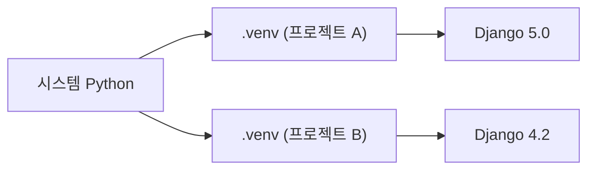
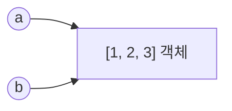

# Day 1 · Python 환경 + JS와 다른 핵심 문법

> 읽는 시간: 약 12분

## 오늘 배울 것

- 가상환경(venv/uv)으로 프로젝트마다 패키지를 분리한다
- JS와 **다르게 동작하는** 문법 몇 가지만 집중해서 본다
- 변수는 "상자"가 아니라 "이름표"라는 Python의 기본 모델

## 오늘의 비유

Node에서는 프로젝트마다 `node_modules` 폴더가 생깁니다.
Python의 가상환경은 **프로젝트 전용 공구함**입니다.
공구함을 열어야(activate) 그 안의 공구를 씁니다.

---

## 1. 가상환경: 프로젝트 전용 공구함

**JS (Node)**

```bash
npm init -y
npm install express
node app.js
```

**Python (uv)**

```bash
uv init myproj && cd myproj
uv add django
uv run python manage.py runserver
```

명령 구조가 거의 같습니다. 차이는 Python이 **가상환경(.venv)을
직접 만들어야** 분리된다는 점인데, `uv`가 그걸 자동으로 해줍니다.

**비유**: 집 공용 공구함에 모든 공구를 섞어두면, 프로젝트 A가
망치를 바꿨을 때 프로젝트 B가 망가집니다.



Python은 기본적으로 패키지를 **전역**에 설치합니다.
그래서 프로젝트마다 `.venv` 폴더를 만들어 분리합니다.

`uv`는 Rust로 만든 빠른 도구로, npm 같은 역할을 합니다.
(`uv add` = `npm install`, `pyproject.toml` = `package.json`)

**JS 비교**: Node는 `node_modules`가 자동으로 프로젝트별입니다.
Python은 **직접 만들어야** 분리됩니다.

> 💡 Python 프로젝트는 항상 가상환경부터. `uv`를 쓰면 자동.

<details>
<summary>🔍 더 깊이 (면접용): activate는 실제로 뭘 하나</summary>

`source .venv/bin/activate`는 마법이 아닙니다.
**환경변수 `PATH` 맨 앞에 `.venv/bin`을 끼워 넣을 뿐**입니다.
그래서 `python`을 치면 `.venv/bin/python`이 먼저 잡힙니다.

```bash
which python
# 출력: /home/me/proj/.venv/bin/python
```

`.venv/bin/python`은 시스템 Python의 심볼릭 링크이고,
옆의 `pyvenv.cfg` 파일을 보고 `site-packages` 위치를 바꿉니다.
activate 없이 `.venv/bin/python app.py`로 실행해도 똑같이 동작합니다.

- `pip`는 설치만, `uv`는 lock 파일(`uv.lock`)까지 관리.
- 도커에서는 venv 없이 이미지 자체가 격리 역할을 하기도 합니다.

</details>

---

## 2. JS와 다르게 동작하는 문법 4가지

**비유**: 외국어를 배울 때 "같은 단어인데 뜻이 다른 것"이
가장 위험합니다. 여기만 잡으면 나머지는 금방 읽힙니다.

```text
┌────────────┬──────────────┐
│ JS         │ Python       │
├────────────┼──────────────┤
│ null/undef │ None 하나    │
│ 1 + "1"    │ TypeError    │
│ []는 true  │ []는 False   │
│ 블록 {}    │ 들여쓰기     │
└────────────┴──────────────┘
```

### 2-1. 빈 것은 거짓(falsy)

falsy = if 문에서 False로 취급되는 값.

**JS (Node)**

```javascript
const items = [];
if (items.length === 0) {
  console.log("비어 있음");
}
```

**Python**

```python
items = []
if not items:
    print("비어 있음")
# 출력: 비어 있음
```

**JS 비교**: JS에서 `[]`와 `{}`는 truthy라 `arr.length`를 써야 합니다.

### 2-2. 암묵적 형변환이 없다 (강한 타입)

**JS (Node)**

```javascript
console.log(1 == "1");
// true
console.log(1 + "1");
// "11"
```

**Python**

```python
print(1 == "1")
# 출력: False
1 + "1"
# TypeError: unsupported operand
```

**JS 비교**: JS는 `1 + "1"`이 `"11"`. Python은 바로 에러를 냅니다.

### 2-3. `==`는 내용, `is`는 같은 객체인지

```python
a = [1, 2]
b = [1, 2]
print(a == b, a is b)
# 출력: True False
```

**JS 비교**: JS `===`는 배열이면 참조 비교. Python `==`는 내용 비교.
`None` 검사만 `x is None`으로 씁니다.

### 2-4. for는 항상 for-of

**JS (Node)**

```javascript
for (const [i, n] of ["a","b"].entries()) {
  console.log(i, n);
}
```

**Python**

```python
for i, name in enumerate(["a", "b"]):
    print(i, name)
# 출력: 0 a
# 출력: 1 b
```

**JS 비교**: `for (const [i, n] of arr.entries())`와 같습니다.
인덱스 기반 `for (i=0;...)`는 Python에 없습니다.

> 💡 빈 것은 거짓, 타입은 섞이지 않고, `==`는 내용 비교.

<details>
<summary>🔍 더 깊이 (면접용): 그 밖의 차이들</summary>

**int는 크기 제한이 없습니다** (임의 정밀도).
`2 ** 100`도 정확합니다. JS는 `2**53` 넘으면 BigInt가 필요합니다.

**스코프**: `if`/`for` 블록은 스코프를 만들지 않습니다.
함수만 스코프를 만듭니다. (Day 3에서 자세히)

```python
for i in range(3):
    pass
print(i)
# 출력: 2
```

**for-else**: `break` 없이 끝까지 돌았을 때만 `else` 실행.

```python
for n in [1, 3, 5]:
    if n % 2 == 0:
        break
else:
    print("짝수 없음")
```

**match** (3.10+): 구조 분해까지 하는 switch.

**EAFP 문화**: "확인하고 실행"보다 "일단 하고 예외 처리" (Day 5).

**비동기**: `time.sleep(1)`은 프로세스 전체를 멈춥니다.
Node처럼 기본이 논블로킹이 아닙니다. `asyncio`는 별도로 선택해 씁니다.

**f-string**: `f"{price:,.1f}"` → `12,345.6`. 문자열은 불변입니다.

</details>

---

## 3. 변수는 이름표다

**JS (Node)**

```javascript
const a = [1, 2];
const b = a;
b.push(3);
console.log(a);
// [1, 2, 3]
```

**Python**

```python
a = [1, 2]
b = a
b.append(3)
print(a)
# 출력: [1, 2, 3]
```

동작이 **완전히 같습니다.** JS에서 객체 참조를 이해했다면
Python 변수도 이미 아는 것입니다.


**비유**: 변수는 물건을 담는 상자가 아니라,
물건(객체)에 붙이는 **포스트잇 이름표**입니다.
이름표 두 장이 같은 물건에 붙을 수 있습니다.



`b = a`는 복사가 아니라 **이름표 하나를 더 붙인 것**입니다.

**차이**:  Python은
**숫자·문자열까지 모두 객체**라는 점(단, 불변이라 티가 안 남).

> 💡 대입은 복사가 아니다. 복사가 필요하면 `a.copy()`.

### 이름표가 일으키는 면접 단골 버그: 기본 인자

```python
def add(x, items=[]):
    items.append(x)
    return items
print(add(1), add(2))
# 출력: [1, 2] [1, 2]
```

기본값 `[]`는 **함수를 정의할 때 한 번만** 만들어집니다.
그래서 모든 호출이 같은 리스트를 공유합니다.

```python
def add(x, items=None):
    if items is None:
        items = []
    items.append(x)
    return items
```

**JS 비교**: JS 기본값은 **호출할 때마다** 새로 평가되므로 이 버그가 없습니다.

> 💡 가변 기본값(`[]`, `{}`) 금지. `None`으로 받고 안에서 만든다.

<details>
<summary>🔍 더 깊이 (면접용): list 복잡도와 set</summary>

`list`는 연결 리스트가 아니라 **동적 배열**(포인터 배열)입니다.

| 연산 | 복잡도 |
|---|---|
| `a[i]`, `append` | O(1) |
| `insert(0, x)`, `pop(0)` | O(n) |
| `x in a` | O(n) |

앞에서 넣고 빼는 큐가 필요하면 `collections.deque` (양쪽 O(1)).

멤버십 검사를 반복하면 `set`으로 바꿉니다: 평균 O(1).
`x in big_list`를 루프 안에서 쓰면 O(n²)이 됩니다.

2차원 리스트 함정: `[[0]*3]*3`은 **같은 행 3개를 가리킵니다**.
`[[0]*3 for _ in range(3)]`로 만드세요.

</details>

---

> 🎬 직접 눈으로 보기: [Python Tutor](https://pythontutor.com/python-compiler.html)에
> 위 코드를 붙여 넣고 한 줄씩 실행하면 이름표 화살표가 보입니다.

## 연습문제

### 문제 1. JS → Python 번역

```javascript
const xs = [3, 0, 5];
const pos = xs.filter(x => x > 0);
if (pos.length === 0) console.log("없음");
```

<details>
<summary>정답 보기</summary>

```python
xs = [3, 0, 5]
pos = [x for x in xs if x > 0]
if not pos:
    print("없음")
```

빈 리스트는 falsy이므로 `len(pos) == 0` 대신 `not pos`.

</details>

### 문제 2. 출력 예측

```python
a = [1]
b = a
b = b + [2]
print(a, b)
```

<details>
<summary>정답 보기</summary>

```text
[1] [1, 2]
```

`b + [2]`는 **새 리스트**를 만들고 `b` 이름표를 옮겨 붙입니다.
`b.append(2)`였다면 `a`도 `[1, 2]`가 됩니다.

</details>

### 문제 3. 첫 번째 중복 찾기

`[3, 1, 4, 1, 5]`에서 처음 다시 나온 값(1)을 O(n)으로 찾으세요.

<details>
<summary>정답 보기</summary>

```python
def first_dup(xs):
    seen = set()
    for x in xs:
        if x in seen:
            return x
        seen.add(x)
    return None
```

`set` 멤버십이 O(1)이라 전체 O(n).

</details>

---

## 면접 질문

<details>
<summary>Q. 가변 기본 인자가 왜 위험한가요?</summary>

- **정의**: 기본값은 함수 정의 시점에 한 번 평가됩니다.
- **원리**: 함수 객체의 `__defaults__`에 저장돼 모든 호출이 공유.
- **실무**: `None` 센티널로 받고 함수 안에서 새로 생성합니다.
  dataclass는 `field(default_factory=list)`를 씁니다.

</details>

<details>
<summary>Q. `==`와 `is`의 차이는?</summary>

`==`는 값(`__eq__`) 비교, `is`는 객체 동일성(id) 비교입니다.
`None`, `True` 같은 싱글턴 검사에만 `is`를 쓰고,
나머지는 `==`를 씁니다. 작은 정수 캐싱 때문에 `is`가
우연히 맞는 경우가 있어 값 비교에 쓰면 버그가 됩니다.

</details>

---

## 오늘 정리

1. 프로젝트마다 가상환경 — `uv`가 npm 역할.
2. 빈 것은 falsy, 형변환 없음, `==`는 내용 비교.
3. 변수는 이름표 — 가변 기본 인자 함정 조심.
