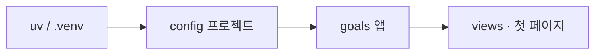
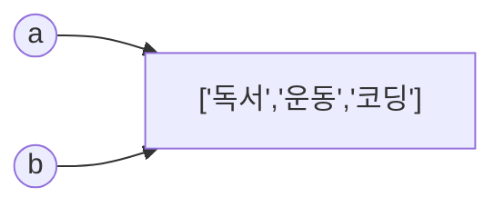
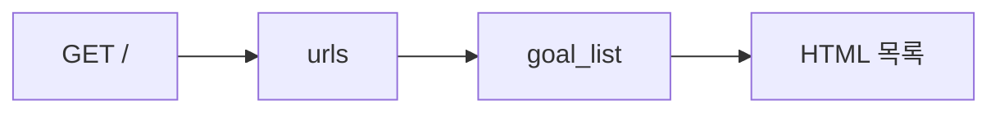

# Day 1 · Goals 앱 뼈대 + Python 최소 문법

> 읽는 시간: 약 12분

## 워밍업 (Node로 생각해 보기)

첫날이므로 복습 대신, 이미 아는 Node 감각으로 워밍업합니다.

**1.** 프로젝트마다 `node_modules`를 두는 이유는?

<details>
<summary>정답</summary>

의존성을 **프로젝트별로 분리**해서, A의 express 버전이 B를 깨지 않게 하기 위함입니다. Python의 가상환경(.venv)도 같은 역할입니다.

</details>

**2.** `const a = [1]; const b = a; b.push(2);` 후 `a`는?

<details>
<summary>정답</summary>

`[1, 2]`. 배열은 참조로 공유됩니다. Python 리스트도 같습니다.

</details>

**3.** `if ([]) console.log("yes")` — 출력될까?

<details>
<summary>정답</summary>

JS에서는 **yes** (`[]`는 truthy). Python에서는 빈 리스트가 **falsy**라 출력이 없습니다. 오늘 이 차이를 씁니다.

</details>

---

## 오늘 만들 것

**Goals 대시보드**의 Django 프로젝트 뼈대 + "내 목표 목록"이 보이는 첫 페이지.

(취미 목표·진행률을 추적하는 작은 앱. 이후 날마다 기능을 붙입니다.)

## 오늘 배울 것

- `uv`로 Django 프로젝트를 만들고 Goals 앱을 붙인다
- JS와 다른 Python 문법 3가지만 익힌다 (빈 값·타입·이름표)
- 하드코딩된 목표 목록을 뷰로 렌더한다

---

## 1. Django 프로젝트 만들기 (로컬)

휴대폰으로 읽되, 코드는 **노트북/PC 터미널**에서 실행하세요.
(Django는 브라우저 Pyodide에서 돌아가지 않습니다.)

**결과를 맞혀 보세요:** Node의 `npm init` + `express` 설치에 가장 가까운 Python 흐름은?

<details>
<summary>정답</summary>

`uv init` → `uv add django` → `uv run django-admin startproject …`.
`uv`가 npm 역할, `.venv`가 node_modules 역할을 합니다.

</details>

**JS (Node)**

```bash
mkdir goals && cd goals
npm init -y
npm install express
```

**Python (로컬 터미널)**

```bash
uv init goals-dash && cd goals-dash
uv add django
uv run django-admin startproject config .
uv run python manage.py startapp goals
uv run python manage.py runserver
```

브라우저에서 `http://127.0.0.1:8000/` 로켓이 보이면 성공입니다.



`config` = 설정·URL 허브, `goals` = 우리가 키울 앱 상자입니다.

`config/settings.py`의 `INSTALLED_APPS`에 `'goals'`를 추가하세요.

> 💡 공구함(`.venv`)을 연 뒤 Django를 설치하고, Goals 상자를 하나 만든다.

<details>
<summary>🔍 더 깊이 (면접용): activate는 뭘 하나</summary>

`source .venv/bin/activate`는 `PATH` 앞에 `.venv/bin`을 넣을 뿐입니다.
`uv run …`은 activate 없이 그 환경을 써서 명령을 실행합니다.

</details>

---

## 2. 오늘 쓸 Python 문법 3가지

Goals 뷰를 쓰기 전에, JS와 **다르게 동작하는** 것만 짚습니다.
아래 `python-run` 블록은 **휴대폰에서 Run**으로 바로 확인해 보세요.

### 2-1. 빈 것은 거짓(falsy)

**결과를 맞혀 보세요:** 이 코드의 출력은?

```python-run
goals = []
if not goals:
    print("목표 없음")
else:
    print("목표 있음")
```

<details>
<summary>정답</summary>

`목표 없음`. Python에서 `[]`, `""`, `0`, `None`은 falsy입니다.

</details>

**JS (Node)** — `[]`는 truthy라 `length`를 봅니다.

```javascript
const goals = [];
if (goals.length === 0) {
  console.log("목표 없음");
}
```

**Python**

```python
goals = []
if not goals:
    print("목표 없음")
```

> 💡 빈 리스트·빈 문자열은 `if not xs`로 검사.

### 2-2. 타입을 섞지 않는다

**결과를 맞혀 보세요:** `1 + "1"`의 결과는?

```python-run
print(1 == "1")
# 다음 줄 주석을 지우고 Run 해 보세요
# print(1 + "1")
```

<details>
<summary>정답</summary>

`1 == "1"` → `False`. `1 + "1"` → **TypeError**.
JS처럼 `"11"`로 합쳐 주지 않습니다.

</details>

진행률은 숫자끼리만 계산하세요. 문자열이면 `int()`로 바꿉니다.

> 💡 Python은 강한 타입. 숫자+문자열은 즉시 에러.

### 2-3. 변수는 이름표다

**결과를 맞혀 보세요:** 출력은?

```python-run
a = ["독서", "운동"]
b = a
b.append("코딩")
print(a)
```

<details>
<summary>정답</summary>

`['독서', '운동', '코딩']`. `b = a`는 복사가 아니라 **같은 리스트에 이름표를 하나 더** 붙인 것입니다.

</details>




**JS 비교:** `const b = a; b.push(…)`와 완전히 같습니다.

> 💡 대입은 복사가 아니다. 복사하려면 `a.copy()`.

<details>
<summary>🔍 더 깊이 (면접용): 가변 기본 인자</summary>

```python
def add_goal(title, bucket=[]):
    bucket.append(title)
    return bucket
```

기본값 `[]`는 **정의 시 한 번만** 만들어져 호출마다 공유됩니다.
`None`을 받고 함수 안에서 `bucket = []`로 만드세요.

</details>

---

## 3. 첫 페이지: 목표 목록 보여 주기

아직 DB 없이, 뷰에 **리스트를 하드코딩**해 화면에 띄웁니다.
(Day 2에서 list/dict를 깊게, Day 4–5에서 모델로 올립니다.)

**결과를 맞혀 보세요:** Django가 URL → 뷰 → 템플릿 순으로 가는 이유는?

<details>
<summary>정답</summary>

요청 경로를 URL이 받아 **어느 함수(뷰)** 로 보낼지 정하고,
뷰가 데이터를 만들어 **템플릿**에 넘기기 때문입니다. Express의
`app.get` + `res.render`와 같은 역할 분리입니다.

</details>

**로컬:** `goals/views.py`

```python
from django.http import HttpResponse

def goal_list(request):
    goals = ["매일 독서 20분", "주 3회 운동"]
    lines = "".join(f"<li>{g}</li>" for g in goals)
    html = f"<h1>내 Goals</h1><ul>{lines}</ul>"
    return HttpResponse(html)
```

**로컬:** `goals/urls.py` (새 파일)

```python
from django.urls import path
from . import views

urlpatterns = [
    path("", views.goal_list, name="goal_list"),
]
```

**로컬:** `config/urls.py`에 연결

```python
from django.contrib import admin
from django.urls import path, include

urlpatterns = [
    path("admin/", admin.site.urls),
    path("", include("goals.urls")),
]
```

`uv run python manage.py runserver` 후 `/` 에 목표 두 개가 보이면
**Day 1 완료**입니다.



> 💡 오늘은 DB 없이 리스트만. 앱이 "존재"하는 게 목표.

> 🎬 이름표가 헷갈리면 [Python Tutor](https://pythontutor.com/python-compiler.html)에
> §2-3 코드를 붙여 한 줄씩 실행해 보세요.

---

## 연습문제

### 문제 1. falsy로 빈 Goals 처리

`goals`가 비면 `"아직 목표 없음"`, 아니면 개수를 출력하세요.
(휴대폰에서 `python-run`으로 검증)

```python-run
goals = ["독서"]
# 여기에 if/else 작성 후 Run
```

<details>
<summary>정답 보기</summary>

```python
goals = ["독서"]
if not goals:
    print("아직 목표 없음")
else:
    print(f"{len(goals)}개")
```

</details>

### 문제 2. 이름표 함정

다음 출력은? (실행 전 예측 → Run)

```python-run
a = ["A"]
b = a
b = b + ["B"]
print(a, b)
```

<details>
<summary>정답 보기</summary>

`['A'] ['A', 'B']`. `b + ["B"]`는 **새 리스트**라 `a`는 그대로.
`b.append("B")`였다면 `a`도 바뀝니다.

</details>

### 문제 3. (로컬) 목표 하나 더

`goal_list`의 `goals`에 항목을 하나 추가하고 새로고침해 보세요.

<details>
<summary>확인</summary>

리스트에 문자열을 하나 `append`처럼 추가한 뒤 서버가 켜진 상태로
새로고침하면 바로 보입니다. 아직 저장소(DB)는 없습니다.

</details>

---

## 면접 질문

<details>
<summary>Q. 가상환경이 왜 필요한가요?</summary>

- **정의**: 프로젝트별 격리된 Python·패키지 디렉터리.
- **원리**: `PATH`/`sys.path`가 그 환경의 `site-packages`를 가리킴.
- **실무**: Django 버전 충돌 방지. `uv`/`pip-tools`로 lock까지 관리.

</details>

<details>
<summary>Q. `==`와 `is`의 차이는?</summary>

`==`는 값 비교, `is`는 같은 객체(id)인지 비교입니다.
`None` 검사만 `is None`, 나머지는 `==`를 씁니다.

</details>

---

## 오늘 정리

1. `uv`로 Goals Django 프로젝트를 켰다.
2. 빈 값은 falsy, 타입은 섞지 않고, 변수는 이름표다.
3. 하드코딩 리스트로 첫 목록 페이지를 띄웠다.

## 다음에 이어갈 것

Day 2: Goal 데이터를 **list/dict**로 제대로 다루고, 진행률 필드를 준비합니다.
