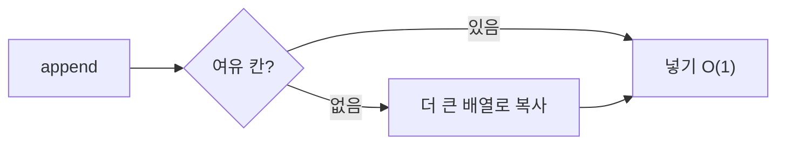
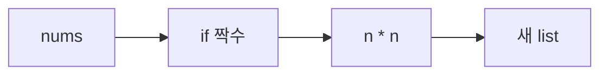

# Day 2 · 컬렉션: list · dict/set · 컴프리헨션

> 읽는 시간: 약 13분

## 오늘 배울 것

- `list`는 JS 배열과 같은 **동적 배열**이다 (앞쪽 삽입은 느리다)
- `dict`/`set`은 **해시 테이블**이라 찾기가 O(1)이다
- 컴프리헨션과 `Counter`/`defaultdict`로 map·filter·groupBy를 한 줄에

## 오늘의 비유

- `list` = **번호 붙은 사물함 줄**. 3번 칸은 바로 찾지만, 맨 앞에
  끼워 넣으면 뒤 칸을 전부 한 칸씩 밀어야 합니다.
- `dict` = **도서관 청구기호**. 책 제목만 알면 계산으로 위치를 바로 압니다.

---

## 1. list — 동적 배열

**JS (Node)**

```javascript
const xs = [10, 20];
xs.push(30);
xs.unshift(0);
console.log(xs.at(-1), xs.length);
// 30 4
```

**Python**

```python
xs = [10, 20]
xs.append(30)
xs.insert(0, 0)
print(xs[-1], len(xs))
# 출력: 30 4
```

거의 1:1 대응입니다. `push`→`append`, `unshift`→`insert(0, x)`,
`.length`→`len()`, `.at(-1)`→`[-1]`.

**왜 append는 빠를까?** 리스트는 **여유 칸을 미리 잡아 둡니다**.
꽉 차면 더 큰 배열을 새로 잡고 복사합니다.




복사는 가끔만 일어나서 평균하면 O(1)입니다
(이걸 **분할 상환 O(1)**, amortized O(1)이라고 부릅니다).

| 연산 | 복잡도 |
|---|---|
| `xs[i]`, `append`, `pop()` | O(1) |
| `insert(0,x)`, `pop(0)` | O(n) |
| `x in xs` | O(n) |

> 💡 list는 뒤에서 넣고 빼라. 앞쪽 작업이 많으면 `deque`.

<details>
<summary>🔍 더 깊이 (면접용): 오버얼로케이션·tuple·deque</summary>

**오버얼로케이션**: CPython은 대략 1.125배 + 상수만큼 키웁니다.
`sys.getsizeof([])`로 append마다 크기가 계단식으로 느는 걸 볼 수 있습니다.
list는 객체 자체가 아니라 **객체 포인터의 배열**입니다.

**슬라이스는 얕은 복사**: `b = a[:]`는 바깥만 복사, 안쪽 리스트는 공유.

**tuple** = 불변 list. 해시 가능해서 dict 키로 쓸 수 있습니다.
`(1,)`처럼 원소 하나면 쉼표 필수 (`(1)`은 그냥 int).
"얕은 불변": `([1], 2)`의 안쪽 list는 바뀔 수 있고, 그래서 해시 불가.

**deque**: 양쪽 끝 O(1). 큐/BFS에 사용.

```python
from collections import deque
q = deque([1, 2])
q.appendleft(0)
print(q.popleft())
# 출력: 0
```

</details>

---

## 2. dict / set — 해시 테이블

**JS (Node)**

```javascript
const m = new Map();
m.set("name", "dh");
console.log(m.get("age") ?? "none");
const s = new Set([1, 2]);
console.log(s.has(2));
```

**Python**

```python
d = {"name": "dh"}
print(d.get("age", "none"))
s = {1, 2}
print(2 in s)
# 출력: none
# 출력: True
```

Python `dict`는 JS의 `Map`과 객체 `{}`를 합친 것입니다.
**없는 키를 `d["age"]`로 읽으면 `KeyError`**(JS처럼 undefined가 아님).
안전하게 읽을 땐 `d.get(키, 기본값)`.

**왜 O(1)일까?** 해시(hash: 값을 숫자 지문으로 바꾸는 것)로
칸 번호를 **계산**하기 때문입니다. 처음부터 훑지 않습니다.


규칙 하나: **키는 해시 가능(불변)해야** 합니다.
`list`는 키가 될 수 없고, `tuple`은 됩니다.

> 💡 "있나?" 검사가 반복되면 list 말고 set/dict.

<details>
<summary>🔍 더 깊이 (면접용): 충돌·순서·순회 중 변경</summary>

**충돌**: 다른 키가 같은 칸에 오는 것.
- 체이닝: 칸마다 연결 리스트 (Java HashMap)
- 오픈 어드레싱: 다른 빈 칸을 탐사 (CPython dict)
최악(모든 키가 충돌)은 O(n). 해시 DoS 공격 때문에 문자열 해시는
프로세스마다 랜덤 시드(`PYTHONHASHSEED`)를 씁니다.

**순서**: 3.7부터 삽입 순서 보장 (compact dict, Day 5 심화).

**순회 중 크기 변경 금지**: `RuntimeError`가 납니다.

```python
for k in list(d):
    if k.startswith("_"):
        del d[k]
```

`list(d)`로 키 복사본을 순회하면 안전합니다.

**set 연산**: `a & b` 교집합, `a | b` 합집합, `a - b` 차집합.
`remove`는 없으면 `KeyError`, `discard`는 조용히 무시.

</details>

---

## 3. 컴프리헨션과 collections

**JS (Node)**

```javascript
const sq = nums
  .filter(n => n % 2 === 0)
  .map(n => n * n);
```

**Python**

```python
sq = [n * n for n in nums if n % 2 == 0]
```

읽는 순서: **"n*n을 만든다 / nums의 n마다 / 짝수일 때만"**.
dict도 됩니다: `{u.id: u for u in users}` (JS의 `Object.fromEntries`).

**비유**: 공장 컨베이어 벨트 한 줄에 "검사 → 가공"을 다 붙인 것.



### 실무 단골: Counter, defaultdict

**JS (Node)**

```javascript
const cnt = {};
for (const c of "banana") {
  cnt[c] = (cnt[c] ?? 0) + 1;
}
```

**Python**

```python
from collections import Counter
cnt = Counter("banana")
print(cnt.most_common(1))
# 출력: [('a', 3)]
```

groupBy는 `defaultdict(list)` — 없는 키에 빈 list를 자동 생성.

```python
from collections import defaultdict
by_role = defaultdict(list)
for u in users:
    by_role[u.role].append(u.name)
```

> 💡 map/filter는 컴프리헨션, 세기는 Counter, 묶기는 defaultdict.

<details>
<summary>🔍 더 깊이 (면접용): 컴프리헨션 함정</summary>

- **중첩 순서**는 for문 쓰는 순서 그대로:
  `[x for row in m for x in row]` = 평탄화.
- **부수효과용으로 쓰지 말 것**: `[print(x) for x in xs]`는
  버릴 리스트를 만듭니다. 그냥 for문.
- 너무 길면(조건 2개 이상) for문이 더 읽기 쉽습니다.
- `namedtuple("P", "x y")`: 이름 붙은 tuple. 요즘은 dataclass(Day 4).
- 큰 데이터는 `[...]` 대신 `(...)` 제너레이터 표현식(Day 6).

</details>

---

## 연습문제

### 문제 1. 순서 유지 중복 제거

`[3, 1, 3, 2, 1]` → `[3, 1, 2]`

<details>
<summary>정답 보기</summary>

```python
def dedupe(xs):
    return list(dict.fromkeys(xs))
```

dict는 삽입 순서를 지키고 키는 중복이 없습니다. O(n).
`list(set(xs))`는 순서가 보장되지 않습니다.

</details>

### 문제 2. 애너그램 판별

`"listen"`과 `"silent"`가 같은 글자 구성인지 판별하세요.

<details>
<summary>정답 보기</summary>

```python
from collections import Counter

def is_anagram(a, b):
    return Counter(a) == Counter(b)
```

O(n). `sorted(a) == sorted(b)`도 정답이지만 O(n log n).

</details>

### 문제 3. 버그 찾기

```python
groups = dict.fromkeys([1, 2], [])
groups[1].append("a")
print(groups)
```

<details>
<summary>정답 보기</summary>

```text
{1: ['a'], 2: ['a']}
```

`fromkeys`는 **같은 list 하나**를 모든 키에 붙입니다 (Day 1 이름표!).

```python
groups = {k: [] for k in [1, 2]}
```

</details>

---

## 면접 질문

<details>
<summary>Q. dict 조회가 왜 평균 O(1)이고, 최악은 언제 O(n)인가요?</summary>

- **정의**: dict는 해시 테이블입니다.
- **원리**: `hash(key)`로 칸 번호를 계산해 바로 접근합니다.
  충돌하면 오픈 어드레싱으로 다른 칸을 탐사합니다.
  부하율이 높아지면 테이블을 키워 충돌을 낮게 유지합니다.
- **최악**: 모든 키가 같은 해시면 탐사가 O(n).
- **실무**: 루프 안 `x in list`를 set으로 바꾸면 O(n²)→O(n).

</details>

---

## 오늘 정리

1. list = 동적 배열: 뒤는 O(1), 앞은 O(n) → deque.
2. dict/set = 해시 테이블: 찾기 O(1), 키는 불변이어야.
3. 컴프리헨션 + Counter + defaultdict로 데이터 가공 한 줄.
