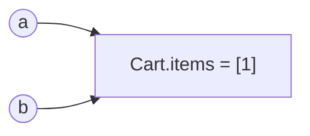

# Day 4 · 클래스 · 던더 메서드 · dataclass

> 읽는 시간: 약 14분

## 오늘 배울 것

- 클래스 기본: `self`, 클래스 속성 vs 인스턴스 속성 함정
- 상속과 `super()`, 다중 상속에서 메서드를 찾는 순서 **MRO**
- 던더 메서드(`__repr__`, `__eq__`)와 `@dataclass`로 보일러플레이트 제거

## 오늘의 비유

클래스는 **붕어빵 틀**, 인스턴스는 **붕어빵**입니다.
틀에 새긴 무늬(클래스 속성)는 모든 붕어빵이 공유하고,
각 붕어빵의 팥 양(인스턴스 속성)은 따로입니다.

---

## 1. 클래스 기본과 속성 함정

**JS (Node)**

```javascript
class User {
  constructor(name) {
    this.name = name;
  }
  hi() { return `hi ${this.name}`; }
}
```

**Python**

```python
class User:
    def __init__(self, name):
        self.name = name

    def hi(self):
        return f"hi {self.name}"
```

`this` → `self`. 차이는 `self`를 **매개변수로 직접 적는다**는 점.
`new`는 없습니다: `u = User("dh")`.

### 함정: 클래스 몸통에 쓴 변수는 공유된다

```python
class Cart:
    items = []
a, b = Cart(), Cart()
a.items.append(1)
print(b.items)
# 출력: [1]
```



`items`가 **클래스(틀)에** 하나만 있어서 a와 b가 공유합니다.
인스턴스별 값은 `__init__`에서 `self.items = []`로.

**JS 비교**: JS 클래스 필드(`items = []`)는 인스턴스마다 새로 생기므로
Python과 반대입니다. JS의 `static items`가 Python 클래스 속성에 가깝습니다.

> 💡 인스턴스 데이터는 `__init__`에서 `self.x = ...`로만.

<details>
<summary>🔍 더 깊이 (면접용): 속성 탐색, property, classmethod</summary>

**읽기/쓰기 비대칭**: `obj.x` 읽기는 인스턴스 → 클래스 순으로 찾지만,
`obj.x = 1` 쓰기는 항상 인스턴스에 새로 만듭니다.
그래서 `items = []`에 `append`(변경)하면 공유, `=`(대입)하면 분리.

**Django 연결**: 모델의 `name = models.CharField()`는 클래스 속성이지만
메타클래스가 이를 필드 정의로 수집해, 인스턴스마다 값이 따로 생깁니다.

**`@property`**: 메서드를 속성처럼 (`c.area`). setter로 검증 추가.
**`@classmethod`**: 대체 생성자 (`User.from_dict(d)`), `cls`를 받음.
**`@staticmethod`**: 클래스 안에 둔 그냥 함수.

**인스턴스 = dict 하나**: `obj.__dict__`. `__slots__ = ("x", "y")`로
고정 배열로 바꾸면 메모리 절약(대략 절반), 새 속성 추가 불가.

**`__init__`은 생성자가 아니라 초기화**입니다. 객체 생성은 `__new__`.

</details>

---

## 2. 상속, super(), MRO

**JS (Node)**

```javascript
class Admin extends User {
  hi() {
    return super.hi() + " (admin)";
  }
}
```

**Python**

```python
class Admin(User):
    def hi(self):
        return super().hi() + " (admin)"
```

단일 상속은 똑같습니다. Python은 **다중 상속**이 됩니다:
`class C(A, B)`. 그럼 같은 메서드가 A와 B 둘 다 있으면?

**비유**: 줄 서서 차례로 물어보기. C에게 먼저, 없으면 A, 그다음 B…
이 줄이 **MRO**(Method Resolution Order, 메서드 탐색 순서)입니다.


```python
class Base: pass
class A(Base): pass
class B(Base):
    def hello(self): return "B"
class C(A, B): pass
print([k.__name__ for k in C.__mro__])
# 출력: ['C', 'A', 'B', 'Base', 'object']
```

Base는 A와 B **둘 다 끝난 뒤에** 나옵니다 (공통 부모는 맨 뒤로).

> 💡 메서드는 `__mro__` 줄 순서대로 찾는다. 헷갈리면 직접 출력.

<details>
<summary>🔍 더 깊이 (면접용): super()는 부모가 아니다, C3</summary>

`super()`는 "부모 클래스"가 아니라 **MRO에서 내 다음 클래스**입니다.
그래서 A 안의 `super().save()`가 C 인스턴스에서는 **B.save**를 부릅니다.
이 덕분에 협력적 다중 상속(mixin)이 동작합니다.

**Django**: `class MyView(LoginRequiredMixin, ListView)`에서
Mixin이 먼저 와야 `dispatch`를 가로챌 수 있습니다. 순서가 중요!

**C3 선형화**: MRO 계산 알고리즘. 규칙:
1. 자식은 부모보다 앞
2. `class C(A, B)`에 적은 순서 유지
둘을 동시에 만족 못 하면 `TypeError: Cannot create a consistent MRO`.

```python
class X(A, B): pass
class Y(B, A): pass
class Z(X, Y): pass
# TypeError
```

</details>

---

## 3. 던더 메서드와 dataclass

던더(dunder) = **d**ouble **under**score, `__이름__` 형태.
`len(x)`, `print(x)`, `x == y` 같은 문법이 내부에서 부르는 메서드입니다.

**JS (Node)**

```javascript
class Money {
  constructor(v) { this.v = v; }
  toString() { return `${this.v}원`; }
}
```

**Python**

```python
class Money:
    def __init__(self, v):
        self.v = v
    def __repr__(self):
        return f"Money({self.v})"
```

```text
문법          →  호출되는 던더
print(x)      →  x.__str__ / __repr__
x == y        →  x.__eq__(y)
len(x)        →  x.__len__()
x[0]          →  x.__getitem__(0)
```

**비유**: 던더는 **콘센트 규격**. 규격에 맞는 플러그(메서드)만 꽂으면
Python 내장 문법이 내 클래스에서도 작동합니다 (덕 타이핑).

### dataclass: 반복 코드 자동 생성

```python
from dataclasses import dataclass

@dataclass(frozen=True)
class Point:
    x: int
    y: int
print(Point(1, 2) == Point(1, 2))
# 출력: True
```

`__init__`, `__repr__`, `__eq__`를 자동으로 만들어 줍니다.
`frozen=True`면 불변 + 해시 가능 → set/dict 키로 사용 가능.

**JS 비교**: JS엔 내장 값 비교가 없어 `===`는 항상 참조 비교입니다.
TypeScript 인터페이스와 비슷하게 생겼지만 실제 클래스입니다.

> 💡 데이터 담는 클래스는 `@dataclass`부터. 문법 연동은 던더로.

<details>
<summary>🔍 더 깊이 (면접용): __eq__와 __hash__, NotImplemented</summary>

**`__eq__`를 정의하면 `__hash__`가 None이 됩니다.**
같다고 판정되는 두 객체는 해시도 같아야 하는데(dict 규칙),
Python이 그걸 보장할 수 없으니 해시 불가로 만듭니다.
필요하면 `__hash__`를 직접 정의(불변 필드 기준)하세요.

**`NotImplemented` 반환**: 모르는 타입과 비교할 땐 `False` 대신
`return NotImplemented`. 그래야 Python이 상대쪽 `__eq__`도 시도합니다.

**`__repr__` vs `__str__`**: repr은 개발자용(재생성 가능한 형태),
str은 사용자용. 리스트 안에선 repr이 쓰입니다.

**dataclass 가변 기본값**: `tags: list = []`는 `ValueError`.
`tags: list = field(default_factory=list)`.

**타입 힌트는 검사하지 않습니다**: `Point("1", "2")`도 에러 없음.
검증은 mypy(정적) 또는 pydantic(런타임).

`dataclasses.replace(p, y=5)`로 불변 객체의 수정본 생성.

</details>

---

## 연습문제

### 문제 1. Vector2

`Vector2(1,2) + Vector2(3,4)`가 `Vector2(4, 6)`으로 출력되게.

<details>
<summary>정답 보기</summary>

```python
@dataclass(frozen=True)
class Vector2:
    x: float
    y: float

    def __add__(self, o):
        return Vector2(self.x + o.x,
                       self.y + o.y)
```

`+`는 `__add__`를 부릅니다. repr은 dataclass가 생성.
(출력은 `Vector2(x=4, y=6)`)

</details>

### 문제 2. MRO 예측

```python
class A:
    def f(self): return "A"
class B(A): pass
class C(A):
    def f(self): return "C"
class D(B, C): pass
print(D().f())
```

<details>
<summary>정답 보기</summary>

`C`. MRO는 `D → B → C → A → object`.
B에 f가 없으면 A가 아니라 **C**로 갑니다 (공통 부모 A는 맨 뒤).

</details>

### 문제 3. 버그 고치기

```python
class Team:
    members = []
    def add(self, m):
        self.members.append(m)
```

<details>
<summary>정답 보기</summary>

모든 Team이 한 리스트를 공유합니다.

```python
class Team:
    def __init__(self):
        self.members = []
    def add(self, m):
        self.members.append(m)
```

</details>

---

## 면접 질문

<details>
<summary>Q. MRO와 super()의 동작을 설명해 주세요.</summary>

- **정의**: MRO는 C3 선형화로 계산한 메서드 탐색 순서(`__mro__`).
- **원리**: `super()`는 부모가 아니라 MRO상 **다음 클래스**에 위임합니다.
  그래서 모든 클래스가 `super()`를 부르면 체인이 한 번씩 다 실행됩니다.
- **실무**: Django CBV의 Mixin은 왼쪽에 둬야 먼저 실행됩니다.

</details>

---

## 오늘 정리

1. `self` 명시, 클래스 몸통 변수는 공유 — 인스턴스 값은 `__init__`.
2. 다중 상속은 MRO 순서, `super()`는 "MRO의 다음".
3. 던더 = 문법 콘센트, 데이터 클래스는 `@dataclass`.
