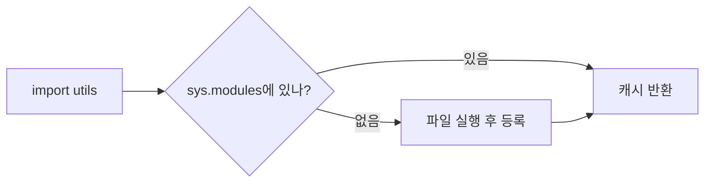

# Day 5 · 모듈 · 예외 · 파일 I/O

> 읽는 시간: 약 14분

## 오늘 배울 것

- `import`는 **한 번만 실행되고 캐시**된다 → 순환 import가 왜 터지나
- `try / except / else / finally`와 커스텀 예외, `raise from`
- `with open`과 `pathlib.Path`로 안전하게 파일 다루기

## 오늘의 비유

- 모듈 import = **도서관 대출**. 처음 한 번 책을 가져오면(실행),
  다음부터는 내 책상(캐시)에 있는 걸 씁니다.
- 예외 = **화재 경보**. 울리면 하던 일을 멈추고 가장 가까운
  대피 담당자(except)에게 갑니다.

---

## 1. 모듈과 import

**JS (Node, ESM)**

```javascript
// utils.js
export const PI = 3.14;
// app.js
import { PI } from "./utils.js";
import * as utils from "./utils.js";
```

**Python**

```python
# utils.py
PI = 3.14
# app.py
from utils import PI
import utils
```

`.py` 파일 하나 = 모듈 하나. `export`가 없고 **모든 최상위 이름이 공개**.
폴더 = 패키지 (`__init__.py`를 둘 수 있음).



**Node와 같은 점**: 둘 다 첫 import 때 한 번만 실행하고 캐시합니다
(`require.cache` ↔ `sys.modules`).

### 스크립트로 실행될 때만

```python
if __name__ == "__main__":
    main()
```

**JS 비교**: `if (require.main === module)`과 같습니다.

> 💡 import는 "파일을 한 번 실행하고 캐시"한다.

<details>
<summary>🔍 더 깊이 (면접용): 순환 import와 sys.path</summary>

**순환 import**: `orders.py`가 `users.py`를, `users.py`가 `orders.py`를
import. orders 실행 도중 users로 넘어가고, users가 다시 orders를
import하면 **반쯤 실행된** orders를 캐시에서 받습니다.
아직 정의 안 된 이름을 꺼내면 `ImportError: cannot import name`.

푸는 법:
1. 함수 안에서 지연 import
2. 타입 힌트용은 `if TYPE_CHECKING:` 안에서
3. 공통 부분을 제3 모듈로 분리 (가장 좋음)

Django는 모델 참조를 **문자열**로 해서 피합니다:
`models.ForeignKey("users.User", ...)`.

**`from x import y`는 이름을 복사**합니다. 나중에 `x.y`가 바뀌어도
내 `y`는 안 바뀝니다. 그래서 mock은 "사용하는 쪽" 경로에 패치합니다.

**sys.path**: 모듈을 찾는 폴더 목록. 스크립트 폴더 → PYTHONPATH →
site-packages 순. 상대 import(`from . import x`)는 패키지 안에서만
동작하므로 `python -m shop.main`처럼 모듈로 실행해야 합니다.

</details>

---

## 2. 예외 처리

**JS (Node)**

```javascript
try {
  data = JSON.parse(text);
} catch (e) {
  if (!(e instanceof SyntaxError)) throw e;
  data = {};
} finally { close(); }
```

**Python**

```python
try:
    data = json.loads(text)
except json.JSONDecodeError:
    data = {}
finally:
    close()
```

Python은 **예외 타입별로 except를 나눠** 잡습니다.
JS처럼 `instanceof`로 걸러낼 필요가 없습니다.
추가로 `else`(예외가 **없을 때만** 실행) 블록이 있습니다.


### 커스텀 예외와 raise from

```python
class OutOfStock(Exception):
    pass

try:
    stock[sku]
except KeyError as e:
    raise OutOfStock(sku) from e
```

`from e`는 **원인 예외를 연결**합니다 (JS `new Error(msg, { cause })`).
트레이스백에 두 예외가 모두 보여 디버깅이 쉽습니다.

> 💡 구체적인 예외만 잡고, 감쌀 땐 `raise ... from e`.

<details>
<summary>🔍 더 깊이 (면접용): 계층, finally, EAFP, Django</summary>

**계층**: `BaseException` 아래 `Exception`, `KeyboardInterrupt`,
`SystemExit`. `except Exception`은 Ctrl+C를 막지 않지만
맨 `except:`는 다 삼킵니다 → 금지.

**finally는 return보다 늦게** 실행됩니다. finally 안에서 return하면
예외가 조용히 사라지므로 금지.

**`raise`만 쓰면** 현재 예외를 그대로 다시 던집니다(스택 보존).

**EAFP vs LBYL**: "허락보다 용서" vs "뛰기 전에 확인".
`if os.path.exists(p): open(p)`는 그 사이 파일이 지워질 수 있습니다
(경쟁 조건). Python은 `try: open(p) except FileNotFoundError`를 선호.

**Django**: 뷰에서 `raise Http404`를 던지면 미들웨어가 404 응답으로 바꿉니다.
`get_object_or_404`, `PermissionDenied`(403), 폼/모델 검증은
`ValidationError`로 사용자 오류를 표현합니다.

</details>

---

## 3. 파일 I/O

**JS (Node)**

```javascript
import { readFile } from "node:fs/promises";
const text = await readFile(
  "a.txt", "utf8");
```

**Python**

```python
from pathlib import Path

with open("a.txt", encoding="utf-8") as f:
    text = f.read()
text = Path("a.txt").read_text("utf-8")
```

`with`는 **블록이 끝나면 자동으로 파일을 닫아줍니다**
(예외가 나도). JS의 `try/finally { fh.close() }`를 한 줄로.

**비유**: `with` = **자동문**. 들어갔다 나오면 알아서 닫힙니다.


### 큰 파일은 한 줄씩

```python
with open("app.log", encoding="utf-8") as f:
    for line in f:
        if "ERROR" in line:
            print(line.rstrip())
```

전체를 메모리에 올리지 않습니다 (Node의 `readline` 스트림).

### 경로는 Path 객체로

```python
BASE = Path(__file__).resolve().parent
cfg = BASE / "config" / "app.json"
print(cfg.suffix, cfg.exists())
```

`/` 연산자로 경로를 이어 붙입니다 (`path.join` 대체).
Django `settings.py`의 `BASE_DIR`이 바로 이 형태입니다.

> 💡 파일은 `with`로, 인코딩은 `utf-8` 명시, 경로는 `Path`.

<details>
<summary>🔍 더 깊이 (면접용): 모드, 인코딩, JSON, 업로드</summary>

- 모드: `"r"` 읽기, `"w"` 덮어쓰기, `"a"` 이어쓰기, `"x"` 없을 때만 생성,
  `"b"` 바이너리(bytes). 이미지는 `"rb"`.
- `encoding` 생략 시 OS 기본값(Windows는 cp949일 수 있음) → 항상 명시.
  엑셀 CSV는 `utf-8-sig`(BOM 제거).
- JSON: `json.load(f)` / `json.dump(obj, f, ensure_ascii=False, indent=2)`.
  `ensure_ascii=False`가 없으면 한글이 `\uXXXX`로 저장됩니다.
- `Path.glob("**/*.py")`로 재귀 검색, `mkdir(parents=True, exist_ok=True)`.
- Django 업로드: `FileField(upload_to=...)` → `MEDIA_ROOT` 아래 저장,
  `MEDIA_URL`로 서빙(운영에선 S3 등 스토리지 백엔드).

</details>

<details>
<summary>🔍 더 깊이 (면접용): dict 해시 테이블 내부</summary>

- 칸 번호 = `hash(key) & (size - 1)` (크기가 2의 거듭제곱이라 비트 마스크).
- 충돌 시 CPython은 **오픈 어드레싱** + 의사난수 탐사(`perturb`).
- 삭제는 칸을 비우지 않고 **DUMMY 표시**(탐사 체인이 끊기지 않게).
- 부하율 **2/3**를 넘으면 리사이즈 → 분할 상환 O(1).
- **compact dict**(3.6+): 작은 인덱스 배열 + 삽입 순서대로 쌓는
  엔트리 배열. 메모리 절약과 순서 보장이 동시에.
- 키 비교 순서: `is` → 해시 비교 → `==`. 그래서 `{1: 'a', True: 'b'}`는
  `{1: 'b'}` (1 == True, hash 동일).
- Django: 루프 안 `x in list` 대신 `set(ids)`, 쿼리 결과를
  `{o.id: o for o in qs}`로 인덱싱하면 O(n·m)을 O(n+m)으로.

</details>

---

## 연습문제

### 문제 1. 커스텀 예외 + raise from

JSON 파일을 읽다 실패하면 `ConfigError`를 원인과 함께 던지세요.

<details>
<summary>정답 보기</summary>

```python
class ConfigError(Exception):
    pass

def load(path):
    try:
        text = Path(path).read_text("utf-8")
        return json.loads(text)
    except json.JSONDecodeError as e:
        raise ConfigError(path) from e
```

`e.__cause__`로 원래 예외에 접근할 수 있습니다.

</details>

### 문제 2. 코드 줄 수 세기

폴더 아래 모든 `.py` 파일의 총 줄 수를 구하세요.

<details>
<summary>정답 보기</summary>

```python
def count_lines(root):
    total = 0
    for p in Path(root).rglob("*.py"):
        with open(p, encoding="utf-8") as f:
            total += sum(1 for _ in f)
    return total
```

한 줄씩 세서 큰 파일도 메모리 걱정 없음.

</details>

### 문제 3. EAFP로 다시 쓰기

```python
if "email" in user and user["email"]:
    email = user["email"]
else:
    email = None
```

<details>
<summary>정답 보기</summary>

```python
try:
    email = user["email"] or None
except KeyError:
    email = None
```

더 간단히는 `email = user.get("email") or None`.

</details>

---

## 면접 질문

<details>
<summary>Q. 순환 import는 왜 발생하고 어떻게 해결하나요?</summary>

- **원리**: import는 모듈을 실행하며 `sys.modules`에 먼저 등록합니다.
  실행 중 상대가 나를 import하면 반쯤 초기화된 모듈을 받아
  아직 없는 이름에서 `ImportError`가 납니다.
- **해결**: 의존 방향 정리(공통 모듈 분리) > 지연 import >
  `TYPE_CHECKING`. Django는 `"app.Model"` 문자열 참조와 앱 레지스트리로 회피.

</details>

---

## 오늘 정리

1. import = 한 번 실행 + 캐시. 순환 import는 구조로 해결.
2. 구체적 예외만 잡고, 감쌀 땐 `raise ... from e`.
3. 파일은 `with open(..., encoding="utf-8")`, 경로는 `Path`.
