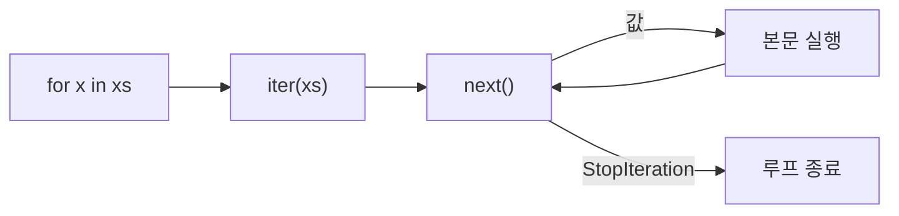
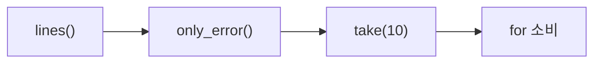

# Day 6 · 이터레이터 · 제너레이터 · yield from

> 읽는 시간: 약 12분

## 오늘 배울 것

- `for`가 실제로 하는 일: `iter()` → `next()` 반복 → `StopIteration`
- 제너레이터: `yield`에서 **멈췄다가 다시 이어지는** 함수
- 지연 평가로 큰 파일·무한 데이터를 메모리 적게 처리하기

## 오늘의 비유

- 리스트 = **뷔페**: 음식을 전부 미리 차려 둡니다(메모리 많이 씀).
- 제너레이터 = **회전초밥**: 손님이 집을 때마다 한 접시씩 만듭니다.

---

## 1. 이터레이션 프로토콜

**JS (Node)**

```javascript
const it = [10, 20][Symbol.iterator]();
console.log(it.next());
// { value: 10, done: false }
it.next();
console.log(it.next());
// { value: undefined, done: true }
```

**Python**

```python
it = iter([10, 20])
print(next(it))
print(next(it))
next(it)
# 출력: 10
# 출력: 20
# StopIteration
```

개념이 **완전히 같습니다.** 차이는 "끝"을 알리는 방법:
JS는 `done: true`, Python은 `StopIteration` 예외.



- **이터러블**(iterable): `iter()`를 줄 수 있는 것 (list, dict, 파일…)
- **이터레이터**(iterator): `next()`로 하나씩 꺼내는 것. **한 번 쓰면 끝**.

> 💡 for = `iter()` 한 번 + `next()` 반복. 이터레이터는 일회용.

<details>
<summary>🔍 더 깊이 (면접용): 클래스로 만들기, 일회용 함정</summary>

```python
class Countdown:
    def __init__(self, n):
        self.n = n
    def __iter__(self):
        return self
    def __next__(self):
        if self.n <= 0:
            raise StopIteration
        self.n -= 1
        return self.n + 1
```

`__iter__`/`__next__` 두 던더 = JS의 `[Symbol.iterator]`/`next`.

**일회용 함정**: 이터레이터를 두 번 순회하면 두 번째는 비어 있습니다.

```python
g = (x for x in [1, 2])
print(list(g), list(g))
# 출력: [1, 2] []
```

list는 이터러블이라 매번 새 이터레이터를 만들어 반복 순회 가능.
`StopIteration`은 에러가 아니라 **신호**이고, `next(it, None)`처럼
기본값을 주면 예외 대신 기본값을 돌려줍니다.
언패킹(`a, *b = it`), `sum()`, `sorted()`도 모두 같은 프로토콜을 씁니다.

</details>

---

## 2. 제너레이터와 yield

**JS (Node)**

```javascript
function* gen() {
  console.log("시작");
  yield 1;
  yield 2;
}
const g = gen();
console.log(g.next().value);
```

**Python**

```python
def gen():
    print("시작")
    yield 1
    yield 2
g = gen()
print(next(g))
```

JS의 `function*`와 **거의 같습니다.** Python은 `*` 표시 없이
함수 안에 `yield`가 있으면 자동으로 제너레이터 함수가 됩니다.

`yield`의 핵심: **값을 내주고 그 자리에서 멈춘다.**
다음 `next()`가 오면 멈춘 곳부터 이어서 실행합니다.


```text
next() → "시작" → yield 1 (멈춤)
next() → 이어서 → yield 2 (멈춤)
next() → 끝     → StopIteration
```

`gen()`을 호출한 순간에는 **아무것도 실행되지 않습니다.**
첫 `next()`에서 비로소 시작합니다.

> 💡 yield = "값 주고 일시정지". 지역 변수 상태가 그대로 보존된다.

<details>
<summary>🔍 더 깊이 (면접용): 프레임 보존, 클래스 vs 제너레이터</summary>

제너레이터 객체는 **실행 프레임(로컬 변수 + 다음 실행 위치)을
힙에 보관**합니다. 그래서 함수가 반환되지 않고도 상태가 유지됩니다.
`g.gi_frame`, `g.gi_running`으로 확인할 수 있습니다.

제너레이터는 그 자체가 이터레이터(`__iter__`, `__next__` 자동 구현).

**언제 클래스?** 순회 외에 다른 메서드(reset, len)가 필요하거나,
여러 번 순회 가능한 이터러블이 필요할 때.
나머지는 거의 제너레이터가 더 짧고 읽기 쉽습니다.

`send(v)`로 값을 넣거나 `close()`로 종료할 수도 있습니다
(코루틴의 조상, `async`/`await`의 기반 아이디어).

</details>

---

## 3. 지연 평가와 파이프라인

**JS (Node)**

```javascript
import readline from "node:readline";
const rl = readline.createInterface({
  input: fs.createReadStream("a.log"),
});
for await (const line of rl) {}
```

**Python**

```python
def errors(path):
    with open(path, encoding="utf-8") as f:
        for line in f:
            if "ERROR" in line:
                yield line.rstrip()
```

10GB 로그라도 **한 줄씩만 메모리에** 올립니다.
`list(errors(p))`를 하는 순간 전부 올라가므로, 기본은 `for`로 소비.

**비유**: 파이프라인 = **정수기 필터 여러 개 연결**.
물은 컵에 따를 때(next) 그만큼만 흐릅니다.



### 제너레이터 표현식

```python
total = sum(x * x for x in range(10**6))
```

`[...]` 대신 `(...)` → 리스트를 만들지 않습니다.
list는 수 MB, 제너레이터 객체는 약 200바이트.

### yield from: 위임

```python
def flatten(tree):
    for node in tree:
        if isinstance(node, list):
            yield from flatten(node)
        else:
            yield node
```

`yield from x` = `for v in x: yield v` 한 줄 버전.
JS의 `yield*`와 같습니다.

> 💡 큰 데이터는 리스트로 모으지 말고 제너레이터로 흘려보낸다.

<details>
<summary>🔍 더 깊이 (면접용): 무한 시퀀스, yield from 반환값, QuerySet</summary>

**무한 시퀀스**: `itertools.count()`는 끝이 없지만 필요한 만큼만 생성.
`list(itertools.islice(count(), 5))` → `[0, 1, 2, 3, 4]`.

**yield from의 반환값**: 하위 제너레이터의 `return v`가
`result = yield from sub()`의 결과가 됩니다.

**Eager vs Lazy**: eager는 즉시 전부 계산(list), lazy는 요청 시 계산.
lazy는 메모리 O(1), 중간에 멈추면 나머지 계산도 안 함.
대신 한 번만 순회 가능하고 디버깅이 어렵습니다.

**Django QuerySet**도 지연 평가입니다. `User.objects.filter(...)`는
SQL을 실행하지 않고, 순회/`list()`/슬라이스 시점에 실행합니다.
대량 처리는 `qs.iterator(chunk_size=2000)`으로 캐시 없이 스트리밍.

**면접 답변 틀**: "풀(pull) 기반 지연 파이프라인이라 소비자가 요청할
때만 값이 생성되고, 메모리는 데이터 크기와 무관하게 일정합니다."

</details>

---

## 연습문제

### 문제 1. 제너레이터로 repeat

`repeat("x", 3)` → `["x", "x", "x"]` (list로 감쌌을 때)

<details>
<summary>정답 보기</summary>

```python
def repeat(v, n):
    for _ in range(n):
        yield v

print(list(repeat("x", 3)))
```

</details>

### 문제 2. 파이프라인 조립

줄 목록에서 공백 줄을 버리고, 앞뒤 공백을 지우고, 처음 2개만.

<details>
<summary>정답 보기</summary>

```python
from itertools import islice

def clean(lines):
    for l in lines:
        if l.strip():
            yield l.strip()

xs = [" a", "", "b ", "c"]
print(list(islice(clean(xs), 2)))
# 출력: ['a', 'b']
```

</details>

### 문제 3. 출력 예측

```python
g = (x * 2 for x in [1, 2, 3])
print(next(g), sum(g), sum(g))
```

<details>
<summary>정답 보기</summary>

```text
2 10 0
```

`next`가 2를 꺼내고, 첫 `sum`이 남은 4+6=10을 소비, 두 번째는 비어서 0.

</details>

---

## 면접 질문

<details>
<summary>Q. 이터러블, 이터레이터, 제너레이터의 차이는?</summary>

- **이터러블**: `__iter__`로 이터레이터를 줄 수 있는 객체 (list 등).
- **이터레이터**: `__next__`로 값을 하나씩 반환, 끝나면 `StopIteration`.
  상태가 있어 일회용.
- **제너레이터**: `yield`로 이터레이터를 쉽게 만드는 함수.
  프레임을 보존해 멈췄다 재개합니다.
- **실무**: 대용량 파일·QuerySet을 메모리 일정하게 처리할 때 사용.

</details>

---

## 오늘 정리

1. for = `iter()` + `next()` 반복, 끝은 `StopIteration`.
2. `yield` = 값 주고 일시정지 (JS `function*`와 같음).
3. 큰 데이터는 제너레이터 파이프라인으로 흘려보낸다.
