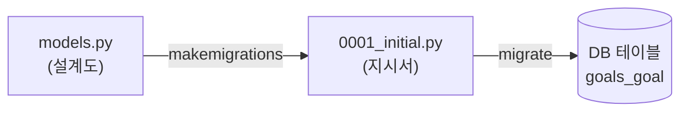
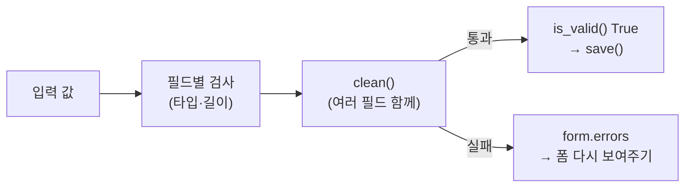

# Day 7 · Goal 모델 + 추가/수정 Form

> 읽는 시간: 약 13분

## 복습 3문제

**1.** (Day 4) `@dataclass`를 붙이면 자동으로 생기는 대표 메서드는?

<details>
<summary>정답</summary>

`__init__`, `__repr__`, `__eq__`입니다. 필드만 적으면 생성자·출력·비교를 Python이 만들어 줍니다. 오늘 Django 모델이 이것과 **모양이 아주 비슷**합니다.

</details>

**2.** (Day 5) `try / except / else / finally`에서 예외가 **없을 때** 실행 순서는?

<details>
<summary>정답</summary>

`try → else → finally`. `except`는 건너뜁니다. `finally`는 예외가 있든 없든 항상 실행됩니다.

</details>

**3.** (Day 6) `g = (x for x in [1, 2])`에 `list(g)`를 두 번 하면 두 번째 결과는?

<details>
<summary>정답</summary>

`[]`. 제너레이터는 이터레이터라 **일회용**입니다. 첫 `list(g)`가 값을 다 꺼냈습니다.

</details>

---

## 오늘 만들 것

Day 1에서 코드에 박아 둔 목표 목록을 **DB에 저장**하고, 브라우저 **폼으로 Goal을 추가·수정**하는 화면을 붙입니다.

## 오늘 배울 것

- 모델: Python 클래스 한 개 = DB 테이블 한 개
- ModelForm: 입력 검증을 Django에게 맡기기
- 한 뷰에서 GET/POST 처리 + 저장 후 redirect

---

## 1. Goal 모델: 클래스가 테이블이 된다

지금 Goals 목록은 `views.py` 안의 리스트입니다. 서버를 껐다 켜면 추가한 목표가 **사라집니다.** 데이터를 오래 남기려면 DB가 필요합니다.

Node에서는 Prisma 스키마나 Sequelize 모델로 테이블 모양을 정했죠. Django에서는 **모델**(model, DB 테이블을 표현하는 클래스)이 그 역할입니다.

**결과를 맞혀 보세요:** `models.py`에 `Goal` 클래스를 저장만 하고, 터미널 명령은 아무것도 안 했습니다. 뷰에서 `Goal.objects.all()`을 쓰면?

<details>
<summary>정답</summary>

에러가 납니다: `no such table: goals_goal`.
Python 클래스는 생겼지만 **DB에는 아직 테이블이 없습니다.** 아래 마이그레이션 두 명령으로 실제 테이블을 만들어야 합니다.

</details>

**JS (Node, Sequelize)**

```javascript
const Goal = sequelize.define("Goal", {
  title: DataTypes.STRING(100),
  target: DataTypes.INTEGER,
  done: { type: DataTypes.INTEGER,
          defaultValue: 0 },
});
```

**Python (Django)** · 로컬 `goals/models.py`

```python
from django.db import models

class Goal(models.Model):
    title = models.CharField(max_length=100)
    target = models.PositiveIntegerField()
    done = models.PositiveIntegerField(
        default=0)
```

필드 하나가 **열**(column) 하나입니다. `CharField`는 짧은 글자, `PositiveIntegerField`는 0 이상 정수이고, `id` 열은 자동으로 붙습니다. 같은 클래스 안에 화면용 메서드 두 개를 더 붙입니다.

```python
    # (Goal 클래스 안에 이어서)
    def __str__(self):
        return self.title

    @property
    def pct(self):
        rate = self.done / self.target
        return round(rate * 100)
```

`__str__`은 Day 4의 던더 메서드 그대로입니다. Admin이나 셸에서 `Goal object (1)` 대신 제목이 보입니다. `@property`는 `goal.pct`처럼 **괄호 없이** 읽는 계산값입니다.

### 마이그레이션: 설계도 → 공사

```bash
uv run python manage.py makemigrations
uv run python manage.py migrate
```

**비유:** 모델은 **건물 설계도**, `makemigrations`는 "무엇이 바뀌었는지" 적은 **공사 지시서**, `migrate`는 그 지시서대로 하는 **실제 공사**입니다.



Prisma의 `prisma migrate dev`가 두 단계를 한 번에 하는 것과 같습니다. 지시서 파일(`goals/migrations/0001_initial.py`)은 **git에 커밋**합니다.

Admin에서 보고 싶다면 `goals/admin.py`에 `admin.site.register(Goal)` 한 줄이면 됩니다.

모양이 Day 4 데이터클래스와 얼마나 비슷한지 직접 돌려 보세요.

```python-run
from dataclasses import dataclass
@dataclass
class Goal:
    title: str
    target: int
    done: int = 0
g = Goal("독서 20권", 20, 5)
print(g, g.done / g.target)
```

차이는 하나입니다. 데이터클래스는 **메모리에만** 있고, Django 모델은 `save()`하면 **DB에 남습니다.**

> 💡 모델 = 테이블 설계도. 바꿨으면 `makemigrations` → `migrate` 두 단계.

<details>
<summary>🔍 더 깊이 (면접용): 마이그레이션은 무엇과 비교하나</summary>

`makemigrations`는 **DB를 보지 않습니다.** 기존 마이그레이션 파일들을 순서대로 "머릿속에서" 재생해 만든 상태와, 지금 `models.py`를 비교해서 차이만 새 파일로 씁니다.

`migrate`는 DB의 `django_migrations` 테이블을 봅니다. 여기에 "이미 적용한 파일 목록"이 있어서, 안 한 것만 순서대로 실행합니다.

실제로 나가는 SQL은 `manage.py sqlmigrate goals 0001`로 볼 수 있습니다.

Django 모델은 **Active Record** 패턴입니다. 객체가 자기 저장 방법(`save()`)을 압니다. 반대는 SQLAlchemy의 Data Mapper 방식입니다. 충돌·데이터 마이그레이션은 Day 13에서 다룹니다.

</details>

---

## 2. ModelForm: 검증을 Django에게 맡기기

사용자 입력은 **믿으면 안 됩니다.** 목표 횟수 칸에 `abc`를 넣을 수도, 제목을 500자 넣을 수도 있습니다.

Express에서는 zod 같은 라이브러리로 스키마를 또 한 번 적었죠. Django의 **ModelForm**(모델을 보고 자동으로 만들어지는 입력 폼)은 모델에 이미 적은 규칙을 그대로 검증에 씁니다. 같은 규칙을 두 번 적지 않아도 됩니다.

**결과를 맞혀 보세요:** 목표 횟수(`target`)에 `abc`를 넣고 제출했습니다. `form.is_valid()`는? DB에는 저장될까요?

<details>
<summary>정답</summary>

`False`이고 **저장되지 않습니다.** `form.errors`에 `target: 정수를 입력하세요` 같은 메시지가 담기고, 폼이 그 메시지와 함께 다시 보입니다.

</details>

**JS (Node, zod)**

```javascript
const GoalInput = z.object({
  title: z.string().max(100),
  target: z.coerce.number().int(),
});
const r = GoalInput.safeParse(req.body);
```

**Python (Django)** · 로컬 `goals/forms.py`

```python
from django import forms
from .models import Goal

class GoalForm(forms.ModelForm):
    class Meta:
        model = Goal
        fields = ["title", "target", "done"]
```

`Meta` 안에 "어떤 모델의 어떤 필드를 받을지"만 적습니다. `max_length=100`, "0 이상 정수" 같은 규칙은 모델에서 자동으로 가져옵니다.

필드 하나로는 못 하는 검사, 예를 들어 "달성량이 목표보다 크면 안 된다"는 `clean()`에 직접 씁니다.

```python
    def clean(self):
        data = super().clean()
        t = data.get("target")
        d = data.get("done", 0)
        if t is not None and d > t:
            raise forms.ValidationError(
                "달성량이 목표보다 큽니다")
        return data
```

**비유:** ModelForm은 **은행 창구 직원**입니다. 서류(입력)의 빈칸과 형식을 먼저 보고, 통과한 것만 금고(DB)로 보냅니다. 틀리면 어디가 틀렸는지 표시해서 서류를 돌려줍니다.



Django가 필드마다 해 주는 일을 순수 Python으로 흉내 내 보면 이렇습니다.

```python-run
def check(data):
    errors = {}
    if not data["target"].isdigit():
        errors["target"] = "정수를 입력하세요"
    return errors
print(check({"target": "abc"}))
print(check({"target": "20"}))
```

> 💡 규칙은 모델에 한 번만. 폼은 그 규칙으로 검사하고, 통과한 값만 저장한다.

<details>
<summary>🔍 더 깊이 (면접용): 검증 순서, cleaned_data, fields="__all__"</summary>

`is_valid()`를 부르면 필드마다 이 순서로 검사합니다.

1. `to_python()`: 문자열 `"20"`을 정수 `20`으로 변환
2. `validate()` + validators: 필수 여부, 최소·최대
3. `clean_<필드명>()`: 내가 쓴 필드별 검사
4. `clean()`: 여러 필드를 함께 보는 검사
5. (ModelForm만) 모델의 `full_clean()`: `unique` 같은 모델 규칙

통과한 값은 **변환된 타입으로** `form.cleaned_data`에 담깁니다. `request.POST`의 값은 모두 문자열이니, 저장할 때는 꼭 `cleaned_data`를 씁니다.

**`fields = "__all__"`을 피하는 이유:** 나중에 모델에 `is_admin` 같은 필드가 생기면, 폼이 그것까지 **자동으로 받아 버립니다.** 공격자가 POST에 값을 끼워 넣는 mass assignment(대량 할당) 취약점이 됩니다. 받을 필드를 명시하는 게 안전합니다.

`form.save(commit=False)`는 DB에 쓰지 않고 객체만 돌려줍니다. 로그인 유저를 붙이고 저장할 때 씁니다 (Day 10).

</details>

---

## 3. 한 뷰에서 GET/POST + redirect

Express에서는 `app.get("/new")`와 `app.post("/new")`를 따로 썼죠. Django는 보통 **한 함수**에서 `request.method`로 나눕니다. GET이면 빈 폼, POST면 검사하고 저장합니다.

**결과를 맞혀 보세요:** 저장한 뒤 redirect 없이 바로 목록을 `render`했습니다. 사용자가 그 화면에서 **새로고침**을 누르면?

<details>
<summary>정답</summary>

브라우저가 "양식을 다시 제출할까요?"라고 묻고, 확인하면 **같은 POST가 또 갑니다.** Goal이 하나 더 생깁니다. 그래서 저장 후에는 redirect로 GET 페이지로 보냅니다.

</details>

**JS (Node, Express)**

```javascript
app.post("/goals/new", async (req, res) => {
  const r = GoalInput.safeParse(req.body);
  if (!r.success) return res.render("new");
  await Goal.create(r.data);
  res.redirect("/");
});
```

**Python (Django)** · 로컬 `goals/views.py`

```python
def goal_create(request):
    form = GoalForm(request.POST or None)
    if form.is_valid():
        form.save()
        return redirect("goal_list")
    return render(request, "goals/form.html",
                  {"form": form})
```

`request.POST or None`이 GET/POST를 나누는 열쇠입니다. GET이면 `request.POST`가 비어 있어 falsy(Day 1)라서 `None`, 즉 **빈 폼**이 됩니다. 빈 폼의 `is_valid()`는 항상 `False`라 바로 폼 화면으로 갑니다.

이 흐름을 **PRG**(Post → Redirect → Get) 패턴이라고 부릅니다.


### 템플릿 두 개 (자세한 문법은 Day 8)

로컬 `goals/templates/goals/form.html`

```html
<h1>목표 저장</h1>
<form method="post">
  
  {{ form.as_p }}
  <button>저장</button>
</form>
```

``을 빼면 POST가 **403**으로 막힙니다. 다른 사이트가 몰래 우리 폼을 제출하는 공격(CSRF)을 막는 장치입니다. Express의 `csurf` 미들웨어가 기본으로 켜져 있다고 보면 됩니다.

로컬 `goals/templates/goals/list.html`

```html
<a href="">+ 추가</a>
<ul>

  <li>{{ g.title }} · {{ g.pct }}%</li>

  <li>아직 목표 없음</li>

</ul>
```

목록 뷰와 URL도 DB를 보도록 바꿉니다 (`views.py`, `goals/urls.py`).

```python
def goal_list(request):
    goals = Goal.objects.all()
    return render(request, "goals/list.html",
                  {"goals": goals})
```

```python
urlpatterns = [
    path("", views.goal_list,
         name="goal_list"),
    path("new/", views.goal_create,
         name="goal_create"),
]
```

`views.py` 맨 위에 `render`, `redirect`, `Goal`, `GoalForm` import를 잊지 마세요.

> 💡 POST로 저장했으면 render 말고 redirect. 새로고침해도 GET만 반복된다.

<details>
<summary>🔍 더 깊이 (면접용): 302 vs 303, 멱등성, CSRF 원리</summary>

**302 vs 303:** `redirect()`는 302를 보냅니다. 의미상 303(See Other)이 더 정확하지만, 브라우저는 302도 GET으로 따라가서 실무 차이는 거의 없습니다.

**멱등성**(idempotency, 여러 번 해도 결과가 같음): GET·PUT·DELETE는 멱등, POST는 아닙니다. 그래서 POST 중복이 위험하고, PRG로 피합니다. 결제처럼 중요한 곳은 PRG만으로 부족해서 **멱등 키**나 DB unique 제약을 함께 씁니다 (Week 8).

**CSRF 원리:** Django는 쿠키(`csrftoken`)와 폼 숨은 필드에 같은 비밀 값을 넣습니다. 다른 사이트는 우리 쿠키 값을 읽을 수 없어서 폼에 맞는 값을 넣지 못합니다. `CsrfViewMiddleware`가 두 값이 맞는지 확인하고, 다르면 403을 돌려줍니다.

</details>

---

## 연습문제

### 문제 1. 목표 0 막기

`target`이 0이면 `pct`에서 `ZeroDivisionError`가 납니다. 폼에서 0을 막아 "목표는 1 이상"이라는 에러를 띄우세요.

<details>
<summary>정답 보기</summary>

```python
    # (GoalForm 클래스 안)
    def clean_target(self):
        t = self.cleaned_data["target"]
        if t < 1:
            raise forms.ValidationError(
                "목표는 1 이상")
        return t
```

`clean_<필드명>`은 **그 필드 하나만** 검사합니다. 이미 정수로 변환된 값이 `cleaned_data`에 있으니 바로 비교하면 됩니다. 마지막에 값을 꼭 `return`해야 합니다. 안 하면 그 필드가 `None`으로 저장됩니다.

모델 필드에 `MinValueValidator(1)`을 붙이면 Admin에서도 똑같이 막힙니다.

</details>

### 문제 2. 수정 뷰 만들기

`/3/edit/`로 들어가면 3번 Goal이 채워진 폼이 보이고, 저장하면 **새로 생기지 않고 고쳐지게** 하세요.

<details>
<summary>정답 보기</summary>

```python
def goal_edit(request, pk):
    goal = get_object_or_404(Goal, pk=pk)
    form = GoalForm(request.POST or None,
                    instance=goal)
    # 아래는 goal_create와 똑같습니다
```

```python
    path("<int:pk>/edit/", views.goal_edit,
         name="goal_edit"),
```

핵심은 `instance=goal`입니다. 기존 객체를 넘기면 폼이 그 값으로 채워지고, `save()`가 INSERT 대신 **UPDATE**를 합니다. `get_object_or_404`는 없는 번호면 500 에러 대신 404를 돌려줍니다 (`from django.shortcuts import get_object_or_404`). 템플릿은 `form.html`을 그대로 재사용합니다.

목록에서 링크를 걸려면 `<a href="">수정</a>`.

</details>

### 문제 3. 출력 예측

`request.POST or None`이 어떻게 동작하는지 순수 Python으로 확인해 봅시다.

```python-run
print({} or None)
print({"title": "독서"} or None)
```

<details>
<summary>정답 보기</summary>

```text
None
{'title': '독서'}
```

빈 dict는 falsy라 `or` 오른쪽 `None`이 나옵니다. 값이 있으면 truthy라 dict가 그대로 나옵니다. GET 요청의 `request.POST`는 비어 있어서 `GoalForm(None)` = 빈 폼, POST면 입력이 담긴 폼이 됩니다.

</details>

---

## 면접 질문

<details>
<summary>Q1. makemigrations와 migrate의 차이는? 마이그레이션 파일은 커밋하나요?</summary>

- `makemigrations`: 모델 코드와 기존 마이그레이션 상태를 비교해 **변경 내역 파일**을 만듭니다. DB는 건드리지 않습니다.
- `migrate`: 아직 적용 안 된 파일을 DB에 **실제로 실행**하고, `django_migrations` 테이블에 기록합니다.
- 파일은 **반드시 커밋**합니다. 모든 환경(로컬·스테이징·운영)이 같은 순서로 같은 스키마를 갖게 하는 기록이기 때문입니다. 운영 서버에서 `makemigrations`를 돌리면 환경마다 다른 파일이 생길 수 있어 위험합니다.

</details>

<details>
<summary>Q2. 폼 저장 후 왜 redirect하나요? CSRF 토큰은 왜 필요한가요?</summary>

- **redirect (PRG)**: POST는 멱등하지 않아서, POST 응답 화면에서 새로고침하면 데이터가 중복 생성됩니다. 저장 후 302로 GET 페이지로 보내면 새로고침해도 GET만 반복됩니다.
- **CSRF 토큰**: 로그인 쿠키는 다른 사이트가 보낸 요청에도 자동으로 붙습니다. Django는 쿠키와 폼에 같은 비밀 값을 두고 비교해, 우리 페이지에서 나온 폼만 받습니다.

</details>

---

## 오늘 정리

1. 모델 클래스 = DB 테이블, `makemigrations` → `migrate`로 반영한다.
2. ModelForm은 모델 규칙으로 입력을 검사하고, 통과한 값만 `save()`한다.
3. POST 저장 후엔 redirect(PRG). 수정은 `instance=`만 넘기면 된다.

## 다음에 이어갈 것

Day 8: 템플릿 상속으로 대시보드 레이아웃을 만들고, `pct`로 **진행률 바**를 그립니다.
