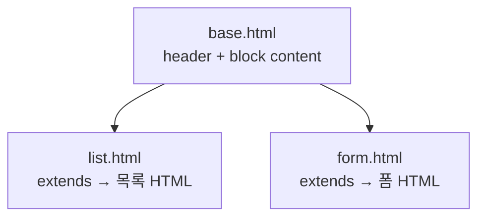
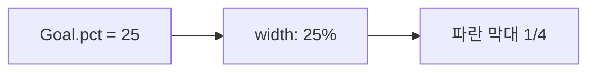

# Day 8 · 템플릿 상속·대시보드 UI

> 읽는 시간: 약 12분

## 복습 3문제

**1.** (Day 5) `try`에서 예외가 **없을** 때 `else`와 `finally` 중 어느 쪽이 먼저인가요?

<details>
<summary>정답</summary>

`else` → `finally` 순입니다. `else`는 예외가 없을 때만, `finally`는 항상 실행됩니다.

</details>

**2.** (Day 6) `yield`가 있는 함수를 호출하면 바로 본문이 실행되나요?

<details>
<summary>정답</summary>

아니요. **제너레이터 객체**만 생깁니다. `next()`나 `for`로 값을 꺼낼 때 본문이 돌아갑니다.

</details>

**3.** (Day 7) POST로 Goal을 저장한 뒤, 왜 `render` 대신 `redirect`하나요?

<details>
<summary>정답</summary>

새로고침 시 POST가 다시 나가 **중복 저장**되기 때문입니다. redirect 후 목록은 GET이라 안전합니다 (PRG).

</details>

---

## 오늘 만들 것

공통 레이아웃(`base.html`)을 두고, Goal 목록을 **진행률 바**가 보이는 대시보드로 바꿉니다. Day 7의 `pct`를 화면에 그립니다.

## 오늘 배울 것

- 템플릿 상속: `` / ``
- 대시보드 UI: `pct`로 진행률 바 그리기
- 정적 파일: ``과 base 레이아웃

---

## 1. 템플릿 상속: 뼈대는 한 번만

Day 7의 `list.html`과 `form.html`에 헤더·푸터를 **각각** 적으면, 로고 문구를 바꿀 때 파일을 전부 고쳐야 합니다. Express의 EJS에서도 `<%- include('header') %>`로 조각을 붙였죠. Django는 한 걸음 더 가서 **뼈대 파일**을 두고, 자식이 **구멍만 채우는** 방식을 씁니다.

**결과를 맞혀 보세요:** `list.html` 맨 위에 ``만 쓰고, ``는 안 썼습니다. 화면에 뭐가 보이나요?

<details>
<summary>정답</summary>

`base.html`의 뼈대만 보입니다. `content` 블록이 비어 있으면 그 자리는 **빈칸**입니다. 목록 HTML은 블록 안에 넣어야 나옵니다.

</details>

**JS (Node, EJS)**

```javascript
// views/layout.ejs
<header>Goals</header>
<%- body %>
<footer>© 2026</footer>
```

**Django** · 로컬 `templates/base.html`

```html
<!DOCTYPE html>
<html lang="ko">
<head>
  <title>Goals</title>
</head>
<body>
  <header>Goals 대시보드</header>
  
</body>
</html>
```

자식은 **뼈대를 고치지 않고** 구멍만 채웁니다. 로컬 `goals/templates/goals/list.html`

```html

목록 · Goals

  <h1>내 목표</h1>
  <!-- 목록은 아래에 -->

```

**비유:** `base.html`은 **아파트 공통 현관·복도**입니다. 각 호수(자식 템플릿)는 자기 방만 꾸밉니다. 현관 이름을 바꾸면 모든 호수에 바로 반영됩니다.




순수 Python으로 "뼈대 + 구멍 채우기"만 흉내 내 보면 이렇습니다.

```python-run
def render(base, blocks):
    out = base
    for name, html in blocks.items():
        tag = "{" + name + "}"
        out = out.replace(tag, html)
    return out

base = "<h1>Goals</h1>\n{content}"
print(render(base, {"content": "<p>독서</p>"}))
```

> 💡 공통은 `base.html`, 페이지마다 다른 부분만 ``. `extends`는 파일 **맨 위**에.

<details>
<summary>🔍 더 깊이 (면접용): 컴파일·렌더, block.super</summary>

Django 템플릿은 요청마다 파일을 새로 읽지 않습니다. 처음 로드할 때 **노드 트리로 컴파일**하고, 이후에는 컨텍스트(변수 dict)만 넣어 **렌더**합니다. `APP_DIRS=True`면 각 앱의 `templates/`도 검색합니다.

부모 블록 내용을 **이어 쓰고** 싶으면 `{{ block.super }}`를 씁니다. 예: base의 `extra_css`에 공통 CSS가 있고, 자식이 페이지 CSS만 추가할 때.

```html

  {{ block.super }}
  <link rel="stylesheet" href="...">

```

`extends`가 있으면 그 파일의 **최상위**는 블록과 로드 태그뿐입니다. 바깥에 일반 HTML을 쓰면 무시되거나 에러가 납니다.

</details>

---

## 2. 대시보드: pct로 진행률 바

Day 7에서 `goal.pct`는 0~100 숫자였습니다. 오늘은 그 숫자로 **가로 막대**를 그립니다. CSS `width`에 퍼센트를 넣으면 됩니다.

**결과를 맞혀 보세요:** `done=5`, `target=20`인 Goal의 `pct`는 25입니다. 아래처럼 쓰면 막대 길이는?

```html
<div style="width: {{ g.pct }}%"></div>
```

<details>
<summary>정답</summary>

부모 너비의 **25%**입니다. `pct`가 이미 0~100이라 `width`에 그대로 넣으면 됩니다. `target`이 0이면 Day 7에서 폼으로 막았으니, 화면에서는 보통 안전합니다.

</details>

**JS (React 느낌)**

```javascript
function Bar({ pct }) {
  return (
    <div className="track">
      <div style={{ width: `${pct}%` }} />
    </div>
  );
}
```

**Django** · `list.html`의 `` 안

```html

  <article class="goal">
    <h2>{{ g.title }}</h2>
    <p>{{ g.done }} / {{ g.target }}
       ({{ g.pct }}%)</p>
    <div class="track">
      <div class="fill"
           style="width: {{ g.pct }}%"></div>
    </div>
  </article>

  <p>아직 목표가 없습니다.</p>

```

**비유:** `track`은 **트랙**, `fill`은 **채워진 거리**입니다. `pct`가 연료량 게이지 숫자이고, CSS가 그 숫자만큼 칠합니다.



`pct` 계산을 다시 확인하려면 순수 Python으로 돌려 보세요.

```python-run
def pct(done, target):
    if target <= 0:
        return 0
    return round(done / target * 100)

print(pct(5, 20))
print(pct(20, 20))
```

> 💡 숫자는 모델(`pct`), 그림은 템플릿(`width: {{ g.pct }}%`). 역할을 나눈다.

---

## 3. 정적 CSS + base에 연결

인라인 `style=`만 쓰면 페이지마다 색을 또 적게 됩니다. CSS 파일 하나로 모으고, base에서 한 번 불러옵니다. Express의 `express.static("public")`과 같은 역할입니다.

**결과를 맞혀 보세요:** CSS를 `goals/static/goals/app.css`에 두었습니다. 템플릿에 `<link href="goals/static/goals/app.css">`처럼 **경로를 직접** 쓰면?

<details>
<summary>정답</summary>

개발 중엔 우연히 될 수도 있지만, **배포·캐시·앱 이름 변경**에 깨지기 쉽습니다. ``를 쓰면 Django가 `STATIC_URL`에 맞는 URL을 만들어 줍니다.

</details>

**JS (Node, Express)**

```javascript
app.use(express.static("public"));
// HTML: <link href="/app.css">
```

**Django** · `base.html`의 `<head>`

```html

<link rel="stylesheet"
      href="">
```

로컬 `goals/static/goals/app.css` 예시 (짧게):

```css
body { font-family: sans-serif;
       background: #0d1117; color: #e6edf3; }
.track { background: #21262d; height: 10px;
         border-radius: 5px; }
.fill { background: #58a6ff; height: 10px;
        border-radius: 5px; }
```

``은 **그 템플릿 파일** 맨 위(또는 `extends` 다음)에 한 번 둡니다. 자식이 `static`을 쓰려면 자식에도 load가 필요합니다. base에만 링크를 두면 자식은 load 없이 상속된 CSS를 씁니다.

뷰는 Day 7과 같습니다. 목록만 예쁘게 바뀝니다.

```python
def goal_list(request):
    goals = Goal.objects.all()
    return render(request,
                  "goals/list.html",
                  {"goals": goals})
```

> 💡 CSS·이미지·JS는 `static/`. 템플릿에서는 ``으로 URL을 만든다.

<details>
<summary>🔍 더 깊이 (면접용): autoescape와 XSS</summary>

템플릿의 `{{ g.title }}`은 기본적으로 **이스케이프**됩니다. 제목에 `<script>`가 들어와도 태그가 아니라 글자로 보입니다. 이게 XSS(Cross-Site Scripting) 기본 방어입니다.

신뢰하는 HTML만 `|safe`나 ``를 씁니다. 사용자 입력에 쓰면 위험합니다. React의 기본 텍스트 노드 삽입과 같은 생각입니다.

`width: {{ g.pct }}%`는 숫자라 태그가 되지 않습니다. 다만 `pct`가 문자열로 오염되면 CSS 주입 여지가 있으니, 모델에서 정수로 지키는 편이 좋습니다.

</details>

---

## 연습문제

### 문제 1. form.html도 상속하기

`form.html`에 헤더가 중복입니다. `base.html`을 쓰도록 고치세요. 제목 블록은 "목표 저장"으로.

<details>
<summary>정답 보기</summary>

```html

목표 저장

  <h1>목표 저장</h1>
  <form method="post">
    
    {{ form.as_p }}
    <button>저장</button>
  </form>

```

`extends`는 반드시 **첫 줄**(주석·공백 제외)에 둡니다. 폼 본문은 전부 `content` 블록 안입니다.

</details>

### 문제 2. 100%면 색 바꾸기

`g.pct == 100`이면 막대 클래스에 `done`을 붙여, CSS에서 초록으로 보이게 하세요.

<details>
<summary>정답 보기</summary>

```html
<div class="fill done"
     style="width: {{ g.pct }}%"></div>
```

```css
.fill.done { background: #3fb950; }
```

``로 클래스만 토글하면 됩니다. `width`는 그대로 `pct`를 씁니다.

</details>

### 문제 3. 문자열 치환으로 상속 흉내

아래를 실행하면 무엇이 출력되나요?

```python-run
base = "[헤더]\n{body}\n[푸터]"
page = base.replace(
    "{body}", "진행률 25%")
print(page)
```

<details>
<summary>정답 보기</summary>

```text
[헤더]
진행률 25%
[푸터]
```

`{body}` 자리만 바뀌고 헤더·푸터는 그대로입니다. Django의 `extends` + `block`이 이 패턴을 **파일 단위**로 한 것입니다.

</details>

---

## 면접 질문

<details>
<summary>Q1. 템플릿 상속(extends)과 include의 차이는?</summary>

- **extends**: 자식이 부모의 **전체 뼈대**를 쓰고, `block`만 덮어씁니다. 페이지 레이아웃에 적합합니다.
- **include**: 조각 HTML을 **그 자리에 삽입**합니다. 버튼·카드처럼 여러 곳에서 쓰는 부품에 적합합니다.
- EJS의 `include`는 Django `include`에 가깝고, 레이아웃 + `body` 패턴이 `extends`에 가깝습니다.

</details>

<details>
<summary>Q2. `{{ value }}`가 XSS에 안전한 이유는? `|safe`는 언제 쓰나?</summary>

- 기본 **autoescape**가 `<`, `>` 등을 엔티티로 바꿉니다. 스크립트가 실행되지 않습니다.
- `|safe`는 "이미 안전한 HTML"일 때만 씁니다. 마크다운 렌더 결과·관리자가 만든 공지 등. **사용자 입력 그대로**에 쓰면 안 됩니다.

</details>

---

## 오늘 정리

1. `base.html` + ``으로 공통 레이아웃을 한곳에서 관리한다.
2. `Goal.pct`를 `width: {{ g.pct }}%`로 진행률 바에 연결한다.
3. CSS는 `static/`에 두고 ``으로 불러온다.

## 다음에 이어갈 것

Day 9: 로그인 후 **내 Goals만** 보이도록 User와 Goal을 연결합니다.
