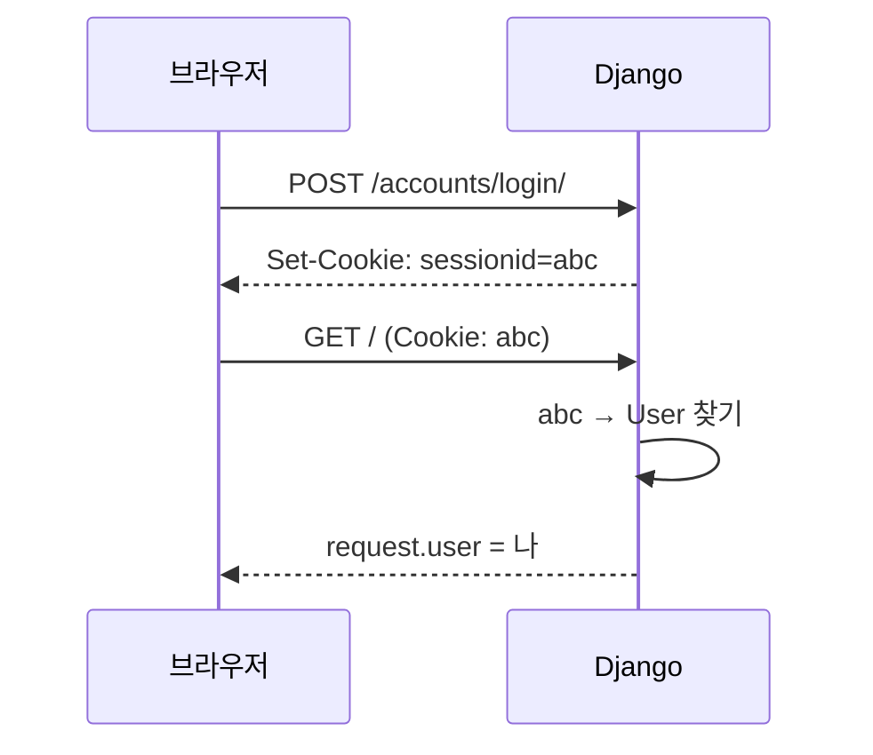
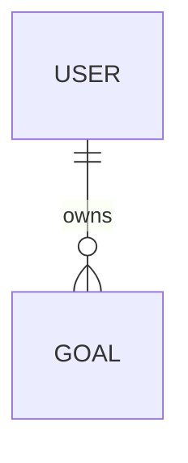
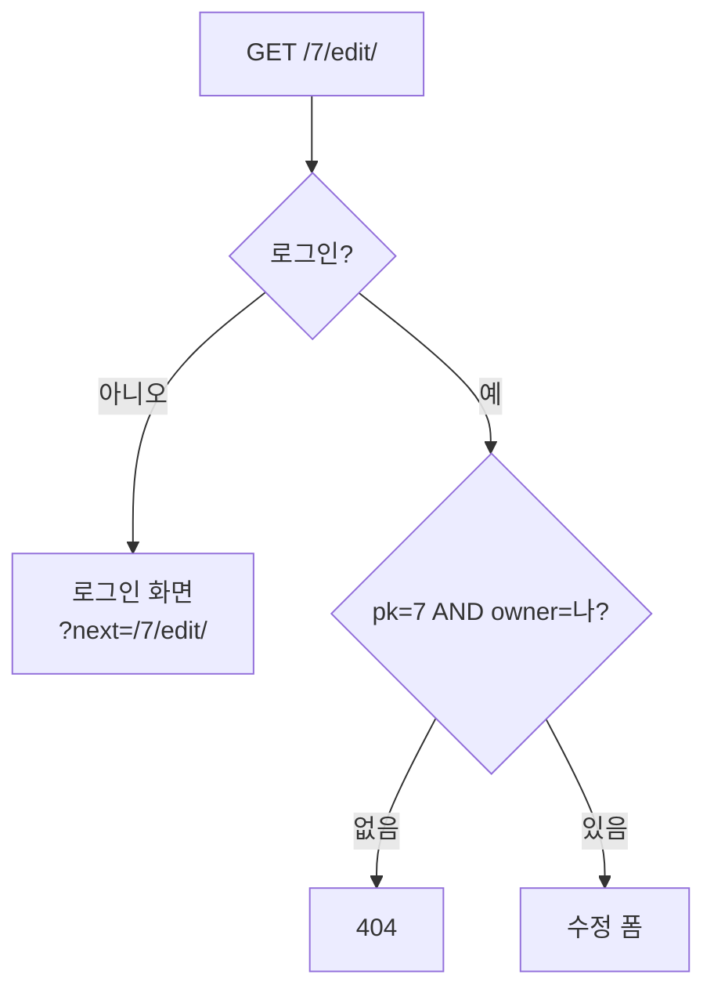

# Day 9 · 로그인: 내 Goals만 보기

> 읽는 시간: 약 13분

## 복습 3문제

**1.** (Day 6) 제너레이터를 `for`로 한 번 다 돈 뒤, 같은 객체로 `for`를 **한 번 더** 돌면?

<details>
<summary>정답</summary>

아무것도 나오지 않습니다. 제너레이터는 **한 번 쓰면 끝**인 이터레이터라, 이미 소진(exhausted)된 상태입니다. 다시 돌리려면 함수를 다시 호출해 새 제너레이터를 만들어야 합니다.

</details>

**2.** (Day 7) 수정 뷰에서 `GoalForm(request.POST, instance=goal)`의 `instance`를 빼면 `save()`는 무엇을 하나요?

<details>
<summary>정답</summary>

기존 Goal을 고치지 않고 **새 Goal을 하나 더 만듭니다** (UPDATE 대신 INSERT). `instance`가 "이 객체를 고친다"는 표시입니다.

</details>

**3.** (Day 8) 자식 템플릿에서 ``는 어디에 써야 하나요?

<details>
<summary>정답</summary>

파일의 **맨 첫 태그**여야 합니다. 그 앞에 다른 태그나 HTML이 있으면 에러가 납니다. 내용은 전부 `` 안에 넣습니다.

</details>

---

## 오늘 만들 것

로그인 화면을 붙이고, Goal에 **주인(owner)** 을 달아 **내가 만든 목표만** 보이고 고칠 수 있게 합니다.

## 오늘 배울 것

- Django 기본 인증: 로그인 화면과 `request.user`
- Goal에 주인 달기: `ForeignKey(User)`
- 내 것만 보기: `@login_required` + `filter(owner=...)`

---

## 1. 로그인 붙이기: 이미 다 들어 있다

지금 Goals 앱은 누구나 들어와 모든 목표를 봅니다. 가족이 같이 쓰면 남의 "다이어트 목표"까지 다 보이겠죠. 그래서 먼저 **누가 접속했는지** 알아야 합니다.

Express라면 `passport`나 `express-session`을 설치하고 비밀번호 해시도 직접 고릅니다. Django는 `django.contrib.auth`(인증 앱)가 **처음부터 켜져 있습니다**. User 테이블, 비밀번호 해시, 로그인·로그아웃 뷰가 이미 있어요.

**결과를 맞혀 보세요:** 로그인하지 않은 상태로 뷰 안에서 `print(request.user)`를 하면 무엇이 찍힐까요?

<details>
<summary>정답</summary>

`AnonymousUser`가 찍힙니다. `None`이 아니라 **"손님" 객체**라서, `request.user.is_authenticated`를 에러 없이 물어볼 수 있습니다 (값은 `False`). 로그인하면 실제 `User` 객체가 들어옵니다.

</details>

**JS (Node, Express)**

```javascript
// passport 설정 후
app.get("/", (req, res) => {
  if (!req.user) {
    return res.redirect("/login");
  }
  res.send(req.user.username);
});
```

**Python (Django)** · 로컬 `config/urls.py`

```python
from django.urls import include, path

urlpatterns = [
    path("accounts/", include(
        "django.contrib.auth.urls")),
    path("", include("goals.urls")),
]
```

이 한 줄로 `/accounts/login/`, `/accounts/logout/` 같은 주소가 생깁니다. 화면만 우리가 만들면 됩니다. Django는 `registration/login.html`이라는 **약속된 이름**의 템플릿을 찾습니다.

로컬 `templates/registration/login.html`

```html


  <h1>로그인</h1>
  <form method="post">
    
    {{ form.as_p }}
    <button>로그인</button>
  </form>

```

Day 8의 `base.html`을 그대로 상속했습니다. 로그인 뒤 어디로 갈지는 `settings.py`에 적습니다.

```python
# config/settings.py 맨 아래
LOGIN_URL = "login"
LOGIN_REDIRECT_URL = "goal_list"
LOGOUT_REDIRECT_URL = "login"
```

계정은 `python manage.py createsuperuser`로 하나 만들고 `/accounts/login/`에서 들어가 보세요.

**비유:** 로그인은 **놀이공원 손목밴드**입니다. 입구(로그인)에서 한 번 확인하고 밴드(세션 쿠키)를 채워 주면, 그다음엔 놀이기구마다 신분증을 다시 안 봅니다.



세션이 하는 일을 순수 Python으로 흉내 내면 이렇습니다. 쿠키에는 **무작위 열쇠**만 있고, 진짜 정보는 서버가 들고 있습니다.

```python-run
import secrets

sessions = {}

def login(username):
    key = secrets.token_hex(4)
    sessions[key] = username
    return key

cookie = login("dong")
print(cookie, "→", sessions[cookie])
print(sessions.get("가짜키", "손님"))
```

> 💡 인증은 이미 내장. URL 한 줄 + `registration/login.html` 하나면 로그인이 된다.

<details>
<summary>🔍 더 깊이 (면접용): 세션 인증과 비밀번호 저장</summary>

로그인에 성공하면 `django.contrib.auth.login()`이 **세션 키를 새로 만듭니다** (`cycle_key`). 로그인 전 키를 계속 쓰면 공격자가 미리 심어 둔 키로 로그인 상태를 가로챌 수 있어서(세션 고정 공격, session fixation) 바꿔 줍니다.

세션 데이터는 기본적으로 DB의 `django_session` 테이블에 있고, 쿠키에는 `sessionid`만 갑니다. 쿠키는 기본 `HttpOnly`라 JS에서 읽을 수 없습니다. 배포 땐 `SESSION_COOKIE_SECURE = True`로 HTTPS에서만 보내게 합니다.

비밀번호는 원문이 아니라 `pbkdf2_sha256$반복횟수$salt$해시` 형태로 저장됩니다. 일부러 느린 해시를 수십만 번 반복해서, DB가 털려도 무차별 대입(brute force)이 비싸지게 만든 것입니다. Node의 `bcrypt`와 같은 생각입니다.

Django 5부터 로그아웃은 **POST만** 받습니다. 링크(`<a>`)로 GET 로그아웃을 하면 다른 사이트가 이미지 태그 하나로 사용자를 로그아웃시킬 수 있기 때문입니다. 그래서 로그아웃도 ``이 있는 작은 폼으로 만듭니다.

</details>

---

## 2. Goal에 주인 달기: ForeignKey

로그인은 됐지만 Goal 테이블에는 "누구 것"이라는 칸이 없습니다. 그래서 Goal 한 줄이 User 한 명을 **가리키게** 만듭니다. 이 연결을 **외래 키**(ForeignKey, 다른 테이블의 id를 저장하는 열)라고 합니다.

**결과를 맞혀 보세요:** 이미 Goal이 3개 저장된 상태에서 `owner` 필드를 추가하고 `makemigrations`를 하면?

<details>
<summary>정답</summary>

Django가 **질문을 합니다**: "기존 3줄의 owner는 뭘로 채울까요?" 비어 있으면 안 되는 열이라 기본값이 필요합니다. 연습용이면 `1`(처음 만든 superuser의 id)을 입력하면 기존 Goal이 전부 그 사람 것이 됩니다.

</details>

**JS (Node, Prisma)**

```javascript
model Goal {
  id      Int  @id @default(autoincrement())
  owner   User @relation(fields: [ownerId],
                         references: [id])
  ownerId Int
}
```

**Python (Django)** · 로컬 `goals/models.py`

```python
from django.conf import settings

class Goal(models.Model):
    owner = models.ForeignKey(
        settings.AUTH_USER_MODEL,
        on_delete=models.CASCADE,
        related_name="goals")
    # title, target, done은 그대로
```

세 부분을 하나씩 봅니다.

- `settings.AUTH_USER_MODEL`: User 클래스를 직접 import하지 않고 **설정에서 가져옵니다**. 나중에 User를 바꿔도(Week 4) 코드가 안 깨집니다.
- `on_delete=CASCADE`: 사람이 탈퇴하면 그 사람 Goal도 **같이 지웁니다**.
- `related_name="goals"`: 반대 방향 이름. `user.goals.all()`로 내 목표를 꺼낼 수 있습니다.

DB에는 `owner_id`라는 정수 열이 생깁니다. Prisma의 `ownerId`와 똑같습니다.

그다음 `makemigrations`(기본값 질문에 `1`) → `migrate`를 실행합니다.



**비유:** Goal 한 장 한 장에 **이름 스티커**(owner_id)를 붙이는 겁니다. 스티커에는 사람 이름 대신 **사원 번호**(User의 id)를 씁니다.

저장할 때는 폼에 owner 칸을 보여 주지 않습니다. 사용자가 남의 번호를 골라 넣으면 안 되니까요. 폼에서 빼고, 뷰에서 **로그인한 사람**을 채웁니다.

```python
# GoalForm.Meta
fields = ["title", "target", "done"]
```

```python
if form.is_valid():
    goal = form.save(commit=False)
    goal.owner = request.user
    goal.save()
    return redirect("goal_list")
```

`commit=False`는 "객체만 만들고 **아직 DB에 쓰지 마**"입니다. 주인을 채운 뒤 직접 `save()`합니다.

> 💡 "누구 것"은 ForeignKey로. 주인은 폼이 아니라 **서버가** `request.user`로 채운다.

---

## 3. 내 것만 보기: login_required + filter

이제 두 가지를 막아야 합니다. 로그인 안 한 사람은 **들어오지 못하게**, 로그인한 사람은 **자기 것만** 보게.

**결과를 맞혀 보세요:** 목록은 내 것만 보이게 고쳤습니다. 그런데 수정 뷰는 아직 `get_object_or_404(Goal, pk=pk)`입니다. 내가 주소창에 `/7/edit/`(남의 Goal 번호)를 치면?

<details>
<summary>정답</summary>

**남의 Goal이 열리고 수정까지 됩니다.** 목록에서 숨기는 건 "버튼을 안 보여 준 것"일 뿐입니다. 번호만 바꿔 남의 데이터에 접근하는 이 구멍을 **IDOR**(Insecure Direct Object Reference)라고 부릅니다.

</details>

**JS (Node, Express)**

```javascript
function requireLogin(req, res, next) {
  if (!req.user) {
    return res.redirect("/login");
  }
  next();
}
app.get("/", requireLogin,
  async (req, res) => {
    const goals = await Goal.findMany({
      where: { ownerId: req.user.id } });
  });
```

**Python (Django)** · 로컬 `goals/views.py`

```python
from django.contrib.auth.decorators \
    import login_required

@login_required
def goal_list(request):
    goals = Goal.objects.filter(
        owner=request.user)
    return render(request, "goals/list.html",
                  {"goals": goals})
```

`@login_required`는 Day 3에서 본 **데코레이터**(함수를 감싸는 함수)입니다. Express 미들웨어 `requireLogin`과 같은 일을 합니다. 손님이면 `LOGIN_URL`로 보내고, 로그인 뒤 원래 주소로 돌아오게 `?next=/`도 붙여 줍니다.

수정 뷰는 **조회 조건에 주인을 넣는 것**이 핵심입니다.

```python
@login_required
def goal_edit(request, pk):
    goal = get_object_or_404(
        Goal, pk=pk, owner=request.user)
    # 아래는 Day 7과 같습니다
```

남의 번호면 조건에 맞는 행이 없으니 **404**가 납니다. "있는데 못 봄(403)"이 아니라 "없음(404)"이라서, 남의 Goal이 존재하는지조차 알려 주지 않습니다.




이 "주인 조건으로 거르기"를 순수 Python으로 돌려 보세요.

```python-run
goals = [
    {"id": 1, "owner": "dong"},
    {"id": 7, "owner": "mom"},
]

def get_mine(pk, user):
    for g in goals:
        mine = g["owner"] == user
        if g["id"] == pk and mine:
            return g
    return "404"

print(get_mine(1, "dong"))
print(get_mine(7, "dong"))
```

> 💡 화면에서 숨기기는 보안이 아니다. **쿼리 조건에** `owner=request.user`를 넣어야 진짜로 막힌다.

<details>
<summary>🔍 더 깊이 (면접용): 매번 잊지 않는 법</summary>

뷰마다 `owner=request.user`를 적다 보면 언젠가 한 곳을 빠뜨립니다. 실무에서는 실수할 자리를 줄입니다.

- **헬퍼 함수**로 모으기: `def my_goals(user): return Goal.objects.filter(owner=user)`.
- **커스텀 매니저**: `Goal.objects.for_user(user)` 같은 메서드를 만들어 쓰기 (Week 6).
- **CBV**(클래스 기반 뷰, Week 3)라면 `LoginRequiredMixin`과 `get_queryset()`을 한 번만 오버라이드.
- DRF(Week 5)에선 `get_queryset()` + 권한 클래스(`IsAuthenticated`)로 같은 원칙을 지킵니다.

그리고 **테스트로 고정합니다** (Week 7): "A로 로그인해서 B의 Goal 수정 주소를 열면 404"를 테스트 하나로 만들어 두면, 누가 실수로 조건을 빼도 바로 빨간불이 켜집니다.

404와 403은 팀 규칙에 따라 고릅니다. 존재 자체가 비밀이면 404, "권한이 없다"를 알려 줘야 하면(예: 공유 문서의 읽기 전용) 403이 자연스럽습니다.

</details>

---

## 연습문제

### 문제 1. 추가 뷰에도 주인 채우기

Day 7의 `goal_create`를 고쳐서, 로그인한 사람만 들어오고 새 Goal의 주인이 자동으로 내가 되게 하세요.

<details>
<summary>정답 보기</summary>

```python
@login_required
def goal_create(request):
    form = GoalForm(request.POST or None)
    if form.is_valid():
        goal = form.save(commit=False)
        goal.owner = request.user
        goal.save()
        return redirect("goal_list")
    return render(request, "goals/form.html",
                  {"form": form})
```

`commit=False`로 저장을 미루고, `owner`를 채운 뒤 `save()`합니다. 폼의 `fields`에 `owner`가 없어야 사용자가 주인을 조작할 수 없습니다. `@login_required`가 없으면 손님일 때 `request.user`가 `AnonymousUser`라서 저장 시 에러가 납니다.

</details>

### 문제 2. base.html에 로그인 상태 보여 주기

헤더에 로그인했으면 "dong님 · 로그아웃 버튼", 아니면 "로그인" 링크가 보이게 하세요.

<details>
<summary>정답 보기</summary>

```html
<header>
  Goals 대시보드
  
    {{ user.username }}님
    <form method="post"
          action="">
      
      <button>로그아웃</button>
    </form>
  
    <a href="">로그인</a>
  
</header>
```

템플릿에서는 뷰가 넘기지 않아도 `user`를 쓸 수 있습니다. 기본 설정의 컨텍스트 프로세서(Week 4)가 자동으로 넣어 주기 때문입니다. 로그아웃은 Django 5부터 POST만 받으므로 링크가 아니라 **폼 + 버튼**입니다.

</details>

### 문제 3. 내 진행률 평균

아래를 실행하면 무엇이 출력되나요? (내 Goal만 골라 평균 pct)

```python-run
goals = [("dong", 25), ("mom", 90),
         ("dong", 75)]
mine = [p for o, p in goals
        if o == "dong"]
print(mine, sum(mine) / len(mine))
```

<details>
<summary>정답 보기</summary>

```text
[25, 75] 50.0
```

리스트 컴프리헨션(Day 2)의 `if`가 `filter(owner=...)` 역할을 합니다. 평균은 (25+75)/2 = 50.0입니다. Django에선 Week 3에 `aggregate(Avg(...))`로 DB가 직접 계산하게 바꿉니다.

</details>

---

## 면접 질문

<details>
<summary>Q1. Django의 세션 기반 로그인은 어떻게 동작하나요?</summary>

- 로그인 폼이 POST되면 `authenticate()`가 아이디·비밀번호를 확인합니다. 비밀번호는 저장된 **해시**와 비교합니다.
- 성공하면 `login()`이 세션에 user id를 저장하고, 브라우저에 `sessionid` 쿠키를 내려줍니다. 이때 세션 키를 새로 발급해 세션 고정 공격을 막습니다.
- 이후 요청마다 `SessionMiddleware`가 쿠키로 세션을 찾고, `AuthenticationMiddleware`가 그 id로 User를 꺼내 `request.user`에 넣습니다. 없으면 `AnonymousUser`입니다.
- JWT와 비교하면: 세션은 서버가 상태를 들고 있어 **즉시 로그아웃·강제 만료**가 쉽고, JWT는 서버 저장소가 없어도 되지만 만료 전 무효화가 어렵습니다 (Week 5).

</details>

<details>
<summary>Q2. 다른 사용자의 데이터에 접근하지 못하게 하려면? (IDOR)</summary>

- **인증**(누구인가)과 **인가**(이 객체에 권한이 있나)를 구분합니다. `@login_required`는 인증만 합니다.
- 인가는 객체를 꺼내는 **쿼리 자체에** 주인 조건을 넣어 지킵니다: `get_object_or_404(Goal, pk=pk, owner=request.user)`.
- 프론트에서 버튼을 숨기거나 id를 감추는 것은 방어가 아닙니다. 공격자는 URL·API를 직접 호출합니다.
- 실수 방지를 위해 공통 queryset(헬퍼·매니저·`get_queryset`)으로 모으고, "남의 객체 접근 시 404" 테스트를 둡니다.

</details>

---

## 오늘 정리

1. 인증은 `django.contrib.auth`에 내장. `accounts/` URL + `registration/login.html`로 로그인 완성.
2. Goal에 `owner = ForeignKey(User)`를 달고, 주인은 서버가 `commit=False` 후 `request.user`로 채운다.
3. `@login_required`로 손님을 막고, 모든 조회에 `owner=request.user`를 넣어 IDOR을 막는다.

## 다음에 이어갈 것

Day 10: 지금까지 만든 Goals 대시보드를 **인터넷에 올려 보고**, 1·2주를 회고합니다.
