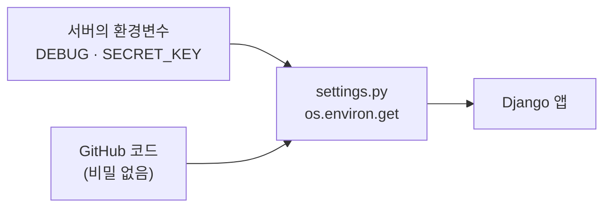
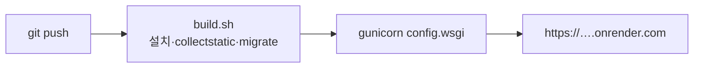
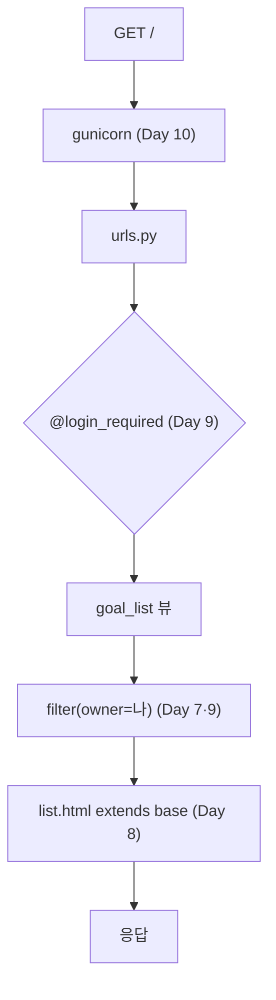

# Day 10 · 간단 배포 맛보기 + 1·2주 회고

> 읽는 시간: 약 14분

## 복습 3문제

**1.** (Day 3) `@login_required`처럼 함수 위에 붙는 `@이름`은 무엇이고, 무슨 일을 하나요?

<details>
<summary>정답</summary>

**데코레이터**입니다. 함수를 받아서 **감싼 새 함수**를 돌려주는 함수예요. `@login_required`는 원래 뷰를 감싸서, 손님이면 로그인 화면으로 보내고 로그인했으면 원래 뷰를 실행합니다.

</details>

**2.** (Day 7) 폼 저장에 성공한 뒤 `render()`가 아니라 `redirect()`를 하는 이유는?

<details>
<summary>정답</summary>

**PRG**(Post → Redirect → Get) 패턴입니다. 저장 후 바로 화면을 그려 주면, 사용자가 새로고침할 때 브라우저가 **POST를 다시 보내** Goal이 두 번 저장됩니다. redirect로 GET 화면으로 옮겨 두면 새로고침해도 안전합니다.

</details>

**3.** (Day 9) `form.save(commit=False)`는 무엇을 하고, 왜 썼나요?

<details>
<summary>정답</summary>

Goal 객체만 만들고 **아직 DB에 저장하지 않습니다**. 그 사이에 `goal.owner = request.user`를 서버가 채운 뒤 `goal.save()`로 저장하려고 썼습니다. 주인을 사용자가 고르게 두면 남의 이름으로 만들 수 있으니까요.

</details>

---

## 오늘 만들 것

내 컴퓨터에서만 돌던 Goals 대시보드를 **운영(production) 설정**으로 바꾸고, 원하면 무료 호스팅에 올려 **휴대폰에서 열어 봅니다**.

## 오늘 배울 것

- `runserver`는 개발용, 운영은 `gunicorn`
- 비밀값과 스위치는 **환경변수**로: `DEBUG`·`SECRET_KEY`·`ALLOWED_HOSTS`
- 정적 파일(CSS) 모으기와 실제로 올리기

---

## 1. runserver는 개발용이다

지금까지는 `python manage.py runserver`로 앱을 띄웠습니다. 편하죠. 코드를 고치면 **알아서 다시 시작**하고, 에러가 나면 자세한 화면을 보여 줍니다.

그런데 Django 공식 문서는 이 서버를 **운영에 쓰지 말라**고 못 박습니다. 보안 점검도, 성능 튜닝도 하지 않은 "작업대용" 서버이기 때문입니다.

**결과를 맞혀 보세요:** Express 앱은 `node server.js` 하나로 운영까지 갑니다. Django는 왜 따로 서버 프로그램이 필요할까요?

<details>
<summary>정답</summary>

Express는 앱 코드 안에 **HTTP 서버**(`app.listen`)가 들어 있습니다. Django 앱은 HTTP 소켓을 직접 열지 않고, **"요청을 주면 응답을 돌려주는 함수"**(WSGI 앱)만 제공합니다. 소켓을 열고, 워커를 띄우고, 죽은 워커를 되살리는 일은 `gunicorn` 같은 **WSGI 서버**가 맡습니다. 역할을 나눠 둔 구조예요.

</details>

**JS (Node)**

```javascript
// 앱 = 서버
const app = express();
app.listen(process.env.PORT);
// 운영: pm2 start server.js -i 4
```

**Python (Django)** · 로컬 터미널

```bash
pip install gunicorn
# config/wsgi.py 안의 application 실행
gunicorn config.wsgi
```

`gunicorn`(그린 유니콘)은 Node의 `pm2 -i 4`처럼 **워커 프로세스 여러 개**를 띄워 요청을 나눠 받습니다. 하나가 죽어도 다시 살립니다.

**비유:** `runserver`는 **집 부엌**입니다. 요리 연습엔 최고지만 손님 100명을 받진 않죠. `gunicorn`은 요리사 여러 명이 있는 **식당 주방**입니다. 레시피(Django 코드)는 같습니다.


WSGI 약속이 얼마나 단순한지 순수 Python으로 보면 이렇습니다. 서버는 이 함수를 **호출만** 합니다.

```python-run
def application(environ, start_response):
    path = environ["PATH_INFO"]
    start_response("200 OK", [])
    return [f"Goals: {path}".encode()]

body = application({"PATH_INFO": "/"},
                   lambda s, h: print(s))
print(body)
```

> 💡 Django는 "요청 → 응답" 함수만 만든다. 그 함수를 운영 환경에서 돌리는 건 `gunicorn`의 일.

<details>
<summary>🔍 더 깊이 (면접용): WSGI·ASGI와 워커 수</summary>

**WSGI**(Web Server Gateway Interface, PEP 3333)는 "웹 서버와 Python 앱이 대화하는 규칙"입니다. 서버는 요청을 `environ` 딕셔너리로 만들어 `application(environ, start_response)`를 호출하고, 앱은 바이트 조각들을 돌려줍니다. 규칙이 하나라서 gunicorn, uWSGI, mod_wsgi 어느 것과도 Django가 붙습니다.

WSGI는 **동기** 규칙이라 워커 하나가 요청 하나를 끝까지 붙잡습니다. 그래서 워커 수가 동시 처리량을 정합니다. gunicorn 문서의 출발점은 `(2 × CPU 코어) + 1`입니다.

**ASGI**는 async 버전입니다. WebSocket이나 오래 열린 연결을 다룰 때 `uvicorn`/`daphne`로 `config.asgi`를 띄웁니다 (Week 8–9).

운영에선 보통 gunicorn **앞에** nginx나 클라우드 프록시를 둡니다. HTTPS 처리, 정적 파일, 느린 클라이언트 버퍼링을 앞단이 맡고 gunicorn은 Python만 돌립니다.

</details>

---

## 2. 스위치와 비밀은 환경변수로

`settings.py`에는 지금 이런 줄이 있습니다.

```python
SECRET_KEY = "django-insecure-..."
DEBUG = True
ALLOWED_HOSTS = []
```

세 줄 다 운영에선 위험합니다.

- `SECRET_KEY`: 세션·비밀번호 재설정 링크에 **서명**하는 열쇠. GitHub에 올라가면 누구나 위조할 수 있습니다.
- `DEBUG = True`: 에러가 나면 코드·설정·SQL이 담긴 **자세한 화면**을 아무에게나 보여 줍니다.
- `ALLOWED_HOSTS`: 이 앱이 응답할 **도메인 목록**. 비어 있으면 운영에서 아무 요청도 안 받습니다.

그래서 값을 코드에 적지 않고, 실행하는 곳에서 **환경변수**(프로그램 밖에서 넣어 주는 설정값)로 받습니다. Node의 `process.env`와 똑같은 생각입니다.

**결과를 맞혀 보세요:** 환경변수는 항상 **문자열**입니다. 아래 코드는 무엇을 출력할까요?

```python-run
import os

os.environ["DEBUG"] = "False"
DEBUG = bool(os.environ["DEBUG"])
print(DEBUG)
```

<details>
<summary>정답</summary>

`True`가 나옵니다! `bool()`은 **빈 문자열만** `False`로 봅니다. `"False"`도 글자가 있으니 `True`예요. 운영 서버가 몰래 DEBUG 모드로 도는 흔한 사고입니다. 그래서 `== "1"`처럼 **정확한 값과 비교**합니다.

</details>

**JS (Node)**

```javascript
const DEBUG =
  process.env.DEBUG === "1";
const HOSTS = (process.env.HOSTS
  ?? "localhost").split(",");
```

**Python (Django)** · 로컬 `config/settings.py`

```python
import os

SECRET_KEY = os.environ.get(
    "SECRET_KEY", "dev-only-key")
DEBUG = os.environ.get("DEBUG") == "1"
ALLOWED_HOSTS = os.environ.get(
    "ALLOWED_HOSTS", "localhost").split(",")
```

포인트는 **안전한 쪽이 기본값**이라는 겁니다. 환경변수를 깜빡해도 DEBUG는 꺼집니다. 내 컴퓨터에서 개발할 땐 켜고 띄웁니다.

```bash
DEBUG=1 python manage.py runserver
```

**비유:** 환경변수는 **가게 금고 비밀번호**입니다. 비밀번호를 간판(코드)에 적어 두지 않고, 가게(서버)마다 사장님이 따로 알고 있죠.



> 💡 비밀값은 코드 밖에. 환경변수는 늘 문자열이니 `bool()` 말고 **값 비교**로 읽는다.

<details>
<summary>🔍 더 깊이 (면접용): DEBUG와 SECRET_KEY가 하는 일</summary>

`DEBUG = True`면 생기는 일:

- 500 에러 화면에 **스택 트레이스, 지역 변수, settings 값**이 나옵니다. `KEY`, `SECRET`, `PASS`, `TOKEN`이 들어간 이름은 가려 주지만, 다른 이름의 비밀은 그대로 보입니다.
- 404 화면에 **URL 목록 전체**가 나와 공격 지도가 됩니다.
- 실행한 SQL을 전부 `connection.queries`에 모아 두어 메모리가 계속 늘어납니다.

`SECRET_KEY`는 `django.core.signing`의 서명, 비밀번호 재설정 토큰, 세션 인증 해시에 쓰입니다. 새면 공격자가 **유효한 토큰을 직접 만들** 수 있습니다. 바꾸면 기존 세션과 재설정 링크가 무효가 되므로 `SECRET_KEY_FALLBACKS`로 천천히 교체합니다.

배포 전엔 `python manage.py check --deploy`를 돌려 보세요. HTTPS 쿠키, HSTS 같은 빠진 보안 설정을 경고로 알려 줍니다.

</details>

---

## 3. CSS 모으기와 실제로 올리기

**결과를 맞혀 보세요:** `DEBUG`를 끄고(`ALLOWED_HOSTS`는 채운 상태) `runserver`로 대시보드를 열면 화면이 어떻게 보일까요?

<details>
<summary>정답</summary>

글자는 다 나오는데 **CSS가 사라져** 맨 HTML처럼 보입니다. DEBUG가 켜져 있을 때만 `runserver`가 `static/` 파일을 대신 내줬기 때문입니다. 운영에선 정적 파일을 누가 줄지 **따로 정해야** 합니다.

</details>

Express의 `express.static("public")`에 해당하는 걸 붙입니다. 가장 간단한 방법은 `whitenoise`라는 패키지입니다.

**JS (Node)**

```javascript
app.use(express.static("public"));
```

**Python (Django)** · 로컬 `config/settings.py`

```python
WN = "whitenoise.middleware"
# SecurityMiddleware(0번) 바로 뒤에
MIDDLEWARE.insert(
    1, WN + ".WhiteNoiseMiddleware")
STATIC_ROOT = BASE_DIR / "staticfiles"
CSRF_TRUSTED_ORIGINS = [
    "https://" + h for h in ALLOWED_HOSTS]
```

`STATIC_ROOT`는 앱마다 흩어진 CSS·이미지를 **한 폴더에 모아 둘 곳**입니다. `collectstatic` 명령이 그 폴더를 채우고, whitenoise가 거기서 파일을 내줍니다. `CSRF_TRUSTED_ORIGINS`는 HTTPS 주소에서 로그인 폼 POST가 막히지 않게 해 줍니다 (연습문제 3).

이제 필요한 패키지 목록을 파일로 남깁니다. Node의 `package.json`에 해당합니다.

```bash
pip install gunicorn whitenoise
pip freeze > requirements.txt
echo "db.sqlite3" >> .gitignore
```

### 올려 보기 (선택, 약 10분)

[Render](https://render.com)의 무료 Web Service를 예로 듭니다. 먼저 프로젝트 루트에 `build.sh`를 만들고 `chmod +x build.sh` 합니다.

```bash
#!/usr/bin/env bash
set -o errexit
pip install -r requirements.txt
python manage.py collectstatic --no-input
python manage.py migrate
python manage.py createsuperuser \
  --no-input || true
```

GitHub에 push한 뒤, Render에서 저장소를 골라 이렇게 채웁니다.

| 칸 | 값 |
|---|---|
| Build Command | `./build.sh` |
| Start Command | `gunicorn config.wsgi` |
| 환경변수 | 아래 5개 |

환경변수는 `SECRET_KEY`(Render의 Generate 버튼), `ALLOWED_HOSTS`(예: `goals-xxxx.onrender.com`), 그리고 관리자 계정용 `DJANGO_SUPERUSER_USERNAME`·`DJANGO_SUPERUSER_EMAIL`·`DJANGO_SUPERUSER_PASSWORD`입니다. 배포가 끝나면 그 주소를 휴대폰으로 열어 로그인해 보세요.



> 💡 운영 체크 3종: 정적 파일은 `collectstatic` + whitenoise, 의존성은 `requirements.txt`, 실행은 gunicorn.

<details>
<summary>🔍 더 깊이 (면접용): 무료 배포의 함정</summary>

- **SQLite가 날아갑니다.** 무료 서버의 디스크는 재배포·재시작 때 초기화됩니다. 그래서 `build.sh`에서 매번 `migrate`와 관리자 생성을 다시 합니다. 진짜 데이터는 PostgreSQL 같은 별도 DB에 둬야 합니다 (Week 9). `|| true`는 계정이 이미 있을 때 빌드가 멈추지 않게 하는 장치입니다.
- **잠듭니다.** Render 무료 서비스는 한동안 요청이 없으면 멈췄다가, 다음 요청 때 수십 초 걸려 깨어납니다.
- **프록시 뒤의 HTTPS.** 브라우저↔Render는 HTTPS지만 Render↔gunicorn은 HTTP입니다. Django는 요청이 HTTP로 왔다고 보고, 브라우저가 보낸 `Origin: https://…`와 맞지 않아 POST를 403으로 막습니다. `CSRF_TRUSTED_ORIGINS`나 `SECURE_PROXY_SSL_HEADER`로 "앞단은 HTTPS였다"를 알려 줍니다.

</details>

---

## 1·2주 회고: 지금까지 만든 것

9일 동안 빈 폴더에서 **로그인되는 목표 대시보드**까지 왔습니다.

| Day | Goals 앱에 붙은 것 |
|---|---|
| 1 | 프로젝트·앱 뼈대, 첫 화면 |
| 2–3 | 목록·진행률 계산 (컬렉션·함수) |
| 4–5 | 클래스·예외·파일 (모델의 바탕) |
| 6 | 통계를 제너레이터로 |
| 7 | Goal 모델 + 추가/수정 폼 (PRG) |
| 8 | base.html 상속 대시보드 |
| 9 | 로그인·owner로 내 것만 |
| 10 | 운영 설정·배포 |

요청 하나가 지금 앱을 지나가는 길을 한 장으로 그리면 이렇습니다. 각 칸이 어느 Day였는지 떠올려 보세요.



막혔던 날이 있다면 그 Day 하나만 **복습 3문제와 💡 줄**만 다시 읽어도 충분합니다. Week 3부터는 이 그림의 칸 하나하나를 깊게 팝니다.

---

## 연습문제

### 문제 1. 안전한 env_bool

`"1"`, `"true"`, `"yes"`(대소문자 무시)만 `True`, 나머지와 없음은 `False`로 읽는 함수를 완성하세요.

```python-run
import os

def env_bool(name):
    # 여기를 채우세요
    return False

os.environ["DEBUG"] = "TRUE"
print(env_bool("DEBUG"), env_bool("NOPE"))
```

<details>
<summary>정답 보기</summary>

```python
def env_bool(name):
    v = os.environ.get(name, "")
    ok = {"1", "true", "yes"}
    return v.strip().lower() in ok
```

출력은 `True False`입니다. `get(name, "")`로 없을 때 빈 문자열을 받고, `strip().lower()`로 공백·대소문자를 정리한 뒤 **허용 목록에 있는지**만 봅니다. 목록에 없으면 전부 `False`라서, 오타가 나도 DEBUG가 켜지지 않습니다.

</details>

### 문제 2. ALLOWED_HOSTS 정리

환경변수가 `"goals.onrender.com, localhost,"`처럼 공백과 끝 쉼표가 섞여 들어왔습니다. 빈 항목 없이 깔끔한 리스트로 만드세요.

```python-run
raw = "goals.onrender.com, localhost,"
hosts = raw.split(",")
print(hosts)
```

<details>
<summary>정답 보기</summary>

```python
hosts = [h.strip() for h in raw.split(",")
         if h.strip()]
print(hosts)
# 출력: ['goals.onrender.com', 'localhost']
```

그냥 `split(",")`만 하면 `' localhost'`(앞 공백)와 `''`(빈 값)가 섞입니다. 공백 붙은 호스트는 매칭이 안 돼 **400 Bad Request**가 납니다. Day 2의 컴프리헨션으로 `strip()`하고, 빈 값은 `if`로 버립니다.

</details>

### 문제 3. 배포했더니 로그인만 403

Render에 올린 뒤 화면은 잘 열리는데, 로그인 버튼을 누르면 `403 Forbidden · CSRF verification failed`가 뜹니다. 로컬에선 잘 됐습니다. 원인과 해결은?

<details>
<summary>정답 보기</summary>

**원인:** 브라우저는 `https://goals-xxxx.onrender.com`에서 POST를 보내지만, Render 프록시 뒤의 Django는 요청이 **HTTP**로 왔다고 봅니다. CSRF 검사가 `Origin` 헤더(https)와 자기 주소(http)를 비교하다 다르다고 막습니다.

**해결:** 믿을 수 있는 출처를 알려 줍니다.

```python
CSRF_TRUSTED_ORIGINS = [
    "https://goals-xxxx.onrender.com"]
```

본문처럼 `ALLOWED_HOSTS`에서 만들어 두면 도메인을 바꿀 때 한 곳만 고치면 됩니다. ``을 지우는 건 해결이 아니라 **보안을 끄는 것**입니다.

</details>

---

## 면접 질문

<details>
<summary>Q1. 운영에서 runserver 대신 gunicorn을 쓰는 이유는? WSGI가 뭔가요?</summary>

- `runserver`는 자동 재시작·디버그용 개발 서버로, 보안 감사나 성능 검증을 받지 않았고 공식 문서도 운영 사용을 금합니다.
- **WSGI**는 웹 서버와 Python 앱 사이의 표준 규칙(PEP 3333)입니다. 앱은 `application(environ, start_response)` 함수 하나만 제공하고, 서버가 이를 호출합니다.
- gunicorn은 WSGI 서버로, **여러 워커 프로세스**를 띄워 동시 요청을 나눠 처리하고 죽은 워커를 되살리며 타임아웃을 관리합니다.
- 보통 앞에 nginx/클라우드 프록시를 두어 HTTPS와 정적 파일을 맡기고, async가 필요하면 ASGI(uvicorn)를 씁니다.

</details>

<details>
<summary>Q2. 운영 배포 전 settings에서 꼭 확인할 것은?</summary>

- `DEBUG = False`: 켜져 있으면 에러 화면으로 코드·설정·URL 목록이 노출되고, SQL 기록으로 메모리가 늘어납니다.
- `SECRET_KEY`는 코드가 아닌 **환경변수/비밀 저장소**에서 읽습니다. 서명·토큰의 열쇠라 새면 위조가 가능합니다.
- `ALLOWED_HOSTS`를 실제 도메인으로 제한해 Host 헤더 공격을 막고, 프록시 뒤라면 `CSRF_TRUSTED_ORIGINS`/`SECURE_PROXY_SSL_HEADER`를 맞춥니다.
- 정적 파일(`STATIC_ROOT` + `collectstatic`), 운영 DB, HTTPS 쿠키(`SESSION_COOKIE_SECURE`) 등은 `manage.py check --deploy`로 점검합니다.

</details>

---

## 오늘 정리

1. `runserver`는 집 부엌. 운영은 WSGI 서버 `gunicorn config.wsgi`로 띄운다.
2. `DEBUG`·`SECRET_KEY`·`ALLOWED_HOSTS`는 환경변수로, 기본값은 안전한 쪽(DEBUG 꺼짐). 문자열은 `bool()` 말고 값 비교.
3. CSS는 `collectstatic` + whitenoise, 의존성은 `requirements.txt`. 무료 서버의 SQLite는 날아갈 수 있다.

## 다음에 이어갈 것

Day 11 (Week 3): 요청 하나가 Django 안에서 **어떤 순서로** 처리되는지(요청 생명주기)와 settings를 정리합니다.
