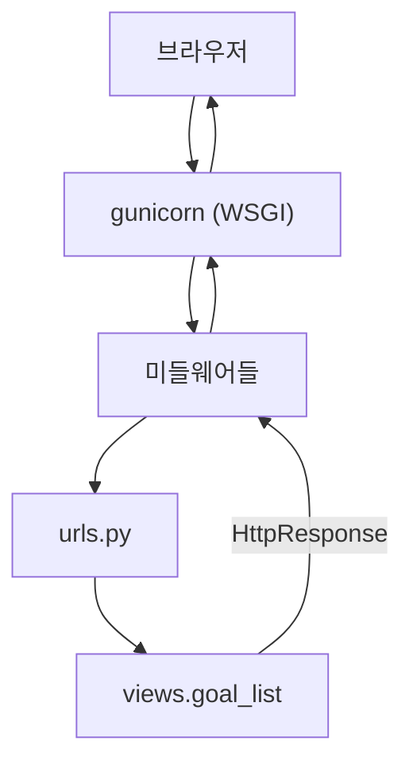

# Day 11 · 요청 생명주기·settings 정리

> 읽는 시간: 약 13분

## 복습 3문제

**1.** (Day 10) `DEBUG = bool(os.environ.get("DEBUG"))`로 쓰고 환경변수에 `DEBUG=False`를 넣으면 DEBUG는?

<details>
<summary>정답</summary>

`True`가 됩니다. 환경변수는 언제나 **문자열**이고, `"False"`도 비어 있지 않은 문자열이라 `bool("False")`는 `True`입니다. 그래서 `os.environ.get("DEBUG") == "1"`처럼 **값을 비교**해야 합니다.

</details>

**2.** (Day 9) `@login_required`가 손님을 로그인 화면으로 보낼 때 주소 뒤에 붙이는 `?next=...`는 무슨 역할인가요?

<details>
<summary>정답</summary>

로그인에 성공한 뒤 **원래 가려던 주소로 돌려보내기** 위한 표시입니다. `/7/edit/`에서 튕겼다면 로그인 후 다시 `/7/edit/`으로 갑니다.

</details>

**3.** (Day 10) Django 앱이 HTTP 소켓을 직접 열지 않는다면, 누가 열고 Django에는 무엇을 넘기나요?

<details>
<summary>정답</summary>

`gunicorn` 같은 **WSGI 서버**가 소켓을 열고 HTTP를 해석합니다. 그다음 요청 정보를 담은 딕셔너리(`environ`)를 Django의 WSGI 앱 함수에 넘기고, 돌려받은 응답을 브라우저로 보냅니다.

</details>

---

## 오늘 만들 것

Goals 앱에 **요청마다 걸린 시간을 찍는 작은 미들웨어**를 붙이고, 한 파일이던 `settings.py`를 **개발용·운영용**으로 나눕니다.

## 오늘 배울 것

- 요청 하나가 Django 안에서 지나가는 길 (생명주기)
- 미들웨어: 모든 요청을 감싸는 양파 껍질
- settings 나누기: `base` / `dev` / `prod`

---

## 1. 요청 하나의 여행

지금까지는 "URL을 치면 뷰가 실행된다"로 충분했습니다. 하지만 에러가 났을 때 **어디서** 났는지 알려면 그 사이의 길을 알아야 합니다. 면접에서도 "Django에서 요청이 처리되는 과정을 설명해 보세요"는 단골 질문입니다.

Express를 떠올려 보세요. 요청이 `app.use()`로 등록한 미들웨어를 차례로 지나고, 라우터가 맞는 핸들러를 찾고, `res.send()`로 끝납니다. Django도 **뼈대는 똑같습니다**. 이름만 다를 뿐이에요.

**결과를 맞혀 보세요:** 브라우저가 `GET /`을 보냈습니다. 아래 다섯 단계를 실제 순서대로 놓으면?

`(가) 뷰 실행` · `(나) 미들웨어 통과` · `(다) gunicorn이 받음` · `(라) urls.py에서 뷰 찾기` · `(마) 응답이 미들웨어를 거꾸로 통과`

<details>
<summary>정답</summary>

**다 → 나 → 라 → 가 → 마** 입니다. 서버가 받고(gunicorn), 미들웨어를 위에서 아래로 통과하고, URL로 뷰를 고르고, 뷰가 응답을 만들면, 그 응답이 미들웨어를 **아래에서 위로** 다시 지나 나갑니다.

</details>

**JS (Node, Express)**

```javascript
app.use(helmet());
app.use(session({ /* ... */ }));
app.get("/", (req, res) => {
  res.send("goals");
});
app.listen(3000);
```

**Python (Django)** · 개념 순서

```python
# 1. gunicorn → config.wsgi.application
# 2. settings.MIDDLEWARE 위→아래
# 3. ROOT_URLCONF(config.urls)에서 매칭
# 4. 뷰 함수(request) → HttpResponse
# 5. MIDDLEWARE 아래→위로 응답 통과
```

차이는 하나입니다. Express는 미들웨어를 **코드로** 등록하고, Django는 `settings.py`의 `MIDDLEWARE` **목록 순서**로 정합니다.




**비유:** 공항 출국과 같습니다. 체크인(gunicorn) → 보안 검색대 여러 개(미들웨어) → 탑승구 안내판(urls.py) → 비행기(뷰). 돌아올 때는 검색대를 **거꾸로** 지나 입국합니다.

이 흐름을 순수 Python으로 줄여 보면 이렇습니다.

```python-run
def view(path):
    return f"200 OK: {path}"

routes = {"/": view}

def handle(path):
    v = routes.get(path)
    return v(path) if v else "404"

print(handle("/"))
print(handle("/nope"))
```

> 💡 요청은 서버 → 미들웨어 → URL → 뷰, 응답은 그 길을 **거꾸로**. Express와 뼈대가 같다.

<details>
<summary>🔍 더 깊이 (면접용): 브라우저에서 Django까지, HTTP·TCP</summary>

Django에 닿기 전에도 일이 많습니다.

1. **DNS**: `goals.example.com` → IP 주소를 찾습니다.
2. **TCP 3-way handshake**: SYN → SYN-ACK → ACK로 연결을 엽니다. 신뢰성(순서·재전송)을 TCP가 맡습니다.
3. **TLS handshake**(HTTPS): 인증서 확인, 암호화 키 합의.
4. **HTTP 요청**: `GET / HTTP/1.1`, `Host:` 헤더, `Cookie:` 헤더가 텍스트로 갑니다.
5. 리버스 프록시(nginx·Render의 앞단)가 TLS를 풀고 gunicorn에 넘깁니다.

gunicorn은 HTTP를 해석해 `environ` 딕셔너리를 만들고 `application(environ, start_response)`를 호출합니다. Django의 `WSGIHandler`가 이것을 `HttpRequest` 객체로 바꾸고, `request_started` 시그널을 보낸 뒤 미들웨어 체인을 실행합니다.

URL 매칭은 `ROOT_URLCONF`의 `urlpatterns`를 **위에서부터** 보고 처음 맞는 것을 고릅니다. 하나도 안 맞으면 `Http404`가 나고, 그것도 미들웨어를 거쳐 404 응답이 됩니다.

HTTP/1.1은 keep-alive로 연결 하나를 재사용하고, HTTP/2는 한 연결에서 여러 요청을 동시에(멀티플렉싱) 보냅니다.

</details>

---

## 2. 미들웨어: 모든 요청을 감싸는 껍질

로그인 확인, 세션 읽기, CSRF 검사. 이런 일은 **모든 요청**에 필요합니다. 뷰마다 복붙하면 언젠가 빠뜨립니다. 그래서 요청이 뷰에 닿기 **전과 후**에 끼어드는 층을 둡니다. 이것이 미들웨어입니다.

Day 9의 `request.user`가 어디서 왔는지 기억나세요? 우리가 넣은 적이 없죠. `MIDDLEWARE`에 이미 있는 `AuthenticationMiddleware`가 넣어 준 것입니다.

**결과를 맞혀 보세요:** 미들웨어 A, B가 이 순서로 등록됐습니다. 각각 "요청 전"과 "응답 후"에 이름을 찍으면 출력 순서는?

<details>
<summary>정답</summary>

`A 전 → B 전 → (뷰) → B 후 → A 후` 입니다. 양파처럼 **먼저 들어간 껍질이 나중에 나옵니다**. 아래 실행 코드로 확인해 보세요.

</details>

```python-run
def mw(name, nxt):
    def handler(req):
        print(name, "전")
        res = nxt(req)
        print(name, "후")
        return res
    return handler

app = mw("A", mw("B", lambda r: "뷰"))
print(app("GET /"))
```

Day 3의 **클로저**(바깥 변수를 기억하는 함수)가 그대로 쓰였습니다. Django 미들웨어도 정확히 이 모양입니다. 이제 Goals 앱에 진짜로 하나 붙여 봅시다.

**JS (Node, Express)**

```javascript
app.use((req, res, next) => {
  const t = Date.now();
  res.on("finish", () =>
    console.log(req.path, Date.now() - t));
  next();
});
```

**Python (Django)** · 로컬 `goals/middleware.py`

```python
import time

class TimingMiddleware:
    def __init__(self, get_response):
        self.get_response = get_response

    def __call__(self, request):
        t = time.perf_counter()
        response = self.get_response(request)
```

```python
        # __call__ 이어서
        ms = (time.perf_counter() - t) * 1000
        print(request.path, f"{ms:.1f}ms")
        response["X-Time-ms"] = f"{ms:.1f}"
        return response
```

`__init__`은 서버가 켜질 때 **한 번**, `__call__`은 **요청마다** 실행됩니다. `get_response`가 Express의 `next()`입니다. 다만 Django는 그 결과(응답)를 **돌려받아서** 손볼 수 있습니다.

`config/settings.py`의 `MIDDLEWARE` 맨 아래에 한 줄 추가합니다.

```python
MIDDLEWARE = [
    # ... 기존 항목 그대로
    "goals.middleware.TimingMiddleware",
]
```

`runserver`를 켜고 목록을 새로고침하면 터미널에 `/ 12.3ms` 같은 줄이 찍힙니다. 개발자 도구의 응답 헤더에도 `X-Time-ms`가 보입니다.

> 💡 미들웨어 = 모든 요청을 감싸는 함수. **목록 순서가 곧 실행 순서**이고, 응답은 거꾸로 나온다.

<details>
<summary>🔍 더 깊이 (면접용): 순서가 중요한 이유</summary>

기본 `MIDDLEWARE`는 순서에 의존합니다.

- `SessionMiddleware`가 `AuthenticationMiddleware`보다 **위**여야 합니다. 세션을 먼저 읽어야 그 안의 user id로 User를 찾을 수 있습니다.
- `SecurityMiddleware`는 거의 맨 위: HTTPS 리다이렉트 같은 일은 일찍 끝내는 게 좋습니다.
- `CsrfViewMiddleware`는 뷰 실행 직전(`process_view`)에 토큰을 검사합니다.

미들웨어가 뷰를 부르지 않고 **바로 응답을 return**하면, 그 아래 미들웨어와 뷰는 실행되지 않습니다 (단락, short-circuit). 점검 모드나 IP 차단을 이렇게 만듭니다.

미들웨어는 **모든** 요청에 비용이 붙습니다. 무거운 DB 조회를 넣으면 정적 파일 요청까지 느려집니다. 특정 뷰에만 필요하면 데코레이터가 낫습니다. 미들웨어는 Week 4에 더 다룹니다.

</details>

---

## 3. settings 나누기: dev와 prod

Day 10에서 환경변수로 `DEBUG`를 바꿨습니다. 그런데 운영과 개발은 DEBUG 말고도 다릅니다. DB, 로그, 보안 쿠키, 설치 앱(디버그 툴바)까지요. `if DEBUG:`가 파일 곳곳에 생기면 읽기 힘들어집니다.

그래서 **공통은 한 파일, 차이는 각자 파일**로 나눕니다. Node에서 `config/default.js` + `config/production.js`를 두는 것과 같은 생각입니다.

**결과를 맞혀 보세요:** settings 파일은 결국 평범한 Python 모듈입니다. `dev.py`에서 `from .base import *` 후 `DEBUG = True`를 쓰면, `base.py`의 `DEBUG = False`는 어떻게 될까요?

<details>
<summary>정답</summary>

**덮어써져서 `True`가 됩니다.** `import *`로 base의 이름들을 모두 가져온 뒤, 같은 이름에 새 값을 대입했기 때문입니다. settings 나누기는 이 **"가져오고 덮어쓰기"** 하나로 동작합니다.

</details>

```text
config/
  settings/
    __init__.py
    base.py
    dev.py
    prod.py
```

기존 `settings.py`를 `settings/base.py`로 옮기고, 경로 하나만 고칩니다. 파일이 한 층 깊어졌으니 `parent`가 하나 더 필요합니다.

```python
# config/settings/base.py
BASE_DIR = (Path(__file__)
            .resolve().parent.parent.parent)
DEBUG = False
```

```python
# config/settings/dev.py
from .base import *

DEBUG = True
ALLOWED_HOSTS = ["127.0.0.1", "localhost"]
```

```python
# config/settings/prod.py
from .base import *

ALLOWED_HOSTS = os.environ[
    "ALLOWED_HOSTS"].split(",")
SESSION_COOKIE_SECURE = True
```

어떤 파일을 쓸지는 **환경변수 하나**가 정합니다.

```bash
# 개발
export DJANGO_SETTINGS_MODULE=\
  config.settings.dev
python manage.py runserver
# 운영 (Render 환경변수에 등록)
# DJANGO_SETTINGS_MODULE=config.settings.prod
```

`manage.py`와 `wsgi.py` 안의 기본값도 각각 `config.settings.dev`, `config.settings.prod`로 바꿔 두면 매번 export하지 않아도 됩니다.

**비유:** 기본 레시피(base) 한 장에 "캠핑용: 불을 약하게"(dev), "손님용: 소금 줄이기"(prod) 메모를 붙이는 것입니다. 레시피를 두 벌 베끼지 않아요.

덮어쓰기가 어떻게 되는지 딕셔너리로 확인해 보세요.

```python-run
base = {"DEBUG": False, "DB": "sqlite"}
dev = {**base, "DEBUG": True}
prod = {**base, "DB": "postgres"}
print("dev :", dev)
print("prod:", prod)
```

> 💡 settings는 그냥 Python 모듈. `base` + `import *` + 덮어쓰기, 고르는 건 `DJANGO_SETTINGS_MODULE`.

<details>
<summary>🔍 더 깊이 (면접용): settings는 언제, 어떻게 읽히나</summary>

`django.conf.settings`는 **지연 로딩**(lazy) 객체입니다. 처음 `settings.DEBUG` 같은 속성을 읽는 순간 `DJANGO_SETTINGS_MODULE`이 가리키는 모듈을 import하고, **대문자 이름만** 설정으로 가져옵니다. 소문자 변수는 무시됩니다.

settings는 프로세스 시작 때 한 번 읽히고 **실행 중 바꾸지 않는** 것이 원칙입니다. 런타임에 바꾸면 워커마다 값이 달라집니다. 테스트에서만 `override_settings`로 잠깐 바꿉니다 (Week 7).

`import *`가 싫다면 대안도 있습니다. `django-environ`으로 `.env` 파일 하나에서 값을 읽거나, 파일은 하나로 두고 모든 차이를 환경변수로만 표현하는 방식(12-Factor App의 "설정은 환경에")입니다. 팀 규칙에 맞추면 됩니다.

`python manage.py diffsettings`는 기본값과 다른 설정만 보여 줘서, 지금 어떤 파일이 적용됐는지 확인할 때 유용합니다.

</details>

---

## 연습문제

### 문제 1. 느린 요청만 경고하기

`TimingMiddleware`를 고쳐서 200ms를 넘는 요청만 `"[느림]"`을 붙여 찍게 하세요.

<details>
<summary>정답 보기</summary>

```python
def __call__(self, request):
    t = time.perf_counter()
    response = self.get_response(request)
    ms = (time.perf_counter() - t) * 1000
    if ms > 200:
        print("[느림]", request.path,
              f"{ms:.1f}ms")
    return response
```

뷰 실행(`get_response`) **앞뒤**의 시간 차이를 재는 것이 핵심입니다. 실무에선 `print` 대신 `logging`을 쓰고(Week 8), 기준값은 settings에 `SLOW_MS = 200`처럼 두어 환경마다 바꿀 수 있게 합니다.

</details>

### 문제 2. 점검 중 화면

settings에 `MAINTENANCE = True`이면 **뷰를 부르지 않고** 503 응답을 돌려주는 미들웨어를 만드세요.

<details>
<summary>정답 보기</summary>

```python
from django.conf import settings
from django.http import HttpResponse

class MaintenanceMiddleware:
    def __init__(self, get_response):
        self.get_response = get_response

    def __call__(self, request):
        if getattr(settings,
                   "MAINTENANCE", False):
            return HttpResponse(
                "점검 중입니다", status=503)
        return self.get_response(request)
```

`get_response`를 부르지 않고 바로 `return`하면 그 아래 미들웨어와 뷰는 **실행되지 않습니다**(단락). `getattr(..., False)`로 설정이 없을 때도 안전하게 합니다. 503(Service Unavailable)은 "잠시 쓸 수 없음"을 뜻하는 상태 코드입니다. 이 미들웨어는 `MIDDLEWARE` 위쪽에 둘수록 일찍 막습니다.

</details>

### 문제 3. 출력 맞히기

```python-run
base = {"DEBUG": False, "HOSTS": []}
dev = {**base, "DEBUG": True}
dev["HOSTS"].append("localhost")
print(base["HOSTS"], dev["DEBUG"])
```

<details>
<summary>정답 보기</summary>

```text
['localhost'] True
```

`{**base}`는 **얕은 복사**(Day 2)라서 리스트 `HOSTS`는 base와 dev가 **같은 객체**를 공유합니다. dev에 append했는데 base도 바뀌었죠. settings 파일에서도 `from .base import *` 후 `INSTALLED_APPS += [...]`를 하면 같은 일이 생길 수 있어, dev에서는 `INSTALLED_APPS = [*INSTALLED_APPS, "debug_toolbar"]`처럼 새 리스트를 만드는 편이 안전합니다.

</details>

---

## 면접 질문

<details>
<summary>Q1. Django에서 요청 하나가 처리되는 과정을 설명해 주세요.</summary>

- WSGI 서버(gunicorn)가 HTTP를 받아 `environ`으로 만들고 Django의 `application`을 호출합니다. `WSGIHandler`가 `HttpRequest`를 만듭니다.
- `settings.MIDDLEWARE` 순서대로 미들웨어를 통과합니다. 여기서 세션·`request.user`·CSRF 같은 공통 처리가 됩니다.
- `ROOT_URLCONF`의 `urlpatterns`를 위에서부터 매칭해 뷰를 고르고, 뷰가 ORM·템플릿으로 `HttpResponse`를 만듭니다. 매칭이 없으면 404입니다.
- 응답은 미들웨어를 **역순**으로 지나며 헤더 등이 붙고, WSGI 서버가 브라우저로 보냅니다.
- 덧붙이면 좋은 점: 미들웨어가 직접 응답을 반환하면 단락되고, 예외는 `process_exception`/에러 핸들러(404·500 뷰)로 처리됩니다.

</details>

<details>
<summary>Q2. 개발/운영 설정을 어떻게 분리하나요?</summary>

- `base.py`에 공통, `dev.py`·`prod.py`에서 `from .base import *` 후 다른 값만 덮어씁니다. 어떤 파일을 쓸지는 `DJANGO_SETTINGS_MODULE` 환경변수로 고릅니다.
- 비밀값(`SECRET_KEY`, DB 비밀번호)은 어느 파일에도 쓰지 않고 환경변수나 비밀 저장소에서 읽습니다.
- 기본값은 **안전한 쪽**으로: base의 `DEBUG = False`, 운영에서만 보안 쿠키·HTTPS 설정을 켭니다.
- 대안으로 파일 하나 + 환경변수(12-Factor, `django-environ`)도 있고, 배포 전 `manage.py check --deploy`로 점검합니다.

</details>

---

## 오늘 정리

1. 요청은 gunicorn → 미들웨어 → urls.py → 뷰, 응답은 미들웨어를 거꾸로 지나 나간다.
2. 미들웨어는 `get_response`를 감싸는 클래스. `MIDDLEWARE` 목록 순서가 실행 순서다.
3. settings는 `base` + `dev`/`prod`로 나누고, `DJANGO_SETTINGS_MODULE`로 고른다.

## 다음에 이어갈 것

Day 12: Goal에 **태그**(M2M)와 날짜별 **체크인**(FK)을 붙여 모델 관계를 배웁니다.
