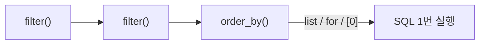

# Day 14 · ORM으로 통계: QuerySet·F/Q·annotate

> 읽는 시간: 약 13분

## 복습 3문제

**1.** (Day 13) 데이터 마이그레이션에서 `from goals.models import Goal` 대신 `apps.get_model("goals", "Goal")`을 쓰는 이유는?

<details>
<summary>정답</summary>

`apps.get_model`은 **그 마이그레이션 시점의 과거 모델**을 줍니다. 나중에 `models.py`에서 필드를 지워도, 처음부터 migrate할 때 깨지지 않습니다.

</details>

**2.** (Day 13) 같은 0004 뒤에 0005가 두 개 생겼습니다. `migrate`하면 어떻게 되고, 해결 명령은?

<details>
<summary>정답</summary>

잎 노드가 2개라 `Conflicting migrations`로 **멈춥니다.** 두 파일이 다른 필드를 건드리면 `python manage.py makemigrations --merge`로 합칩니다.

</details>

**3.** (Day 12) 목록에서 Goal 20개마다 `goal.done_total`(Python에서 체크인 합)을 부르면 쿼리가 몇 번 나가나요?

<details>
<summary>정답</summary>

**1 + 20 = 21번**입니다. 목록 1번, Goal마다 체크인 1번씩. 이것이 N+1 문제이고, 오늘 `annotate`로 **1번**으로 줄입니다.

</details>

---

## 오늘 만들 것

대시보드 위에 **통계 카드**를 붙입니다. "Goal별 누적 체크인", "달성한 Goal 수", "검색"을 모두 **DB가 계산**하게 만듭니다.

## 오늘 배울 것

- QuerySet은 게으르다: 언제 SQL이 나가는가
- `F`(열끼리 비교)와 `Q`(OR·NOT 조건)
- `aggregate`(전체 한 줄) vs `annotate`(행마다 한 칸)

---

## 1. QuerySet은 게으르다

`Goal.objects.filter(...)`를 쓰면 바로 DB에 가는 것 같지만, 아닙니다. QuerySet은 **"이런 SQL을 실행할 예정"이라는 메모**입니다. 실제로 값을 꺼낼 때 한 번 실행됩니다.

왜 중요할까요? 조건을 여러 줄에 나눠 붙여도 SQL은 **하나**로 합쳐집니다. 반대로, 모르고 같은 QuerySet을 여러 번 평가하면 쿼리가 여러 번 나갑니다.

**결과를 맞혀 보세요:** 아래 4줄 중 DB 쿼리는 몇 번 나갈까요?

```python
qs = Goal.objects.filter(owner=me)
qs = qs.filter(target__gte=10)
qs = qs.order_by("-id")
print(qs[0])
```

<details>
<summary>정답</summary>

**1번**입니다. 1~3줄은 메모만 쌓습니다. 4줄에서 `qs[0]`로 값을 꺼낼 때 `WHERE owner_id=… AND target>=10 ORDER BY id DESC LIMIT 1` 하나가 나갑니다.

</details>

**JS (Node, Knex)**

```javascript
// 쿼리 빌더도 await 전엔 안 나감
let q = knex("goal")
  .where("owner_id", me);
q = q.where("target", ">=", 10);
const rows = await q;
```

**Python (Django)**

```python
qs = Goal.objects.filter(owner=me)
qs = qs.filter(target__gte=10)
# 여기서 실행됨
rows = list(qs)
```

Knex는 `await`(정확히는 `.then`)할 때 실행됩니다. Django는 `for`, `list()`, `len()`, 슬라이스 `[0]`, `bool()`, 템플릿 반복 같은 **값이 필요한 순간**에 실행됩니다.

**비유:** 장바구니에 담기만 하면 결제가 안 됩니다. "결제하기"를 누를 때 한 번에 계산되죠. 그 결제 버튼이 `list(qs)`입니다.



게으름을 순수 Python 제너레이터로 흉내 내 보세요 (Day 6 복습).

```python-run
def query():
    print("SQL 실행!")
    yield from [1, 2, 3]
qs = query()
print("아직 안 나감")
print(list(qs))
```

> 💡 QuerySet은 메모. 값을 꺼내는 순간 SQL 1번. 체이닝은 공짜.

<details>
<summary>🔍 더 깊이 (면접용): 결과 캐시와 흔한 실수</summary>

QuerySet을 한 번 평가하면 결과가 `_result_cache`에 저장됩니다. 같은 `qs`로 다시 `for`를 돌면 **쿼리가 안 나갑니다.** 하지만 `qs.filter(...)`처럼 새 QuerySet을 만들면 캐시가 없으니 다시 나갑니다.

- `if qs:` → 전체 행을 다 가져와 평가합니다. 존재만 궁금하면 `qs.exists()`.
- `len(qs)` → 전체를 가져옵니다. 개수만 필요하면 `qs.count()` (`SELECT COUNT(*)`).
- 단, 어차피 곧 전부 쓸 거라면 `len(qs)` 후 반복이 쿼리 1번이라 더 낫습니다.
- `qs[0]`은 매번 `LIMIT 1` 쿼리입니다. 캐시된 뒤라면 캐시에서 꺼냅니다.

수만 행을 순회할 땐 `qs.iterator()`로 캐시 없이 조금씩 받아 메모리를 아낍니다.

</details>

---

## 2. F와 Q: 조건을 DB에게 맡기기

지금까지 `filter(target__gte=10)`처럼 **열과 고정값**만 비교했습니다. 그런데 "목표보다 많이 한 Goal"은 **열과 열**을 비교해야 합니다. 또 `filter(a, b)`는 항상 AND인데, "독서 **또는** 습관 태그"처럼 OR가 필요할 때도 있습니다.

- `F("열")`: "이 행의 그 열 값"을 가리키는 표시. 열끼리 비교·계산.
- `Q(조건)`: 조건 하나를 상자에 담은 것. `|`(OR), `&`(AND), `~`(NOT)으로 조합.

**결과를 맞혀 보세요:** Goal에 `streak`(연속 일수) 필드가 있다고 해 봅시다. 체크인 버튼을 두 사람이 **동시에** 누릅니다. 아래 코드로 `streak`를 올리면 어떤 일이 생길 수 있을까요?

```python
g = Goal.objects.get(pk=1)
g.streak = g.streak + 1
g.save()
```

<details>
<summary>정답</summary>

**1만 오를 수 있습니다** (두 번 눌렀는데). 둘 다 `streak=5`를 읽고, 둘 다 6을 저장하기 때문입니다. 이를 **경쟁 조건**(race condition, 동시에 읽고 쓰다 값이 덮이는 문제)이라고 합니다. 해결은 아래 `F`입니다.

</details>

`F`를 쓰면 Python이 값을 읽지 않고, DB가 **그 자리에서** 더합니다.

```python
from django.db.models import F
Goal.objects.filter(pk=1).update(
    streak=F("streak") + 1)
# SQL: SET streak = streak + 1
```

이제 `Q`로 검색창을 만듭니다. 제목에 글자가 있거나, 그 태그가 붙은 Goal입니다.

**JS (Node, Knex)**

```javascript
knex("goal")
  .where("title", "ilike", `%${w}%`)
  .orWhere("tag", w);
```

**Python (Django)**

```python
from django.db.models import Q
Goal.objects.filter(
    Q(title__icontains=w)
    | Q(tags__name=w)
).distinct()
```

`tags__name`은 M2M을 JOIN하므로, 태그 두 개가 맞으면 같은 Goal이 두 번 나올 수 있습니다. 그래서 `.distinct()`를 붙입니다.

**비유:** `F`는 "그 칸에 적힌 숫자 그대로"라는 화살표, `Q`는 조건을 적은 카드입니다. 카드를 `|`, `&`로 묶어 한 장으로 만들어 DB에 넘깁니다.

`Q`의 조합을 순수 Python 함수로 흉내 내 보세요.

```python-run
goals = [{"t": "독서", "tags": []},
         {"t": "걷기", "tags": ["독서"]},
         {"t": "코딩", "tags": []}]
w = "독서"
hit = [g["t"] for g in goals
       if w in g["t"] or w in g["tags"]]
print(hit)
```

> 💡 열끼리·동시성 안전 계산은 `F`, OR·NOT은 `Q`. 둘 다 SQL로 번역돼 DB에서 돈다.

<details>
<summary>🔍 더 깊이 (면접용): F의 함정과 Q 우선순위</summary>

- `update(streak=F("streak")+1)`은 원자적(atomic, 쪼개지지 않음)입니다. 하지만 `g.streak = F("streak")+1; g.save()` 후 메모리의 `g.streak`은 숫자가 아니라 **표현식**입니다. 값을 보려면 `g.refresh_from_db()`.
- `save()`를 두 번 부르면 `+1`이 **두 번** 적용됩니다.
- `filter(Q(...), title="x")`처럼 Q와 키워드를 섞으면 **Q가 앞**에 와야 합니다 (위치 인자 규칙).
- `~Q(tags__name="습관")`은 M2M에서 "습관 태그가 하나도 없는 Goal"이 됩니다. Django가 서브쿼리로 바꿔 줍니다.
- 진짜 동시성 제어(읽고 판단한 뒤 쓰기)는 `select_for_update()` + 트랜잭션이 필요합니다 (Week 6).

</details>

---

## 3. aggregate vs annotate: 통계를 DB가 계산

Day 12의 `done_total`은 Python에서 `sum()`을 돌렸습니다. Goal 20개면 쿼리 21번이었죠. DB는 원래 더하기·세기를 아주 잘합니다. `GROUP BY`라는 SQL로요.

Django에는 두 가지가 있습니다.

| 메서드 | 결과 | SQL |
|---|---|---|
| `aggregate` | dict 한 개 | 전체 집계 |
| `annotate` | 행마다 새 칸 | GROUP BY |


**결과를 맞혀 보세요:** 둘의 반환 타입은 무엇일까요?

```python
a = CheckIn.objects.aggregate(
    s=Sum("amount"))
b = Goal.objects.annotate(
    s=Sum("checkins__amount"))
```

<details>
<summary>정답</summary>

- `a`는 **dict**: `{"s": 57}`. 체크인 전체를 더한 한 줄입니다.
- `b`는 **QuerySet**: Goal마다 `.s` 속성이 붙어 있습니다. `b[0].s`처럼 씁니다.

</details>

대시보드 뷰를 바꿔 봅시다. 체크인이 없으면 `Sum`은 `None`이므로 `Coalesce`로 0을 채웁니다.

```python
from django.db.models import Sum
from django.db.models.functions \
    import Coalesce
goals = Goal.objects.filter(
    owner=request.user).annotate(
    done=Coalesce(
        Sum("checkins__amount"), 0))
```

이제 템플릿의 `{{ goal.done }}`은 **이미 계산된 숫자**입니다. 쿼리는 1번입니다. 여기에 `F`를 붙이면 "달성한 Goal 수"도 DB가 셉니다.

```python
from django.db.models import Count, Q
stats = goals.aggregate(
    total=Count("id"),
    cleared=Count("id", filter=Q(
        done__gte=F("target"))))
# {"total": 5, "cleared": 2}
```

**JS (Node, Knex)**

```javascript
knex("goal as g")
  .leftJoin("checkin as c",
    "c.goal_id", "g.id")
  .groupBy("g.id")
  .select("g.*")
  .sum({ done: "c.amount" });
```

**비유:** `aggregate`는 반 전체 평균 점수 하나, `annotate`는 학생마다 성적표에 "평균" 칸을 하나 더 채워 주는 것입니다.

GROUP BY를 순수 Python으로 풀면 이렇습니다.

```python-run
cks = [(1, 2), (1, 3), (2, 5)]
done = {}
for gid, amt in cks:
    done[gid] = done.get(gid, 0) + amt
print(done)
print(sum(done.values()))
```

마지막 줄이 `aggregate`, `done` dict가 `annotate`입니다.

> 💡 전체 한 줄은 `aggregate`(dict), 행마다 한 칸은 `annotate`(QuerySet). `None`은 `Coalesce`로.

<details>
<summary>🔍 더 깊이 (면접용): annotate 두 개가 숫자를 부풀린다</summary>

`annotate(done=Sum("checkins__amount"), n_tags=Count("tags"))`처럼 **서로 다른 다대(多) 관계 두 개**를 한 번에 집계하면 JOIN이 곱해집니다. 체크인 3개 × 태그 2개 = 6행이 되어 `done`이 **2배**로 부풀어요.

- `Count`는 `Count("tags", distinct=True)`로 막을 수 있습니다.
- `Sum`은 distinct로 못 막습니다(같은 금액이 두 번이면 틀림). 이때는 `Subquery`로 체크인 합을 따로 계산해 붙입니다.
- `values("tag").annotate(...)`처럼 `annotate` **앞의** `values()`는 GROUP BY 기준을 바꿉니다. 순서가 의미를 바꾸니 주의하세요.
- 쿼리를 확인하려면 `print(qs.query)` 또는 `django-debug-toolbar`를 씁니다.

</details>

---

## 연습문제

### 문제 1. 이번 주 체크인 합

로그인한 사용자의 **최근 7일** 체크인 `amount` 합을 숫자 하나로 구하세요. 없으면 0.

<details>
<summary>정답 보기</summary>

```python
from datetime import date, timedelta
week = date.today() - timedelta(days=7)
s = CheckIn.objects.filter(
    goal__owner=request.user,
    day__gte=week).aggregate(
    s=Coalesce(Sum("amount"), 0))["s"]
```

전체 한 줄이 필요하니 `aggregate`입니다. 결과가 dict라서 `["s"]`로 꺼냅니다. `goal__owner`는 FK를 따라가는 JOIN이고, `Coalesce`가 체크인이 없을 때의 `None`을 0으로 바꿉니다.

</details>

### 문제 2. 뒤처진 Goal

누적 `done`이 `target`의 **절반 미만**인 Goal만 보여 주세요. (`annotate`한 `done` 사용)

<details>
<summary>정답 보기</summary>

```python
behind = Goal.objects.annotate(
    done=Coalesce(
        Sum("checkins__amount"), 0)
).filter(done__lt=F("target") / 2)
```

`annotate`로 만든 칸도 `filter`에 쓸 수 있습니다. 이때 SQL은 `WHERE`가 아니라 **`HAVING`**(그룹을 만든 뒤 거르는 조건)이 됩니다. 정수 열이면 `/ 2`가 DB에서 정수 나눗셈(예: 7/2=3)이 될 수 있습니다. 걱정되면 `annotate(d2=F("done") * 2).filter(d2__lt=F("target"))`처럼 양쪽에 2를 곱해 비교합니다.

</details>

### 문제 3. Python으로 HAVING 흉내

체크인 목록에서 합이 5 이상인 Goal id만 출력하세요.

```python-run
cks = [(1, 2), (1, 3), (2, 1), (3, 6)]
# 여기에 작성
```

<details>
<summary>정답 보기</summary>

```python-run
cks = [(1, 2), (1, 3), (2, 1), (3, 6)]
done = {}
for gid, amt in cks:
    done[gid] = done.get(gid, 0) + amt
hit = [g for g, s in done.items()
       if s >= 5]
print(hit)
# 출력: [1, 3]
```

먼저 묶어서 더하고(GROUP BY), 그다음에 거릅니다(HAVING). 순서가 반대면 개별 체크인 금액으로 거르게 되어 틀립니다. Django에선 `annotate(...).filter(done__gte=5)`가 정확히 이 순서입니다.

</details>

---

## 면접 질문

<details>
<summary>Q1. QuerySet이 lazy하다는 게 무슨 뜻이고, 실무에서 어떤 점을 조심하나요?</summary>

- `filter`·`exclude`·`order_by`는 SQL을 만들 **계획**만 쌓고, 반복·`list()`·슬라이스·`len()`·`bool()` 시점에 한 번 실행됩니다.
- 장점: 조건을 나눠 조립해도 쿼리는 1번. 필요 없는 쿼리는 아예 안 나감.
- 조심: 템플릿 반복 안에서 관계(`goal.checkins.all`)에 접근하면 N+1. `annotate`·`prefetch_related`로 해결합니다.
- 존재 확인은 `exists()`, 개수는 `count()`. 평가된 QuerySet은 캐시되지만, 새로 `filter`하면 다시 쿼리합니다.

</details>

<details>
<summary>Q2. F 표현식은 왜 쓰나요? aggregate와 annotate의 차이는?</summary>

- `F`: 행의 열 값을 SQL 안에서 참조합니다. 열끼리 비교(`done__gte=F("target")`), 그리고 `update(x=F("x")+1)`처럼 **읽지 않고 DB에서 증가**시켜 경쟁 조건을 막습니다.
- `aggregate`: QuerySet 전체를 하나로 집계해 **dict**를 반환합니다.
- `annotate`: 행(그룹)마다 집계 값을 붙여 **QuerySet**을 반환하며 SQL은 `GROUP BY`. 그 값으로 거르면 `HAVING`이 됩니다.
- 주의: 다대 관계 여러 개를 함께 annotate하면 JOIN 곱으로 값이 부풀어, `distinct=True`나 `Subquery`가 필요합니다.

</details>

---

## 오늘 정리

1. QuerySet은 메모다. 값을 꺼내는 순간 SQL 1번, 체이닝은 공짜.
2. `F`는 열 참조(열끼리 비교·안전한 증가), `Q`는 OR·NOT 조합.
3. `aggregate`는 dict 한 개, `annotate`는 행마다 한 칸(GROUP BY). `done_total`의 N+1이 사라졌다.

## 다음에 이어갈 것

Day 15: 뷰가 늘어나 `views.py`가 복잡해졌습니다. URL 설계와 FBV vs CBV, `ListView`·`CreateView` 같은 제네릭 뷰로 Goals 화면을 정리합니다.
