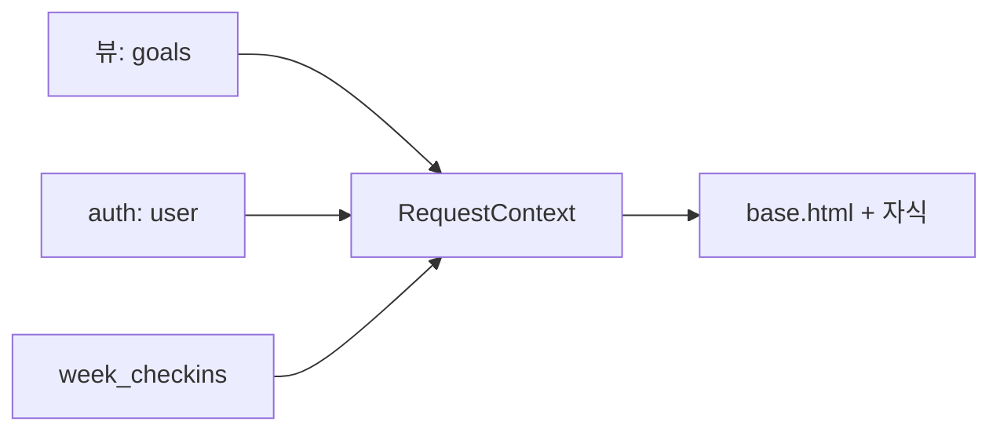

# Day 16 · 템플릿 심화: 커스텀 필터·태그와 컨텍스트 프로세서

> 읽는 시간: 약 13분

## 복습 3문제

**1.** (Day 15) `CreateView`의 `success_url`에 `reverse` 대신 `reverse_lazy`를 쓰는 이유는?

<details>
<summary>정답</summary>

클래스 속성은 **파이썬이 파일을 읽는 순간**(import 시점) 계산됩니다. 그때는 URL 설정이 아직 다 안 올라와 있을 수 있어 `reverse`가 실패합니다. `reverse_lazy`는 "나중에, 실제로 쓸 때 계산"하므로 안전합니다.

</details>

**2.** (Day 15) `ListView`에서 "내 Goal만" 보이게 하려면 어디를 고치나요?

<details>
<summary>정답</summary>

`get_queryset()`을 오버라이드해 `Goal.objects.filter(owner=self.request.user)`를 돌려줍니다. 그리고 `LoginRequiredMixin`을 **가장 왼쪽**에 둡니다.

</details>

**3.** (Day 12) `related_name="checkins"`를 붙였다면, Goal `g`의 체크인 개수는 어떻게 구하나요?

<details>
<summary>정답</summary>

`g.checkins.count()`. `related_name`이 "거꾸로 찾아가는 이름"을 정합니다. `count()`는 행을 다 가져오지 않고 DB에서 `COUNT(*)`만 합니다.

</details>

---

## 오늘 만들 것

Goals 앱 **모든 페이지 헤더**에 "이번 주 체크인 N회"를 띄우고, 목록의 진행률 바를 **재사용 부품** ``으로 바꿉니다.

## 오늘 배울 것

- 커스텀 필터: 템플릿 안에서 쓰는 작은 함수
- 인클루전 태그: 템플릿 조각을 부품처럼 쓰기
- 컨텍스트 프로세서: 모든 페이지에 같은 값 넣기

---

## 1. 커스텀 필터: 템플릿용 작은 함수

Day 8에서 진행률 `pct`를 **뷰에서** 계산해 넘겼습니다. 그런데 페이지가 늘면 뷰마다 같은 계산을 반복하게 됩니다. 템플릿 언어는 일부러 기능이 적어서, 템플릿 안에서 `done * 100 / target` 같은 계산을 못 합니다.

이럴 때 **필터**(filter, `{{ 값|이름 }}` 꼴로 값을 바꾸는 함수)를 직접 만듭니다. `{{ title|upper }}`의 `upper`가 내장 필터입니다. 우리도 `pct` 필터를 만들 수 있습니다.

**결과를 맞혀 보세요:** 아래 필터에 `done=12, target=10`을 넣으면? `target=0`이면?

```python-run
def pct(done, target):
    if not target:
        return 0
    r = round(done * 100 / target)
    return min(100, r)

print(pct(12, 10))
print(pct(3, 0))
```

<details>
<summary>정답</summary>

`100`과 `0`이 나옵니다. 목표를 넘겨도 바가 100%를 넘지 않게 `min`으로 자르고, 목표가 0이면 0으로 나누기 에러(`ZeroDivisionError`) 대신 0을 돌려줍니다. **템플릿에서 에러가 나면 페이지 전체가 500**이 되므로, 필터는 이렇게 방어적으로 씁니다.

</details>

Django에 등록하려면 정해진 자리에 파일을 둡니다. 앱 안에 `templatetags` 폴더와 빈 `__init__.py`가 꼭 있어야 합니다.

```bash
goals/templatetags/__init__.py
goals/templatetags/goal_extras.py
```

**Python (Django)** · 로컬 `goal_extras.py`

```python
from django import template

register = template.Library()

@register.filter
def pct(done, target):
    if not target:
        return 0
    r = round(done * 100 / target)
    return min(100, r)
```

템플릿에서는 `load`로 불러와 씁니다. 필터 인자는 콜론(`:`) 뒤에 하나만 줄 수 있습니다.

```python

{{ g.done|pct:g.target }}%
```

**JS (Node)** · EJS라면 헬퍼 함수를 `locals`에 넣어 부릅니다.

```javascript
app.locals.pct = (d, t) =>
  t ? Math.min(100, Math.round(d * 100 / t))
    : 0;
// 템플릿: <%= pct(g.done, g.target) %>
```

**비유:** 필터는 **주방의 채칼**입니다. 재료(값)를 넣으면 모양만 바꿔 내놓고, 요리 순서(뷰 로직)에는 끼어들지 않습니다.

> 💡 필터 = 값 하나를 받아 바꿔 주는 순수 함수. 에러 없이 기본값을 돌려주게 쓴다. 새 `templatetags` 파일은 **서버 재시작** 후에 인식된다.

---

## 2. 인클루전 태그: 진행률 바를 부품으로

진행률 바 HTML은 목록·상세·대시보드 세 곳에 똑같이 나옵니다. 복붙하면 색을 바꿀 때 세 군데를 고쳐야 합니다. Day 8의 ``도 방법이지만, 넘길 값을 매번 손으로 맞춰야 합니다.

**인클루전 태그**(inclusion tag)는 "값을 받아 계산한 뒤, 작은 템플릿을 그려 주는 함수"입니다. React 컴포넌트와 거의 같은 생각입니다.

**결과를 맞혀 보세요:** ``를 쓰면, 아래 함수가 돌려준 dict는 어디로 가나요?

```python
@register.inclusion_tag("goals/_bar.html")
def progress_bar(goal):
    p = pct(goal.done, goal.target)
    return {"title": goal.title, "p": p}
```

<details>
<summary>정답</summary>

`goals/_bar.html` **전용 컨텍스트**가 됩니다. 그 작은 템플릿은 `title`과 `p`만 볼 수 있고, 바깥 페이지의 변수(`request` 등)는 기본적으로 못 봅니다. 그래서 부품이 바깥에 덜 의존합니다.

</details>

**부품 템플릿** · `templates/goals/_bar.html`

```python
<div class="bar-row">
  <span>{{ title }}</span>
  <div class="bar">
    <i style="width: {{ p }}%"></i>
  </div>
  <b>{{ p }}%</b>
</div>
```

**쓰는 쪽** · `goal_list.html`

```python


  

```

**JS (React)** · 같은 일을 컴포넌트로 하면:

```javascript
function ProgressBar({ goal }) {
  const p = pct(goal.done, goal.target);
  return <Bar title={goal.title} p={p} />;
}
// 쓰기: <ProgressBar goal={g} />
```

| 도구 | 하는 일 | 비슷한 것 |
|---|---|---|
| 필터 | 값 → 값 | JS 헬퍼 |
| `simple_tag` | 인자 여럿 → 값 | 헬퍼 |
| 인클루전 태그 | 값 → HTML 조각 | React 컴포넌트 |

> 💡 같은 HTML이 두 곳 이상 나오면 인클루전 태그. 계산은 파이썬에, 모양은 작은 템플릿에 둔다.

<details>
<summary>🔍 더 깊이 (면접용): 필터에서 HTML을 직접 만들면 안 되는 이유</summary>

필터가 `"<b>" + value + "</b>"`를 돌려주면 autoescape 때문에 `&lt;b&gt;`로 화면에 글자가 그대로 나옵니다. 이를 피하려고 `mark_safe()`를 씌우면, `value`에 사용자 입력이 섞여 있을 때 **XSS**(남의 스크립트 실행)가 됩니다.

안전한 길은 두 가지입니다.

- HTML은 인클루전 태그의 템플릿에 두기 (자동 이스케이프 유지).
- 꼭 코드로 만들면 `format_html("<b>{}</b>", value)`. 인자만 이스케이프하고 틀은 안전하게 표시합니다.

`simple_tag`도 결과를 자동 이스케이프합니다. 반면 `mark_safe`는 "이 문자열은 내가 책임진다"는 선언입니다.

</details>

---

## 3. 컨텍스트 프로세서: 모든 페이지에 같은 값

헤더에 "이번 주 체크인 N회"를 띄우고 싶습니다. 헤더는 `base.html`에 있으니 **모든 페이지**에 필요합니다. 뷰마다 `context["week_checkins"] = ...`를 넣으면 한 곳만 빠뜨려도 헤더가 빈칸이 됩니다.

**컨텍스트 프로세서**(context processor)는 `request`를 받아 dict를 돌려주는 함수입니다. Django가 **모든 렌더링마다** 이 dict를 컨텍스트에 자동으로 합칩니다. 템플릿에서 `{{ user }}`가 그냥 되는 것도 `auth` 프로세서 덕분입니다.


**JS (Node)** · Express의 `res.locals` 미들웨어와 같습니다.

```javascript
app.use(async (req, res, next) => {
  res.locals.weekCheckins =
    await countWeek(req.user);
  next();
});
```

**결과를 맞혀 보세요:** 프로세서도 `title`을, 뷰도 `title`을 넘기면 템플릿의 `{{ title }}`은 누구 값일까요?

```python-run
def site(request):
    return {"title": "Goals", "ver": 1}

def render(view_ctx, procs, request=None):
    ctx = {}
    for p in procs:
        ctx.update(p(request))
    ctx.update(view_ctx)
    return ctx

print(render({"title": "목록"}, [site]))
```

<details>
<summary>정답</summary>

`{'title': '목록', 'ver': 1}`. **뷰 값이 이깁니다.** Django도 프로세서 결과를 아래층에, 뷰 컨텍스트를 그 위층에 쌓습니다. 그래서 프로세서 이름은 `week_checkins`처럼 겹치지 않게 짓습니다.

</details>

**Python (Django)** · 로컬 `goals/context_processors.py`

```python
from datetime import date, timedelta
from .models import CheckIn

def week_checkins(request):
    if not request.user.is_authenticated:
        return {}
    start = date.today() - timedelta(days=6)
```

```python
    n = CheckIn.objects.filter(
        goal__owner=request.user,
        day__gte=start,
    ).count()
    return {"week_checkins": n}
```

로그인 안 한 사용자는 `AnonymousUser`라서 `owner=` 조건에 넣으면 에러가 납니다. 그래서 맨 앞에서 빈 dict를 돌려줍니다. **로그인 페이지에서도 프로세서는 실행**된다는 점을 기억하세요.

**등록** · `settings/base.py`의 `TEMPLATES`

```python
"context_processors": [
    # ...기본 4개는 그대로
    "goals.context_processors"
    ".week_checkins",
],
```

(두 줄로 나눈 문자열은 파이썬이 자동으로 이어 붙입니다. 한 줄로 써도 됩니다.)

**헤더** · `base.html`

```python

  <span>이번 주 체크인
    {{ week_checkins }}회</span>

```



**비유:** 컨텍스트 프로세서는 **모든 방에 기본으로 깔리는 비품**입니다. 손님(뷰)이 같은 이름의 물건을 가져오면 손님 것이 우선입니다.

**주의 두 가지**

- `render(request, ...)`처럼 **request가 있을 때만** 실행됩니다. `render_to_string("x.html", ctx)`에 request를 안 넘기면 헤더 숫자가 사라집니다.
- 모든 페이지에서 돌기 때문에, 안에 무거운 쿼리를 넣으면 **사이트 전체가 느려집니다.**

> 💡 "모든 페이지에 필요한 작은 값" = 컨텍스트 프로세서. 특정 페이지 데이터는 뷰에. 쿼리는 가볍게, 이름은 겹치지 않게.

<details>
<summary>🔍 더 깊이 (면접용): 필요할 때만 쿼리하기 (게으른 값)</summary>

Django 템플릿은 변수가 **호출 가능**(callable)하면 인자 없이 불러서 결과를 씁니다. 그래서 숫자 대신 **함수**를 넘기면, 템플릿이 그 변수를 실제로 쓸 때만 쿼리가 나갑니다.

```python
def week_checkins(request):
    if not request.user.is_authenticated:
        return {}
    start = date.today() - timedelta(days=6)
    qs = CheckIn.objects.filter(
        goal__owner=request.user,
        day__gte=start)
    return {"week_checkins": qs.count}
```

`qs.count`(괄호 없음)는 함수 자체입니다. JSON API처럼 헤더가 없는 화면에선 쿼리 0번. `auth` 프로세서의 `user`도 비슷하게, `request.user`가 `SimpleLazyObject`(처음 쓸 때 DB를 보는 객체)라 안 쓰면 세션 조회를 안 합니다.

같은 요청에서 템플릿이 변수를 두 번 쓰면 두 번 쿼리할 수 있으니 ``로 한 번만 꺼내 씁니다.

</details>

<details>
<summary>🔍 더 깊이 (면접용): "숫자를 Goal에 열로 저장하면?" — DB 정규화</summary>

체크인 수를 매번 세지 말고 `Goal.week_count` 열에 저장하면 빠르지 않을까요? 이 질문이 **정규화**(normalization, 같은 사실을 한 곳에만 저장하도록 표를 나누는 것) 이야기입니다.

| 단계 | 규칙 | Goals 앱 예 |
|---|---|---|
| 1NF | 칸에 값 하나 | 태그를 `"a,b"` 문자열로 X |
| 2NF | 키 전체에 의존 | GoalTag에 goal 제목 X |
| 3NF | 키 아닌 값 경유 X | CheckIn에 owner 이름 X |

- **1NF**: `tags="운동,독서"`처럼 넣으면 "운동 태그 Goal 찾기"가 `LIKE` 검색이 됩니다. 그래서 Day 12에서 M2M 표로 나눴습니다.
- **2NF**: 키가 `(goal, tag)`인 표에 `goal_title`을 두면, 제목은 `goal`에만 의존합니다. 제목을 바꿀 때 여러 행을 고쳐야 합니다.
- **3NF**: CheckIn → Goal → Owner로 이어지는데 CheckIn에 `owner_name`을 또 두면, 이름 변경 시 불일치가 생깁니다.

`week_count` 열은 **비정규화**(denormalization, 읽기 속도를 위해 일부러 중복 저장)입니다. 빠르지만 체크인 추가·삭제마다 같이 고쳐야 하고, 빠뜨리면 숫자가 틀어집니다. 면접 답: "먼저 정규화하고, 측정해서 느린 곳만 비정규화하거나 캐시를 씁니다. 비정규화하면 갱신 경로(시그널·트랜잭션)를 한 곳으로 모읍니다."

</details>

---

## 연습문제

**1.** `streak` 숫자를 받아 7 이상이면 `"🔥"`, 3 이상이면 `"✨"`, 아니면 빈 문자열을 돌려주는 필터 `streak_icon`을 만드세요. 순수 함수로 먼저 확인합니다.

```python-run
def streak_icon(n):
    # 여기를 채우세요
    return ""

print(streak_icon(8), streak_icon(3))
print(repr(streak_icon(1)))
```

<details>
<summary>정답</summary>

```python-run
def streak_icon(n):
    if n >= 7:
        return "🔥"
    if n >= 3:
        return "✨"
    return ""

print(streak_icon(8), streak_icon(3))
print(repr(streak_icon(1)))
# 출력: 🔥 ✨
# 출력: ''
```

Django에 붙일 땐 `goal_extras.py`에 `@register.filter`를 위에 달고, 템플릿에서 `{{ g.streak|streak_icon }}`. 큰 조건부터 검사해야 8이 `"✨"`로 잘못 잡히지 않습니다.

</details>

**2.** 컨텍스트 프로세서를 만들고 `settings`에 등록했는데, 이메일로 보내는 주간 리포트 HTML(`render_to_string("report.html", {"goals": gs})`)에서만 헤더 숫자가 비어 있습니다. 왜일까요? 어떻게 고치나요?

<details>
<summary>정답</summary>

`render_to_string`에 **request를 안 넘겨서** 일반 `Context`로 렌더되기 때문입니다. 컨텍스트 프로세서는 `RequestContext`(request가 있는 컨텍스트)일 때만 실행됩니다.

```python
html = render_to_string(
    "report.html",
    {"goals": gs},
    request=request,
)
```

다만 이메일은 보통 **요청 없이**(예: 매주 도는 배치 작업) 만들어집니다. 그럴 땐 request가 없으니, 필요한 값을 컨텍스트 dict에 직접 넣는 게 맞습니다.

</details>

**3.** 진행률 바 부품에 "목표 달성!" 배지를 붙이려 합니다. `p`가 100이면 `_bar.html`에 `<em>달성!</em>`이 나오게, 태그 함수와 템플릿을 고치세요.

<details>
<summary>정답</summary>

계산은 파이썬에서 해서 템플릿에는 참/거짓만 넘깁니다.

```python
@register.inclusion_tag("goals/_bar.html")
def progress_bar(goal):
    p = pct(goal.done, goal.target)
    return {"title": goal.title, "p": p,
            "done": p >= 100}
```

```python
  <b>{{ p }}%</b>
  <em>달성!</em>
```

`p == 100`보다 `p >= 100`이 안전합니다. 나중에 `pct`에서 `min`을 빼도 배지가 계속 맞게 나옵니다. 쓰는 쪽(``)은 하나도 안 바뀝니다. 이게 부품의 장점입니다.

</details>

---

## 면접 질문

<details>
<summary>Q1. 컨텍스트 프로세서는 무엇이고, 쓸 때 주의할 점은?</summary>

- `request`를 받아 dict를 돌려주는 함수로, `TEMPLATES`의 `context_processors`에 등록하면 **모든 `RequestContext` 렌더링**에 그 값이 합쳐집니다. `user`, `messages`, `request`가 기본 예입니다.
- 주의 1, **성능**: 모든 페이지에서 실행되므로 쿼리는 가볍게 하거나, 함수(callable)를 넘겨 실제로 쓸 때만 실행되게 합니다.
- 주의 2, **이름 충돌**: 뷰 컨텍스트가 우선하므로 겹치지 않는 이름을 씁니다.
- 주의 3, **request 필요**: `render_to_string`에 request가 없으면 실행되지 않습니다.
- 페이지 전용 데이터는 뷰(또는 `get_context_data`)에 둡니다.

</details>

<details>
<summary>Q2. 정규화와 비정규화는 언제 각각 선택하나요?</summary>

- 정규화는 같은 사실을 한 곳에만 둬서 **갱신 이상**(한 곳만 고쳐져 데이터가 어긋나는 문제)을 막습니다. 1NF(원자값), 2NF(복합키 전체 의존), 3NF(이행 종속 제거)가 기본입니다.
- 비정규화는 읽기가 아주 잦고 JOIN·집계가 병목일 때, 측정 후 일부러 중복을 둡니다. 예: `Goal.checkin_count` 캐시 열.
- 대가는 쓰기 복잡도입니다. 갱신을 트랜잭션 하나에 묶고, 정합성 재계산 작업을 둡니다.
- 기본은 "정규화로 시작, 측정해서 필요한 곳만 비정규화 또는 캐시".

</details>

---

## 오늘 정리

1. 커스텀 필터는 값을 바꾸는 작은 함수(`templatetags/` + `@register.filter` + ``). 에러 대신 기본값을 돌려준다.
2. 반복되는 HTML은 인클루전 태그로 부품화한다. 계산은 파이썬, 모양은 작은 템플릿.
3. 모든 페이지에 필요한 값은 컨텍스트 프로세서. request가 있을 때만 돌고, 뷰 값이 우선하며, 쿼리는 가볍게.

## 다음에 이어갈 것

Day 17: Goal 추가 폼을 튼튼하게 만듭니다. `clean_<필드>`와 `clean()`으로 "목표치는 1 이상", "마감일은 오늘 이후" 같은 **검증 규칙**을 넣어 봅니다.
