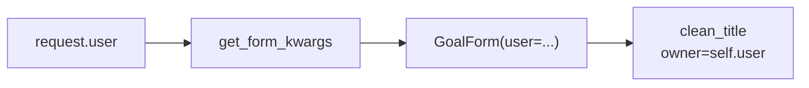
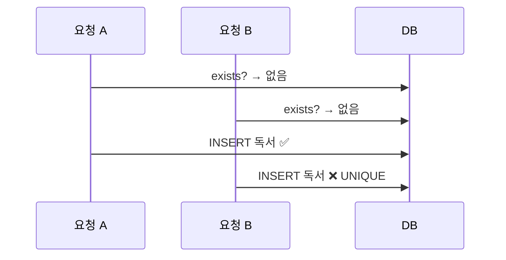

# Day 17 · Forms 검증 심화: clean 순서·add_error·3겹 방어

> 읽는 시간: 약 14분

## 복습 3문제

**1.** (Day 16) 컨텍스트 프로세서도 `title`을, 뷰도 `title`을 넘기면 템플릿에는 누구 값이 나오나요?

<details>
<summary>정답</summary>

**뷰 값**이 나옵니다. 프로세서 결과가 아래층, 뷰 컨텍스트가 위층에 쌓이기 때문입니다. 그래서 프로세서 변수 이름은 `week_checkins`처럼 겹치지 않게 짓습니다.

</details>

**2.** (Day 15) `CreateView`에서 "검증 통과 후, 저장 직전"에 `owner`를 채우는 메서드는?

<details>
<summary>정답</summary>

`form_valid(self, form)`입니다. `form.instance.owner = self.request.user`를 넣고 `super().form_valid(form)`을 부르면 저장과 리다이렉트까지 해 줍니다.

</details>

**3.** (Day 7) `clean_target()` 안에서 값을 `return`하지 않으면 어떻게 되나요?

<details>
<summary>정답</summary>

함수가 `None`을 돌려준 셈이라 `cleaned_data["target"]`이 `None`이 됩니다. 에러 없이 조용히 값이 사라지는 버그라서 더 위험합니다.

</details>

---

## 오늘 만들 것

Goal 추가 폼에 **마감일**을 붙이고, "마감일은 오늘 이후", "내 Goal끼리 제목 중복 금지", "달성량 ≤ 목표치" 규칙을 폼·모델·DB 세 곳에 제대로 나눠 넣습니다.

## 오늘 배울 것

- 검증 순서: 필드 → `clean_<필드>` → `clean()` → 모델
- `add_error`와 폼에 `user` 넘기기
- 폼·모델·DB 제약, 3겹 방어

---

## 1. 검증 순서: 누가 먼저 검사하나

Day 7에서 `clean()`을 써 봤습니다. 그런데 규칙이 늘면 "이 검사를 어디에 쓰지?"가 헷갈립니다. 답은 **검사가 몇 개의 필드를 보느냐**입니다.

먼저 모델에 마감일을 붙입니다. 비워 둘 수 있게 `null`(DB에 NULL 허용)과 `blank`(폼에서 빈칸 허용)를 둘 다 켭니다.

```python
# goals/models.py (Goal 안에 추가)
deadline = models.DateField(
    null=True, blank=True)
```

```bash
python manage.py makemigrations goals
python manage.py migrate
```

이제 `is_valid()`가 부르는 순서를 그림으로 봅니다. 필드마다 ①~③을 돌고, 모든 필드가 끝난 뒤 ④, ⑤가 한 번씩 돕니다.


| 단계 | 보는 범위 | 예 |
|---|---|---|
| ① 변환·기본 검사 | 필드 1개 | `"20"` → `20` |
| ② `clean_<필드>` | 필드 1개 | 마감일 ≥ 오늘 |
| ③ `clean()` | 여러 필드 | done ≤ target |

(④ ModelForm은 이어서 모델의 `full_clean()`으로 `unique` 같은 모델 규칙을 봅니다. 3절에서 다룹니다.)

**결과를 맞혀 보세요:** `target`에 `"abc"`를 넣었습니다. `clean()`이 돌 때 `data["target"]`을 쓰면 어떻게 될까요?

```python-run
def run(raw):
    data, errors = {}, {}
    try:
        data["target"] = int(raw["target"])
    except ValueError:
        errors["target"] = "정수 아님"
    data["done"] = int(raw["done"])
    return data, errors
```

```python-run
def clean(data):
    return data["done"] <= data["target"]

data, errs = run({"target": "abc",
                  "done": "3"})
print(errs)
print(clean(data))
```

<details>
<summary>정답</summary>

첫 셀을 먼저 실행한 뒤 둘째 셀을 실행하면, `errs`는 `{'target': '정수 아님'}`로 나오고 `clean(data)`에서 **`KeyError: 'target'`** 이 납니다.

Django도 똑같습니다. 앞 단계에서 실패한 필드는 `cleaned_data`에 **아예 없습니다.** 그래서 `clean()`에서는 `data["target"]` 대신 `data.get("target")`를 쓰고, `None`이면 검사를 건너뜁니다. 그 필드 에러는 이미 붙어 있으니까요.

</details>

필드 하나만 보는 "마감일은 오늘 이후"는 `clean_deadline`에 둡니다.

```python
from datetime import date

def clean_deadline(self):
    d = self.cleaned_data.get("deadline")
    if d and d < date.today():
        raise forms.ValidationError(
            "오늘 이후로 정해 주세요")
    return d
```

`d and`가 빠지면 빈칸(`None`)일 때 `None < date`로 `TypeError`가 납니다. 마지막 `return d`는 꼭 있어야 합니다.

**JS (Node)** · zod라면 필드 규칙과 전체 규칙을 이렇게 나눕니다.

```javascript
const Goal = z.object({
  target: z.coerce.number().min(1),
  done: z.coerce.number().min(0),
}).refine(g => g.done <= g.target, {
  path: ["done"],
  message: "목표보다 큽니다",
});
```

필드 안 규칙(`.min`)이 `clean_<필드>`, `.refine`이 `clean()`입니다. zod도 필드 검사가 실패하면 `refine`을 돌리지 않습니다.

**비유:** 서류 심사와 같습니다. 칸마다 형식을 보는 직원(①②)이 먼저, 서류 전체가 앞뒤가 맞는지 보는 팀장(③)이 나중입니다. 칸이 비어 있으면 팀장은 그 칸을 건너뜁니다.

> 💡 필드 1개만 보면 `clean_<필드>`, 여러 개를 함께 보면 `clean()`. `clean()`에서는 항상 `.get()`으로 꺼낸다.

---

## 2. add_error와 폼에 user 넘기기

Day 7의 `clean()`은 `raise ValidationError`를 썼습니다. 이렇게 하면 에러가 **폼 맨 위**(`non_field_errors`, 특정 칸에 속하지 않은 에러)에 뜹니다. 휴대폰에서 아래쪽 `done` 칸을 고치던 사용자는 에러를 못 봅니다.

`self.add_error("필드명", "메시지")`는 에러를 **그 칸 바로 아래**에 붙입니다. 그리고 그 필드를 `cleaned_data`에서 빼 줍니다.

**결과를 맞혀 보세요:** 아래 `clean()`은 `raise`가 없습니다. 그래도 `is_valid()`는 `False`일까요?

```python
def clean(self):
    data = super().clean()
    t = data.get("target")
    d = data.get("done")
    if t is not None and d is not None \
            and d > t:
        self.add_error(
            "done", "목표보다 커요")
    return data
```

<details>
<summary>정답</summary>

**`False`입니다.** `is_valid()`는 "`form.errors`가 비었는가"만 봅니다. `add_error`가 `errors`에 항목을 넣었으니 실패입니다. `raise`와 달리 **여러 에러를 한 번에** 모아 붙일 수 있다는 것도 장점입니다.

</details>

이제 "내 Goal끼리 제목 중복 금지"를 넣고 싶습니다. 그런데 폼은 **지금 누가 로그인했는지** 모릅니다. 폼은 `request`를 받지 않기 때문입니다. 그래서 만들 때 `user`를 직접 넘깁니다.

```python
class GoalForm(forms.ModelForm):
    def __init__(self, *args,
                 user=None, **kwargs):
        super().__init__(*args, **kwargs)
        self.user = user
```

```python
    def clean_title(self):
        t = self.cleaned_data["title"]
        qs = Goal.objects.filter(
            owner=self.user, title=t)
        qs = qs.exclude(pk=self.instance.pk)
        if qs.exists():
            raise forms.ValidationError(
                "이미 있는 목표예요")
        return t
```

`exclude(pk=self.instance.pk)`가 핵심입니다. **수정 화면**에서는 자기 자신이 이미 DB에 있으므로, 빼지 않으면 제목을 안 바꿔도 "이미 있다"고 막힙니다. 새로 만들 땐 `pk`가 `None`이라 아무것도 빠지지 않습니다.

CBV에서는 `get_form_kwargs`가 "폼을 만들 때 넘길 인자 dict"를 돌려줍니다. 여기에 `user`를 끼워 넣습니다.

```python
class GoalCreate(LoginRequiredMixin,
                 CreateView):
    form_class = GoalForm

    def get_form_kwargs(self):
        kw = super().get_form_kwargs()
        kw["user"] = self.request.user
        return kw
```



**JS (Node)** · Express에선 검증 함수에 `req.user`를 인자로 넘기는 것과 같습니다.

```javascript
async function validate(body, user) {
  const dup = await Goal.exists({
    owner: user.id, title: body.title });
  if (dup) return { title: "이미 있음" };
}
```

> 💡 칸에 붙일 에러는 `add_error`. 폼이 모르는 값(user)은 `__init__` 인자로 받고, CBV는 `get_form_kwargs`로 넘긴다. 수정 화면은 `exclude(pk=...)`.

---

## 3. 3겹 방어: 폼 · 모델 · DB

폼 검증은 **폼을 거칠 때만** 돕니다. 그런데 Goal은 폼 말고도 생깁니다. 셸, 관리 명령, 나중에 만들 DRF API, 동시에 들어온 두 요청이 있습니다.

**결과를 맞혀 보세요:** 셸에서 이렇게 저장하면 `GoalForm.clean()`의 "done ≤ target" 규칙이 막아 줄까요?

```python
g = Goal(owner=me, title="독서",
         target=10, done=50)
g.save()
```

<details>
<summary>정답</summary>

**못 막습니다.** 그냥 저장됩니다. `save()`는 폼도, 모델 검증(`full_clean`)도 부르지 않습니다. 폼 규칙은 "폼을 쓰는 화면"만 지킵니다. 그래서 꼭 지켜야 하는 규칙은 더 아래층에도 둡니다.

</details>

규칙을 어디에 둘지는 이렇게 고릅니다.

| 층 | 누가 지키나 | 둘 규칙 |
|---|---|---|
| 폼 | 그 화면만 | 화면 전용 (오늘 이후) |
| 모델 `clean` | 폼·Admin·DRF* | 업무 규칙 |
| DB 제약 | **모두** | 절대 깨지면 안 됨 |

(*DRF는 직접 호출해야 합니다. Week 5에서 봅니다.)

"마감일 ≥ 오늘"은 DB 제약으로 두면 안 됩니다. 내일이 되면 어제 만든 Goal이 규칙을 어기게 되니까요. 반면 "done ≤ target", "내 제목 중복 금지"는 언제나 참이어야 하니 DB까지 내립니다.

```python
class Meta:
    constraints = [
        models.CheckConstraint(
            condition=Q(
                done__lte=F("target")),
            name="done_lte_target"),
    ]
```

```python
        models.UniqueConstraint(
            fields=["owner", "title"],
            name="uniq_owner_title"),
```

(두 번째 블록은 같은 `constraints` 리스트 안에 이어 씁니다. Django 5.1 이전 버전은 `condition=` 대신 `check=`입니다.) 추가 후 `makemigrations`, `migrate`를 돌립니다. 이미 규칙을 어긴 행이 있으면 마이그레이션이 실패하니 먼저 고쳐 둡니다.

좋은 소식은, ModelForm이 ④단계에서 이 제약들도 **미리 검사해 칸 에러로** 보여 준다는 점입니다 (Django 4.1+). 단, 폼에 없는 필드(`owner`)가 낀 제약은 건너뜁니다. 그래서 2절의 `clean_title`이 여전히 필요합니다 (아래 접기 참고).

**비유:** 폼은 **현관 직원**, 모델 검증은 **사무실 출입증**, DB 제약은 **금고 자물쇠**입니다. 현관을 안 거치고 뒷문(셸·API)으로 와도 금고는 열리지 않습니다.

```python-run
class DB:
    def __init__(self):
        self.rows = []
    def insert(self, owner, title):
        for o, t in self.rows:
            if (o, t) == (owner, title):
                raise ValueError(
                    "UNIQUE 위반")
        self.rows.append((owner, title))
```

```python-run
db = DB()
db.insert("동", "독서")
try:
    db.insert("동", "독서")
except ValueError as e:
    print("DB가 막음:", e)
```

> 💡 폼 = 사용자에게 친절한 메시지, DB 제약 = 마지막 보증. "항상 참"인 규칙만 DB로 내리고, 시간에 따라 바뀌는 규칙은 폼에 둔다.

<details>
<summary>🔍 더 깊이 (면접용): "폼에서 중복 검사했는데 왜 IntegrityError가?"</summary>

`clean_title`의 `exists()` 검사와 실제 `INSERT` 사이에는 틈이 있습니다. 사용자가 저장 버튼을 두 번 빠르게 누르면 두 요청이 **동시에** `exists()`를 통과하고, 둘 다 `INSERT`합니다. 이것이 **경쟁 조건**(race condition, 실행 순서에 따라 결과가 달라지는 버그)이고, TOCTOU(검사 시점과 사용 시점이 다름) 문제입니다.



파이썬 코드로는 이 틈을 못 막습니다. **DB의 `UniqueConstraint`만** 원자적으로 막습니다. 그래서 뷰에서 `IntegrityError`를 잡아 폼 에러로 바꿔 줍니다.

```python
from django.db import IntegrityError

def form_valid(self, form):
    form.instance.owner = self.request.user
    try:
        return super().form_valid(form)
    except IntegrityError:
        form.add_error(
            "title", "이미 있어요")
        return self.form_invalid(form)
```

PostgreSQL에서는 트랜잭션 안에서 에러가 나면 그 트랜잭션이 깨지므로, `ATOMIC_REQUESTS`를 쓴다면 저장 부분을 `transaction.atomic()`으로 따로 감쌉니다 (Week 6).

또 하나: ModelForm의 ④단계 `_post_clean()`은 `instance`에 값을 채운 뒤 `instance.full_clean(exclude=...)`를 부릅니다. 폼에 **없는 필드**(예: `owner`)는 검사에서 빠지므로, `owner`가 포함된 `UniqueConstraint`는 폼 단계에서 검사되지 않습니다. 그래서 2절처럼 `user`를 넘겨 직접 검사하거나, 위처럼 `IntegrityError`를 잡는 것이 실무 패턴입니다.

</details>

---

## 연습문제

**1.** `clean()`에 "마감일이 있으면 목표치는 1 이상"이라는 규칙을 넣으세요. 에러는 `target` 칸에 붙입니다. 먼저 순수 함수로 확인합니다.

```python-run
def check(data):
    errs = {}
    # 여기를 채우세요
    return errs

print(check({"deadline": "11-30",
             "target": 0}))
print(check({"deadline": None,
             "target": 0}))
```

<details>
<summary>정답</summary>

```python-run
def check(data):
    errs = {}
    dl = data.get("deadline")
    t = data.get("target")
    if dl and t is not None and t < 1:
        errs["target"] = "1 이상으로"
    return errs

print(check({"deadline": "11-30",
             "target": 0}))
print(check({"deadline": None,
             "target": 0}))
# 출력: {'target': '1 이상으로'}
# 출력: {}
```

Django에서는 `errs["target"] = ...` 자리에 `self.add_error("target", "1 이상으로")`를 씁니다. `t is not None`을 빠뜨리면 target 변환이 실패했을 때 `None < 1`로 `TypeError`가 납니다.

</details>

**2.** `GoalEdit`(UpdateView)에서 제목을 안 바꾸고 저장했는데 "이미 있는 목표예요"가 뜹니다. 원인과 고칠 곳은?

<details>
<summary>정답</summary>

중복 검사가 **자기 자신**을 찾아서입니다. 수정 화면에서는 `self.instance`가 이미 DB에 있는 그 Goal입니다.

```python
qs = Goal.objects.filter(
    owner=self.user, title=t)
qs = qs.exclude(pk=self.instance.pk)
```

`exclude` 줄을 넣으면 됩니다. 그리고 `GoalEdit`에도 `get_form_kwargs`로 `user`를 넘겨야 합니다. 안 넘기면 `self.user`가 `None`이라 `owner=None`으로 검색해서 중복을 못 잡습니다. 공통 Mixin(`UserFormKwargsMixin`)으로 빼 두면 두 뷰가 같이 씁니다.

</details>

**3.** 다음 중 DB 제약(`CheckConstraint`/`UniqueConstraint`)으로 두기에 **알맞지 않은** 규칙을 고르고 이유를 쓰세요. (가) done ≥ 0 (나) 마감일 ≥ 오늘 (다) 한 사람 안에서 제목 유일

<details>
<summary>정답</summary>

**(나)** 입니다. "오늘"은 매일 바뀝니다. DB 제약은 **언제 확인해도 참**이어야 하는데, 어제 만든 정상 Goal이 내일은 위반이 됩니다. 그래서 그 행을 수정해 다시 저장할 때 갑자기 실패합니다.

(가)는 `PositiveIntegerField`가 이미 DB 제약을 겁니다. (다)는 2절의 `UniqueConstraint(fields=["owner", "title"])`입니다. 둘 다 시간과 상관없이 참이어야 하므로 DB에 둡니다.

</details>

---

## 면접 질문

<details>
<summary>Q1. Django Form의 검증 순서를 설명해 주세요.</summary>

- `is_valid()` → `full_clean()`이 필드마다 `to_python()`(타입 변환) → `validate()`(필수 등) → `run_validators()` → `clean_<필드>()`를 돌립니다.
- 모든 필드가 끝나면 폼 전체 `clean()`이 한 번 돕니다. 앞에서 실패한 필드는 `cleaned_data`에 없으므로 `.get()`으로 꺼냅니다.
- ModelForm은 마지막으로 `_post_clean()`에서 instance에 값을 넣고 모델 `full_clean()`(모델 `clean()`, unique, 제약)을 부릅니다. 폼에 없는 필드는 제외됩니다.
- 에러는 `raise ValidationError`(필드 메서드면 그 칸, `clean()`이면 `non_field_errors`) 또는 `add_error(필드, 메시지)`로 붙입니다.

</details>

<details>
<summary>Q2. 폼에서 중복을 검사하는데 DB에도 unique 제약이 필요한 이유는?</summary>

- 폼 검증은 폼을 거치는 경로만 지킵니다. 셸·관리 명령·API·`bulk_create`는 폼을 우회합니다.
- 폼 경로 안에서도 `exists()` 검사와 `INSERT` 사이에 **경쟁 조건**이 있어, 동시 요청 두 개가 모두 통과할 수 있습니다.
- DB 유니크 인덱스는 원자적으로 막는 유일한 층입니다. 뷰에서 `IntegrityError`를 잡아 사용자 메시지로 바꿉니다.
- 정리: 폼은 친절한 메시지, DB는 마지막 보증. 시간에 따라 바뀌는 규칙(오늘 이후)은 DB에 두지 않습니다.

</details>

---

## 오늘 정리

1. 필드 하나는 `clean_<필드>`, 여러 필드는 `clean()`. 실패한 필드는 `cleaned_data`에 없으니 `.get()`.
2. 칸 아래 에러는 `add_error`. 폼에 필요한 `user`는 `__init__` 인자 + `get_form_kwargs`, 수정 화면은 `exclude(pk=)`.
3. 꼭 지킬 규칙은 DB 제약까지 내린다. 폼 = 메시지, DB = 보증. `IntegrityError`는 잡아서 폼 에러로.

## 다음에 이어갈 것

Day 18: 지금까지 Django 기본 `User`를 썼습니다. **커스텀 User 모델**로 바꾸고, 권한(permission)과 세션이 실제로 어떻게 저장되는지 봅니다.
