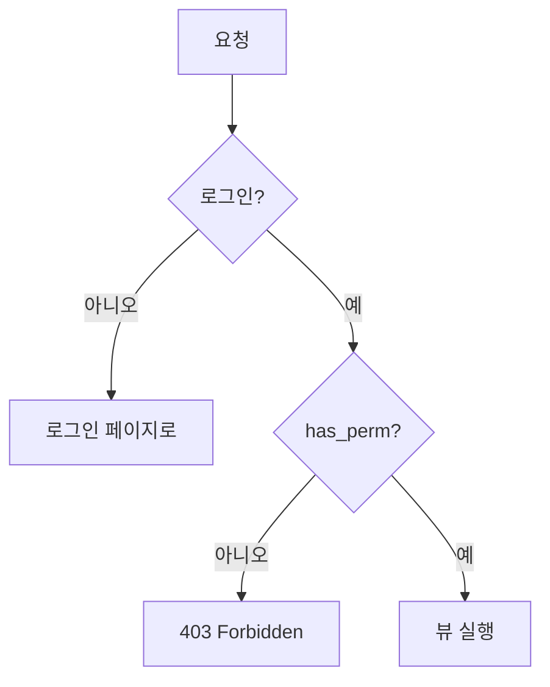

# Day 18 · 커스텀 User·권한·세션: 로그인은 어디에 저장될까

> 읽는 시간: 약 14분

## 복습 3문제

**1.** (Day 17) `clean()` 안에서 `data["target"]` 대신 `data.get("target")`을 쓰는 이유는?

<details>
<summary>정답</summary>

앞 단계(변환·`clean_target`)에서 실패한 필드는 `cleaned_data`에 **아예 없기** 때문입니다. `data["target"]`은 `KeyError`가 나고, `.get()`은 `None`을 돌려줘서 "이미 에러가 붙은 칸은 건너뛰기"를 할 수 있습니다.

</details>

**2.** (Day 17) "마감일 ≥ 오늘"을 DB `CheckConstraint`로 두면 안 되는 이유는?

<details>
<summary>정답</summary>

"오늘"이 매일 바뀌기 때문입니다. DB 제약은 언제 확인해도 참이어야 하는데, 어제 만든 정상 Goal이 내일은 위반이 되어 수정·저장이 갑자기 실패합니다. 시간에 따라 바뀌는 규칙은 폼에 둡니다.

</details>

**3.** (Day 15) `class GoalCreate(CreateView, LoginRequiredMixin)`처럼 Mixin을 **오른쪽**에 쓰면 무슨 일이 생기나요?

<details>
<summary>정답</summary>

로그인 검사가 **조용히 건너뛰어집니다.** MRO(메서드 찾는 순서)에서 `View.dispatch`가 먼저 걸리고, 이 메서드는 `super()`를 부르지 않아 `LoginRequiredMixin.dispatch`까지 내려가지 않습니다. Mixin은 항상 **왼쪽**에 둡니다.

</details>

---

## 오늘 만들 것

Goals 앱의 사용자를 **내가 소유한 User 모델**로 바꾸고(닉네임 추가), "목표 내보내기" 권한을 만들고, 세션에 "최근 본 목표"를 저장합니다.

## 오늘 배울 것

- 커스텀 User: 왜 **처음에** 만들어야 하나
- 권한(permission): 표 단위 권한 vs "내 것만"
- 세션: 로그인 상태는 서버 DB에 있다

---

## 1. 커스텀 User: 왜 처음에 만드나

지금까지는 Django가 준 `auth.User`를 그대로 썼습니다. 편하지만 **내 테이블이 아닙니다.** 닉네임, 프로필 사진, "이메일로 로그인" 같은 요구가 오면 손대기 어렵습니다.

Django 공식 문서도 "새 프로젝트는 **시작할 때** 커스텀 User를 만들라"고 권합니다. 이미 다른 테이블들이 `auth_user`를 FK로 가리킨 뒤에는 바꾸기가 매우 어렵기 때문입니다.

**비유:** 회원 명부 양식을 처음부터 우리 회사 양식으로 찍어 두는 것입니다. 회원이 1만 명 생긴 뒤 양식을 바꾸려면 모든 서류의 참조 번호를 다시 써야 합니다.

가장 쉬운 방법은 `AbstractUser`(기본 User의 필드를 전부 가진 부모 클래스)를 상속하는 것입니다.

```bash
python manage.py startapp accounts
```

```python
# accounts/models.py
from django.contrib.auth.models import (
    AbstractUser)

class User(AbstractUser):
    nickname = models.CharField(
        max_length=30, blank=True)
```

```python
# config/settings.py
INSTALLED_APPS += ["accounts"]
AUTH_USER_MODEL = "accounts.User"
```

`AUTH_USER_MODEL`은 "이 프로젝트의 사용자 테이블은 이것"이라는 선언입니다. 이제 다른 모델은 User를 **직접 import하지 않고** 이 설정을 가리킵니다.

```python
# goals/models.py
from django.conf import settings

owner = models.ForeignKey(
    settings.AUTH_USER_MODEL,
    on_delete=models.CASCADE)
```

뷰나 폼처럼 실제 클래스가 필요한 곳에서는 `get_user_model()`을 씁니다.

**결과를 맞혀 보세요:** 설정을 바꾼 뒤, 예전 코드에 남아 있던 이 줄은 어떻게 될까요?

```python
from django.contrib.auth.models import User
User.objects.count()
```

<details>
<summary>정답</summary>

**`AttributeError`가 납니다.** 메시지는 `Manager isn't available; 'auth.User' has been swapped for 'accounts.User'`입니다. 기본 User는 "교체됨(swapped)" 상태라 테이블도, 매니저도 없습니다. 그래서 모델 FK는 `settings.AUTH_USER_MODEL`, 코드에서는 `get_user_model()`을 씁니다.

</details>

**JS (Node)** · Mongoose에선 원래 User 스키마를 내가 씁니다. Django는 기본을 주고, 교체 지점을 하나 열어 둔 셈입니다.

```javascript
const User = model("User",
  new Schema({
    username: String,
    nickname: String,
  }));
```

⚠️ **우리 Goals 앱은 이미 `auth.User`로 만들어져 있습니다.** 학습용 프로젝트이니 가장 깔끔한 길은 DB를 새로 시작하는 것입니다.

```bash
python manage.py dumpdata goals > bk.json
rm db.sqlite3
rm goals/migrations/0*.py
python manage.py makemigrations
python manage.py migrate
python manage.py createsuperuser
```

(백업 `bk.json`은 참고용입니다. owner id가 바뀌므로 그대로 `loaddata`하지 말고 필요한 목표만 다시 만드세요.) 실서비스라면 이렇게 못 하니, 아래 접기의 다른 방법을 씁니다.

> 💡 새 프로젝트는 첫 `migrate` 전에 `AbstractUser`로 커스텀 User를 만든다. FK는 `settings.AUTH_USER_MODEL`, 코드는 `get_user_model()`.

<details>
<summary>🔍 더 깊이 (면접용): AbstractUser vs AbstractBaseUser, 그리고 이미 늦었을 때</summary>

- `AbstractUser`: username·email·is_staff 등 **기본 필드 그대로 + 내 필드 추가**. 대부분 이걸로 충분합니다.
- `AbstractBaseUser` + `PermissionsMixin`: 비밀번호·last_login만 있는 **빈 판**. "username 없이 이메일로만 로그인"처럼 구조를 바꿀 때 씁니다. `USERNAME_FIELD = "email"`, 직접 만든 `UserManager`(`create_user`, `create_superuser`)가 필요합니다.
- Admin 등록은 `admin.site.register(User, UserAdmin)`처럼 `django.contrib.auth.admin.UserAdmin`을 재사용합니다. 회원가입 폼은 `class Meta(UserCreationForm.Meta): model = User`로 모델을 바꿔 줍니다.
- **운영 중이라 교체가 어렵다면:** `Profile` 모델을 `OneToOneField(settings.AUTH_USER_MODEL)`로 붙여 추가 정보만 따로 저장합니다. 조회마다 JOIN이 하나 늘지만 마이그레이션 위험이 없습니다.
- 운영 DB에서 진짜로 교체하려면 `auth_user` 테이블을 새 앱 테이블로 **이름만 옮기는** 수동 마이그레이션(`SeparateDatabaseAndState`)이 필요합니다. 면접에서는 "어렵다는 것과 그 이유(모든 FK·contenttypes·권한 테이블이 얽힘)"를 말할 수 있으면 충분합니다.

</details>

---

## 2. 권한: "할 수 있나" vs "내 것인가"

Day 10에서 `LoginRequiredMixin`으로 "로그인했나"를 막았습니다. 오늘은 한 단계 더 갑니다. **로그인한 사람 중 누가 무엇을 할 수 있나**입니다.

Django는 모델마다 권한 4개를 **자동으로** 만듭니다. `goals.add_goal`, `goals.change_goal`, `goals.delete_goal`, `goals.view_goal`입니다. 이름 규칙은 `앱이름.동작_모델이름`입니다.

나만의 권한도 `Meta`에 추가할 수 있습니다. "목표를 CSV로 내보내기"는 아무나 못 하게 해 보겠습니다.

```python
class Goal(models.Model):
    # ...필드들...
    class Meta:
        permissions = [
            ("export_goal",
             "목표 내보내기 가능"),
        ]
```

```python
from django.contrib.auth.mixins import (
    PermissionRequiredMixin)

class GoalExport(PermissionRequiredMixin,
                 View):
    permission_required = "goals.export_goal"
```

템플릿에서는 `perms` 변수로 버튼을 숨깁니다. (화면에서 숨기는 것은 친절일 뿐, **진짜 방어는 뷰의 Mixin**입니다.)

```html

  <a href="">
    내보내기</a>

```



**결과를 맞혀 보세요:** Admin에서 권한을 준 직후, **같은 user 객체**로 다시 물어봅니다. 두 번째 줄은?

```python-run
class User:
    def __init__(self, db):
        self.db, self._cache = db, None
    def has_perm(self, p):
        if self._cache is None:
            self._cache = set(self.db)
        return p in self._cache
```

```python-run
db = []
u = User(db)
print(u.has_perm("goals.export_goal"))
db.append("goals.export_goal")
print(u.has_perm("goals.export_goal"))
u = User(db)
print(u.has_perm("goals.export_goal"))
```

<details>
<summary>정답</summary>

`False`, **`False`**, `True`입니다. Django의 User도 처음 `has_perm`을 부를 때 권한을 DB에서 읽어 **객체에 캐시**합니다. 같은 객체에 권한을 추가해도 캐시는 그대로라 여전히 `False`입니다.

실제 요청에서는 매 요청마다 `request.user`를 새로 만들므로 문제가 없습니다. 하지만 **테스트 코드**에서 권한을 준 뒤 바로 `has_perm`을 확인하면 이 함정에 걸립니다. `User.objects.get(pk=u.pk)`로 다시 불러오면 됩니다.

</details>

여기서 중요한 구분이 있습니다. `goals.change_goal`은 **"Goal 표 전체에 대한 권한"** 입니다. "이 Goal이 내 것인가"는 따로 막아야 합니다. 이건 Day 10처럼 쿼리셋을 내 것으로 좁히는 방식이 정답입니다.

```python
class GoalEdit(LoginRequiredMixin,
               UpdateView):
    def get_queryset(self):
        return Goal.objects.filter(
            owner=self.request.user)
```

남의 Goal 주소를 쳐도 쿼리셋에 없으니 **404**가 납니다. 403보다 좋은 점은 "그런 Goal이 존재한다"는 사실조차 알려 주지 않는다는 것입니다.

**JS (Node)** · Express에선 미들웨어 두 개로 나눠 씁니다.

```javascript
const can = (perm) => (req, res, next) =>
  req.user.perms.includes(perm)
    ? next() : res.sendStatus(403);

app.get("/export", can("export"), h);
// 내 것인지: findOne({_id, owner})
```

**비유:** 권한은 **사원증 등급**(이 층에 들어갈 수 있나), 쿼리셋 필터는 **사물함 열쇠**(이 사물함이 내 것인가)입니다. 등급이 높아도 남의 사물함은 못 엽니다.

> 💡 "이 기능을 쓸 수 있나" = 모델 권한 + `PermissionRequiredMixin`. "이 행이 내 것인가" = `get_queryset`에서 owner로 필터 → 404.

<details>
<summary>🔍 더 깊이 (면접용): 권한은 어디에 저장되고, superuser는?</summary>

- 권한은 `auth_permission` 테이블의 행입니다. `migrate` 후 `post_migrate` 시그널이 모델마다 4개(+Meta 권한)를 만듭니다. 그래서 새 권한은 `migrate`를 돌려야 생깁니다.
- 사용자에게 직접(`user.user_permissions`) 또는 **그룹**(`Group`)을 통해 줍니다. 실무는 "편집자" 같은 그룹에 권한을 묶고 사람을 그룹에 넣습니다.
- `has_perm`은 `is_active=False`면 무조건 `False`, `is_superuser=True`면 무조건 `True`입니다.
- 기본 `ModelBackend`는 **객체 단위 권한을 지원하지 않습니다.** `has_perm("goals.change_goal", obj)`처럼 객체를 넘기면 항상 `False`입니다. 행 단위 권한이 정말 필요하면 django-guardian 같은 백엔드를 붙이거나, 위처럼 쿼리셋 필터로 해결합니다.
- `PermissionRequiredMixin`: 비로그인은 로그인 페이지로 **리다이렉트**, 로그인했지만 권한 없음은 **403**(`PermissionDenied`)입니다.

</details>

---

## 3. 세션: 로그인 상태는 어디에 있나

로그인하면 다음 요청에서 Django는 어떻게 "아, 너구나"를 알까요? 브라우저가 매번 비밀번호를 보내는 건 아닙니다.

답은 **세션**(서버가 기억하는 사용자별 저장 공간)입니다. 기본 설정에서 Django는 세션을 **DB의 `django_session` 테이블**에 저장하고, 브라우저에는 그 행을 찾는 **열쇠(`sessionid` 쿠키)** 만 줍니다.


`login(request, user)`는 세션에 사용자 id를 적습니다. 다음 요청 때 `SessionMiddleware`가 쿠키로 세션을 찾고, `AuthenticationMiddleware`가 그 id로 `request.user`를 만들어 줍니다.

**비유:** 호텔 체크인입니다. 투숙객 정보는 **프런트 장부**(DB)에 있고, 손님은 **방 카드키**(쿠키)만 들고 다닙니다. 카드키를 잃어버려도 장부에는 신용카드 번호가 없습니다.

**JS (Node)** · express-session과 거의 같은 구조입니다.

```javascript
app.use(session({
  secret: "s3cret",
  store: new RedisStore({ client }),
}));
// 로그인 성공 후
req.session.userId = user.id;
```

```python
# Django: login()이 대신 적어 줌
from django.contrib.auth import login
login(request, user)
# 세션 안: {"_auth_user_id": "7", ...}
```

세션은 로그인 말고도 쓸 수 있습니다. "최근 본 목표"를 세션에 저장해 보겠습니다. DB 테이블을 만들 필요가 없습니다.

**결과를 맞혀 보세요:** Django 세션은 "값이 **대입**되었을 때"만 저장 표시(`modified`)를 켭니다. 아래처럼 리스트에 `append`만 하면?

```python-run
class Session(dict):
    modified = False
    def __setitem__(self, k, v):
        self.modified = True
        super().__setitem__(k, v)
```

```python-run
s = Session()
s["recent"] = []
s.modified = False
s["recent"].append(7)
print(s["recent"], s.modified)
```

<details>
<summary>정답</summary>

`[7] False`가 출력됩니다. `s["recent"]`로 리스트를 **꺼내서** 고쳤을 뿐, `s[...] = ...` 대입은 없었기 때문입니다.

Django에서는 이 경우 **요청이 끝날 때 세션이 DB에 저장되지 않습니다.** 화면에는 잠깐 보이는데 새로고침하면 사라지는 버그가 됩니다. 해결은 둘 중 하나입니다. 새 리스트를 대입하거나, `request.session.modified = True`를 직접 켭니다.

</details>

그래서 이렇게 씁니다. 새 리스트를 만들어 **대입**합니다.

```python
def goal_detail(request, pk):
    goal = get_object_or_404(
        Goal, pk=pk, owner=request.user)
    r = request.session.get("recent", [])
    r = [pk] + [x for x in r if x != pk]
    request.session["recent"] = r[:5]
    ...
```

세션 값은 기본적으로 **JSON**으로 저장됩니다. 그래서 숫자·문자열·리스트·dict만 넣고, 모델 객체 대신 **id**를 넣습니다.

> 💡 브라우저엔 `sessionid` 열쇠만, 데이터는 서버(`django_session`)에. 세션 안 리스트를 고칠 땐 **대입**하거나 `modified = True`.

<details>
<summary>🔍 더 깊이 (면접용): 세션 고정 공격, 비밀번호 변경, 세션 vs JWT</summary>

- **세션 고정(session fixation):** 공격자가 미리 알고 있는 세션 id를 피해자에게 심은 뒤, 피해자가 로그인하면 그 id로 접속하는 공격입니다. Django `login()`은 로그인 순간 `cycle_key()`로 **세션 키를 새로 발급**해 막습니다.
- 세션에는 `_auth_user_hash`(비밀번호 해시에서 만든 값)도 저장됩니다. 비밀번호를 바꾸면 이 값이 달라져 **다른 기기의 세션이 모두 로그아웃**됩니다. 현재 기기는 유지하려면 `update_session_auth_hash(request, user)`를 부릅니다.
- 비밀번호 자체는 평문이 아니라 `pbkdf2_sha256$반복횟수$소금$해시` 형태로 저장됩니다. 일부러 느린 해시라 무차별 대입이 어렵습니다.
- 쿠키 보안: `SESSION_COOKIE_HTTPONLY`(기본 True, JS에서 못 읽음), 운영에선 `SESSION_COOKIE_SECURE=True`(HTTPS만), `SESSION_COOKIE_SAMESITE="Lax"`(기본, CSRF 완화).
- 만료: 기본 `SESSION_COOKIE_AGE`는 2주(1209600초). 만료 행은 자동으로 지워지지 않으니 `python manage.py clearsessions`를 주기적으로 돌립니다. 성능이 필요하면 `SESSION_ENGINE`을 캐시(Redis) 기반으로 바꿉니다(Week 8).
- **세션 vs JWT:** 세션은 서버가 상태를 갖고 있어 **즉시 강제 로그아웃**이 쉽고, 쿠키 하나로 끝납니다. JWT는 서버 저장이 없어 여러 서버·모바일 앱에 편하지만, 만료 전에 무효화하기 어렵습니다. Week 5에서 DRF와 함께 비교합니다.

</details>

---

## 연습문제

**1.** 커스텀 User에 추가한 `nickname`을 상단 메뉴에 보여 주세요. 닉네임이 비어 있으면 `username`을 보여 줍니다.

<details>
<summary>정답</summary>

```html

님

```

`user`는 `auth` 컨텍스트 프로세서(Day 16)가 모든 템플릿에 넣어 주는 변수입니다. `firstof` 태그는 나열한 값 중 **처음으로 비어 있지 않은 값**을 출력합니다. `{{ user.nickname|default:user.username }}`도 같은 뜻입니다. 같은 로직을 여러 곳에서 쓴다면 모델에 메서드를 두는 편이 낫습니다.

```python
def display_name(self):
    return self.nickname or self.username
```

템플릿에서는 `{{ user.display_name }}`로 씁니다.

</details>

**2.** "최근 본 목표"를 갱신하는 순수 함수를 완성하세요. 방금 본 것이 맨 앞, 중복 없음, 최대 3개입니다.

```python-run
def push_recent(recent, pk, n=3):
    # 여기를 채우세요
    return recent

print(push_recent([2, 5, 9], 5))
print(push_recent([2, 5, 9], 4))
```

<details>
<summary>정답</summary>

```python-run
def push_recent(recent, pk, n=3):
    rest = [x for x in recent if x != pk]
    return ([pk] + rest)[:n]

print(push_recent([2, 5, 9], 5))
print(push_recent([2, 5, 9], 4))
# 출력: [5, 2, 9]
# 출력: [4, 2, 5]
```

**새 리스트를 돌려주는** 함수라는 점이 중요합니다. 뷰에서 `request.session["recent"] = push_recent(...)`로 **대입**하면 `modified`가 자동으로 켜져 저장됩니다. 원래 리스트를 `insert`/`remove`로 고치는 방식이었다면 `modified = True`를 따로 켜야 했습니다.

</details>

**3.** `GoalExport` 뷰에 (가) 로그아웃한 사람, (나) 로그인했지만 `export_goal` 권한이 없는 사람이 접속하면 각각 무엇을 보나요? 그리고 "편집자" 그룹에 권한을 주는 셸 코드를 쓰세요.

<details>
<summary>정답</summary>

(가) **로그인 페이지로 리다이렉트**(302)됩니다. (나) **403 Forbidden**입니다. `PermissionRequiredMixin`은 로그인한 사용자에게는 "로그인해도 소용없다"는 뜻으로 403을 줍니다.

```python
from django.contrib.auth.models import (
    Group, Permission)

g, _ = Group.objects.get_or_create(
    name="편집자")
p = Permission.objects.get(
    codename="export_goal")
g.permissions.add(p)
me.groups.add(g)
```

`codename`에는 앱 이름 없이 `export_goal`만 씁니다. 이후 `me.has_perm(...)`을 확인하려면 2절의 캐시 때문에 `me`를 DB에서 다시 불러와야 합니다.

</details>

---

## 면접 질문

<details>
<summary>Q1. Django 프로젝트를 시작할 때 커스텀 User 모델을 권장하는 이유는?</summary>

- 나중에 필드 추가·이메일 로그인 등 요구가 생기는데, 기본 `auth.User`는 내 코드가 아니라 바꿀 수 없습니다.
- `AUTH_USER_MODEL`은 첫 `migrate` 이후 바꾸기가 매우 어렵습니다. 모든 FK, 권한·그룹 M2M, contenttypes가 기존 테이블에 묶여 있어 수동 마이그레이션이 필요합니다.
- 그래서 처음부터 `AbstractUser`를 상속한 빈 커스텀 User를 만들어 두는 것이 비용 0의 보험입니다.
- 코드에서는 `settings.AUTH_USER_MODEL`(FK)과 `get_user_model()`(런타임)으로 참조해 교체 가능하게 둡니다. 이미 늦었다면 `OneToOneField` 프로필 모델로 확장합니다.

</details>

<details>
<summary>Q2. Django에서 로그인 상태가 유지되는 원리를 설명해 주세요.</summary>

- `login()`이 세션에 `_auth_user_id`, `_auth_user_backend`, `_auth_user_hash`를 저장하고, 세션 고정 공격을 막기 위해 세션 키를 새로 발급합니다.
- 세션 데이터는 기본적으로 `django_session` 테이블에 있고, 브라우저에는 `sessionid` 쿠키(HttpOnly)만 내려갑니다.
- 다음 요청에서 `SessionMiddleware`가 쿠키로 세션을 로드하고, `AuthenticationMiddleware`가 `request.user`를 **게으르게**(처음 접근할 때) 조회합니다. 이때 저장된 해시와 현재 비밀번호 해시를 비교해, 비밀번호가 바뀌었으면 로그아웃시킵니다.
- 세션 방식은 서버가 상태를 가져 강제 로그아웃이 쉽고, 대신 저장소(DB·Redis) 조회 비용이 있습니다.

</details>

---

## 오늘 정리

1. 커스텀 User는 **첫 migrate 전에** `AbstractUser`로. FK는 `settings.AUTH_USER_MODEL`, 코드는 `get_user_model()`.
2. 기능 권한은 `app.동작_모델` + `PermissionRequiredMixin`(비로그인 302, 권한 없음 403). "내 것만"은 쿼리셋 필터 → 404.
3. 로그인 = 서버 세션 + `sessionid` 쿠키. 세션 안 리스트는 **대입**해야 저장된다.

## 다음에 이어갈 것

Day 19: Goals를 관리하는 **Admin 화면을 커스터마이징**합니다. 목록 컬럼·검색·필터·인라인 체크인, 그리고 오늘 만든 권한이 Admin에서 어떻게 쓰이는지 봅니다.
