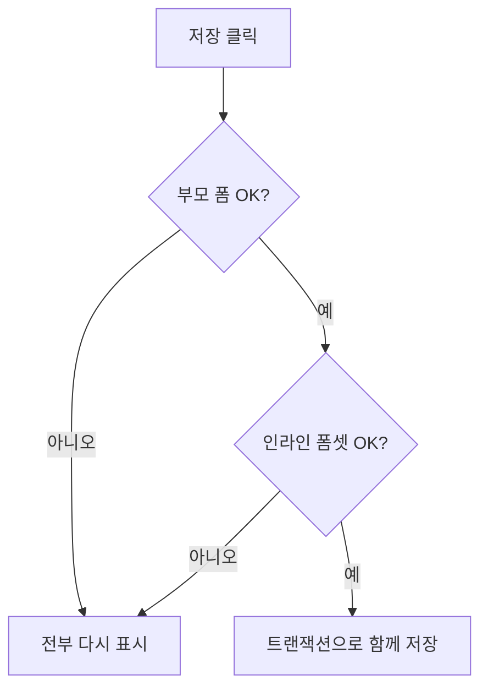

# Day 19 · Admin 커스터마이징: 목록·인라인·액션과 권한

> 읽는 시간: 약 13분

## 복습 3문제

**1.** (Day 18) `PermissionRequiredMixin`이 붙은 뷰에 (가) 로그아웃한 사람, (나) 권한 없는 로그인 사용자가 오면 각각 무슨 응답을 받나요?

<details>
<summary>정답</summary>

(가) 로그인 페이지로 **302 리다이렉트**, (나) **403 Forbidden**입니다. 로그인한 사람에게는 "다시 로그인해도 소용없다"는 뜻으로 403을 줍니다.

</details>

**2.** (Day 18) 브라우저 쿠키 `sessionid`에는 무엇이 들어 있나요?

<details>
<summary>정답</summary>

**세션 키(무작위 문자열)만** 들어 있습니다. 실제 데이터(`_auth_user_id` 등)는 서버의 `django_session` 테이블에 있습니다. 쿠키는 그 행을 찾는 열쇠일 뿐입니다.

</details>

**3.** (Day 14) `qs.update(streak=F("streak") + 1)`에서 `F`를 쓰면 무엇이 좋은가요?

<details>
<summary>정답</summary>

값을 파이썬으로 읽어 오지 않고 SQL `SET streak = streak + 1`로 **DB가 직접 계산**합니다. 두 사람이 동시에 눌러도 값이 덮이지 않아 경쟁 조건이 사라집니다. 오늘 Admin 액션에서도 같은 방식을 씁니다.

</details>

---

## 오늘 만들 것

Goals 앱의 Admin을 **운영자가 실제로 쓰는 화면**으로 바꿉니다. 진행률 컬럼, 검색·필터, 체크인 인라인 편집, "선택한 목표 마감 1주 연장" 액션을 붙입니다.

## 오늘 배울 것

- `ModelAdmin`: 목록 컬럼·검색·필터
- 인라인: 부모 화면에서 자식(체크인) 편집
- 액션과 권한: 여러 개를 한 번에, 하지만 아무나는 안 되게

---

## 1. ModelAdmin: 목록 화면 꾸미기

`admin.site.register(Goal)`만 하면 목록에 `Goal object (1)` 같은 `__str__` 한 줄만 보입니다. 목표가 200개가 되면 원하는 걸 찾을 수가 없습니다.

Django Admin은 **설정만으로** 화면을 바꿉니다. `ModelAdmin`(모델 하나의 관리 화면 설정 클래스)에 "어떤 칸을 보여 줄지"를 적으면 됩니다. HTML을 한 줄도 안 씁니다.

**비유:** 엑셀 표의 "열 고르기 + 필터 + 찾기" 버튼을 클래스 속성으로 켜는 것입니다.

```python
# goals/admin.py
from django.contrib import admin
from .models import Goal

@admin.register(Goal)
class GoalAdmin(admin.ModelAdmin):
    list_display = ["title", "owner",
                    "target", "deadline"]
```

검색창과 오른쪽 필터도 한 줄씩입니다.

```python
    search_fields = ["title",
                     "owner__username"]
    list_filter = ["tags", "deadline"]
    ordering = ["-id"]
    list_per_page = 30
```

`owner__username`처럼 `__`로 관계를 건너 검색할 수 있습니다 (Day 12의 조회 문법 그대로). 검색어는 이 칸들에 `icontains`(대소문자 무시 포함)로 OR 검색됩니다.

**계산된 컬럼**은 메서드로 만듭니다. Day 13에서 `done` 열을 체크인으로 옮겼으니, 진행률은 Day 14의 `annotate`로 목록 쿼리에 합계를 붙여 계산합니다.

```python
from django.db.models import Sum

    def get_queryset(self, request):
        qs = super().get_queryset(request)
        return qs.annotate(
            done_sum=Sum("checkins__amount"))
```

```python
    list_display = ["title", "progress"]

    @admin.display(description="진행률",
                   ordering="done_sum")
    def progress(self, obj):
        n = obj.done_sum or 0
        return f"{n}/{obj.target}"
```

`ordering="done_sum"` 덕분에 머리글을 눌러 진행률 순으로 정렬됩니다. 합계는 목록 쿼리 **한 번**에 같이 계산되니, 행마다 체크인을 다시 세지 않습니다.

**결과를 맞혀 보세요:** `list_display = ["title", "tags"]`처럼 M2M 필드 `tags`를 넣으면?

<details>
<summary>정답</summary>

**서버가 시작할 때 시스템 체크 에러(`admin.E109`)가 납니다.** 목록 한 칸에 "여러 개"를 어떻게 보여 줄지 Django가 정할 수 없고, 행마다 쿼리가 늘기 때문에 막아 둡니다. 보여 주고 싶다면 메서드 컬럼을 만들어 `", ".join(...)`으로 직접 문자열을 만듭니다 (3절 접기의 N+1 주의).

</details>

**JS (Node)** · Express에는 기본 관리 화면이 없어 AdminJS 같은 라이브러리에 비슷한 설정을 씁니다.

```javascript
new AdminJS({ resources: [{
  resource: Goal,
  options: {
    listProperties: ["title", "target"],
    filterProperties: ["deadline"],
  },
}]});
```

`list_display`가 사실 무엇을 하는지 순수 Python으로 흉내 내 봅시다. 문자열이면 속성을, 함수면 호출 결과를 칸에 넣습니다.

```python-run
class G:
    title, done, target = "걷기", 3, 10
def progress(o):
    return f"{o.done}/{o.target}"
cols = ["title", progress]
row = [c(G) if callable(c)
       else getattr(G, c) for c in cols]
print(row)
```

<details>
<summary>출력 확인</summary>

```text
['걷기', '3/10']
```

실제 Admin도 이 규칙(필드 이름 → 모델 속성 → ModelAdmin 메서드 순으로 찾기)으로 칸을 채웁니다.

</details>

> 💡 Admin 목록은 `list_display`·`search_fields`·`list_filter` 세 줄이 80%다. 계산 칸은 `@admin.display` 메서드로.

---

## 2. 인라인: 목표 화면에서 체크인까지

지금은 체크인을 고치려면 CheckIn 목록으로 가서 목표를 골라야 합니다. 운영자는 "이 목표의 기록"을 **한 화면에서** 보고 싶어 합니다.

인라인(inline)은 FK로 연결된 **자식 모델을 부모 편집 화면 안에** 표로 붙여 줍니다. 저장 버튼 한 번에 부모와 자식이 같이 저장됩니다.

**비유:** 일기장(Goal) 표지를 열면 날짜별 쪽(CheckIn)이 바로 펼쳐져 있는 것입니다.

```python
from .models import CheckIn

class CheckInInline(admin.TabularInline):
    model = CheckIn
    extra = 1
    fields = ["amount", "day"]
    readonly_fields = ["day"]
```

```python
@admin.register(Goal)
class GoalAdmin(admin.ModelAdmin):
    inlines = [CheckInInline]
    # list_display 등은 그대로
```

- `TabularInline`: 한 줄짜리 표. `StackedInline`은 세로로 길게.
- `extra = 1`: 빈 입력 줄 1개를 미리 보여 줍니다.
- `day`는 `auto_now_add`라 편집할 수 없어 `readonly_fields`에 둡니다. 안 그러면 `fields`에 넣는 순간 에러가 납니다.

**결과를 맞혀 보세요:** 인라인에서 체크인 3개를 지우고 1개를 새로 쓴 뒤, 목표 제목 칸을 **비워서** 저장하면?

<details>
<summary>정답</summary>

**아무것도 저장되지 않습니다.** 부모 폼이 검증에 실패하면 인라인(폼셋)까지 전부 다시 보여 주고, 삭제·추가도 반영되지 않습니다. Admin은 부모 + 인라인을 **하나의 트랜잭션**으로 저장하기 때문에 "반만 저장"이 생기지 않습니다.

</details>



**JS (Node)** · Node라면 보통 이렇게 직접 묶어야 합니다.

```javascript
await prisma.$transaction([
  prisma.goal.update({ ... }),
  prisma.checkIn.deleteMany({ ... }),
  prisma.checkIn.create({ ... }),
]);
```

> 💡 FK 자식은 `TabularInline`으로 부모 화면에 붙인다. 부모·자식은 한 트랜잭션으로 저장된다.

---

## 3. 액션과 권한: 한 번에, 하지만 아무나는 안 되게

목표 20개의 마감을 미루려고 20번 들어가 고치는 건 고통입니다. **액션**(action)은 목록에서 체크박스로 고른 행들에 함수 하나를 실행합니다. 기본으로 "선택한 항목 삭제"가 들어 있는 그 드롭다운입니다.


```python
    actions = ["extend_week"]

    @admin.action(description="1주 연장",
                  permissions=["change"])
    def extend_week(self, request, qs):
        n = qs.update(deadline=F("deadline")
                      + timedelta(days=7))
        self.message_user(
            request, f"{n}개 연장")
```

(`F`는 `django.db.models`, `timedelta`는 `datetime`에서 가져옵니다.) `qs`는 고른 행들의 QuerySet입니다. `update()`는 SQL `UPDATE` 한 번이라 20개든 2000개든 쿼리 하나입니다 (Day 14의 `F`). 대신 모델의 `save()`와 시그널은 **불리지 않습니다.**

`permissions=["change"]`는 "Goal 수정 권한(`goals.change_goal`)이 있는 사람에게만 이 액션을 보여 줘"라는 뜻입니다. Day 18에서 만든 커스텀 권한도 쓸 수 있습니다.

```python
    @admin.action(permissions=["export"])
    def export_csv(self, request, qs):
        ...

    def has_export_permission(self, req):
        return req.user.has_perm(
            "goals.export_goal")
```

`permissions=["export"]`라고 쓰면 Django가 `has_export_permission` 메서드를 찾아 부릅니다. 이름 규칙이 곧 연결입니다.

**결과를 맞혀 보세요:** `is_staff=True`지만 권한을 **하나도** 안 준 사용자가 `/admin/`에 로그인하면?

<details>
<summary>정답</summary>

**로그인은 되지만 "볼 수 있거나 편집할 수 있는 권한이 없습니다"만 보입니다.** Admin 입장 조건은 `is_active`와 `is_staff`이고, 각 모델 메뉴는 `view`/`add`/`change`/`delete` 권한이 있어야 나타납니다. `is_superuser`만 모든 권한을 자동으로 가집니다.

</details>

**"내 목표만" 보이게 하기.** 직원(staff)마다 담당 목표만 보게 하려면 `get_queryset`을 덮어씁니다. Day 18의 "내 것만 = 쿼리셋 필터" 원칙이 Admin에서도 똑같습니다.

1절의 `get_queryset`에 두 줄을 더합니다.

```python
    def get_queryset(self, request):
        qs = super().get_queryset(request)
        qs = qs.annotate(
            done_sum=Sum("checkins__amount"))
        if request.user.is_superuser:
            return qs
        return qs.filter(owner=request.user)
```

목록뿐 아니라 수정 화면 URL(`/admin/goals/goal/5/change/`)도 이 쿼리셋에서 찾기 때문에, 남의 목표 번호를 직접 쳐도 "없음"으로 처리됩니다.

권한 검사 순서를 순수 Python으로 흉내 내 봅시다.

```python-run
def can_run(user, need):
    if not user["staff"]:
        return "admin 입장 불가"
    if user["super"]:
        return "실행"
    ok = need in user["perms"]
    return "실행" if ok else "메뉴에 안 보임"
```

```python-run
u = {"staff": True, "super": False,
     "perms": {"goals.change_goal"}}
print(can_run(u, "goals.change_goal"))
print(can_run(u, "goals.export_goal"))
# 출력: 실행
# 출력: 메뉴에 안 보임
```

(두 블록을 이어서 실행하세요. 첫 블록이 함수를 정의합니다.)

**JS (Node)** · Express라면 라우트마다 미들웨어로 직접 막아야 합니다.

```javascript
app.post("/admin/goals/extend",
  requirePerm("goals.change_goal"),
  extendWeek);
```

> 💡 액션 = 고른 행의 QuerySet에 함수 실행. `permissions=[...]`로 노출을 막고, `get_queryset`으로 보이는 행 자체를 줄인다.

<details>
<summary>🔍 더 깊이 (면접용): Admin의 N+1, 큰 FK, 그리고 Admin은 누구의 것인가</summary>

**N+1이 가장 흔한 Admin 성능 문제입니다.** `list_display`에 `owner`(FK)나 `obj.owner.nickname` 같은 메서드 칸이 있으면, 기본 목록 쿼리 1번 + **행마다** User 조회 1번이 나갈 수 있습니다. 30행이면 31번입니다.

```python
    list_select_related = ["owner"]

    def get_queryset(self, request):
        qs = super().get_queryset(request)
        return qs.prefetch_related("tags")
```

- FK·OneToOne은 `list_select_related`(JOIN 한 번), M2M·역참조는 `get_queryset`에서 `prefetch_related`(쿼리 1번 추가).
- Django는 `list_display`에 **FK 필드 이름 자체**가 있으면 자동으로 `select_related`를 해 주지만, 메서드 안에서 건너가는 관계는 모릅니다.
- `django-debug-toolbar`로 Admin 목록의 쿼리 수를 꼭 확인하세요. Week 6에서 깊게 다룹니다.

**FK 선택 상자 폭발.** 체크인 수정 화면의 `goal` 드롭다운은 Goal 전체를 `<option>`으로 그립니다. 10만 개면 페이지가 멈춥니다. `raw_id_fields = ["goal"]`(id 입력 + 돋보기) 또는 `autocomplete_fields = ["goal"]`(검색형, 대상 Admin에 `search_fields` 필요)로 바꿉니다.

**`update()` 액션의 함정.** `qs.update()`는 `save()`·`pre_save/post_save` 시그널·`full_clean()`을 모두 건너뜁니다. 저장 시 로직(예: 마감 변경 알림)이 있다면 `for obj in qs: obj.save()`로 돌리거나, 그 로직을 액션 안에 명시적으로 씁니다. 성능과 일관성의 트레이드오프입니다.

**Admin은 내부 운영 도구입니다.** 공식 문서도 "Admin을 서비스의 프런트엔드로 쓰지 말라"고 합니다. 실무 체크리스트:

- URL을 `/admin/`에서 추측하기 어려운 경로로 바꾸고, 가능하면 VPN·IP 제한 뒤에 둡니다.
- 직원 계정은 그룹 단위로 최소 권한만 줍니다. superuser는 몇 명만.
- 모든 변경은 `django_admin_log`(LogEntry)에 기록되므로 "누가 언제 무엇을 바꿨나"를 감사할 수 있습니다.

</details>

---

## 연습문제

**1.** Goal 목록에 "남은 일수" 칸을 추가하세요. `deadline`이 없으면 `"-"`, 있으면 `"D-3"`처럼 보여 주고, 마감일 순으로 정렬되게 하세요.

<details>
<summary>정답</summary>

```python
from datetime import date

    @admin.display(description="남은 일수",
                   ordering="deadline")
    def d_day(self, obj):
        if not obj.deadline:
            return "-"
        today = date.today()
        n = (obj.deadline - today).days
        return f"D-{n}" if n >= 0 else "지남"
```

그리고 `list_display`에 `"d_day"`를 추가합니다. `ordering="deadline"`이 없으면 계산 칸은 DB 열이 아니라서 머리글을 눌러도 정렬되지 않습니다. 이 칸은 DB 쿼리를 더 만들지 않으므로 N+1 걱정도 없습니다.

</details>

**2.** 날짜 차이 계산 부분만 순수 Python으로 확인해 보세요. 오늘이 2026-10-30일 때 각 마감일의 출력을 맞혀 보세요.

```python-run
from datetime import date
def d_day(deadline, today):
    if not deadline:
        return "-"
    n = (deadline - today).days
    return f"D-{n}" if n >= 0 else "지남"
t = date(2026, 10, 30)
print(d_day(date(2026, 11, 2), t))
```

<details>
<summary>정답</summary>

```python-run
from datetime import date
def d_day(deadline, today):
    if not deadline:
        return "-"
    n = (deadline - today).days
    return f"D-{n}" if n >= 0 else "지남"
t = date(2026, 10, 30)
for d in [date(2026, 11, 2), t,
          date(2026, 10, 1), None]:
    print(d_day(d, t))
# 출력: D-3 / D-0 / 지남 / -
```

`date - date`는 `timedelta`이고 `.days`로 정수 일수를 꺼냅니다. 오늘을 **인자로 받게** 만들면 테스트에서 날짜를 고정할 수 있습니다 (Week 7 테스트에서 다시 씁니다).

</details>

**3.** CheckIn Admin을 만드세요. 목록에 목표 제목과 소유자 이름을 보여 주되 쿼리가 행마다 늘지 않게 하고, 목표 선택은 검색형으로 바꾸세요.

<details>
<summary>정답</summary>

```python
@admin.register(CheckIn)
class CheckInAdmin(admin.ModelAdmin):
    list_display = ["goal", "owner_name",
                    "amount", "day"]
    list_select_related = ["goal__owner"]
    autocomplete_fields = ["goal"]

    @admin.display(description="소유자")
    def owner_name(self, obj):
        return obj.goal.owner.username
```

- `goal__owner`로 **두 단계 JOIN**을 미리 해서 `obj.goal.owner`가 추가 쿼리 없이 나옵니다. 없으면 30행에 최대 60번 쿼리가 더 나갑니다.
- `autocomplete_fields`가 동작하려면 `GoalAdmin`에 `search_fields`가 있어야 합니다 (1절에서 이미 넣었습니다).

</details>

---

## 면접 질문

<details>
<summary>Q1. Django Admin을 고객용 화면으로 써도 될까요? 실무에서 Admin을 운영할 때 주의점은?</summary>

- 아니요. Admin은 **신뢰할 수 있는 내부 직원용 CRUD 도구**로 설계되었습니다. 화면 흐름·디자인·권한 모델이 모델 단위라 고객 요구를 맞추기 어렵습니다.
- 운영 시에는 URL 변경과 IP/VPN 제한, 그룹 기반 최소 권한, superuser 최소화, `get_queryset`으로 행 단위 범위 제한을 둡니다.
- 성능은 `list_select_related`/`prefetch_related`로 N+1을 막고, 큰 FK는 `raw_id_fields`·`autocomplete_fields`로 바꿉니다.
- 변경 이력은 `LogEntry`로 남아 감사(audit)에 쓸 수 있습니다.

</details>

<details>
<summary>Q2. Admin 액션에서 queryset.update()를 쓸 때의 장단점은?</summary>

- 장점: SQL `UPDATE` 한 번이라 행 수와 상관없이 빠르고, `F()`와 함께 쓰면 경쟁 조건 없이 DB에서 계산합니다.
- 단점: 모델 `save()`, `pre_save`/`post_save` 시그널, `full_clean()` 검증, `auto_now` 갱신이 **모두 건너뛰어집니다.**
- 저장 시 부수 효과(알림, 캐시 무효화)가 필요하면 객체마다 `save()`를 부르거나, 그 부수 효과를 액션에서 명시적으로 실행합니다. 어느 쪽인지 팀에서 정해 두는 것이 중요합니다.

</details>

---

## 오늘 정리

1. `list_display`·`search_fields`·`list_filter`로 목록을 만들고, 계산 칸은 `@admin.display` 메서드로.
2. FK 자식은 `TabularInline`으로 부모 화면에 붙인다. 저장은 한 트랜잭션.
3. 액션은 QuerySet에 함수 실행. `permissions=[...]`와 `get_queryset`으로 "누가·무엇을"을 제한한다.

## 다음에 이어갈 것

Day 20: 모든 요청을 거치는 **미들웨어**와, 저장 순간에 끼어드는 **시그널**을 배웁니다. 특히 "시그널을 언제 쓰지 말아야 하는지"가 면접 단골입니다.
