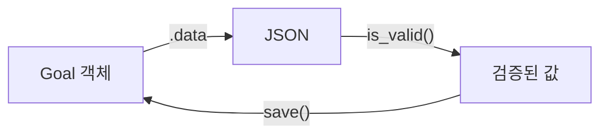
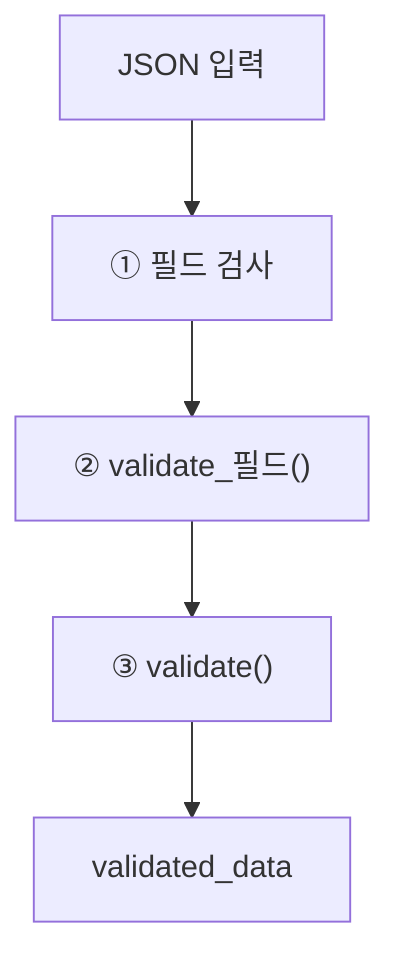

# Day 21 · DRF Serializer 심화: 중첩 응답과 검증

> 읽는 시간: 약 13분

## 복습 3문제

**1.** (Day 20) `MIDDLEWARE` 리스트에서 위에 있는 미들웨어는 요청 때 먼저 실행됩니다. 응답 때는요?

<details>
<summary>정답</summary>

응답 때는 **반대로 나중에** 실행됩니다. 위에 있을수록 바깥 껍질이라, 요청은 바깥에서 안으로, 응답은 안에서 바깥으로 지나갑니다.

</details>

**2.** (Day 17) 폼 검증의 3단계 순서는?

<details>
<summary>정답</summary>

① 필드 자체 변환·검증(`to_python`, `validate`) → ② `clean_<필드>()` → ③ 여러 필드를 함께 보는 `clean()`. 앞 단계에서 실패한 필드는 `cleaned_data`에 없습니다. 오늘 Serializer도 **거의 같은 순서**입니다.

</details>

**3.** (Day 12) `CheckIn`의 `ForeignKey`에 `related_name="checkins"`를 주면 무엇이 생기나요?

<details>
<summary>정답</summary>

Goal 쪽에서 `goal.checkins.all()`처럼 **거꾸로 따라가는 이름**이 생깁니다. 안 주면 기본 이름은 `checkin_set`입니다. 오늘 중첩 응답에서 이 이름을 그대로 씁니다.

</details>

---

## 오늘 만들 것

Goals 앱에 첫 **JSON API**를 붙입니다. `GET /api/goals/1/`이 태그와 최근 체크인까지 담은 JSON을 돌려주고, `POST`로 들어온 데이터는 규칙에 맞는지 검사합니다.

## 오늘 배울 것

- Serializer: 모델 ↔ JSON 양방향 번역기
- 중첩: 읽을 땐 펼치고, 쓸 땐 id로 받기
- 검증: 필드 → 객체 순서, 그리고 모델 `clean`의 빈자리

---

## 1. Serializer: 양방향 번역기

지금까지 Goals 앱은 HTML을 돌려줬습니다. 모바일 앱이나 React 화면이 붙으려면 **JSON**이 필요합니다.

그런데 `Goal` 객체를 그냥 `json.dumps`할 수는 없습니다. 날짜, 관계(FK), 비밀 필드 같은 것을 **어떻게 바꿀지** 누군가 정해야 합니다. 반대로 들어온 JSON은 **믿을 수 없는 문자열 덩어리**라 검사도 필요합니다.

**DRF**(Django REST Framework, Django로 API를 만드는 사실상 표준 라이브러리)의 **Serializer**가 이 두 일을 합니다.



**비유:** 통역사입니다. 나갈 땐 한국어(파이썬 객체)를 영어(JSON)로 옮기고, 들어올 땐 영어를 듣고 **말이 되는지 확인한 뒤** 한국어로 옮깁니다.

**JS (Node)** · 보통 둘을 따로 씁니다.

```javascript
// 나갈 때: 직접 골라 담기
const toJSON = g => ({
  id: g.id, title: g.title });
// 들어올 때: zod로 검사
const GoalIn = z.object({
  title: z.string().max(50) });
```

**Python (DRF)** · 하나의 클래스가 둘 다 합니다. 설치는 로컬에서 `pip install djangorestframework` 후 `INSTALLED_APPS`에 `"rest_framework"`를 넣습니다.

```python
# goals/serializers.py
from rest_framework import serializers

class GoalSerializer(
        serializers.ModelSerializer):
    class Meta:
        model = Goal
        fields = ["id", "title", "target"]
```

`ModelSerializer`는 Day 7의 `ModelForm`과 같은 발상입니다. 모델을 보고 필드 종류와 기본 검증(`max_length` 등)을 **자동으로** 만듭니다.

**결과를 맞혀 보세요:** 아래는 Serializer의 두 방향을 흉내 낸 코드입니다. 마지막 줄은 무엇을 출력할까요?

```python-run
class Goal:
    def __init__(s, id, title, secret):
        s.id, s.title = id, title
        s.secret = secret
FIELDS = ["id", "title"]
g = Goal(1, "독서", "메모")
data = {f: getattr(g, f) for f in FIELDS}
print(data)
```

<details>
<summary>정답</summary>

`{'id': 1, 'title': '독서'}`가 나옵니다. `secret`은 `FIELDS`에 없으니 **아예 나가지 않습니다**. 실제 DRF의 `.data`도 `Meta.fields`에 적힌 것만 내보냅니다.

그래서 `fields = "__all__"`은 위험합니다. 나중에 모델에 비밀 필드를 추가하면 **API로 그대로 새어 나갑니다.** 항상 필드를 직접 적는 습관을 들이세요.

</details>

실제 사용은 로컬 `python manage.py shell`에서 해 보세요.

```python
g = Goal.objects.first()
GoalSerializer(g).data
# 출력: {'id': 1, 'title': '독서', ...}
s = GoalSerializer(data={"title": ""})
s.is_valid()
# 출력: False
```

`s.errors`를 보면 `title`이 비었다는 메시지와 `target`이 없다는 메시지가 필드별로 담겨 있습니다.

> 💡 Serializer는 나갈 땐 `.data`로 JSON을 만들고, 들어올 땐 `is_valid()`로 검사한다. 필드는 `__all__` 말고 직접 적는다.

---

## 2. 중첩: 읽을 땐 펼치고, 쓸 땐 id로

화면에는 목표와 함께 **태그 이름**과 **체크인 목록**이 보여야 합니다. 기본 `ModelSerializer`는 관계를 **id 숫자**로만 내보냅니다.

`"tags": [3, 7]`처럼요. 프런트가 태그 이름을 알려면 요청을 또 보내야 합니다. 그래서 다른 Serializer를 **필드처럼 끼워 넣습니다.** 이것이 **중첩**(nested) Serializer입니다.

```python
class CheckInSerializer(
        serializers.ModelSerializer):
    class Meta:
        model = CheckIn
        fields = ["amount", "day"]
```

```python
class GoalDetailSerializer(
        serializers.ModelSerializer):
    checkins = CheckInSerializer(
        many=True, read_only=True)
    tags = serializers.SlugRelatedField(
        many=True, slug_field="name",
        queryset=Tag.objects.all())
```

```python
    class Meta:
        model = Goal
        fields = ["id", "title", "target",
                  "tags", "checkins"]
```

- `many=True`: 여러 개(리스트)라는 뜻입니다.
- `read_only=True`: 응답에만 나오고, 입력으로는 **무시**합니다.
- `SlugRelatedField`: 관계를 id 대신 **이름 같은 고유 값**으로 주고받습니다. 태그 `name`은 `unique=True`라 딱 맞습니다.

결과는 이렇게 나옵니다.

```text
{"id": 1, "title": "독서", "target": 30,
 "tags": ["취미", "아침"],
 "checkins": [{"amount": 5,
   "day": "2026-10-31"}]}
```


**JS (Node)** · Prisma라면 `include`로 같은 모양을 만듭니다.

```javascript
await prisma.goal.findUnique({
  where: { id: 1 },
  include: { tags: true,
             checkins: true } });
```

**결과를 맞혀 보세요:** 위 `GoalDetailSerializer`에 아래 JSON을 `POST`하면 체크인 2개도 함께 저장될까요?

```text
{"title": "걷기", "target": 100,
 "tags": ["건강"],
 "checkins": [{"amount": 3}]}
```

<details>
<summary>정답</summary>

**아니요.** 목표와 태그 연결만 저장되고 `checkins`는 **조용히 무시됩니다.** `read_only=True`라서 `validated_data`에 들어가지 않기 때문입니다. 에러도 안 나서 더 헷갈립니다.

만약 `read_only`를 빼면? DRF는 `create()`에서 **"중첩 쓰기는 기본 지원 안 함"** 이라는 `AssertionError`를 냅니다. 부모와 자식을 어떤 순서로, 어떤 트랜잭션으로 저장할지 DRF가 대신 정할 수 없어서입니다.

</details>

**비유:** 식당 메뉴판(응답)에는 세트 구성을 다 펼쳐 보여 주지만, 주문서(입력)에는 "세트 3번"처럼 번호만 적게 합니다. 펼쳐서 받으면 확인할 게 너무 많아지거든요.

그래서 실무 기본값은 이렇습니다.

| 방향 | 관계 표현 |
|---|---|
| 읽기 | 중첩으로 펼침 |
| 쓰기 | id·slug로 받기 |
| 둘 다 꼭 필요 | `create()` 직접 작성 |

> 💡 읽을 땐 중첩으로 펼치고, 쓸 땐 id·slug로 받는다. 중첩 쓰기는 `create()`를 직접 짜야 한다.

<details>
<summary>🔍 더 깊이 (면접용)</summary>

**중첩 쓰기 직접 구현.** `validated_data`에서 자식 데이터를 `pop`하고, 부모를 먼저 만든 뒤 자식을 만듭니다. 중간 실패를 대비해 `transaction.atomic()`으로 감쌉니다 (Week 6).

```python
def create(self, data):
    items = data.pop("checkins", [])
    tags = data.pop("tags", [])
    with transaction.atomic():
        g = Goal.objects.create(**data)
        g.tags.set(tags)
        for i in items:
            CheckIn.objects.create(
                goal=g, **i)
    return g
```

**`update()`는 더 어렵습니다.** 자식 목록이 바뀌면 "어떤 걸 지우고, 고치고, 새로 만들지"를 정해야 합니다. 그래서 보통 자식은 별도 엔드포인트(`/goals/1/checkins/`)로 분리합니다.

**N+1 문제.** 목록 API에서 목표 20개를 중첩으로 내보내면, 목표마다 `checkins`와 `tags` 쿼리가 따로 나가 **1 + 20 × 2 = 41번** 쿼리가 됩니다. 뷰의 `queryset`에 `prefetch_related("tags", "checkins")`를 붙이면 3번으로 줄어듭니다. Week 6 첫날 주제입니다.

**`source`와 `SerializerMethodField`.** `done = serializers.IntegerField(source="done_total", read_only=True)`처럼 모델의 다른 속성·annotate 값을 다른 이름으로 내보낼 수 있습니다. 계산이 필요하면 `SerializerMethodField` + `get_<이름>(self, obj)`를 씁니다. 단, 메서드 안에서 쿼리를 날리면 바로 N+1입니다.

</details>

---

## 3. 검증: 필드 → 객체, 그리고 빈자리

들어온 데이터를 검사하는 순서는 Day 17의 폼과 거의 같습니다.



Goals 앱 규칙 두 개를 넣어 봅시다. 제목에 공백만 있으면 안 되고, 마감일이 있으면 오늘 이후여야 합니다.

```python
def validate_title(self, value):
    value = value.strip()
    if not value:
        raise serializers.ValidationError(
            "제목을 입력하세요.")
    # 꼭 return! (Day 7 기억나죠?)
    return value
```

```python
def validate(self, attrs):
    d = attrs.get("deadline")
    if d and d < date.today():
        raise serializers.ValidationError(
          {"deadline": "과거 불가"})
    return attrs
```

두 메서드 모두 `GoalDetailSerializer` 클래스 안에 넣습니다. `validate`에서 딕셔너리로 에러를 던지면 **그 필드 이름 아래** 에러가 붙습니다.

**JS (Node)** · zod의 `refine`이 ③에 해당합니다.

```javascript
const GoalIn = z.object({
  title: z.string().trim().min(1),
  deadline: z.coerce.date().optional(),
}).refine(g => !g.deadline
  || g.deadline >= today(),
  { path: ["deadline"] });
```

**결과를 맞혀 보세요:** 같은 순서를 흉내 낸 코드입니다. `title`이 비어 있고 `deadline`도 과거일 때, 에러는 몇 개 나올까요?

```python-run
def run(raw):
    errs = {}
    t = raw["title"].strip()
    if not t:
        errs["title"] = "제목 필요"
    if errs:
        return errs
    return "validate() 실행"
print(run({"title": " ", "d": "과거"}))
```

<details>
<summary>정답</summary>

에러는 **`title` 하나만** 나옵니다: `{'title': '제목 필요'}`.

DRF도 같습니다. ①② 필드 단계에서 하나라도 실패하면 ③ `validate()`는 **아예 실행되지 않습니다.** 그래서 사용자는 제목을 고친 뒤에야 마감일 에러를 보게 됩니다. `validate()` 안에서는 모든 필드가 이미 통과했다고 믿어도 된다는 장점이기도 합니다.

</details>

이제 **빈자리** 이야기입니다. Day 17에서 `Goal.clean()`에 "done ≤ target" 규칙을 넣었죠. 폼과 Admin은 이걸 자동으로 불렀습니다.

**DRF는 모델의 `clean()`을 부르지 않습니다.** API로 들어오면 그 규칙이 **그냥 통과됩니다.** 대신 모델의 `unique`, `UniqueConstraint`(일부)는 DRF가 읽어서 검증기로 만들어 줍니다.

**비유:** 정문(폼)에는 경비원이 있는데, 새로 낸 옆문(API)에는 아무도 안 세운 상황입니다. 마지막 자물쇠(DB 제약)만 남아 있죠.

해결은 규칙을 **한 곳**에 두고 양쪽에서 부르는 것입니다.

```python
# validate() 안, deadline 검사 다음
data = {k: v for k, v in attrs.items()
        if k != "tags"}
try:
    Goal(**data).clean()
except DjangoValidationError as e:
    raise serializers.ValidationError(
        e.message_dict)
```

(`DjangoValidationError`는 `from django.core.exceptions import ValidationError as DjangoValidationError`로 가져옵니다. M2M인 `tags`는 저장 전 객체에 넣을 수 없어서 뺐습니다.)

> 💡 검증 순서는 필드 → `validate_필드` → `validate`. DRF는 모델 `clean()`을 안 부르니, 업무 규칙은 직접 연결하거나 DB 제약으로 지킨다.

<details>
<summary>🔍 더 깊이 (면접용)</summary>

**`is_valid(raise_exception=True)`.** 실패하면 `ValidationError`를 던지고, DRF의 예외 처리기가 자동으로 **400 응답**과 에러 JSON을 만듭니다. 뷰에서 `if not s.is_valid(): return Response(s.errors, 400)`를 반복할 필요가 없습니다.

**`partial=True`(PATCH).** 일부 필드만 보내도 되게 합니다. 이때 `validate()`의 `attrs`에는 **보낸 필드만** 있습니다. `attrs["target"]` 대신 `attrs.get("target", self.instance.target)`처럼 기존 값과 합쳐서 검사해야 합니다. 자주 나오는 버그입니다.

**`save(owner=request.user)`.** 사용자가 보내면 안 되는 값(소유자)은 Serializer 필드로 받지 말고, 뷰에서 `save()`에 키워드로 넘깁니다. 이 값은 `validated_data`에 합쳐져 `create()`로 갑니다. `owner`를 입력 필드로 열어 두면 **남의 이름으로 목표를 만드는 구멍**이 됩니다 (Mass Assignment, OWASP API Top 10).

**왜 DRF는 `full_clean()`을 안 부를까?** DRF 3.0부터 의도적으로 뺐습니다. 검증 로직을 Serializer에 명시적으로 모으자는 설계 결정입니다 (모델 `clean()`은 M2M·요청 문맥을 모르고, 두 번 검증하는 혼란도 생김).

</details>

---

## 연습문제

**1.** Goals 목록 API용 `GoalListSerializer`를 만드세요. `id`, `title`, 태그 이름 목록만 내보내고, 모든 필드가 읽기 전용이어야 합니다.

<details>
<summary>정답</summary>

```python
class GoalListSerializer(
        serializers.ModelSerializer):
    tags = serializers.SlugRelatedField(
        many=True, read_only=True,
        slug_field="name")
```

```python
    class Meta:
        model = Goal
        fields = ["id", "title", "tags"]
        read_only_fields = fields
```

`read_only=True`인 `SlugRelatedField`에는 `queryset`이 필요 없습니다. 입력을 받지 않으니 "어디서 찾을지" 몰라도 되기 때문입니다. 목록은 가볍게, 상세는 중첩으로 풍부하게 나누는 것이 흔한 패턴입니다 (뷰에서 `get_serializer_class()`로 고릅니다. 내일 배웁니다).

</details>

**2.** `CheckInSerializer`에 규칙을 넣으세요: `amount`는 1 이상 1000 이하. 먼저 순수 Python으로 함수를 완성해 보세요.

```python-run
def validate_amount(v):
    # 여기를 완성하세요
    return v
for v in [0, 5, 2000]:
    try:
        print(validate_amount(v))
    except ValueError as e:
        print("에러:", e)
```

<details>
<summary>정답</summary>

```python-run
def validate_amount(v):
    if not 1 <= v <= 1000:
        raise ValueError("1~1000만 가능")
    return v
for v in [0, 5, 2000]:
    try:
        print(validate_amount(v))
    except ValueError as e:
        print("에러:", e)
# 출력: 에러… / 5 / 에러…
```

DRF에서는 메서드 대신 필드 옵션이 더 짧습니다.

```python
class Meta:
    model = CheckIn
    fields = ["amount", "day"]
    extra_kwargs = {"amount": {
        "min_value": 1,
        "max_value": 1000}}
```

`PositiveIntegerField`는 0을 허용하므로 `min_value=1`이 필요합니다. 이 규칙이 API 전용이 아니라면 모델의 `validators=[MinValueValidator(1)]`에 두는 편이 낫습니다. `ModelSerializer`가 모델 필드 검증기는 **자동으로 가져오기** 때문입니다.

</details>

**3.** 누군가 API로 `{"title": "독서", "target": 10, "owner": 2}`를 보내 다른 사람 목표를 만들려고 합니다. 어떻게 막을까요?

<details>
<summary>정답</summary>

`owner`를 Serializer `fields`에 **넣지 않거나** `read_only_fields`에 넣고, 뷰에서 현재 사용자로 채웁니다.

```python
class Meta:
    model = Goal
    fields = ["id", "title", "target",
              "owner"]
    read_only_fields = ["owner"]
```

```python
# 뷰 (내일 배울 ViewSet)
def perform_create(self, s):
    s.save(owner=self.request.user)
```

이제 `owner: 2`는 입력에서 무시되고, 항상 로그인한 사용자가 소유자가 됩니다. Day 9의 "내 Goals만" 원칙을 API에도 그대로 지키는 것입니다.

</details>

---

## 면접 질문

**Q1.** 중첩 Serializer로 쓰기(create)를 지원하려면 무엇을 해야 하고, 실무에서는 보통 어떻게 하나요?

<details>
<summary>모범 답안</summary>

DRF는 중첩 쓰기를 기본 지원하지 않아서 `create()`/`update()`를 오버라이드해야 합니다. `validated_data`에서 자식 데이터를 `pop`하고, 부모를 먼저 저장한 뒤 자식을 만들며, 일부만 성공하지 않도록 `transaction.atomic()`으로 묶습니다.

다만 `update()`에서는 자식의 추가·수정·삭제를 구분해야 해서 복잡해집니다. 그래서 실무에서는 **읽기는 중첩, 쓰기는 id(PrimaryKey/Slug)로 받고**, 자식은 별도 엔드포인트로 다루는 경우가 많습니다. 중첩 읽기는 N+1을 피하려고 `prefetch_related`를 같이 씁니다.

</details>

**Q2.** 모델의 `clean()`에 넣은 검증이 DRF API에서는 동작하지 않았습니다. 왜 그렇고, 어떻게 해결하나요?

<details>
<summary>모범 답안</summary>

DRF 3부터 `ModelSerializer`는 모델의 `full_clean()`을 호출하지 않습니다. 필드 정의의 검증기와 `unique` 제약만 가져옵니다. 검증을 Serializer에 명시적으로 모으려는 설계입니다.

해결책은 세 가지입니다. ① Serializer의 `validate()`에서 규칙을 구현하거나 모델 `clean()`을 직접 호출합니다. ② 규칙을 서비스 함수로 빼서 폼·Serializer 양쪽에서 부릅니다. ③ 꼭 지켜야 하는 불변식은 `CheckConstraint` 같은 **DB 제약**으로 마지막 방어선을 둡니다. 경쟁 조건까지 막을 수 있는 건 ③뿐입니다.

</details>

---

## 오늘 정리

1. Serializer는 모델 ↔ JSON 양방향 번역기. 필드는 `__all__` 대신 직접 적는다.
2. 읽을 땐 중첩으로 펼치고, 쓸 땐 id·slug로 받는다. 중첩 쓰기는 `create()`를 직접 짠다.
3. 검증은 필드 → `validate_필드` → `validate`. 모델 `clean()`은 안 불리니 직접 연결한다.

## 다음에 이어갈 것

오늘 만든 Serializer를 **ViewSet·Router**에 연결해 `/api/goals/` 목록·상세·생성 API를 한 번에 엽니다.
