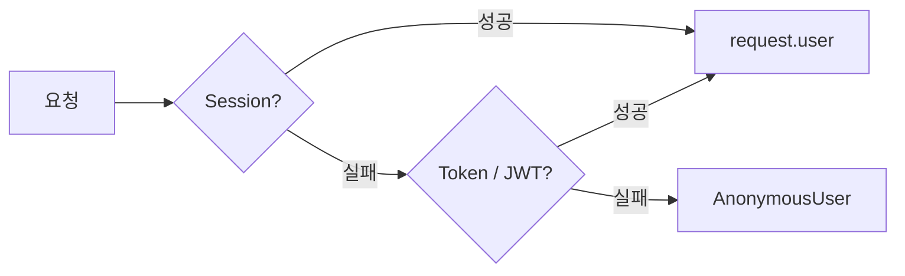

# Day 23 · 인증: Session·Token·JWT로 "누구세요?" 답하기

> 읽는 시간: 약 14분

## 복습 3문제

**1.** (Day 22) ViewSet에서 남의 목표를 못 보게 막는 **가장 중요한** 메서드는?

<details>
<summary>정답</summary>

`get_queryset()`입니다. `Goal.objects.filter(owner=self.request.user)`로 범위를 좁혀 두면 목록·상세·수정·삭제가 모두 그 범위 안에서만 움직입니다. 남의 id로 요청하면 404가 납니다.

</details>

**2.** (Day 18) Django 세션은 브라우저에 무엇을 저장하고, 서버에는 무엇을 저장하나요?

<details>
<summary>정답</summary>

브라우저에는 **세션 id만** 쿠키(`sessionid`)로 저장됩니다. 실제 내용(로그인한 사용자 id 등)은 **서버**의 세션 저장소(기본은 DB의 `django_session` 테이블)에 있습니다.

</details>

**3.** (Day 22) `@action`에서 객체를 직접 `Goal.objects.get(pk=pk)`로 꺼내면 왜 위험한가요?

<details>
<summary>정답</summary>

`get_queryset()`의 소유자 필터와 객체 권한 검사를 **우회**하기 때문입니다. 남의 목표 id를 넣으면 그대로 조회됩니다(IDOR). 반드시 `self.get_object()`를 씁니다.

</details>

---

## 오늘 만들 것

지금 Goals API는 로그인한 **브라우저**에서만 됩니다. 오늘은 모바일 앱·스크립트도 쓸 수 있게 **토큰 인증**과 **JWT 로그인**을 붙입니다.

## 오늘 배울 것

- 인증과 권한의 차이, 그리고 세션 인증의 한계
- Token 인증: DB에 저장하는 열쇠
- JWT: 서버가 기억하지 않는 서명된 출입증

---

## 1. 인증 vs 권한, 그리고 세션 인증

두 단어가 자주 섞입니다. 면접에서도 단골입니다.

- **인증**(Authentication): "**누구**세요?" → `request.user`를 채우는 일
- **권한**(Authorization): "그 사람이 **이걸 해도** 되나요?" → 다음 레슨의 `permission_classes`

DRF는 요청이 오면 `authentication_classes`를 **순서대로** 시도합니다. 처음 성공한 방식이 `request.user`를 정합니다. 모두 실패하면 사용자는 `AnonymousUser`(익명)가 됩니다.



**JS (Node)** · Express에선 Passport 전략을 쌓습니다.

```javascript
app.use(passport.session());
app.use("/api", passport.authenticate(
  ["bearer", "jwt"], { session: false }));
```

**Python (DRF)** · settings 한 곳에 씁니다.

```python
# config/settings.py
REST_FRAMEWORK = {
  "DEFAULT_AUTHENTICATION_CLASSES": [
    "rest_framework.authentication"
    ".SessionAuthentication",
  ],
}
```

**세션 인증**은 Day 18의 그 세션 쿠키를 그대로 씁니다. 같은 도메인의 웹 화면에는 가장 편하고 안전합니다.

**결과를 맞혀 보세요:** 브라우저에서 로그인한 상태로, JS `fetch`로 `POST /api/goals/`를 보냈습니다. 쿠키는 잘 갔는데 403이 납니다. 왜일까요?

<details>
<summary>정답</summary>

**CSRF 토큰**이 없어서입니다. `SessionAuthentication`은 쿠키로 인증하므로, 다른 사이트가 몰래 요청을 보내는 공격(CSRF)을 막으려고 `POST`·`PUT`·`DELETE`에 `X-CSRFToken` 헤더를 요구합니다. `csrftoken` 쿠키 값을 읽어 헤더에 넣으면 통과합니다.

반대로 Token·JWT 인증은 쿠키가 아니라 **헤더**에 직접 넣으므로 CSRF 검사를 하지 않습니다. 브라우저가 헤더를 자동으로 붙이지 않기 때문입니다.

</details>

**세션의 한계**는 이렇습니다.

- 모바일 앱·CLI는 쿠키와 CSRF를 다루기 번거롭습니다.
- 서버 여러 대라면 세션 저장소를 공유해야 합니다(DB·Redis).

**비유:** 세션은 **호텔 프런트**입니다. 손님은 방 번호표(세션 id)만 들고, 누가 묵는지는 프런트 장부(서버)에 있습니다.

> 💡 인증은 "누구?", 권한은 "해도 돼?". 세션 인증은 쿠키 기반이라 웹에 편하지만 CSRF가 따라오고, 앱에는 불편하다.

---

## 2. Token 인증: DB에 저장하는 열쇠

DRF가 기본 제공하는 **TokenAuthentication**은 단순합니다. 사용자마다 무작위 문자열 하나를 DB에 저장하고, 클라이언트는 매 요청 헤더에 넣습니다.

```bash
curl -H "Authorization: Token 9944b0..." \
  https://goals.example.com/api/goals/
```

설정은 앱 추가 → 마이그레이션 → 발급 URL입니다.

```python
INSTALLED_APPS += [
    "rest_framework.authtoken"]
# 그리고: python manage.py migrate
```

```python
# config/urls.py
from rest_framework.authtoken.views \
    import obtain_auth_token

urlpatterns += [
  path("api/token/", obtain_auth_token),
]
```

`POST /api/token/`에 아이디·비밀번호를 보내면 `{"token": "9944b0..."}`가 돌아옵니다. 그 뒤로는 비밀번호 대신 이 토큰을 씁니다.

**결과를 맞혀 보세요:** 토큰이 유출됐습니다. 관리자가 Admin에서 그 사용자의 Token 행을 **삭제**하면, 공격자의 다음 요청은?

<details>
<summary>정답</summary>

**즉시 401**입니다. 매 요청마다 DB에서 토큰을 찾기 때문에, 행이 없으면 바로 인증 실패입니다.

이것이 Token 방식의 장점이자 비용입니다. **언제든 끊을 수 있지만**, 요청마다 DB 조회 1번이 듭니다.

</details>

기본 Token의 약점도 알아 둡니다.

- **만료가 없습니다.** 한 번 발급하면 지울 때까지 영원합니다.
- 사용자당 **토큰 1개**라 기기별로 따로 끊을 수 없습니다.
- 실무에선 `django-rest-knox`처럼 만료·기기별 토큰을 주는 패키지를 쓰기도 합니다.

**비유:** Token은 **회원 카드**입니다. 카드 번호가 회사 명부에 있어서, 분실 신고하면 그 즉시 막힙니다.

> 💡 Token 인증 = DB에 저장된 무작위 열쇠. 즉시 폐기가 쉽지만 요청마다 DB를 보고, 기본형은 만료가 없다.

---

## 3. JWT: 서버가 기억하지 않는 출입증

**JWT**(JSON Web Token)는 발상이 반대입니다. 서버가 토큰을 **저장하지 않습니다**. 대신 토큰 안에 정보를 넣고 **서명**합니다.

구조는 점(`.`)으로 나뉜 세 덩어리입니다.

```text
헤더.페이로드.서명
eyJhbGci...eyJ1c2VyX2lkIjo3...SflKxw...
```

- **헤더**: 서명 알고리즘(예: HS256)
- **페이로드**: `user_id`, 만료 시각 `exp` 등. **암호화가 아니라 Base64**라서 누구나 읽습니다.
- **서명**: 서버 비밀키로 앞 두 덩어리를 HMAC한 값. 내용을 바꾸면 서명이 안 맞습니다.


직접 만들어 보면 원리가 보입니다. 표준 라이브러리만 씁니다.

```python-run
import hmac, hashlib, base64, json
b64 = lambda b: base64.urlsafe_b64encode(
    b).rstrip(b"=")
KEY = b"server-secret"
sign = lambda d: b64(hmac.new(
    KEY, d, hashlib.sha256).digest())
data = json.dumps({"user_id": 7})
body = b64(data.encode())
tok = body + b"." + sign(body)
print(tok.decode())
```

**결과를 맞혀 보세요:** 공격자가 페이로드를 `{"user_id": 1}`(관리자)로 바꿔 끼웠습니다. 서명은 그대로입니다. 서버는 통과시킬까요? 아래를 실행해 확인하세요.

```python-run
import hmac, hashlib, base64, json
b64 = lambda b: base64.urlsafe_b64encode(
    b).rstrip(b"=")
sign = lambda d: b64(hmac.new(
    b"server-secret", d,
    hashlib.sha256).digest())
old = sign(b64(b'{"user_id": 7}'))
fake = b64(b'{"user_id": 1}')
print(hmac.compare_digest(sign(fake), old))
```

<details>
<summary>정답</summary>

`False`, **거부됩니다.** 서명은 페이로드 내용으로 계산되므로, 내용이 바뀌면 서버가 다시 계산한 서명과 다릅니다. 공격자는 비밀키를 모르니 새 서명을 만들 수 없습니다.

`compare_digest`는 비교 시간을 일정하게 해서, 응답 속도로 서명을 한 글자씩 추측하는 **타이밍 공격**을 막습니다.

</details>

**Goals 앱에 붙이기** · 실무 표준은 `djangorestframework-simplejwt`입니다. 로컬에서 설치하세요.

```bash
pip install djangorestframework-simplejwt
```

```python
# config/settings.py
REST_FRAMEWORK = {
  "DEFAULT_AUTHENTICATION_CLASSES": [
    "rest_framework_simplejwt"
    ".authentication.JWTAuthentication",
    "rest_framework.authentication"
    ".SessionAuthentication",
  ],
}
```

```python
# config/urls.py
from rest_framework_simplejwt.views import (
    TokenObtainPairView, TokenRefreshView)

urlpatterns += [
  path("api/jwt/",
       TokenObtainPairView.as_view()),
  path("api/jwt/refresh/",
       TokenRefreshView.as_view()),
]
```

로그인하면 토큰이 **두 개** 옵니다.

| 토큰 | 수명 | 용도 |
|---|---|---|
| access | 짧게 (5분~1시간) | 매 요청 헤더 |
| refresh | 길게 (1~14일) | 새 access 받기 |

```bash
curl -H "Authorization: Bearer eyJhbGci..." \
  https://goals.example.com/api/goals/
```

왜 둘일까요? JWT는 서버가 기억하지 않으니 **중간에 끊기 어렵습니다**. 그래서 access를 짧게 둬서, 유출돼도 피해 시간을 줄입니다. refresh는 드물게만 오가니 노출이 적습니다.

**JS (Node)** · `jsonwebtoken`과 똑같은 개념입니다.

```javascript
const token = jwt.sign(
  { user_id: 7 }, SECRET,
  { expiresIn: "15m" });
const data = jwt.verify(token, SECRET);
```

**비유:** JWT는 **위조 방지 홀로그램이 찍힌 놀이공원 손목띠**입니다. 입구 직원은 명부를 볼 필요 없이 홀로그램과 날짜만 확인합니다. 대신 이미 채운 띠를 중간에 회수하긴 어렵습니다.

> 💡 JWT = 서명된 자기 증명. DB 조회 없이 검증되지만 내용은 누구나 읽고, 중간 폐기가 어려워 access는 짧게 둔다.

<details>
<summary>🔍 더 깊이 (면접용)</summary>

**JWT를 "로그아웃"시키려면?** 서버가 무상태라 그대로는 불가능합니다. 방법은 세 가지입니다.

1. access 수명을 짧게 하고, 만료를 기다린다.
2. refresh 토큰을 **블랙리스트**에 넣는다. simplejwt의 `token_blacklist` 앱이 DB 테이블로 제공합니다. 결국 일부 상태(DB)를 다시 들이는 셈입니다.
3. 사용자별 `token_version`을 페이로드에 넣고, 비밀번호 변경 시 올린다. 검증 때 DB를 한 번 봐야 합니다.

**Refresh 회전**(`ROTATE_REFRESH_TOKENS=True`): refresh를 쓸 때마다 새 refresh를 주고 옛것을 블랙리스트에 넣습니다. 탈취된 refresh가 재사용되면 탐지할 수 있습니다.

**어디에 저장하나?**

- `localStorage`: 구현이 쉽지만 **XSS**(악성 스크립트 삽입) 한 번이면 JS가 토큰을 읽어 갑니다.
- `httpOnly` 쿠키: JS가 못 읽어 XSS에 강합니다. 대신 쿠키라서 **CSRF 대비**(SameSite, CSRF 토큰)가 다시 필요합니다.
- 흔한 절충: access는 메모리, refresh는 `httpOnly; Secure; SameSite=Strict` 쿠키.

**알고리즘 함정:** 옛 라이브러리는 헤더의 `alg: none`을 믿어 서명 없이 통과시키는 버그가 있었습니다. 검증 시 허용 알고리즘을 **서버가 고정**해야 합니다. 마이크로서비스라면 HS256(공유 비밀키) 대신 **RS256**(개인키로 서명, 공개키로 검증)을 써서 검증 서버에 비밀키를 나눠 주지 않습니다.

**페이로드에 넣지 말 것:** 비밀번호, 개인정보. Base64는 암호화가 아닙니다.

**세 방식 비교**

| 방식 | 서버 상태 | 즉시 폐기 |
|---|---|---|
| Session | 있음 | 쉬움 |
| Token | 있음(DB) | 쉬움 |
| JWT | 없음 | 어려움 |

</details>

---

## 연습문제

**1.** Goals 웹 화면은 세션으로, 모바일 앱은 JWT로 쓰고 싶습니다. `DEFAULT_AUTHENTICATION_CLASSES`를 어떻게 쓰고, 순서는 상관있을까요?

<details>
<summary>정답</summary>

```python
"DEFAULT_AUTHENTICATION_CLASSES": [
  "rest_framework_simplejwt"
  ".authentication.JWTAuthentication",
  "rest_framework.authentication"
  ".SessionAuthentication",
],
```

둘 다 넣으면 됩니다. 각 클래스는 자기 방식의 증거가 **없으면** `None`을 돌려 다음으로 넘깁니다. JWT는 `Authorization` 헤더가 없으면 넘어가고, 세션은 쿠키가 없으면 넘어갑니다.

순서는 **401 응답 모양**에 영향을 줍니다. 첫 번째 클래스의 `authenticate_header()`가 `WWW-Authenticate` 헤더를 정하는데, 세션은 이 값이 없어서 DRF가 401 대신 **403**을 돌려줍니다. API 클라이언트에 401을 주려면 JWT를 앞에 둡니다.

</details>

**2.** 아래 JWT 페이로드를 Base64로 풀었더니 이렇게 나왔습니다. 이 설계의 문제 두 가지는?

```text
{"user_id": 7, "email": "a@b.com",
 "is_staff": true}
```

<details>
<summary>정답</summary>

1. **개인정보 노출**: 페이로드는 누구나 디코드합니다. 이메일 같은 정보는 넣지 않는 게 좋습니다.
2. **권한이 굳어 버림**: `is_staff`를 토큰에 넣으면, 관리자 권한을 회수해도 토큰이 만료될 때까지 서버가 `true`로 믿을 수 있습니다. 권한은 요청 때 DB의 `request.user`에서 확인합니다.

simplejwt의 기본 페이로드는 `user_id`, `exp`, `jti`(토큰 고유 id), `token_type` 정도입니다. 최소한만 넣습니다.

</details>

**3.** 순수 Python으로 `verify(token)`을 완성하세요. 서명이 맞으면 페이로드 딕셔너리를, 틀리면 `None`을 돌려줍니다.

```python-run
import hmac, hashlib, base64, json
b64 = lambda b: base64.urlsafe_b64encode(
    b).rstrip(b"=")
sign = lambda d: b64(hmac.new(
    b"k", d, hashlib.sha256).digest())
def verify(token):
    ...
```

<details>
<summary>정답</summary>

```python-run
import hmac, hashlib, base64, json
b64 = lambda b: base64.urlsafe_b64encode(
    b).rstrip(b"=")
sign = lambda d: b64(hmac.new(
    b"k", d, hashlib.sha256).digest())
unb = lambda b: base64.urlsafe_b64decode(
    b + b"=" * (-len(b) % 4))
def verify(tok):
    body, _, sig = tok.partition(b".")
    ok = hmac.compare_digest(sign(body), sig)
    if not ok:
        return None
    return json.loads(unb(body))
body = b64(b'{"user_id": 7}')
print(verify(body + b"." + sign(body)))
fake = b64(b'{"user_id": 1}')
print(verify(fake + b"." + sign(body)))
# 출력: {'user_id': 7}
# 출력: None
```

해설: Base64 패딩(`=`)은 토큰에서 지우므로, 풀 때 길이를 4의 배수로 다시 채웁니다. 진짜 JWT는 여기에 헤더와 `exp`(만료) 검사가 더해집니다. 실무에서는 직접 만들지 말고 검증된 라이브러리를 씁니다.

</details>

---

## 면접 질문

**Q1. 세션 인증과 JWT 인증의 차이, 그리고 각각 언제 쓰시겠어요?**

<details>
<summary>모범 답안</summary>

세션은 서버가 로그인 상태를 저장하고, 클라이언트는 세션 id 쿠키만 들고 다닙니다. 서버에서 즉시 로그아웃·강제 만료가 쉽지만, 서버가 여러 대면 세션 저장소(Redis 등)를 공유해야 하고 쿠키라서 CSRF 대비가 필요합니다.

JWT는 서버가 상태를 저장하지 않고, 서명된 토큰 자체가 신원을 증명합니다. DB 조회 없이 검증해 확장에 유리하고 모바일·타 서비스에 쓰기 좋지만, 발급 후 폐기가 어렵습니다. 그래서 짧은 access + refresh 회전·블랙리스트로 보완합니다.

같은 도메인의 웹 앱이면 세션을, 모바일 앱이나 여러 서비스가 신원을 공유하는 구조면 JWT를 고르겠습니다. Goals 앱처럼 둘 다 있으면 DRF에 두 인증 클래스를 함께 둡니다.

</details>

**Q2. JWT가 탈취됐습니다. 어떻게 대응하나요?**

<details>
<summary>모범 답안</summary>

access는 수명이 짧으니 만료되도록 두고, 해당 사용자의 **refresh 토큰을 블랙리스트**에 넣어 재발급을 막습니다. 전체 기기를 끊어야 하면 사용자별 `token_version`을 올리거나 비밀번호를 바꾸게 하고, 최악의 경우 서명 키를 교체해 모든 토큰을 무효화합니다.

예방책으로는 refresh 회전(재사용 탐지), `httpOnly` 쿠키 저장으로 XSS 노출 줄이기, HTTPS 강제, 페이로드 최소화를 말하겠습니다.

</details>

---

## 오늘 정리

1. 인증은 "누구?", 권한은 "해도 돼?". DRF는 인증 클래스를 순서대로 시도한다.
2. Session·Token은 서버가 상태를 가져 즉시 끊기 쉽고, 세션은 CSRF가 따라온다.
3. JWT는 서명으로 무상태 검증. 내용은 공개, 폐기가 어려워 access는 짧게.

## 다음에 이어갈 것

이제 "누구인지"는 압니다. 내일은 "**무엇을 해도 되는지**"를 다룹니다. Goals API에 권한·요청 횟수 제한(Throttling)·페이지네이션·필터링을 붙입니다.
