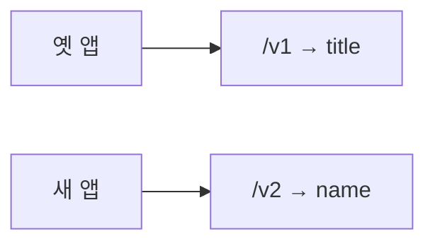

# Day 25 · API 버저닝·OpenAPI: 앱이 바뀌어도 옛 클라이언트가 안 깨지게

> 읽는 시간: 약 13분

## 복습 3문제

**1.** (Day 24) `has_object_permission`만 두고 `get_queryset()`을 `Goal.objects.all()`로 두면, 목록 API에서 남의 목표가 보일까요?

<details>
<summary>정답</summary>

**보입니다.** 객체 권한은 `get_object()`가 돌 때, 즉 상세·수정·삭제에서만 실행됩니다. 목록 보안은 `get_queryset()` 필터가 책임집니다.

</details>

**2.** (Day 24) 요청이 너무 잦을 때 DRF가 돌려주는 상태 코드는?

<details>
<summary>정답</summary>

**429 Too Many Requests**입니다. Throttling이 캐시에 요청 기록을 두고 한도를 넘으면 거부합니다.

</details>

**3.** (Day 22) `DefaultRouter`에 `GoalViewSet`을 등록하면 `GET /goals/1/`은 어떤 액션으로 가나요?

<details>
<summary>정답</summary>

**retrieve**입니다. 목록 URL의 GET은 `list`, 상세 URL의 GET은 `retrieve`로 라우터가 붙입니다.

</details>

---

## 오늘 만들 것

Goals API에 **버전(`/api/v1/`, `/api/v2/`)**을 나누고, `drf-spectacular`로 **Swagger UI 문서**를 자동 생성합니다.

## 오늘 배울 것

- 왜 API를 버전으로 나누는지 (깨지는 변경)
- DRF 버저닝 클래스와 `request.version`
- OpenAPI 스키마 = 프론트·모바일과의 **계약**


버전 없이 필드명을 바꾸면 옛 앱이 바로 깨집니다. URL로 v1·v2를 나누면 옛 계약과 새 계약이 **동시에** 살아 있습니다.

---

## 1. 왜 버전이 필요한가

모바일 앱은 스토어 심사·유저 업데이트 때문에 **옛 클라이언트가 오래** 남습니다. 서버만 먼저 바꾸면 옛 앱이 기대하던 JSON 모양이 사라져 화면이 깨집니다. 이것을 **깨지는 변경(breaking change)**이라고 합니다.

예: Goals 응답의 `title`을 `name`으로 바꾸면, 옛 앱의 `goal.title`은 `undefined`가 됩니다.

**결과를 맞혀 보세요:** 옛 앱은 `title`을 읽고, 서버는 어느 날부터 `name`만 보냅니다. 버전 없이 배포하면?

<details>
<summary>정답</summary>

옛 앱은 `title`이 없어서 제목이 비거나 크래시합니다. 서버·클라이언트를 **동시에** 바꿀 수 없을 때 버전이 필요합니다.

</details>

**비유:** 식당 메뉴판입니다. "김치찌개"를 "Kimchi Stew"로만 바꿔 적으면, 한국어만 읽는 손님은 주문을 못 합니다. 한동안 **한·영 메뉴를 둘 다** 두는 것이 버저닝입니다.

DRF가 자주 쓰는 방식 세 가지입니다.

| 방식 | 예 | 특징 |
|---|---|---|
| URLPath | `/api/v1/goals/` | 눈에 잘 보임, 캐시·프록시 쉬움 |
| Namespace | `v1:goal-list` | Django URL 네임스페이스 |
| AcceptHeader | `Accept: application/json; version=1.0` | URL은 하나, 헤더로 고름 |

Goals API는 **URLPath**가 가장 읽기 쉽습니다. 문서·로그·curl 모두 `/v1/`이 보입니다.



> 💡 버전은 "옛 클라이언트와의 계약"을 지키면서 새 계약을 추가하는 방법이다.

<details>
<summary>🔍 더 깊이 (면접용)</summary>

**언제 v2를 만드나?** 필드 삭제·이름 변경·의미 변경·필수 여부 강화처럼 **기존 클라이언트가 깨질 때**입니다. 필드 추가는 보통 하위 호환이라 같은 버전에서 해도 됩니다.

**헤더 vs URL:** AcceptHeader는 URL이 깔끔하지만, CDN·브라우저 캐시·공유 링크에서 버전이 안 보여 실수가 납니다. 공개 REST API는 URLPath가 디버깅에 유리합니다. GraphQL은 스키마 진화로 버전을 거의 안 쓰지만, REST Goals API에는 URL 버전이 잘 맞습니다.

**폐기(deprecation):** v1을 바로 끄지 말고, 응답 헤더나 문서로 "종료 예정일"을 알린 뒤 트래픽이 줄면 내립니다.

</details>

---

## 2. DRF에서 버전 붙이기

설정의 `DEFAULT_VERSIONING_CLASS`로 전역 방식을 고릅니다. URLPath면 URL 패턴에 `(?P<version>v[12])`를 넣습니다.

**JS (Node)** · Express는 라우터를 나눕니다.

```javascript
app.use("/api/v1", v1Router);
app.use("/api/v2", v2Router);
```

**Python (DRF)** · 설정 + URL에 version 캡처.

```python
# config/settings.py
REST_FRAMEWORK = {
    "DEFAULT_VERSIONING_CLASS":
        "rest_framework.versioning"
        ".URLPathVersioning",
    "DEFAULT_VERSION": "v1",
    "ALLOWED_VERSIONS": ["v1", "v2"],
}
```

```python
# config/urls.py
urlpatterns = [
    path("api/<version>/",
         include("goals.urls")),
]
```

뷰에서는 `request.version`으로 분기합니다. 시리얼라이저를 버전마다 다르게 고르는 패턴이 흔합니다.

```python
# goals/serializers.py — v1
class GoalSerializerV1(
        serializers.ModelSerializer):
    class Meta:
        model = Goal
        fields = ["id", "title", "target"]
```

```python
# v2: title 컬럼 → JSON name
class GoalSerializerV2(
        serializers.ModelSerializer):
    name = serializers.CharField(
        source="title")
    class Meta:
        model = Goal
        fields = ["id", "name", "target"]
```

```python
# goals/views.py
class GoalViewSet(viewsets.ModelViewSet):
    def get_serializer_class(self):
        if self.request.version == "v2":
            return GoalSerializerV2
        return GoalSerializerV1
```

v2는 DB 컬럼 `title`을 JSON 키 `name`으로 **이름만** 바꿉니다. `source="title"` 덕분에 모델은 그대로입니다.

**결과를 맞혀 보세요:** `GET /api/v1/goals/1/`과 `GET /api/v2/goals/1/`의 JSON 키 차이는?

<details>
<summary>정답</summary>

v1은 `"title": "독서"`, v2는 `"name": "독서"`입니다. 같은 Goal 행이지만 **계약(스키마)만** 다릅니다.

</details>

허용되지 않은 버전(`v9`)으로 오면 DRF는 **404**에 가깝게 거절합니다(`ALLOWED_VERSIONS` 밖). 기본값(`DEFAULT_VERSION`)은 버전이 빠졌을 때 쓰입니다. URLPath에서는 보통 URL에 버전이 꼭 들어가게 만듭니다.

> 💡 `request.version`으로 Serializer·권한·쿼리까지 분기할 수 있다. URL만 나눈 뒤 로직은 공유한다.

<details>
<summary>🔍 더 깊이 (면접용)</summary>

**ViewSet을 두 개로 쪼갤까?** v1/v2 차이가 크면 `GoalViewSetV1` / `V2`로 나누고 URL에서 각각 등록합니다. 차이가 Serializer 정도면 `get_serializer_class()` 분기가 유지보수에 유리합니다.

**NamespaceVersioning**은 `path("api/v1/", include((…, "v1")))`처럼 앱 네임스페이스를 씁니다. `reverse("v1:goal-list")`가 됩니다. URLPath와 비슷하지만 Django URL name 쪽에 버전이 붙습니다.

**호환 레이어:** v2를 만든 뒤 v1 Serializer가 v2 필드에서 값을 읽어 옛 모양으로 바꿔 주는 **어댑터**를 두면, 내부 모델은 한 종류만 유지할 수 있습니다.

</details>

---

## 3. OpenAPI · drf-spectacular — 문서를 코드로

프론트·모바일은 "어떤 URL에 무엇을 보내면 무엇이 오나"를 알아야 합니다. 손으로 적힌 Notion 문서는 API가 바뀌는 순간 **거짓**이 됩니다. **OpenAPI**(옛 Swagger 스펙)는 그 계약을 JSON/YAML로 적어 두고, UI·클라이언트 코드 생성까지 이어집니다.

`drf-spectacular`는 DRF 뷰·시리얼라이저를 읽어 OpenAPI 3 스키마를 **자동**으로 만듭니다.

```bash
pip install drf-spectacular
```

```python
# settings.py
INSTALLED_APPS += ["drf_spectacular"]
REST_FRAMEWORK[
    "DEFAULT_SCHEMA_CLASS"
] = "drf_spectacular.openapi.AutoSchema"
SPECTACULAR_SETTINGS = {
    "TITLE": "Goals API",
    "VERSION": "1.0.0",
}
```

```python
# config/urls.py
from drf_spectacular.views import (
    SpectacularAPIView as Schema,
    SpectacularSwaggerView as Docs,
)
urlpatterns += [
    path("api/schema/", Schema.as_view()),
    path("api/docs/",
         Docs.as_view(url_name="schema")),
]
```

브라우저에서 `/api/docs/`를 열면 Swagger UI가 뜹니다. `/api/schema/`는 raw OpenAPI JSON입니다.

액션 설명은 `@extend_schema`로 보강합니다.

```python
from drf_spectacular.utils import (
    extend_schema, extend_schema_view)

@extend_schema_view(
    list=extend_schema(
        summary="내 목표 목록"),
)
class GoalViewSet(viewsets.ModelViewSet):
    ...
```

**JS (Node)** · 비슷한 역할은 swagger-jsdoc + swagger-ui-express입니다.

```javascript
// JS: 주석/설정으로 스키마를 적음
swaggerUi.setup(openapiSpec);
```

**Python** · 뷰와 Serializer에서 **추론**합니다.

```python
# Python: 코드가 곧 스키마 입력
SpectacularAPIView.as_view()
```

**결과를 맞혀 보세요:** Serializer 필드에 `help_text="하루 목표 횟수"`를 달면 Swagger에 보이나요?

<details>
<summary>정답</summary>

**보입니다.** spectacular는 Serializer 메타·`help_text`·타입을 읽어 스키마 description에 넣습니다. 문서와 코드가 한곳(코드)에 모입니다.

</details>

버전을 쓰면 스키마에도 버전별 경로가 잡힙니다. `/api/v1/goals/`, `/api/v2/goals/`가 각각 다른 응답 스키마로 문서화되면, 모바일 개발자가 "어느 앱 버전이 어느 API를 쓰는지"를 UI에서 확인합니다.

> 💡 OpenAPI 스키마는 서버·클라이언트의 계약서다. 코드에서 생성하면 문서가 거짓말을 덜 한다.

<details>
<summary>🔍 더 깊이 (면접용)</summary>

**docs-as-code:** PR에서 스키마 diff를 보면 깨지는 변경을 리뷰할 수 있습니다. CI에서 `spectacular --file schema.yml`을 만들고 이전 커밋과 비교하는 팀도 많습니다.

**클라이언트 생성:** openapi-generator로 TypeScript axios 클라이언트를 뽑으면, 필드 rename이 **컴파일 에러**로 먼저 드러납니다.

**보안:** `/api/docs/`를 프로덕션에 그대로 두면 공격 표면이 커집니다. 내부망·스태프 권한·스테이징만 여는 편이 안전합니다. 스키마에 민감 필드가 실수로 노출되지 않는지도 검토합니다.

</details>

---

## 연습문제

**1.** Goals용 `negotiate(path, allowed)`를 만드세요. 경로에서 `v1`/`v2`를 골라 반환하고, 없거나 허용 밖이면 `"v1"`을 기본으로 씁니다.

```python-run
def negotiate(path, allowed=("v1", "v2")):
    ...
print(negotiate("/api/v1/goals/"))
print(negotiate("/api/v9/goals/"))
print(negotiate("/api/goals/"))
# 출력: ?
```

<details>
<summary>정답</summary>

```python-run
def negotiate(path, allowed=("v1", "v2")):
    for part in path.strip("/").split("/"):
        if part in allowed:
            return part
    return "v1"
print(negotiate("/api/v1/goals/"))
print(negotiate("/api/v9/goals/"))
print(negotiate("/api/goals/"))
# 출력: v1
# 출력: v1
# 출력: v1
```

해설: URLPathVersioning이 하는 일의 축소판입니다. `v9`는 `allowed`에 없으니 기본 `v1`로 떨어집니다. 실제 DRF는 설정에 따라 404를 낼 수도 있지만, 연습에서는 **안전한 기본값**을 돌려보게 했습니다.

</details>

**2.** v1 응답 dict 목록을 v2 모양으로 바꾸는 `to_v2(rows)`를 작성하세요. `title` → `name`, 나머지 키는 유지합니다.

```python-run
rows = [
    {"id": 1, "title": "독서", "target": 30},
    {"id": 2, "title": "걷기", "target": 100},
]
def to_v2(rows):
    ...
print(to_v2(rows)[0])
# 출력: ?
```

<details>
<summary>정답</summary>

```python-run
rows = [
    {"id": 1, "title": "독서", "target": 30},
    {"id": 2, "title": "걷기", "target": 100},
]
def to_v2(rows):
    out = []
    for r in rows:
        item = {k: v for k, v in r.items()
                if k != "title"}
        item["name"] = r["title"]
        out.append(item)
    return out
print(to_v2(rows)[0])
# 출력: {'id': 1, 'target': 30, 'name': '독서'}
```

해설: SerializerV2의 `source="title"`이 JSON 단에서 하는 일과 같습니다. DB 컬럼은 `title`로 두고, **바깥 계약만** `name`으로 바꿉니다.

</details>

**3.** (로컬) spectacular를 켠 뒤 Goals ViewSet에 `@extend_schema_view`로 `list` 요약만 달고 `/api/docs/`에서 목록 설명이 바뀌는지 확인하세요.

<details>
<summary>정답</summary>

```python
# goals/views.py (로컬)
from drf_spectacular.utils import (
    extend_schema, extend_schema_view)
@extend_schema_view(
    list=extend_schema(
        summary="내 목표 목록"),
)
class GoalViewSet(viewsets.ModelViewSet):
    ...
```

```bash
# 서버 실행 후 브라우저
# http://127.0.0.1:8000/api/docs/
```

해설: `summary`는 Swagger UI 목록에 짧게 보입니다. `description`·`responses`를 더 적으면 상태 코드별 예시도 문서에 고정됩니다. 코드가 바뀌면 문서도 같이 바뀌는 것이 핵심입니다.

</details>

---

## 면접 질문

**Q1. API 버저닝 전략(URL / 헤더 / 쿼리)의 장단점은? Goals API에는 무엇을 고르겠습니까?**

<details>
<summary>모범 답안</summary>

URL 버전(`/api/v1/`)은 눈에 보이고, 로그·캐시·북마크가 쉽습니다. 다만 URL이 길어지고 같은 리소스가 여러 경로를 갖습니다.

Accept 헤더 버전은 URL이 하나로 깔끔하지만, 캐시 키·프록시·공유 링크에서 버전이 숨겨져 실수가 납니다. 쿼리(`?version=1`)는 구현은 쉽지만 캐시·라우팅 규칙이 지저분해지기 쉽습니다.

Goals처럼 모바일·웹이 함께 쓰는 REST API에는 **URLPathVersioning**을 고르겠습니다. 깨지는 변경이 생기면 v2 Serializer를 추가하고, v1은 폐기 일정을 공지한 뒤 트래픽이 줄면 내리겠습니다.

</details>

**Q2. 손글씨 API 문서 대신 OpenAPI(drf-spectacular)를 쓰는 이유는?**

<details>
<summary>모범 답안</summary>

손글씨 문서는 배포 직후부터 어긋나기 쉽습니다. spectacular는 ViewSet·Serializer에서 스키마를 추론하므로 **코드와 문서가 같은 소스**를 씁니다. Swagger UI로 바로 호출해 볼 수 있고, 스키마로 TypeScript 클라이언트를 생성하면 필드 변경이 컴파일 단계에서 드러납니다. 즉 OpenAPI는 "설명"이 아니라 **계약**입니다.

</details>

---

## 오늘 정리

1. 깨지는 변경이 있으면 버전으로 옛 계약을 남긴다. Goals는 `/api/v1/`, `/api/v2/`.
2. DRF는 `URLPathVersioning` + `request.version`으로 Serializer를 고른다.
3. `drf-spectacular`는 코드에서 OpenAPI 스키마·Swagger UI를 만든다. 문서 = 계약.

## 다음에 이어갈 것

API 모양이 갖춰졌습니다. 다음 주(Day 26)는 Goals 목록이 느려지는 원인인 **N+1 쿼리**를 `select_related` / `prefetch_related`로 없앱니다.
