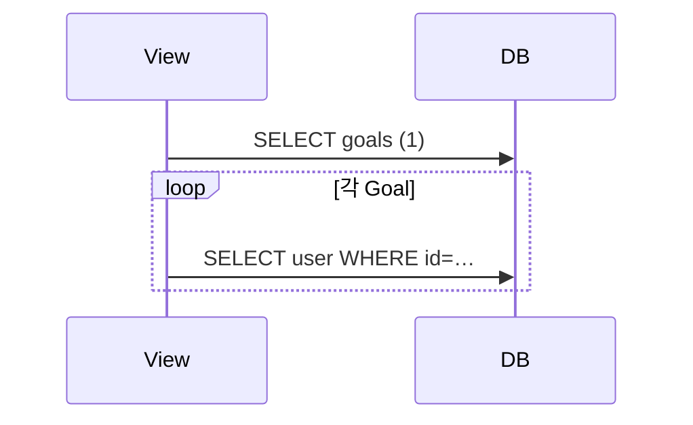

# Day 26 · N+1: select_related / prefetch_related

> 읽는 시간: 약 13분

## 복습 3문제

**1.** (Day 25) 모바일 옛 앱이 `title`을 읽는데, 서버가 버전 없이 `name`만 보내면?

<details>
<summary>정답</summary>

**깨집니다.** 옛 앱은 `title`이 없어 화면이 비거나 크래시합니다. 깨지는 변경은 `/api/v1/`, `/api/v2/`처럼 **버전으로 옛 계약을 남긴 뒤** 새 계약을 추가합니다.

</details>

**2.** (Day 24) 목록 API 보안은 `has_object_permission`만으로 충분한가요?

<details>
<summary>정답</summary>

**부족합니다.** 객체 권한은 상세·수정·삭제(`get_object`)에서만 돕니다. 목록은 `get_queryset()`으로 **내 것만** 걸러야 합니다.

</details>

**3.** (Day 21) 목표 20개를 중첩으로 내보낼 때 `tags`·`checkins`를 매번 따로 조회하면 쿼리는 대략 몇 번?

<details>
<summary>정답</summary>

**약 41번**입니다. 목록 1번 + 목표마다 tags·checkins 각 1번 → `1 + 20 × 2`. 오늘 이 숫자를 **3번**으로 줄입니다.

</details>

---

## 오늘 만들 것

Goals 목록·상세 API의 QuerySet에 `select_related` / `prefetch_related`를 붙여, 소유자·태그·체크인을 **적은 쿼리**로 가져오게 합니다.

## 오늘 배울 것

- N+1이 왜 생기는지 (루프 안 관계 접근)
- FK는 `select_related` (SQL JOIN)
- M2M·역참조는 `prefetch_related` (추가 쿼리 1번)


목록 20개에서 관계에 접근하면 쿼리가 폭증합니다. JOIN·프리패치로 **한 번에** 모아 오면 응답이 가벼워집니다.

---

## 1. N+1이 무엇인가

Goals 대시보드가 목표 20개를 보여 주고, 각 줄에 **주인 이름**과 **태그**를 붙인다고 합시다. 코드는 짧고 자연스럽습니다.

```python
# 템플릿·시리얼라이저에서
for g in goals:
    print(g.owner.username)
    print(list(g.tags.all()))
```

문제는 ORM이 **게으르다**는 점입니다. `goals`를 가져올 때 owner·tags는 아직 안 옵니다. 루프에서 `g.owner`를 터치하는 순간 **목표마다** User 조회가 나갑니다.

**결과를 맞혀 보세요:** 목표 20개 목록 쿼리 1번 뒤, 루프에서 `g.owner.username`만 읽으면 총 쿼리는?

<details>
<summary>정답</summary>

**21번**입니다. 목록 1 + owner 조회 20. 이것이 **N+1 문제**(N+1 query problem)입니다. N이 커질수록 응답 시간이 선형으로 늘어납니다.

</details>

**비유:** 장바구니에 물건 20개를 담아 두고, 계산대에서 **한 개씩** 가격표를 다시 찾으러 가는 것과 같습니다. 한 번에 가격표를 모아 오면 계산이 끝납니다.



Node(Prisma)에서도 `include` 없이 관계를 나중에 읽으면 비슷한 패턴이 납니다. Django는 템플릿·SerializerMethodField에서 특히 자주 터집니다.

> 💡 N+1 = "목록 1번 + 행마다 관계 1번". 기능은 맞아도 트래픽·데이터만 늘면 느려진다.

<details>
<summary>🔍 더 깊이 (면접용)</summary>

**왜 기본이 게으른가?** 항상 JOIN하면 필요 없는 큰 행·중복 컬럼을 가져옵니다. Django는 **쓸 때만** 조회하는 쪽을 고릅니다. 대신 개발자가 "이 루프에서 쓸 관계"를 미리 알려 줘야 합니다.

**발견법:** `django-debug-toolbar`, `connection.queries`, 또는 `assertNumQueries`로 테스트에서 쿼리 개수를 고정합니다. "목록이 느리다"의 1순위 용의자가 N+1입니다.

**API에서의 형태:** Day 21 중첩 Serializer가 `obj.checkins.all()`을 호출하면 목록 N+1이 바로 납니다. 뷰 QuerySet에서 미리 prefetch하지 않으면 Serializer는 모릅니다.

</details>

---

## 2. select_related — FK를 JOIN으로

`owner`는 Goal → User **ForeignKey**(다대일)입니다. 한 Goal 행에 owner_id 하나가 붙어 있으니, SQL **LEFT OUTER JOIN**으로 한 번에 가져올 수 있습니다.

**JS (Node)** · Prisma `include`

```javascript
prisma.goal.findMany({
  include: { owner: true },
});
```

**Python (Django)** · `select_related`

```python
Goal.objects
    .filter(owner=request.user)
    .select_related("owner")
```

이제 루프에서 `g.owner.username`을 읽어도 **추가 쿼리가 없습니다.** 이미 JOIN 결과에 User 컬럼이 실려 있습니다.

```python
# goals/views.py (로컬)
class GoalViewSet(viewsets.ModelViewSet):
    def get_queryset(self):
        return (
            Goal.objects
            .filter(owner=self.request.user)
            .select_related("owner")
        )
```

**결과를 맞혀 보세요:** `goal.checkins`처럼 **역방향 1:N**에도 `select_related("checkins")`를 쓸 수 있을까요?

<details>
<summary>정답</summary>

**없습니다.** `select_related`는 FK·OneToOne처럼 "이쪽 행에 상대 id가 있는" 관계만 JOIN합니다. 체크인은 Goal 쪽에 id가 없고 CheckIn 쪽에 `goal_id`가 있으므로 **prefetch_related**를 씁니다.

</details>

체이닝도 됩니다. `select_related("goal__owner")`처럼 `__`로 건너뜁니다. CheckIn 목록에서 목표 주인까지 한 JOIN에 올릴 때 씁니다.

> 💡 FK·O2O는 `select_related` → SQL JOIN 한 방. 역참조·M2M에는 쓰지 않는다.

<details>
<summary>🔍 더 깊이 (면접용)</summary>

**JOIN 부풀림:** 한 쿼리에 FK를 여러 개 JOIN하면 행이 가로로 넓어질 뿐입니다(1:1에 가깝게 붙음). 반면 1:N을 JOIN으로 억지로 붙이면 부모 행이 자식 수만큼 **중복**됩니다. 그래서 Django는 1:N에 `select_related`를 허용하지 않습니다.

**`only` / `defer`:** JOIN 후 컬럼이 너무 많으면 `only("title", "owner__username")`으로 필요한 칸만 고릅니다. 다만 나중에 빠진 필드에 접근하면 **또 쿼리**가 나니 주의합니다.

</details>

---

## 3. prefetch_related — M2M·역참조를 한 번에

태그는 **ManyToMany**, 체크인은 **역 ForeignKey**입니다. 둘 다 "한 Goal에 여러 줄"이라 JOIN으로 붙이면 부모가 복제됩니다. Django는 **쿼리를 나눠** 가져옵니다.

1. Goals 목록 쿼리
2. `WHERE goal_id IN (…)` 로 tags / checkins를 **한 번 더** 조회
3. 파이썬에서 Goal id끼리 묶어 `g.tags.all()` 캐시에 넣음

**JS (Node)** · Prisma

```javascript
prisma.goal.findMany({
  include: {
    tags: true,
    checkins: true,
  },
});
```

**Python (Django)**

```python
Goal.objects
    .filter(owner=request.user)
    .select_related("owner")
    .prefetch_related(
        "tags", "checkins")
```

**결과를 맞혀 보세요:** 목표 20개에 tags·checkins를 prefetch하면 총 쿼리는 대략?

<details>
<summary>정답</summary>

**3번**입니다. goals 1 + tags 1 + checkins 1. (owner는 `select_related`로 1번에 포함.) Day 21의 41번과 비교하면 체감이 큽니다.

</details>

```python
# Goals API 목록 — 로컬에 적용
def get_queryset(self):
    return (
        Goal.objects
        .filter(owner=self.request.user)
        .select_related("owner")
        .prefetch_related(
            "tags", "checkins")
    )
```

템플릿에서 `goal.tags.all`을 써도, Serializer가 중첩 `TagSerializer(many=True)`를 써도, **캐시된 결과**를 재사용합니다. 단, `.filter(...)`처럼 **새 QuerySet**을 다시 만들면 캐시를 우회해 N+1이 돌아옵니다.

순수 Python으로 "IN 묶기" 느낌을 실행해 봅시다.

```python-run
goals = [
    {"id": 1, "title": "독서"},
    {"id": 2, "title": "걷기"},
]
tags = [
    {"goal_id": 1, "name": "습관"},
    {"goal_id": 1, "name": "건강"},
    {"goal_id": 2, "name": "운동"},
]
by = {}
for t in tags:
    by.setdefault(t["goal_id"], [])
    by[t["goal_id"]].append(t["name"])
for g in goals:
    print(g["title"], by.get(g["id"], []))
# 출력: ?
```

<details>
<summary>실행 결과</summary>

```
독서 ['습관', '건강']
걷기 ['운동']
```

태그 테이블을 **한 번** 읽은 뒤 id로 묶는 것이 `prefetch_related`의 축소판입니다.

</details>

> 💡 M2M·역FK는 `prefetch_related` → 추가 SELECT 1번 + 파이썬에서 매칭.

<details>
<summary>🔍 더 깊이 (면접용)</summary>

**`Prefetch` 객체:** 프리패치 쿼리 자체에 필터·정렬·`select_related`를 걸고 싶을 때 씁니다.

```python
from django.db.models import Prefetch
Prefetch(
    "checkins",
    queryset=CheckIn.objects
        .order_by("-created_at")[:5],
    to_attr="recent_checkins",
)
```

`to_attr`에 담으면 `g.checkins.all()`과 별도 캐시라서, 실수로 `.filter()`를 다시 호출해 N+1을 만드는 일을 줄입니다.

**`prefetch_related` vs JOIN:** 자식이 매우 많으면 IN 절·메모리도 커집니다. 그때는 페이지 단위로 목표를 자르거나, 체크인을 **별도 엔드포인트**로 빼는 편이 낫습니다.

**`select_related` + `prefetch_related` 조합**이 실무 기본입니다. FK는 JOIN, 컬렉션은 prefetch.

</details>

---

## 연습문제

**1.** 아래 루프는 쿼리를 몇 번 쓰나요? (goals 20개, owner는 FK, 아직 select_related 없음)

```python-run
def count_queries(n_goals):
    # 목록 1 + owner N
    return 1 + n_goals
print(count_queries(20))
# 출력: ?
```

<details>
<summary>정답</summary>

```python-run
def count_queries(n_goals):
    return 1 + n_goals
print(count_queries(20))
# 출력: 21
```

해설: 전형적인 N+1입니다. `select_related("owner")`를 붙이면 **1**로 떨어집니다.

</details>

**2.** `bundle(goals, tags)`를 완성하세요. 각 goal에 `tag_names` 리스트를 붙인 새 dict 목록을 반환합니다. (prefetch 매칭 연습)

```python-run
goals = [
    {"id": 1, "title": "독서"},
    {"id": 2, "title": "걷기"},
]
tags = [
    {"goal_id": 1, "name": "습관"},
    {"goal_id": 2, "name": "운동"},
    {"goal_id": 1, "name": "집중"},
]
def bundle(goals, tags):
    ...
print(bundle(goals, tags)[0])
# 출력: ?
```

<details>
<summary>정답</summary>

```python-run
goals = [
    {"id": 1, "title": "독서"},
    {"id": 2, "title": "걷기"},
]
tags = [
    {"goal_id": 1, "name": "습관"},
    {"goal_id": 2, "name": "운동"},
    {"goal_id": 1, "name": "집중"},
]
def bundle(goals, tags):
    by = {}
    for t in tags:
        by.setdefault(t["goal_id"], [])
        by[t["goal_id"]].append(t["name"])
    out = []
    for g in goals:
        item = dict(g)
        item["tag_names"] = by.get(g["id"], [])
        out.append(item)
    return out
print(bundle(goals, tags)[0])
# 출력: {'id': 1, 'title': '독서', 'tag_names': ['습관', '집중']}
```

해설: DB에서 tags를 IN으로 한 번 가져온 뒤, 파이썬에서 goal_id로 묶는 과정과 같습니다.

</details>

**3.** (로컬) `GoalViewSet.get_queryset`에 `select_related("owner")`와 `prefetch_related("tags", "checkins")`를 추가한 뒤, debug toolbar 또는 `len(connection.queries)`로 목록 API 쿼리 수가 줄었는지 확인하세요.

<details>
<summary>정답</summary>

```python
# goals/views.py (로컬)
class GoalViewSet(viewsets.ModelViewSet):
    def get_queryset(self):
        return (
            Goal.objects
            .filter(owner=self.request.user)
            .select_related("owner")
            .prefetch_related(
                "tags", "checkins")
        )
```

```python
# Django shell / 테스트에서
from django.db import connection, reset_queries
from django.conf import settings
settings.DEBUG = True
reset_queries()
list(Goal.objects
     .select_related("owner")
     .prefetch_related("tags", "checkins")
     [:20])
print(len(connection.queries))
```

해설: DEBUG에서만 `connection.queries`가 채워집니다. 테스트에서는 `self.assertNumQueries(3)`처럼 **개수를 고정**해 N+1 회귀를 막습니다.

</details>

---

## 면접 질문

**Q1. `select_related`와 `prefetch_related`의 차이와 각각 언제 쓰나요?**

<details>
<summary>모범 답안</summary>

`select_related`는 FK·OneToOne에 SQL **JOIN**을 걸어 한 쿼리로 가져옵니다. 상대 행이 최대 하나라 부모가 복제되지 않습니다.

`prefetch_related`는 M2M·역FK처럼 여러 줄이 붙는 관계에 씁니다. 메인 쿼리 후 `WHERE id IN (…)` 추가 쿼리로 자식을 모은 뒤 파이썬에서 매칭합니다. JOIN으로 붙이면 부모 행이 자식 수만큼 부풀어 비효율적입니다.

Goals에서는 `owner`는 `select_related`, `tags`·`checkins`는 `prefetch_related`가 기본 조합입니다.

</details>

**Q2. 중첩 Serializer를 쓰는 목록 API에서 N+1을 어떻게 예방하나요?**

<details>
<summary>모범 답안</summary>

Serializer는 관계를 읽는 쪽이고, **몇 번 읽을지는 QuerySet**이 정합니다. ViewSet의 `get_queryset()`에서 응답에 필요한 관계를 모두 `select_related` / `prefetch_related`로 미리 올립니다. `SerializerMethodField` 안에서 추가 `.filter()`를 치면 캐시를 우회하므로, 필터가 필요하면 `Prefetch(..., queryset=..., to_attr=...)`로 프리패치 단계에 넣습니다. 테스트에 `assertNumQueries`를 두면 회귀를 일찍 잡습니다.

</details>

---

## 오늘 정리

1. N+1 = 목록 1번 + 행마다 관계 조회. 기능은 되어도 데이터가 늘면 느려진다.
2. FK·O2O → `select_related`(JOIN). M2M·역FK → `prefetch_related`(추가 SELECT + 매칭).
3. Goals API `get_queryset`에 owner/tags/checkins를 미리 올리면 중첩 응답도 쿼리 3번 안팎이다.

## 다음에 이어갈 것

쿼리 개수를 줄였습니다. Day 27은 **인덱스 설계와 EXPLAIN**으로, "왜 이 쿼리가 느린지"를 실행 계획으로 읽는 법을 봅니다.
