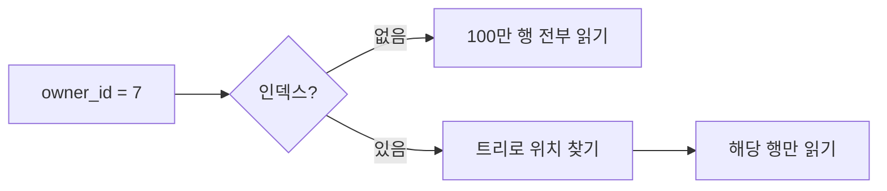

# Day 27 · 인덱스와 EXPLAIN: 왜 이 쿼리가 느린지 읽는 법

> 읽는 시간: 약 13분

## 복습 3문제

**1.** (Day 26) 목표 20개의 `owner`를 루프에서 읽을 때 쿼리를 1번으로 줄이는 메서드는?

<details>
<summary>정답</summary>

**`select_related("owner")`** 입니다. FK(다대일)를 SQL JOIN으로 한 번에 가져옵니다. 태그 같은 M2M·역참조는 `prefetch_related`를 씁니다.

</details>

**2.** (Day 25) 옛 앱을 깨지 않으면서 응답 필드 이름을 바꾸려면?

<details>
<summary>정답</summary>

**버전을 나눕니다.** `/api/v1/`은 옛 계약을 그대로 두고, `/api/v2/`에서 새 이름을 씁니다. 옛 버전은 폐기 공지 후 제거합니다.

</details>

**3.** (Day 24) 목록 API에서 남의 목표를 숨기는 곳은?

<details>
<summary>정답</summary>

**`get_queryset()`** 입니다. `has_object_permission`은 상세·수정·삭제에서만 돕니다.

</details>

---

## 오늘 만들 것

Goals 목록 API에서 "내 목표 중 진행 중인 것, 최신순"을 빠르게 가져오도록 **복합 인덱스**를 설계합니다.

## 오늘 배울 것

- 인덱스가 왜 필요한가 (풀 스캔 vs 인덱스 탐색)
- EXPLAIN으로 실행 계획 읽기
- 복합 인덱스는 컬럼 순서가 중요하다

---

## 1. 인덱스는 왜 필요한가

Day 26에서 쿼리 **개수**를 줄였습니다. 이제 쿼리 **한 번의 속도**를 봅니다. 목표가 100만 개인 테이블에서 `owner_id = 7`인 행을 찾는다고 합시다.

인덱스가 없으면 DB는 100만 행을 처음부터 끝까지 읽습니다. 이것을 **풀 스캔**(full scan, 전체 훑기)이라고 합니다. 데이터가 늘수록 느려집니다.

**결과를 맞혀 보세요:** 100만 행에서 `owner_id`로 찾는데, 인덱스가 있으면 대략 몇 행을 읽을까요? (a) 100만 (b) 수십 개

<details>
<summary>정답</summary>

**(b) 수십 개 수준**입니다. 인덱스는 보통 B-트리(균형 잡힌 정렬 트리)라서, 100만 건도 대여섯 번의 단계로 위치를 찾습니다. 그 뒤 해당 행만 읽습니다.

</details>

**비유:** 책에서 단어를 찾을 때 첫 쪽부터 넘기면 풀 스캔이고, 맨 뒤 **색인**을 보고 쪽수로 바로 가면 인덱스 탐색입니다.



**JS (Node)** · Prisma 스키마

```javascript
model Goal {
  id      Int @id
  ownerId Int
  @@index([ownerId])
}
```

**Python (Django)** · 모델

```python
class Goal(models.Model):
    owner = models.ForeignKey(User)
    class Meta:
        indexes = [
            models.Index(fields=["owner"]),
        ]
```

참고로 Django의 `ForeignKey`는 인덱스를 **자동으로** 만듭니다. 그래서 위 예시는 이해용이고, 필터에 자주 쓰는 다른 컬럼에는 직접 추가해야 합니다.

> 💡 인덱스 = 정렬된 색인. 읽기는 빨라지고, 쓰기·저장공간 비용이 조금 듭니다.

<details>
<summary>🔍 더 깊이 (면접용)</summary>

**인덱스의 비용:** INSERT·UPDATE·DELETE마다 인덱스도 함께 고쳐야 합니다. 그래서 "일단 다 걸자"는 틀린 답입니다. 읽기가 많고 선택도(값이 얼마나 다양한가)가 높은 컬럼에 겁니다.

**선택도가 낮은 컬럼:** `is_done`처럼 값이 두 개뿐이면 인덱스 효과가 작습니다. 절반을 읽어야 하면 DB는 오히려 풀 스캔을 고르기도 합니다.

</details>

---

## 2. EXPLAIN으로 실행 계획 읽기

DB가 쿼리를 **어떻게 실행할지** 미리 보여 주는 명령이 `EXPLAIN`입니다. 느린 이유를 추측하지 않고 **계획을 읽는** 것이 핵심입니다.

아래는 표준 라이브러리 SQLite로 직접 돌려 볼 수 있습니다.

```python-run
import sqlite3
db = sqlite3.connect(":memory:")
db.execute("create table goal(id integer primary key, owner_id int, done int)")
db.executemany("insert into goal(owner_id, done) values (?, 0)",
               [(i % 1000,) for i in range(5000)])
q = "explain query plan select * from goal where owner_id = 7"
print(db.execute(q).fetchall())
```

**결과를 맞혀 보세요:** 위 출력에는 `SCAN`과 `SEARCH` 중 무엇이 나올까요?

<details>
<summary>정답</summary>

**`SCAN goal`** 이 나옵니다. 인덱스가 없어서 전체를 훑습니다. 이제 인덱스를 만들고 다시 보면 달라집니다.

</details>

```python-run
import sqlite3
db = sqlite3.connect(":memory:")
db.execute("create table goal(id integer primary key, owner_id int)")
db.execute("create index idx_owner on goal(owner_id)")
q = "explain query plan select * from goal where owner_id = 7"
print(db.execute(q).fetchall())
# 출력: SEARCH goal USING INDEX idx_owner (owner_id=?)
```

`SCAN`은 풀 스캔, `SEARCH ... USING INDEX`는 인덱스 탐색입니다. PostgreSQL에서는 `Seq Scan`과 `Index Scan`으로 보입니다.

Django에서는 QuerySet에 `.explain()`을 붙이면 됩니다.

```python
# python manage.py shell (로컬)
qs = Goal.objects.filter(owner_id=7)
print(qs.explain())
```

> 💡 느린 쿼리는 감으로 고치지 말고 EXPLAIN으로 `Scan`인지 `Index`인지부터 확인한다.

<details>
<summary>🔍 더 깊이 (면접용)</summary>

**EXPLAIN vs EXPLAIN ANALYZE:** `EXPLAIN`은 예상 계획만, PostgreSQL의 `EXPLAIN ANALYZE`는 **실제로 실행**해서 걸린 시간과 읽은 행 수를 보여 줍니다. 운영 DB에서 쓰기 쿼리에 ANALYZE를 쓰면 실제로 데이터가 바뀌니 주의합니다.

**통계:** 플래너는 테이블 통계로 비용을 추정합니다. 통계가 오래되면 엉뚱한 계획을 고릅니다 (`ANALYZE`로 갱신).

</details>

---

## 3. 복합 인덱스: 컬럼 순서가 전부

Goals 목록은 "내 목표 중 진행 중인 것을 최신순"으로 가져옵니다.

```python
Goal.objects.filter(
    owner=user, done=False
).order_by("-created_at")
```

컬럼 여러 개를 한 인덱스에 묶는 것이 **복합 인덱스**(composite index)입니다. 전화번호부가 "성 → 이름" 순으로 정렬된 것과 같습니다. 성을 모르고 이름만 알면 못 찾습니다.

**결과를 맞혀 보세요:** 인덱스가 `(owner, created_at)`일 때, `created_at`만으로 필터하면 이 인덱스를 잘 쓸까요?

<details>
<summary>정답</summary>

**잘 못 씁니다.** 복합 인덱스는 **왼쪽 컬럼부터** 쓸 수 있습니다 (leftmost prefix). `owner`가 조건에 없으면 정렬 순서를 이용하지 못합니다.

</details>

```python
class Goal(models.Model):
    class Meta:
        indexes = [
            models.Index(
                fields=["owner", "done", "-created_at"],
                name="goal_owner_done_created",
            ),
        ]
```

등호(`owner`, `done`) 컬럼을 앞에, 정렬 컬럼(`created_at`)을 뒤에 두면, 필터와 정렬을 **인덱스 하나로** 끝냅니다. 별도 정렬 작업이 사라집니다.

```bash
python manage.py makemigrations
python manage.py migrate
```

**JS (Node)** · Prisma

```javascript
@@index([ownerId, done, createdAt])
```

> 💡 복합 인덱스는 "같다(=) 조건 먼저, 정렬·범위 나중"으로 순서를 정한다.

<details>
<summary>🔍 더 깊이 (면접용)</summary>

**커버링 인덱스:** 쿼리에 필요한 컬럼이 모두 인덱스에 있으면 테이블을 읽지 않고 인덱스만으로 답합니다 (index-only scan).

**부분 인덱스:** `condition=Q(done=False)`로 진행 중인 행만 인덱싱하면 크기가 줄어듭니다 (PostgreSQL 등).

**함수 사용 주의:** `WHERE lower(title) = ...`처럼 컬럼에 함수를 씌우면 일반 인덱스를 못 씁니다.

</details>

---

## 연습문제

**1.** `Goal.objects.filter(title__icontains="운동")`은 `title`에 일반 인덱스를 걸어도 빨라지지 않습니다. 왜일까요?

<details>
<summary>정답</summary>

**앞부분을 모르는 부분 일치라서**입니다. `LIKE '%운동%'`은 정렬된 색인의 시작점을 정할 수 없어 풀 스캔이 됩니다. 접두사 검색(`istartswith`)은 인덱스를 쓸 수 있고, 진짜 검색은 전문 검색(full-text) 인덱스를 씁니다.

</details>

**2.** 아래 `EXPLAIN` 결과에서 문제를 찾으세요: `SCAN goal`. 한 줄로 고치려면?

<details>
<summary>정답</summary>

필터 컬럼에 인덱스가 없다는 뜻입니다. 예를 들어 `owner_id`로 거른다면:

```python
indexes = [models.Index(fields=["owner"])]
```

마이그레이션 후 EXPLAIN을 다시 보고 `SEARCH ... USING INDEX`로 바뀌었는지 확인합니다. 바뀌지 않으면 컬럼 순서나 함수 사용을 의심합니다.

</details>

**3.** 쿼리가 `filter(owner=u).order_by("-created_at")`입니다. 인덱스 `(created_at, owner)`와 `(owner, created_at)` 중 어느 쪽이 맞나요?

<details>
<summary>정답</summary>

**`(owner, created_at)`** 입니다. `owner`는 등호 조건이라 앞에, 정렬 컬럼은 뒤에 둡니다. 그러면 한 사용자의 행이 이미 시간순으로 모여 있어 바로 읽을 수 있습니다.

</details>

---

## 면접 질문

**Q1. 인덱스를 많이 걸면 항상 좋은가요?**

<details>
<summary>모범 답안</summary>

아닙니다. 인덱스는 읽기를 빠르게 하지만 쓰기마다 함께 갱신되어 **쓰기 비용과 저장공간**이 늘어납니다. 그래서 자주 쓰는 WHERE·JOIN·ORDER BY 컬럼, 선택도가 높은 컬럼에만 겁니다. 근거는 감이 아니라 EXPLAIN과 실제 느린 쿼리 로그로 잡습니다.

</details>

**Q2. 복합 인덱스 `(a, b)`가 `WHERE b = 1`에 쓰일까요?**

<details>
<summary>모범 답안</summary>

보통 잘 쓰이지 않습니다. 복합 인덱스는 **leftmost prefix** 규칙으로 왼쪽 컬럼 `a`부터 조건이 있어야 효율적으로 탐색합니다. `b`만 자주 찾는다면 `b` 단독 인덱스나 `(b, a)` 순서를 고려합니다.

</details>

---

## 오늘 정리

- 인덱스는 정렬된 색인이라 풀 스캔을 피하게 해 주지만, 쓰기 비용이 있다.
- 느린 쿼리는 EXPLAIN에서 `SCAN`인지 `SEARCH`인지 먼저 본다.
- 복합 인덱스는 등호 조건 먼저, 정렬·범위는 나중 순서로 만든다.

## 다음에 이어갈 것

쿼리를 빠르게 만들었으니, Day 28은 **트랜잭션과 `atomic`**으로 체크인과 진행률이 함께 저장되거나 함께 취소되게 합니다.
