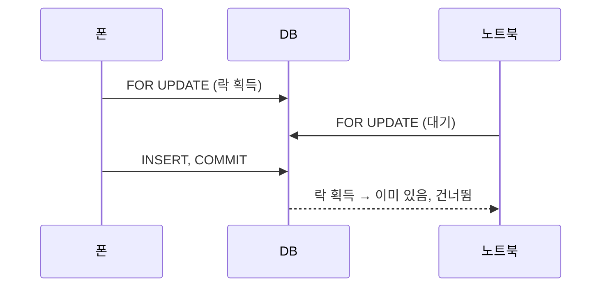

# Day 28 · 트랜잭션·atomic·select_for_update: 함께 저장되거나 함께 취소되게

> 읽는 시간: 약 13분

## 복습 3문제

**1.** (Day 27) EXPLAIN 결과에 `SCAN goal`이 보이면 무슨 뜻일까요?

<details>
<summary>정답</summary>

**테이블 전체를 훑는다(풀 스캔)**는 뜻입니다. 필터 컬럼에 맞는 인덱스가 없거나, 컬럼에 함수를 씌워 인덱스를 못 쓰는 경우입니다. 인덱스를 쓰면 `SEARCH ... USING INDEX`로 바뀝니다.

</details>

**2.** (Day 26) 태그(M2M)를 루프에서 읽을 때 쿼리 폭발을 막는 메서드는?

<details>
<summary>정답</summary>

**`prefetch_related("tags")`** 입니다. 목표 목록 1번 + 태그 `IN (...)` 1번, 총 2번으로 끝납니다. FK는 `select_related`(JOIN)를 씁니다.

</details>

**3.** (Day 14) `update(streak=F("streak") + 1)`이 `g.streak += 1; g.save()`보다 안전한 이유는?

<details>
<summary>정답</summary>

**DB가 그 자리에서 더하기 때문**입니다. SQL이 `SET streak = streak + 1`이 되어, 파이썬이 옛 값을 읽어 덮어쓰는 일이 없습니다. 동시에 두 요청이 와도 둘 다 반영됩니다.

</details>

---

## 오늘 만들 것

체크인을 저장할 때 **CheckIn 행 추가 + Goal의 streak 증가**가 반드시 함께 성공하거나 함께 취소되게 합니다.

## 오늘 배울 것

- 트랜잭션이 왜 필요한가 (반쯤 저장된 상태 막기)
- `transaction.atomic` 사용법과 흔한 함정
- `select_for_update`로 동시 수정 막기

---

## 1. 트랜잭션은 왜 필요한가

체크인 버튼을 누르면 서버는 두 가지를 합니다. 체크인 기록을 한 줄 추가하고, 목표의 연속 달성일(streak)을 1 올립니다. 이 둘은 **한 묶음의 사실**입니다.

그런데 첫 번째는 성공하고 두 번째에서 서버가 죽으면 어떻게 될까요? 기록은 있는데 streak는 그대로인 **어긋난 상태**가 DB에 남습니다. 이런 데이터는 나중에 고치기도 어렵습니다.

**트랜잭션**(transaction, 여러 작업을 하나로 묶은 단위)은 "전부 성공하면 확정(COMMIT), 하나라도 실패하면 전부 취소(ROLLBACK)"를 보장합니다.

**결과를 맞혀 보세요:** Django 기본 설정에서 아래 코드의 두 번째 줄이 예외를 던지면, 첫 줄의 체크인은 DB에 남을까요?

```python
CheckIn.objects.create(goal=g, amount=1)
Goal.objects.filter(pk=999).get()
```

<details>
<summary>정답</summary>

**남습니다.** Django는 기본이 **autocommit**(쿼리 하나하나를 바로 확정)입니다. 첫 줄의 INSERT는 이미 COMMIT되었고, 둘째 줄의 `DoesNotExist`는 그것을 되돌리지 못합니다.

</details>

**비유:** 은행 이체입니다. 내 통장에서 빠지고 상대 통장에 들어가는 것은 한 묶음이죠. 중간에 끊겼다고 돈이 사라지면 안 됩니다.

순수 Python으로 "묶어서 확정"을 흉내 내 봅시다.

```python-run
db = {"checkins": 0, "streak": 3}
draft = dict(db)
try:
    draft["checkins"] += 1
    raise RuntimeError("streak 저장 실패")
except RuntimeError as e:
    print("롤백:", e)
print(db)
```

`draft`(작업용 사본)에만 쓰고, 끝까지 성공해야 `db = draft`로 확정하는 방식입니다. 실패하면 사본만 버리면 되죠. DB 트랜잭션도 개념은 같습니다.

> 💡 "둘 다 되거나 둘 다 안 되거나"가 필요한 작업은 트랜잭션으로 묶는다.

<details>
<summary>🔍 더 깊이 (면접용)</summary>

**ACID**는 트랜잭션의 네 가지 보장입니다.

| 글자 | 뜻 |
|---|---|
| Atomicity | 전부 아니면 전무 |
| Consistency | 제약조건을 지킨 상태 유지 |
| Isolation | 동시 트랜잭션끼리 간섭 제한 |
| Durability | 확정 후엔 장애에도 유지 |

DB는 보통 **WAL**(Write-Ahead Log, 먼저 로그에 쓰고 나중에 데이터 반영)로 원자성과 지속성을 구현합니다. Isolation은 Day 29에서 격리수준으로 자세히 봅니다.

</details>

---

## 2. `transaction.atomic` 쓰기

Django에서는 `transaction.atomic`으로 블록을 감쌉니다. 블록에 들어갈 때 BEGIN, 정상 종료 시 COMMIT, 예외가 블록 밖으로 나가면 ROLLBACK입니다.


**Python** · `goals/services.py`

```python
def check_in(goal, amount):
    with transaction.atomic():
        CheckIn.objects.create(
            goal=goal, amount=amount)
        Goal.objects.filter(
            pk=goal.pk,
        ).update(streak=F("streak") + 1)
```

(`from django.db import transaction`과 `from django.db.models import F`를 파일 위에 import합니다.)

이제 둘째 줄에서 실패하면 첫 줄의 INSERT도 취소됩니다. 데코레이터 `@transaction.atomic`으로 함수 전체를 감싸도 됩니다.

**JS (Node)** · Prisma

```javascript
await prisma.$transaction(async (tx) => {
  await tx.checkIn.create({ data })
  await tx.goal.update({
    where: { id },
    data: { streak: { increment: 1 } },
  })
})
```

Prisma의 `$transaction` 콜백과 같은 구조입니다. 콜백이 throw하면 롤백, 끝까지 가면 커밋이죠.

**결과를 맞혀 보세요:** 아래처럼 `atomic` **안에서** 예외를 잡아 버리면 어떻게 될까요?

```python
with transaction.atomic():
    CheckIn.objects.create(goal=g, amount=1)
    try:
        Goal.objects.get(pk=999)
    except Goal.DoesNotExist:
        pass
```

<details>
<summary>정답</summary>

**체크인이 커밋됩니다.** `atomic`은 예외가 블록 **밖으로 나갈 때만** 롤백합니다. 안에서 삼키면 "정상 종료"로 보고 COMMIT합니다. 실패를 롤백하려면 예외를 다시 던지거나, try/except를 `atomic` 바깥에 둡니다.

</details>

또 하나 자주 쓰는 도구가 `transaction.on_commit`입니다. 축하 알림 같은 **외부 부작용**은 커밋이 확정된 뒤에만 실행해야 합니다.

```python
with transaction.atomic():
    check_in_rows(goal, amount)
    transaction.on_commit(
        lambda: notify(goal.owner_id))
```

롤백되면 `notify`는 아예 호출되지 않습니다. "기록은 취소됐는데 알림은 갔다"를 막는 것이죠.

> 💡 `atomic` 안에서 예외를 삼키지 말고, 이메일·알림은 `on_commit`으로 미룬다.

<details>
<summary>🔍 더 깊이 (면접용)</summary>

**중첩 atomic = SAVEPOINT:** `atomic` 안의 `atomic`은 새 트랜잭션이 아니라 **세이브포인트**(중간 저장점)입니다. 안쪽만 실패하면 안쪽만 되돌리고 바깥은 계속할 수 있습니다.

```python
with transaction.atomic():
    save_checkin()
    try:
        with transaction.atomic():
            award_badge()
    except IntegrityError:
        pass
```

배지 저장이 실패해도 체크인은 살아남습니다. 안쪽 `atomic`이 예외를 받아 세이브포인트까지 롤백했기 때문에, 바깥에서 잡아도 안전합니다.

**ATOMIC_REQUESTS:** settings의 DB 설정에 `"ATOMIC_REQUESTS": True`를 주면 뷰 하나 전체를 트랜잭션으로 감쌉니다. 편하지만 트랜잭션이 길어져 락을 오래 잡을 수 있어, 큰 서비스는 필요한 곳에만 `atomic`을 씁니다.

**트랜잭션 안에서 외부 API 호출 금지:** 느린 HTTP 호출을 기다리는 동안 DB 커넥션과 락을 붙잡습니다.

</details>

---

## 3. `select_for_update`: 동시에 고치는 것 막기

사용자가 폰과 노트북에서 **동시에** 체크인을 눌렀다고 합시다. "오늘 이미 체크인했으면 streak를 안 올린다"는 규칙이 있다면, 두 요청 모두 "아직 안 했네?"라고 읽고 둘 다 올릴 수 있습니다.

이것이 **경쟁 조건**(race condition, 실행 순서에 따라 결과가 달라지는 버그)입니다. 트랜잭션만으로는 못 막습니다. 둘 다 각자의 트랜잭션 안에서 "읽고 → 판단하고 → 쓰기" 때문입니다.

**결과를 맞혀 보세요:** 두 요청이 동시에 아래 코드를 실행하면, 체크인이 몇 개 생길 수 있을까요?

```python
with transaction.atomic():
    done = goal.checkins.filter(
        day=today).exists()
    if not done:
        CheckIn.objects.create(goal=goal,
                               amount=1)
```

<details>
<summary>정답</summary>

**2개까지** 생길 수 있습니다. 두 요청이 거의 동시에 `exists()`를 실행하면 둘 다 `False`를 봅니다. 그 뒤 둘 다 INSERT합니다.

</details>

해결책은 판단하기 전에 **행에 자물쇠(락)**를 거는 것입니다. `select_for_update()`는 SQL `SELECT ... FOR UPDATE`를 만듭니다. 이 트랜잭션이 끝날 때까지 다른 트랜잭션은 같은 행을 잠그려 하면 **기다립니다**.

```python
with transaction.atomic():
    goal = (Goal.objects
            .select_for_update()
            .get(pk=goal_id))
    if not goal.checkins.filter(
            day=today).exists():
        CheckIn.objects.create(
            goal=goal, amount=1)
```

이제 두 번째 요청은 첫 번째가 커밋할 때까지 Goal 행 앞에서 줄을 섭니다. 차례가 오면 이미 체크인이 있으니 건너뜁니다.



**비유:** 화장실 열쇠가 하나뿐인 카페입니다. 열쇠(락)를 가진 사람만 들어가고, 나머지는 문 앞에서 기다립니다.

**JS (Node)** · Prisma엔 전용 API가 없어 raw SQL을 씁니다.

```javascript
await prisma.$transaction(async (tx) => {
  await tx.$queryRaw`
    SELECT id FROM "Goal"
    WHERE id = ${id} FOR UPDATE`
  // 이후 판단과 쓰기
})
```

> 💡 "읽고 판단해서 쓰기"가 동시에 일어날 수 있으면, 읽을 때 `select_for_update()`로 잠근다.

<details>
<summary>🔍 더 깊이 (면접용)</summary>

**반드시 `atomic` 안에서:** `select_for_update`는 트랜잭션 밖에서 평가하면 `TransactionManagementError`가 납니다. 락은 트랜잭션이 끝날 때 풀리기 때문입니다.

**옵션:** `nowait=True`는 기다리지 않고 바로 에러, `skip_locked=True`는 잠긴 행을 건너뜁니다 (작업 큐에서 여러 워커가 일감을 나눠 가질 때 유용). `of=("self",)`는 JOIN된 테이블 중 일부만 잠급니다.

**SQLite 주의:** SQLite는 `FOR UPDATE`를 지원하지 않아 Django가 조용히 무시합니다. 대신 DB 전체에 쓰기 락을 겁니다. 동시성 테스트는 PostgreSQL로 합니다.

**락 없이 막는 방법도 있습니다:**

- **유니크 제약:** `UniqueConstraint(fields=["goal", "day"])`를 걸면 DB가 중복 INSERT를 거부합니다. 가장 확실한 최후 방어선입니다.
- **낙관적 락:** `version` 컬럼을 두고 `filter(pk=1, version=v).update(..., version=v+1)`의 반환값이 0이면 누가 먼저 고친 것이니 재시도합니다.

비관적 락(`select_for_update`)은 충돌이 잦을 때, 낙관적 락은 충돌이 드물 때 유리합니다.

</details>

---

## 연습문제

**1.** 아래 함수는 체크인 후 축하 이메일을 보냅니다. 무엇이 문제이고, 어떻게 고칠까요?

```python
@transaction.atomic
def check_in(goal, amount):
    CheckIn.objects.create(goal=goal,
                           amount=amount)
    send_mail_to(goal.owner)
    bump_streak(goal)
```

<details>
<summary>정답</summary>

`bump_streak`가 실패하면 DB는 롤백되지만 **이메일은 이미 나갔습니다**. 되돌릴 수 없는 부작용은 커밋 후로 미룹니다.

```python
@transaction.atomic
def check_in(goal, amount):
    CheckIn.objects.create(goal=goal,
                           amount=amount)
    bump_streak(goal)
    transaction.on_commit(
        lambda: send_mail_to(goal.owner))
```

이제 롤백되면 이메일도 안 나갑니다. 또 메일 서버가 느려도 트랜잭션(과 락)을 오래 잡지 않습니다.

</details>

**2.** 하루에 한 목표당 체크인 1개만 허용하려 합니다. 동시 요청까지 막는 **DB 차원의** 방법을 모델에 추가해 보세요.

<details>
<summary>정답</summary>

유니크 제약을 겁니다.

```python
class CheckIn(models.Model):
    class Meta:
        constraints = [
            models.UniqueConstraint(
                fields=["goal", "day"],
                name="one_checkin_per_day"),
        ]
```

두 요청이 동시에 INSERT해도 DB가 하나를 `IntegrityError`로 거부합니다. 뷰에서는 이 예외를 잡아 "오늘은 이미 체크인했어요"로 응답합니다. 이때 try/except는 **`atomic` 바깥**(또는 안쪽 `atomic`으로 감싼 바깥)에 둬야 합니다.

</details>

**3.** 아래 코드는 왜 에러가 날까요?

```python
goals = Goal.objects.select_for_update()
for g in goals:
    print(g.title)
```

<details>
<summary>정답</summary>

**트랜잭션 밖이라서**입니다. 쿼리셋은 `for`에서 실제로 실행되는데, 그때 `atomic` 블록이 없으니 `TransactionManagementError`가 납니다. 락은 트랜잭션이 끝날 때 풀리는데, autocommit에선 잡자마자 풀려 의미가 없기 때문입니다.

```python
with transaction.atomic():
    qs = Goal.objects.select_for_update()
    for g in qs:
        print(g.title)
```

</details>

---

## 면접 질문

**Q1. Django에서 트랜잭션은 기본적으로 어떻게 동작하고, 어떻게 제어하나요?**

<details>
<summary>모범 답안</summary>

Django 기본은 **autocommit**이라 쿼리 하나하나가 바로 커밋됩니다. 여러 쓰기를 묶어야 할 때 `transaction.atomic`(컨텍스트 매니저나 데코레이터)을 씁니다. 블록 밖으로 예외가 나가면 롤백, 정상 종료면 커밋입니다. 중첩하면 세이브포인트가 되어 부분 롤백이 가능합니다. 외부 부작용은 `on_commit`으로 커밋 후에 실행하고, 요청 전체를 감싸는 `ATOMIC_REQUESTS`는 트랜잭션이 길어지는 단점이 있어 필요한 곳에만 `atomic`을 씁니다.

</details>

**Q2. 동시에 같은 데이터를 수정할 때 생기는 문제와 해결책을 말해 주세요.**

<details>
<summary>모범 답안</summary>

두 요청이 같은 값을 읽고 각자 계산해 쓰면 한쪽 변경이 사라지는 **lost update**, 또는 "없으면 만든다"가 둘 다 실행되는 중복 생성이 생깁니다. 해결책은 상황에 따라 고릅니다.

- 단순 증감: `F()` 식으로 DB에서 원자적 갱신
- 읽고 판단 후 쓰기: `select_for_update`로 비관적 락
- 충돌이 드문 수정: `version` 컬럼으로 낙관적 락 + 재시도
- 중복 방지: 유니크 제약을 최후 방어선으로

락은 트랜잭션을 짧게 유지하고, 여러 행을 잠글 땐 항상 같은 순서로 잠가 데드락을 피합니다.

</details>

---

## 오늘 정리

- Django는 기본 autocommit이라, 함께 저장돼야 하는 쓰기는 `transaction.atomic`으로 묶는다.
- `atomic` 안에서 예외를 삼키면 커밋되고, 되돌릴 수 없는 부작용은 `on_commit`으로 미룬다.
- "읽고 판단해서 쓰기"의 경쟁 조건은 `select_for_update`나 유니크 제약으로 막는다.

## 다음에 이어갈 것

Day 29는 **격리수준·락·데드락**: 두 트랜잭션이 서로의 데이터를 어디까지 보는지, 서로 기다리다 멈추는 데드락은 왜 생기는지 Goals 체크인으로 확인합니다.
