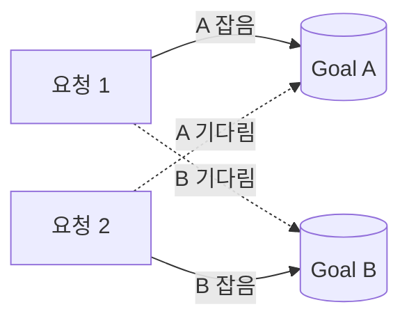

# Day 29 · 격리수준·락·데드락: 동시에 일하는 트랜잭션끼리의 규칙

> 읽는 시간: 약 13분

## 복습 3문제

**1.** (Day 28) `atomic` 블록 안에서 예외를 `try/except`로 삼키면 어떻게 될까요?

<details>
<summary>정답</summary>

예외가 블록 밖으로 나가지 않으므로 Django는 **정상 종료로 보고 커밋**합니다. 실패한 쓰기 뒤의 상태가 그대로 확정될 수 있습니다. 부분 실패를 다루려면 안쪽에 `atomic`을 하나 더 둬서 세이브포인트로 감쌉니다.

</details>

**2.** (Day 28) `select_for_update()`는 어떤 SQL을 만들고, 언제까지 락을 잡을까요?

<details>
<summary>정답</summary>

`SELECT ... FOR UPDATE`를 만듭니다. 락은 **트랜잭션이 끝날 때(COMMIT/ROLLBACK)까지** 유지됩니다. 그래서 반드시 `atomic` 안에서 써야 합니다.

</details>

**3.** (Day 27) 인덱스를 많이 만들면 생기는 비용은?

<details>
<summary>정답</summary>

**쓰기가 느려집니다.** INSERT·UPDATE·DELETE 때마다 인덱스도 함께 고쳐야 하기 때문입니다. 디스크 공간도 더 씁니다.

</details>

---

## 오늘 만들 것

체크인과 "목표 합치기" 기능이 동시에 돌 때 **데드락 없이** 동작하게, 락 순서를 정하고 재시도 장치를 붙입니다.

## 오늘 배울 것

- 격리수준(isolation level): 다른 트랜잭션의 변경이 어디까지 보이나
- 락의 종류와 `nowait`·`skip_locked`
- 데드락이 생기는 이유와 막는 법

---

## 1. 격리수준: 남의 작업이 어디까지 보이나

어제는 트랜잭션을 "한 묶음"으로 봤습니다. 그런데 트랜잭션은 **동시에 여러 개** 돌아갑니다. 내가 읽는 도중 다른 트랜잭션이 값을 바꾸면 무엇이 보여야 할까요?

이 규칙이 **격리수준**(isolation, ACID의 I)입니다. 완벽히 떼어 놓으면 안전하지만 느리고, 느슨하면 빠르지만 이상한 결과가 보입니다. DB는 이 사이에서 단계를 고르게 해 줍니다.

**결과를 맞혀 보세요:** 트랜잭션 A가 streak를 두 번 읽습니다. 그 사이 B가 3을 4로 바꾸고 커밋했습니다. PostgreSQL 기본 설정에서 A의 두 번째 읽기는?

```sql
-- A: BEGIN
SELECT streak FROM goal WHERE id=1;
-- (B가 4로 바꾸고 COMMIT)
SELECT streak FROM goal WHERE id=1;
```

<details>
<summary>정답</summary>

**4**가 보입니다. PostgreSQL 기본은 **READ COMMITTED**라서, 문장(SELECT)마다 "그 순간 커밋된 최신 값"을 봅니다. 같은 트랜잭션 안에서 같은 행을 읽었는데 값이 달라집니다. 이것을 **non-repeatable read**라고 합니다.

</details>

**비유:** READ COMMITTED는 "볼 때마다 최신판 신문", REPEATABLE READ는 "아침에 찍어 둔 사진"입니다. 사진은 하루 종일 같지만, 그 사이 일어난 일은 안 보입니다.

이상 현상 3가지와 막아 주는 수준을 표로 보면 이렇습니다.

| 이상 현상 | 뜻 | 막는 최소 수준 |
|---|---|---|
| Dirty read | 커밋 안 된 값을 봄 | READ COMMITTED |
| Non-repeatable | 다시 읽으니 값이 바뀜 | REPEATABLE READ |
| Phantom | 다시 세니 행 수가 바뀜 | SERIALIZABLE* |

\* PostgreSQL의 REPEATABLE READ는 스냅샷 방식이라 phantom도 사실상 막습니다.

순수 Python으로 "최신판 vs 사진"을 흉내 내 봅시다.

```python-run
db = {"streak": 3}
snap = dict(db)
# 다른 트랜잭션이 커밋
db["streak"] = 4
print("READ COMMITTED:", db["streak"])
print("REPEATABLE READ:", snap["streak"])
# 출력: READ COMMITTED: 4
# 출력: REPEATABLE READ: 3
```

**JS (Node)** — Prisma에서 수준 지정

```javascript
await prisma.$transaction(
  async (tx) => { /* ... */ },
  { isolationLevel:
      "Serializable" }
);
```

**Python** — Django는 연결 단위로 지정 (settings.py, 로컬)

```python
from psycopg import IsolationLevel
DATABASES["default"]["OPTIONS"] = {
    "isolation_level":
        IsolationLevel.SERIALIZABLE,
}
```

실무에서는 보통 **기본값(READ COMMITTED)을 유지**하고, 꼭 필요한 곳만 락이나 제약으로 막습니다. 전부 SERIALIZABLE로 올리면 충돌 에러와 재시도가 크게 늘어납니다.

> 💡 격리수준은 "동시에 도는 트랜잭션끼리 서로를 얼마나 보나"의 규칙이다. 기본값은 대개 READ COMMITTED.

<details>
<summary>🔍 더 깊이 (면접용)</summary>

- **MVCC**(다중 버전 동시성 제어): PostgreSQL·MySQL InnoDB는 행을 고칠 때 옛 버전을 남깁니다. 그래서 읽기가 쓰기를 기다리지 않습니다. "읽기는 쓰기를 막지 않고, 쓰기는 읽기를 막지 않는다."
- **DB마다 기본값이 다릅니다.** PostgreSQL·Oracle은 READ COMMITTED, MySQL InnoDB는 REPEATABLE READ.
- **SERIALIZABLE**(PostgreSQL SSI)은 순서가 꼬일 위험을 감지하면 한쪽을 `could not serialize access` 에러로 실패시킵니다. 즉 **애플리케이션이 재시도**해야 합니다.
- **Write skew**: 두 트랜잭션이 서로 다른 행을 읽고 다른 행을 써서 규칙이 깨지는 현상. REPEATABLE READ로도 못 막고 SERIALIZABLE이나 명시적 락이 필요합니다.

</details>

---

## 2. 락의 종류: 기다릴까, 포기할까, 건너뛸까

격리수준이 "무엇이 보이나"라면, **락**(lock, 자물쇠)은 "누가 먼저 고치나"를 정합니다. 어제 `select_for_update`로 행에 배타 락을 걸었습니다.

락에는 크게 두 종류가 있습니다.

- **공유 락**(shared, S): 여럿이 함께 읽을 수 있음. 쓰기는 막음.
- **배타 락**(exclusive, X): 한 명만. 다른 S·X 모두 막음.

`UPDATE`나 `SELECT ... FOR UPDATE`는 행에 X 락을 겁니다. 다른 트랜잭션은 그 행을 고치려 하면 **기다립니다**.

**결과를 맞혀 보세요:** 리마인더 작업자 2명이 "보낼 리마인더"를 동시에 가져갑니다. 둘 다 `select_for_update()`를 쓰면 무슨 일이 생길까요?

```python
with transaction.atomic():
    jobs = (Reminder.objects
            .select_for_update()
            .filter(sent=False)[:10])
    for j in jobs:
        send(j)
```

<details>
<summary>정답</summary>

두 번째 작업자는 첫 번째가 커밋할 때까지 **그냥 기다립니다.** 작업자가 둘이어도 사실상 한 명씩 일하는 셈입니다. 같은 행을 두 번 보내진 않지만 병렬 처리의 의미가 사라집니다.

</details>

Django는 기다리는 방식을 고를 수 있게 해 줍니다.

| 옵션 | 잠긴 행을 만나면 | 쓰는 곳 |
|---|---|---|
| (기본) | 풀릴 때까지 대기 | 일반 수정 |
| `nowait=True` | 즉시 에러 | 빠른 실패 응답 |
| `skip_locked=True` | 건너뜀 | 작업 큐 |

```python
jobs = (Reminder.objects
        .select_for_update(
            skip_locked=True)
        .filter(sent=False)[:10])
```

이제 작업자 A가 1~10번을 잡으면, B는 잠긴 행을 건너뛰고 11~20번을 가져갑니다. 이것이 DB를 간단한 **작업 큐**로 쓰는 대표 패턴입니다.

**JS (Node)** — Knex에도 같은 기능이 있습니다

```javascript
await trx("reminder")
  .where({ sent: false })
  .limit(10)
  .forUpdate()
  .skipLocked();
```

**비유:** 은행 창구 번호표입니다. 기본은 "내 차례까지 기다리기", `nowait`는 "줄이 있으면 바로 돌아가기", `skip_locked`는 "빈 창구로 가기"입니다.

> 💡 락을 만나면 기다리기(기본)·바로 실패(`nowait`)·건너뛰기(`skip_locked`) 중 고른다. 작업 큐에는 `skip_locked`.

<details>
<summary>🔍 더 깊이 (면접용)</summary>

- **SQLite는 `select_for_update`를 지원하지 않습니다.** Django가 조용히 무시하므로, 로컬 SQLite 테스트로 락 동작을 검증하면 안 됩니다. PostgreSQL로 테스트하세요.
- `select_related`와 함께 쓰면 JOIN된 테이블 행까지 잠급니다. `of=("self",)`로 내 테이블만 잠글 수 있습니다 (PostgreSQL).
- `nowait=True`에서 잠긴 행을 만나면 `DatabaseError`가 납니다. 이를 잡아 "잠시 후 다시 시도해 주세요"(409/423) 응답으로 바꿉니다.
- 행 락 말고도 테이블 락, 인덱스 범위를 잠그는 **gap lock**(MySQL REPEATABLE READ)이 있어, MySQL은 예상보다 넓게 잠글 수 있습니다.

</details>

---

## 3. 데드락: 서로를 기다리다 멈춤

Goals 앱에 "목표 합치기" 기능을 넣었습니다. 목표 A의 체크인을 B로 옮기므로 **두 행을 모두 잠급니다**.

**결과를 맞혀 보세요:** 요청 1은 "A를 B로 합치기", 요청 2는 "B를 A로 합치기"를 동시에 실행합니다. 각자 첫 번째 인자부터 잠급니다. 어떻게 될까요?

```python
def merge(src_id, dst_id):
    with transaction.atomic():
        src = lock(src_id)
        dst = lock(dst_id)
        move_checkins(src, dst)
```

<details>
<summary>정답</summary>

**데드락**이 생깁니다. 요청 1은 A를 잡고 B를 기다리고, 요청 2는 B를 잡고 A를 기다립니다. 둘 다 영원히 기다리게 됩니다. PostgreSQL은 이를 감지해 한쪽을 `deadlock detected` 에러로 끝냅니다.

</details>




**비유:** 좁은 골목에서 두 차가 마주 보고 "네가 먼저 비켜"라고 버티는 상황입니다. 누군가 후진(롤백)해야 풀립니다.

DB는 "누가 누구를 기다리나" 그래프에서 **고리(cycle)**를 찾아 데드락을 감지합니다. 직접 흉내 내 봅시다.

```python-run
waits = {"요청1": "요청2", "요청2": "요청1"}
def deadlock(start):
    seen, cur = set(), start
    while cur in waits:
        if cur in seen: return True
        seen.add(cur); cur = waits[cur]
    return False
print(deadlock("요청1"))
```

<details>
<summary>출력과 해설</summary>

`True`가 나옵니다. 요청1 → 요청2 → 요청1로 돌아오는 고리가 있기 때문입니다. `waits`에서 `"요청2": "요청1"`을 지우면 `False`가 됩니다.

</details>

**해결 1: 항상 같은 순서로 잠근다.** 인자 순서와 상관없이 id가 작은 행부터 잠그면 고리가 생길 수 없습니다.

```python
@transaction.atomic
def merge(src_id, dst_id):
    rows = (Goal.objects
            .select_for_update()
            .filter(pk__in=[src_id, dst_id])
            .order_by("pk"))
    g = {r.pk: r for r in rows}
    move(g[src_id], g[dst_id])
```

`order_by("pk")`가 핵심입니다. 두 요청 모두 A(작은 id)부터 잡으려 하므로, 늦은 쪽은 처음부터 줄을 섭니다.

**해결 2: 실패하면 짧게 재시도한다.** 순서를 지켜도 복잡한 시스템에선 데드락이 가끔 납니다. 롤백된 트랜잭션은 다시 실행하면 대부분 성공합니다. (`import time` 필요)

```python
from django.db import OperationalError
def merge_retry(src, dst, tries=3):
    for i in range(tries):
        try:
            return merge(src, dst)
        except OperationalError:
            time.sleep(0.05 * (i + 1))
    raise RuntimeError("재시도 실패")
```

**JS (Node)** — 같은 아이디어

```javascript
const ids = [src, dst].sort((a, b) => a - b);
await trx("goal").whereIn("id", ids)
  .orderBy("id").forUpdate();
```

> 💡 데드락은 "서로 다른 순서로 여러 락을 잡을 때" 생긴다. 잠그는 순서를 통일하고, 트랜잭션을 짧게, 실패 시 재시도.

<details>
<summary>🔍 더 깊이 (면접용)</summary>

- 데드락 4조건(Coffman): 상호 배제, 점유 대기, 비선점, **순환 대기**. 락 순서 통일은 순환 대기를 없애는 방법입니다.
- PostgreSQL은 락을 `deadlock_timeout`(기본 1초) 이상 기다리면 그래프를 검사합니다. 고리를 찾으면 한쪽을 강제 롤백합니다.
- **재시도는 `atomic` 바깥에서** 해야 합니다. 안쪽에서 잡으면 이미 망가진 트랜잭션 안에서 다시 쿼리하게 되어 `TransactionManagementError`가 납니다.
- 재시도 시 외부 부작용(이메일 등)이 두 번 나가지 않도록 `on_commit`을 씁니다 (Day 28).
- 락을 오래 잡는 원인: 트랜잭션 안의 외부 API 호출, 긴 루프. 이것들을 밖으로 빼는 것이 가장 효과적인 예방입니다.

</details>

---

## 연습문제

**1.** 리마인더 작업자 3명이 같은 테이블에서 일을 나눠 가져야 합니다. 중복 발송 없이, 서로 기다리지도 않게 쿼리를 쓰세요.

<details>
<summary>정답</summary>

```python
with transaction.atomic():
    jobs = list(Reminder.objects
        .select_for_update(skip_locked=True)
        .filter(sent=False)
        .order_by("pk")[:10])
    for j in jobs:
        j.sent = True
        j.save(update_fields=["sent"])
```

`skip_locked`로 다른 작업자가 잡은 행은 건너뜁니다. `sent=True`를 같은 트랜잭션에서 저장하므로, 커밋 뒤엔 다른 작업자가 다시 가져가지 않습니다. 실제 발송은 `transaction.on_commit`으로 커밋 후에 하는 것이 더 안전합니다.

</details>

**2.** 아래 이체(목표 간 포인트 옮기기) 코드는 데드락 위험이 있습니다. 이유와 고친 코드를 쓰세요.

```python
with transaction.atomic():
    a = Goal.objects.select_for_update() \
        .get(pk=from_id)
    b = Goal.objects.select_for_update() \
        .get(pk=to_id)
```

<details>
<summary>정답</summary>

`from_id`→`to_id` 순서로 잠그므로, 반대 방향 요청과 동시에 돌면 서로를 기다립니다. id 순으로 한 번에 잠급니다.

```python
with transaction.atomic():
    first, second = sorted([from_id, to_id])
    rows = (Goal.objects.select_for_update()
            .filter(pk__in=[first, second])
            .order_by("pk"))
    g = {r.pk: r for r in rows}
    a, b = g[from_id], g[to_id]
```

</details>

**3.** 아래 재시도 코드는 왜 동작하지 않을까요?

```python
with transaction.atomic():
    for i in range(3):
        try:
            merge_inner(src, dst)
            break
        except OperationalError:
            continue
```

<details>
<summary>정답</summary>

데드락으로 DB가 트랜잭션을 롤백하면, **바깥 `atomic` 트랜잭션 자체가 망가진 상태**가 됩니다. 그 안에서 다시 쿼리하면 에러가 납니다. 재시도 루프를 `atomic` **바깥**에 두고, 매 시도마다 새 트랜잭션을 엽니다.

```python
for i in range(3):
    try:
        with transaction.atomic():
            merge_inner(src, dst)
        break
    except OperationalError:
        time.sleep(0.05 * (i + 1))
```

</details>

---

## 면접 질문

**Q1. 트랜잭션 격리수준 4가지와 각각이 막는 현상을 설명해 주세요.**

<details>
<summary>모범 답안</summary>

READ UNCOMMITTED는 커밋 안 된 값까지 보여 dirty read가 생깁니다. READ COMMITTED는 커밋된 값만 보지만, 같은 행을 다시 읽으면 값이 바뀌는 non-repeatable read가 생깁니다. REPEATABLE READ는 트랜잭션 시작 시점 스냅샷을 봐서 이를 막고, 표준상 phantom(행 수 변화)은 남습니다. SERIALIZABLE은 순서대로 실행한 것과 같은 결과를 보장하지만 충돌 시 에러와 재시도가 필요합니다.

PostgreSQL 기본은 READ COMMITTED, MySQL InnoDB는 REPEATABLE READ입니다. 실무에선 기본값을 유지하고, 필요한 곳만 `select_for_update`·`F()`·유니크 제약으로 보완합니다.

</details>

**Q2. 데드락이 무엇이고, 실무에서 어떻게 예방하고 대응하나요?**

<details>
<summary>모범 답안</summary>

두 트랜잭션이 서로가 가진 락을 기다리며 영원히 멈추는 상태입니다. 보통 여러 행을 **다른 순서로** 잠글 때 생깁니다. DB는 대기 그래프에서 고리를 찾아 한쪽을 롤백합니다.

예방은 세 가지입니다. 잠그는 순서를 통일하고(예: pk 오름차순), 트랜잭션을 짧게 유지하고(외부 호출을 밖으로), 필요한 행만 잠급니다. 대응으로는 `atomic` 바깥에서 짧은 백오프로 재시도하고, 부작용은 `on_commit`으로 커밋 후에 실행해 중복을 막습니다. 데드락 로그를 모니터링해 반복되는 패턴을 찾는 것도 중요합니다.

</details>

---

## 오늘 정리

- 격리수준은 동시에 도는 트랜잭션이 서로를 얼마나 보는지 정한다. PostgreSQL 기본은 READ COMMITTED.
- 잠긴 행 앞에서 기다리기·`nowait`·`skip_locked`를 고른다. 작업 큐는 `skip_locked`.
- 데드락은 락 순서 통일 + 짧은 트랜잭션 + `atomic` 바깥 재시도로 다룬다.

## 다음에 이어갈 것

Day 30은 **raw SQL·집계·bulk 연산**: 체크인 수천 개를 한 번에 넣고 고치는 `bulk_create`·`bulk_update`, ORM으로 안 될 때 안전하게 raw SQL 쓰는 법을 다룹니다.
