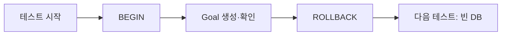

# Day 31 · pytest·pytest-django 기초: 고칠 때마다 자동으로 확인하기

> 읽는 시간: 약 13분

## 복습 3문제

**1.** (Day 30) 체크인 1000개를 저장할 때 `save()` 루프 대신 `bulk_create`를 쓰면 무엇을 잃나요?

<details>
<summary>정답</summary>

모델의 `save()` 오버라이드와 `pre_save`/`post_save` **시그널이 실행되지 않습니다.** 대신 쿼리 수가 1000번 → `batch_size` 단위 몇 번으로 줄어듭니다. 부수 효과가 필요하면 따로 처리하고, 전체를 `atomic`으로 감쌉니다.

</details>

**2.** (Day 28) `atomic` 블록 안에서 예외를 `try/except`로 삼키면 어떻게 되나요?

<details>
<summary>정답</summary>

`atomic`은 **예외가 블록 밖으로 나가야** 롤백합니다. 안에서 삼키면 정상 종료로 보고 커밋합니다. 일부만 되돌리고 싶으면 안쪽에 `atomic`을 하나 더 두고(SAVEPOINT), 그 **바깥**에서 예외를 잡습니다.

</details>

**3.** (Day 26) 목록 API의 쿼리 수가 늘지 않았는지 자동으로 확인하는 도구는?

<details>
<summary>정답</summary>

Django의 `assertNumQueries`(pytest-django에선 `django_assert_num_queries` fixture)입니다. 오늘 배우는 테스트 안에서 "이 API는 쿼리 3번 이하"를 **약속처럼 고정**할 수 있습니다.

</details>

---

## 오늘 만들 것

Goals 앱에 **첫 자동 테스트**를 붙입니다. 진행률 계산 함수, Goal 모델, 목록 화면이 깨지지 않았는지 `pytest` 한 줄로 확인합니다.

## 오늘 배울 것

- 왜 테스트를 쓰나, 그리고 pytest의 `assert` 한 줄 문법
- pytest-django: DB를 쓰는 테스트와 테스트 격리(롤백)
- `parametrize`와 `client`로 여러 경우·화면까지 확인하기

---

## 1. 왜 테스트인가, 그리고 pytest

지금까지는 기능을 만들고 **브라우저를 열어 눈으로** 확인했습니다. 기능이 30개가 되면, 하나를 고칠 때마다 30개를 다시 눌러 볼 수 없습니다.

**테스트**는 "이 입력이면 이 결과가 나와야 한다"를 코드로 적어 둔 것입니다. 한 번 적어 두면 명령 한 줄로 몇 초 만에 전부 다시 확인합니다. 이걸 **회귀 테스트**(regression test, 고친 뒤 옛 기능이 뒤로 망가지지 않았는지 확인)라고 부릅니다.

Python 테스트 도구의 사실상 표준은 **pytest**입니다. 특별한 문법 없이 평범한 `assert`만 씁니다.

**결과를 맞혀 보세요:** 아래 `tests/test_progress.py`에서 pytest가 실행하는 테스트는 몇 개일까요?

```python
def test_half():
    assert progress(5, 10) == 50

def helper():
    assert progress(0, 10) == 0

def test_zero_target():
    assert progress(3, 0) == 0
```

<details>
<summary>정답</summary>

**2개**입니다. pytest는 `test_`로 시작하는 **파일**(`test_*.py`) 안에서 `test_`로 시작하는 **함수**만 찾아 실행합니다. `helper`는 이름 때문에 무시됩니다. 이 규칙을 **테스트 탐색**(test discovery)이라고 합니다.

</details>

**비유:** 테스트는 요리사의 **맛보기 숟가락**입니다. 손님(사용자)에게 나가기 전에 매번 같은 기준으로 맛을 봅니다.

pytest가 하는 일을 표준 라이브러리로 흉내 내 봅시다. 진짜 pytest는 아니지만 원리는 같습니다.

```python-run
def progress(done, target):
    if target == 0: return 0
    return min(100, done * 100 // target)
cases = [(5,10,50), (15,10,100), (3,0,0)]
for d, t, want in cases:
    got = progress(d, t)
    print("PASS" if got == want else "FAIL",
          d, t, got)
```

실행하면 세 줄 모두 `PASS`가 나옵니다. 이제 `min(100, ...)`을 지우고 다시 실행해 보세요. `15 10` 줄이 `FAIL 15 10 150`으로 바뀝니다. 이게 회귀 테스트가 잡아 주는 순간입니다.

**JS (Node)** — Jest

```javascript
test("half", () => {
  expect(progress(5, 10)).toBe(50);
});
```

**Python** — pytest (로컬)

```python
def test_half():
    assert progress(5, 10) == 50
```

Jest의 `expect(...).toBe(...)` 대신 그냥 `assert`입니다. 실패하면 pytest가 **양쪽 값을 자세히** 보여 줍니다.

```bash
pip install pytest
pytest -q
# 출력: 3 passed in 0.02s
```

> 💡 pytest = `test_` 파일의 `test_` 함수를 찾아 `assert`를 확인. 고칠 때마다 한 줄로 전부 다시 맛본다.

<details>
<summary>🔍 더 깊이 (면접용)</summary>

- **assert rewriting:** 원래 `assert a == b`는 실패해도 값을 안 보여 줍니다. pytest는 테스트 파일을 import할 때 AST(구문 트리)를 고쳐서 양쪽 값과 diff를 출력합니다. 그래서 `conftest.py`나 테스트 파일이 아닌 일반 모듈의 assert는 다시 쓰지 않습니다.
- **unittest와의 관계:** Django 기본 `TestCase`는 `unittest` 기반(클래스 + `self.assertEqual`)입니다. pytest는 unittest 스타일 테스트도 그대로 실행하므로 섞어 쓸 수 있습니다.
- **테스트 피라미드:** 빠르고 많은 단위 테스트, 중간 수의 통합 테스트, 소수의 E2E. 아래로 갈수록 빠르고 안정적입니다.
- `python -O`로 실행하면 `assert` 문이 제거됩니다. 그래서 **운영 코드의 검증에는 assert를 쓰지 않고** 예외를 직접 던집니다. 테스트에서만 씁니다.

</details>

---

## 2. pytest-django: DB를 쓰는 테스트

`progress()` 같은 순수 함수는 쉽습니다. 하지만 Goals 앱의 대부분은 **DB를 읽고 씁니다.** 테스트가 진짜 DB를 더럽히면 안 되고, 테스트끼리 데이터가 섞여도 안 됩니다.

**pytest-django**는 이 문제를 풀어 줍니다. 테스트용 DB를 따로 만들고, **테스트마다 트랜잭션을 열었다가 끝나면 롤백**합니다. Day 28의 `atomic`을 테스트 격리에 쓰는 셈입니다.

설정은 파일 하나면 됩니다.

```bash
pip install pytest-django
```

```ini
# pytest.ini (manage.py 옆)
[pytest]
DJANGO_SETTINGS_MODULE = config.settings
python_files = test_*.py
```

**결과를 맞혀 보세요:** 아래 테스트를 실행하면?

```python
from goals.models import Goal

def test_create_goal():
    Goal.objects.create(title="독서")
    assert Goal.objects.count() == 1
```

<details>
<summary>정답</summary>

**실패합니다.** 에러 메시지는 대략 `Database access not allowed, use the "django_db" mark`입니다.

pytest-django는 **기본적으로 DB 접근을 막습니다.** 실수로 느린 DB 테스트가 늘어나는 것을 막으려는 설계입니다. DB가 필요한 테스트에만 표시를 붙입니다.

</details>

```python
import pytest
from goals.models import Goal

@pytest.mark.django_db
def test_create_goal():
    Goal.objects.create(title="독서")
    assert Goal.objects.count() == 1
```

이 테스트를 두 번, 세 번 돌려도 개수는 항상 1입니다. 끝날 때마다 롤백되기 때문입니다.


**비유:** 테스트마다 **새 도화지**를 받습니다. 그림을 다 그리면 도화지는 버리고, 다음 테스트는 다시 새 도화지에서 시작합니다.



**JS (Node)** — 보통 직접 정리합니다

```javascript
afterEach(async () => {
  await prisma.goal.deleteMany();
});
```

Node에선 `afterEach`로 지우거나 테스트 DB를 따로 띄우는 일을 직접 합니다. pytest-django는 이걸 **마크 하나**로 해 줍니다.

> 💡 DB를 쓰면 `@pytest.mark.django_db`. 테스트마다 롤백되니 서로 섞이지 않는다.

<details>
<summary>🔍 더 깊이 (면접용)</summary>

- **테스트 DB:** 세션 시작 시 `test_<DB이름>` DB를 만들고 마이그레이션을 돌립니다. `--reuse-db`로 재사용, `--nomigrations`로 마이그레이션 생략(빠르지만 마이그레이션 버그를 못 잡음).
- **`django_db(transaction=True)`:** 롤백 방식으로는 `on_commit` 콜백이 실행되지 않습니다(커밋이 안 일어나니까). 커밋 동작을 테스트하려면 이 옵션을 씁니다. 대신 테이블을 비우는(TRUNCATE) 방식이라 느립니다. Django 3.2+는 `captureOnCommitCallbacks`(pytest-django의 `django_capture_on_commit_callbacks`)로 빠르게 확인할 수 있습니다.
- Django의 `TestCase`(롤백) vs `TransactionTestCase`(테이블 비우기)와 같은 구분입니다.
- `select_for_update`·데드락 같은 **동시성**은 한 트랜잭션 안 테스트로는 재현이 안 됩니다. 스레드 + `transaction=True`가 필요합니다.

</details>

---

## 3. parametrize와 client: 여러 경우, 화면까지

진행률 함수의 경계값은 여러 개입니다: 0%, 50%, 100% 초과, 목표 0. 테스트 함수를 4개 복붙하면 길고 고치기 귀찮습니다.

`@pytest.mark.parametrize`는 **같은 테스트를 입력만 바꿔** 여러 번 돌립니다.

**결과를 맞혀 보세요:** 아래는 테스트 몇 개로 보고될까요?

```python
@pytest.mark.parametrize(
    "done, target, want", [
    (0, 10, 0), (5, 10, 50),
    (15, 10, 100), (3, 0, 0),
])
def test_progress(done, target, want):
    assert progress(done, target) == want
```

<details>
<summary>정답</summary>

**4개**입니다. `test_progress[0-10-0]`, `test_progress[5-10-50]`처럼 각각 이름이 붙고, 하나가 실패해도 나머지는 계속 실행됩니다. 어떤 입력에서 깨졌는지 바로 보입니다.

</details>

다음은 화면입니다. pytest-django는 **fixture**(테스트 함수 인자로 자동 주입되는 준비물)를 여러 개 줍니다. 인자 이름만 적으면 pytest가 알아서 넣어 줍니다. fixture는 Day 32에서 직접 만들어 봅니다.

| fixture | 하는 일 |
|---|---|
| `client` | 가짜 브라우저 (요청 보내기) |
| `django_user_model` | 현재 User 모델 |
| `admin_client` | 관리자로 로그인된 client |

Day 9의 "내 Goals만 보기"를 테스트로 고정해 봅시다.

```python
@pytest.mark.django_db
def test_only_my_goals(client,
                       django_user_model):
    make = (django_user_model
            .objects.create_user)
    me = make("me", password="pw")
    o = make("other", password="pw")
    Goal.objects.create(owner=o, title="비밀")
```

```python
    # (위 테스트 이어서)
    Goal.objects.create(owner=me, title="독서")
    client.force_login(me)
    resp = client.get("/goals/")
    assert resp.status_code == 200
    body = resp.content.decode()
    assert "독서" in body
    assert "비밀" not in body
```

`force_login`은 비밀번호 확인 없이 바로 로그인시킵니다. 로그인 과정 자체가 아니라 **"로그인한 뒤의 동작"**을 확인하는 테스트라서 충분합니다.

**JS (Node)** — supertest

```javascript
const res = await request(app)
  .get("/goals")
  .set("Cookie", myCookie);
expect(res.status).toBe(200);
```

**비유:** `client`는 **연습용 손님**입니다. 서버를 띄우지 않고, Django 안에서 요청 → 미들웨어 → 뷰 → 응답을 그대로 지나갑니다.

> 💡 경우가 여러 개면 `parametrize`. 화면은 `client`로 요청을 보내고 상태 코드와 내용을 본다.

<details>
<summary>🔍 더 깊이 (면접용)</summary>

- **좋은 테스트의 구조 AAA:** Arrange(준비) → Act(실행) → Assert(확인). 위 테스트도 이 세 부분이 보입니다. 한 테스트는 **한 가지 행동**만 확인합니다.
- **테스트 이름이 문서다:** `test_only_my_goals`처럼 "무엇이 보장되는가"를 이름에 씁니다. 실패 목록만 읽어도 무엇이 깨졌는지 압니다.
- **`client` vs `RequestFactory`:** `client`는 URL 라우팅·미들웨어까지 전부 통과(통합에 가까움). `RequestFactory`는 요청 객체만 만들어 뷰 함수를 직접 호출(더 빠르고 좁은 단위 테스트). 미들웨어가 채우는 `request.user`는 직접 넣어야 합니다.
- **보안 회귀 테스트:** "남의 데이터가 안 보인다", "남의 Goal 수정은 404/403" 같은 권한 테스트는 버그가 나면 사고가 크므로 우선순위가 높습니다.
- `reverse("goals:list")`로 URL을 만들면 URL 경로가 바뀌어도 테스트가 덜 깨집니다.

</details>

---

## 연습문제

**1.** 아래 함수에 대한 `parametrize` 테스트를 써 보세요. 연속 체크인 일수(streak)를 셉니다. 경우: 빈 목록 → 0, 오늘만 → 1, 오늘·어제·그제 → 3, 오늘·그제(어제 빠짐) → 1.

```python
def streak(days, today):
    n = 0
    while today - timedelta(n) in days:
        n += 1
    return n
```

<details>
<summary>정답</summary>

날짜를 "오늘로부터 며칠 전"으로 적으면 읽기 쉽습니다.

```python
from datetime import date, timedelta
T = date(2026, 11, 13)

def ago(*ns):
    return {T - timedelta(n) for n in ns}
```

```python
@pytest.mark.parametrize("days, want", [
    (set(), 0),
    (ago(0), 1),
    (ago(0, 1, 2), 3),
    (ago(0, 2), 1),
])
def test_streak(days, want):
    assert streak(days, T) == want
```

**해설:** 오늘 날짜를 `date.today()`로 쓰지 않고 **고정값 `T`**로 넘겼습니다. 테스트가 날짜에 따라 결과가 바뀌면(불안정한 테스트, flaky test) 믿을 수 없습니다. 함수가 `today`를 인자로 받게 설계한 덕분에 테스트하기 쉬워졌습니다.

</details>

**2.** 다음 테스트는 혼자 돌리면 통과하지만, 다른 테스트와 같이 돌리면 가끔 실패합니다. 왜일까요?

```python
CACHE = []
def test_a():
    CACHE.append("독서")
    assert len(CACHE) == 1

def test_b():
    CACHE.append("운동")
    assert len(CACHE) == 1
```

<details>
<summary>정답</summary>

`CACHE`는 **모듈 전역 리스트**라서 테스트 사이에 공유됩니다. `test_a`가 먼저 돌면 `test_b` 시점에 길이가 2가 됩니다. DB는 pytest-django가 롤백해 주지만, **Python 메모리 상태는 롤백되지 않습니다.**

고치는 법: 테스트마다 새로 만듭니다.

```python
def test_a():
    cache = []
    cache.append("독서")
    assert len(cache) == 1
```

운영 코드가 전역 상태를 꼭 써야 한다면, 테스트 시작 시 비우는 fixture를 둡니다(Day 32). 테스트는 **순서와 무관하게** 통과해야 합니다. `pytest -p random_order` 같은 플러그인으로 순서를 섞어 이런 버그를 찾습니다.

</details>

**3.** 로그인하지 않은 사용자가 `/goals/`에 들어오면 로그인 페이지로 리다이렉트되는지 확인하는 테스트를 써 보세요. (뷰는 `@login_required`)

<details>
<summary>정답</summary>

```python
@pytest.mark.django_db
def test_anonymous_redirect(client):
    resp = client.get("/goals/")
    assert resp.status_code == 302
    assert "/login/" in resp.url
```

**해설:** `login_required`는 비로그인 요청을 `302`로 `LOGIN_URL`(`?next=/goals/` 포함)에 보냅니다. `resp.url`이 리다이렉트 목적지입니다. 리다이렉트를 따라가고 싶으면 `client.get(url, follow=True)`를 쓰고 `resp.redirect_chain`을 봅니다. 세션 조회 때문에 DB가 필요하니 `django_db` 마크를 붙였습니다.

</details>

---

## 면접 질문

**Q1. pytest-django에서 테스트 간 DB 격리는 어떻게 이루어지고, 그 방식의 한계는 무엇인가요?**

<details>
<summary>모범 답안</summary>

테스트 세션 시작 시 별도의 테스트 DB를 만들고 마이그레이션을 적용합니다. `@pytest.mark.django_db` 테스트마다 트랜잭션을 열고, 끝나면 롤백해서 다음 테스트가 깨끗한 상태에서 시작합니다. Django `TestCase`와 같은 방식이라 빠릅니다.

한계는 실제 커밋이 일어나지 않는다는 점입니다. 그래서 `transaction.on_commit` 콜백이 실행되지 않고, 여러 커넥션이 필요한 동시성(락·데드락) 테스트도 재현되지 않습니다. 이런 경우 `django_db(transaction=True)`(테이블 비우기 방식, 느림)를 쓰거나 `django_capture_on_commit_callbacks`로 콜백만 확인합니다. 또 DB만 롤백되므로 전역 변수·캐시 같은 메모리 상태는 직접 정리해야 합니다.

</details>

**Q2. Django 기본 `TestCase` 대신 pytest를 쓰는 이유는?**

<details>
<summary>모범 답안</summary>

첫째, 문법이 간단합니다. 클래스·`self.assertEqual` 없이 함수와 `assert`만 쓰고, 실패 시 assert rewriting으로 양쪽 값을 자세히 보여 줍니다. 둘째, fixture로 준비 코드를 재사용·조합하고 범위(scope)를 조절할 수 있어 `setUp` 상속보다 유연합니다. 셋째, `parametrize`로 경계값 테스트를 짧게 쓰고, `-k`·마커·`--lf`(지난번 실패만) 같은 실행 옵션과 xdist(병렬)·coverage 등 플러그인 생태계가 풍부합니다.

기존 `unittest` 스타일 테스트도 pytest가 그대로 실행하므로 점진적으로 옮길 수 있다는 점도 실무에서 장점입니다.

</details>

---

## 오늘 정리

- 테스트는 "이 입력 → 이 결과"를 코드로 고정한다. pytest는 `test_` 함수와 평범한 `assert`.
- DB 테스트는 `@pytest.mark.django_db`. 테스트마다 롤백되지만 메모리 상태는 직접 정리한다.
- 여러 경우는 `parametrize`, 화면·권한은 `client` + `force_login`으로 확인한다.

## 다음에 이어갈 것

Day 32는 **fixture·factory_boy**: 테스트마다 반복되는 "유저 만들고 Goal 만들기"를 재사용 가능한 준비물로 뽑아 테스트를 짧게 만듭니다.
