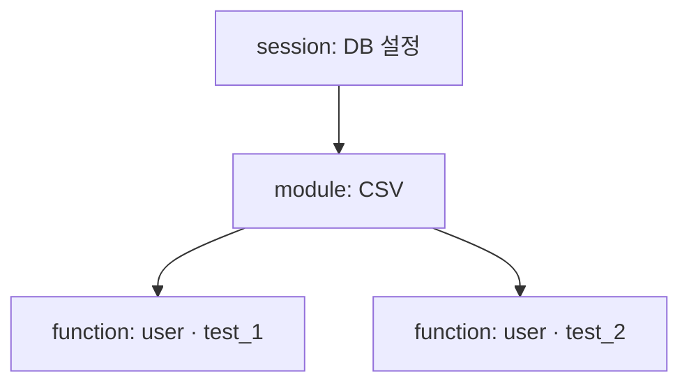

# Day 32 · fixture·factory_boy: 테스트 준비물을 재사용하기

> 읽는 시간: 약 13분

## 복습 3문제

**1.** (Day 31) pytest-django에서 `@pytest.mark.django_db` 없이 `Goal.objects.create()`를 부르면?

<details>
<summary>정답</summary>

**실패합니다.** `Database access not allowed` 에러가 납니다. pytest-django는 기본적으로 DB 접근을 막고, 마크를 붙인 테스트에만 허용합니다. 허용된 테스트는 끝날 때마다 롤백됩니다.

</details>

**2.** (Day 31) 테스트마다 롤백되는데도 테스트끼리 결과가 섞일 수 있는 경우는?

<details>
<summary>정답</summary>

**Python 메모리 상태**(모듈 전역 리스트, 캐시, 클래스 변수 등)를 건드릴 때입니다. 롤백은 DB만 되돌립니다. 메모리 상태는 테스트 안에서 새로 만들거나, 정리하는 fixture를 둡니다(오늘 배웁니다).

</details>

**3.** (Day 29) 두 트랜잭션이 서로가 잡은 락을 기다리며 영원히 멈추는 현상은?

<details>
<summary>정답</summary>

**데드락**(deadlock)입니다. DB는 이를 감지해 한쪽을 에러로 끝냅니다. 예방은 락을 항상 **같은 순서**로 잡고, 트랜잭션을 짧게 유지하는 것입니다.

</details>

---

## 오늘 만들 것

Goals 앱 테스트마다 반복되던 "유저 만들기 → 로그인 → Goal 만들기"를 **fixture와 factory**로 뽑아 냅니다. 테스트 본문이 3~4줄로 줄어듭니다.

## 오늘 배울 것

- fixture: 인자 이름으로 준비물을 받는 법, `yield`로 정리하기
- `conftest.py`와 scope: 어디서 공유하고, 얼마나 오래 살리나
- factory_boy: 그럴듯한 테스트 데이터를 한 줄로 만들기

---

## 1. fixture: 인자 이름이 곧 주문서

어제 쓴 테스트를 떠올려 봅시다. 거의 모든 테스트가 "유저 하나 만들고, Goal 하나 만들고"로 시작했습니다. 같은 준비 코드가 20번 복붙되면, User 모델에 필수 필드가 하나 생기는 순간 20곳을 고쳐야 합니다.

**fixture**(픽스처, 테스트 준비물)는 이 준비 코드를 함수 하나로 뽑아 둔 것입니다. 테스트는 **인자 이름만 적으면** pytest가 같은 이름의 fixture를 찾아 실행하고, 결과를 넣어 줍니다. 이것을 **의존성 주입**(DI, 필요한 것을 밖에서 넣어 줌)이라 합니다.

**결과를 맞혀 보세요:** 아래를 `pytest -s`로 돌리면 어떤 순서로 출력될까요?

```python
@pytest.fixture
def user():
    print("user 생성")
    return "me"

def test_hello(user):
    print("테스트:", user)
```

<details>
<summary>정답</summary>

```text
user 생성
테스트: me
```

pytest가 `test_hello`의 인자 이름 `user`를 보고, 같은 이름의 fixture를 **먼저** 실행합니다. 반환값 `"me"`가 인자로 들어옵니다. 테스트에서 fixture를 직접 호출하지 않는다는 점이 핵심입니다.

</details>

fixture는 **다른 fixture를 인자로 받을 수도** 있습니다. `goal`이 `user`를 받으면, pytest가 알아서 `user` → `goal` 순서로 만듭니다.


이 원리를 표준 라이브러리로 흉내 내 봅시다. 인자 이름을 읽어 같은 이름의 함수를 먼저 부르는 게 전부입니다.

```python-run
import inspect
def user(): return "me"
def goal(user): return f"{user}의 독서"
FX = {"user": user, "goal": goal}
def run(fn):
    ps = inspect.signature(fn).parameters
    return fn(*[run(FX[p]) for p in ps])
print(run(lambda goal: "받음: " + goal))
```

`# 출력: 받음: me의 독서`가 나옵니다. 진짜 pytest도 함수 시그니처를 읽고, 의존성을 재귀적으로 풀어 줍니다.

**정리(teardown)도 필요할 때**는 `return` 대신 `yield`를 씁니다. `yield` 앞은 준비, 뒤는 테스트가 끝난 뒤 정리입니다. 테스트가 실패해도 정리 코드는 실행됩니다.

```python
@pytest.fixture
def clean_cache():
    CACHE.clear()
    yield CACHE
    # 테스트 끝난 뒤 실행
    CACHE.clear()
```

**JS (Node)** — Jest는 훅으로 준비합니다

```javascript
let user;
beforeEach(async () => {
  user = await makeUser();
});
afterEach(() => cleanup());
```

**Python** — pytest (로컬)

```python
@pytest.fixture
def user(django_user_model):
    return (django_user_model.objects
        .create_user("me", password="pw"))
```

Jest의 `beforeEach`는 파일 안 **모든 테스트**에 실행되고, 변수를 바깥에 둡니다. pytest fixture는 **필요하다고 적은 테스트에만** 실행되고, 값이 인자로 들어옵니다. 무엇이 필요한지 테스트 시그니처만 보면 압니다.

**비유:** fixture는 식당의 **주문서**입니다. 손님(테스트)이 "goal 하나요"라고 적으면, 주방(pytest)이 필요한 재료(user)부터 준비해 접시에 담아 줍니다.

> 💡 fixture = 인자 이름으로 받는 준비물. 서로 의존할 수 있고, `yield` 뒤는 정리 코드.

<details>
<summary>🔍 더 깊이 (면접용)</summary>

- **실행 순서:** 같은 테스트 안에서 fixture는 (1) scope가 넓은 것 먼저, (2) 의존 관계 순서로 만들어집니다. 정리(`yield` 뒤)는 **만든 순서의 역순**(LIFO)입니다.
- **`request` fixture:** fixture 안에서 `request.addfinalizer(fn)`로 정리 함수를 등록할 수도 있습니다. `yield`가 더 읽기 쉬워 요즘은 `yield`를 권장합니다.
- **`autouse=True`:** 인자로 적지 않아도 범위 안 모든 테스트에 자동 적용됩니다. 전역 상태 초기화엔 편하지만, 테스트만 봐서는 무슨 준비가 일어나는지 안 보여 남용하면 디버깅이 어렵습니다.
- **fixture override:** 하위 폴더 `conftest.py`에서 같은 이름의 fixture를 다시 정의하면 그 범위에선 그것이 이깁니다. 상위 것을 인자로 받아 확장할 수도 있습니다.
- **`yield` 정리가 실행 안 되는 경우:** `yield` **앞**(준비 단계)에서 예외가 나면 정리 코드는 실행되지 않습니다.

</details>

---

## 2. conftest.py와 scope: 어디서, 얼마나 오래

fixture를 테스트 파일 안에 두면 그 파일에서만 쓸 수 있습니다. 여러 파일이 같은 `user`를 쓰려면 **`conftest.py`**에 둡니다.

`conftest.py`는 pytest가 **자동으로 읽는** 특별한 파일입니다. import 없이도 같은 폴더와 하위 폴더의 모든 테스트가 그 안의 fixture를 쓸 수 있습니다.

예: `goals/tests/conftest.py`에 두면 `goals/tests/` 안 모든 테스트 파일이 import 없이 씁니다.

```python
# goals/tests/conftest.py
import pytest

@pytest.fixture
def auth_client(client, user):
    client.force_login(user)
    return client
```

이제 화면 테스트는 `auth_client` 하나만 받으면 "로그인된 브라우저"가 생깁니다.

다음은 **scope**(범위, fixture를 얼마나 오래 살릴지)입니다. 기본값은 `function`, 테스트마다 새로 만듭니다. 만들기 비싼 준비물은 범위를 넓혀 **한 번만** 만들 수 있습니다.

| scope | 몇 번 만드나 |
|---|---|
| `function` (기본) | 테스트마다 |
| `module` | 파일마다 한 번 |
| `session` | 전체 실행에 한 번 |

**결과를 맞혀 보세요:** 테스트가 3개인 파일에서 아래 fixture는 몇 번 실행될까요?

```python
@pytest.fixture(scope="module")
def big_data():
    print("로딩!")
    return load_csv("goals.csv")
```

<details>
<summary>정답</summary>

**1번**입니다. 첫 테스트가 요청할 때 만들고, 같은 파일의 나머지 2개 테스트는 **같은 객체**를 재사용합니다. 파일 끝에서 정리됩니다.

함정이 있습니다. 한 테스트가 `big_data`를 수정(append 등)하면 **다음 테스트도 수정된 걸** 봅니다. 넓은 scope는 **읽기 전용** 준비물에만 쓰세요.

</details>



Jest로 치면 `beforeAll`이 module scope, `beforeEach`가 function scope와 비슷합니다.

**비유:** `function` scope는 **일회용 컵**, `session` scope는 **사무실 정수기**입니다. 정수기는 한 번 설치해 모두 쓰지만, 누가 물에 뭘 타면 모두가 마십니다.

> 💡 공유는 `conftest.py`, 수명은 scope. 넓은 scope는 빠르지만 상태가 새기 쉬우니 읽기 전용에만.

<details>
<summary>🔍 더 깊이 (면접용)</summary>

- **scope 규칙:** 넓은 scope의 fixture는 **좁은 scope의 fixture를 인자로 받을 수 없습니다.** (`session` fixture가 `function` fixture에 의존하면 `ScopeMismatch` 에러.) 오래 사는 것이 금방 사라질 것을 붙잡으면 안 되기 때문입니다.
- **DB와 scope:** pytest-django의 `db` fixture는 function scope라서, `module`/`session` scope fixture에서 DB에 쓰려면 `django_db_setup`과 `django_db_blocker.unblock()`을 써야 합니다. 이렇게 만든 데이터는 **롤백되지 않으니** 직접 정리해야 합니다. 보통은 function scope + 빠른 factory가 더 안전합니다.
- **`scope="package"`/`"class"`**도 있습니다.
- **parametrize된 fixture:** `@pytest.fixture(params=["sqlite", "pg"])`와 `request.param`으로 fixture 자체를 여러 버전으로 돌려, 그 fixture를 쓰는 모든 테스트를 버전 수만큼 반복할 수 있습니다.

</details>

---

## 3. factory_boy: 그럴듯한 데이터를 한 줄로

fixture로 `user`, `goal` 하나씩은 해결됐습니다. 그런데 "체크인 30개 있는 Goal", "다른 유저의 Goal 5개"처럼 **데이터 모양이 테스트마다 다르면** fixture가 끝없이 늘어납니다.

**factory_boy**는 모델별 **데이터 공장**을 만듭니다. 기본값은 공장이 채우고, 테스트는 **관심 있는 필드만** 바꿉니다.

```bash
pip install factory_boy
```

`goals/tests/factories.py`에 공장을 만듭니다.

```python
import factory
class GoalFactory(
        factory.django.DjangoModelFactory):
    class Meta:
        model = Goal
    title = factory.Sequence(
        lambda n: f"목표{n}")
```

```python
    # (GoalFactory 이어서)
    owner = factory.SubFactory(UserFactory)
    target = 30
```

- `Sequence`: 만들 때마다 번호가 올라가 **이름이 겹치지 않습니다** (unique 제약 대비).
- `SubFactory`: Goal에 owner가 필요하면 **UserFactory로 유저도 자동 생성**합니다.

`Sequence`의 원리는 단순한 카운터입니다.

```python-run
import itertools
seq = itertools.count()
def make_goal(**kw):
    n = next(seq)
    g = {"title": f"목표{n}", "target": 30}
    g.update(kw)
    return g
print(make_goal(), make_goal(target=7))
```

두 번째 호출은 `title`이 `목표1`이고 `target`만 7로 바뀝니다. **기본값 + 덮어쓰기**, 이게 factory의 전부입니다.

**결과를 맞혀 보세요:** 아래 테스트가 끝났을 때 DB의 User는 몇 명일까요?

```python
@pytest.mark.django_db
def test_many():
    me = UserFactory()
    GoalFactory(owner=me)
    GoalFactory.create_batch(3)
```

<details>
<summary>정답</summary>

**4명**입니다. `me` 1명 + `create_batch(3)`의 Goal 3개가 각자 `SubFactory`로 유저를 1명씩 만듭니다. `owner=me`를 넘긴 첫 Goal은 새 유저를 만들지 않습니다.

"남의 Goal 3개"를 만들 때는 이게 딱 원하는 동작입니다. 한 사람에게 몰고 싶으면 `create_batch(3, owner=me)`처럼 넘깁니다.

</details>

**JS (Node)** — 보통 fishery·faker로 비슷하게 합니다

```javascript
const goalFactory = Factory.define(
  ({ sequence }) => ({
    title: `목표${sequence}`,
    target: 30,
  }));
goalFactory.build({ target: 7 });
```

**Python** — 테스트에서 쓰기 (로컬)

```python
def test_list(auth_client, user):
    GoalFactory.create_batch(2, owner=user)
    GoalFactory()
    resp = auth_client.get("/goals/")
    assert len(resp.context["goals"]) == 2
```

이제 이 테스트는 **무엇이 중요한지**만 보입니다. "내 Goal 2개, 남의 Goal 1개 → 목록엔 2개".

**비유:** factory는 **붕어빵 틀**입니다. 틀(기본값)은 같고, 속(바꿀 필드)만 팥이나 슈크림으로 바꿔 넣습니다.

> 💡 factory = 기본값 + 필요한 필드만 덮어쓰기. `SubFactory`로 연관 객체까지, `create_batch`로 여러 개.

<details>
<summary>🔍 더 깊이 (면접용)</summary>

- **build vs create:** `GoalFactory.build()`는 **DB에 저장하지 않은** 객체(`save()` 안 함)를 만듭니다. DB가 필요 없는 로직 테스트는 `build`로 훨씬 빠르게 돌립니다. `build_batch`, `stub`도 있습니다.
- **`LazyAttribute`:** 다른 필드 값으로 계산합니다. 예: `slug = factory.LazyAttribute(lambda o: slugify(o.title))`.
- **`factory.Faker("sentence")`:** 무작위 그럴듯한 값. 단, 무작위는 **재현이 어려운(flaky) 테스트**를 만들 수 있어, 결과에 영향을 주는 필드는 명시적으로 넘기는 게 좋습니다. `factory.random.reseed_random(42)`로 고정 가능합니다.
- **M2M:** `@factory.post_generation`으로 생성 후 tags 등을 붙입니다.
- **pytest-factoryboy:** `register(GoalFactory)`로 factory를 `goal`, `goal_factory` fixture로 자동 등록합니다.
- **fixture 파일(JSON, `loaddata`) vs factory:** JSON fixture는 스키마가 바뀌면 깨지고, 테스트와 데이터가 멀리 떨어져 읽기 어렵습니다. factory는 모델 기본값이 코드에 있고 테스트 안에서 의도가 보여 실무에서 더 선호됩니다.
- **N+1과 함께:** `create_batch(20)` 후 `django_assert_num_queries(3)`으로 "개수가 늘어도 쿼리 수는 고정"을 테스트하는 패턴이 자주 쓰입니다(Day 26 복습).

</details>

---

## 연습문제

**1.** 아래 테스트 세 개에 반복되는 준비 코드를 `conftest.py`의 fixture로 뽑아 보세요. (유저 생성 + 로그인)

```python
def test_a(client, django_user_model):
    u = django_user_model.objects \
        .create_user("me", password="pw")
    client.force_login(u)
    ...
```

<details>
<summary>정답</summary>

```python
# conftest.py
@pytest.fixture
def user(django_user_model):
    return (django_user_model.objects
        .create_user("me", password="pw"))
```

```python
@pytest.fixture
def auth_client(client, user):
    client.force_login(user)
    return client

def test_a(auth_client):
    ...
```

**해설:** `user`와 `auth_client`를 나눠 둔 이유는, 어떤 테스트는 유저 객체만(모델 테스트), 어떤 테스트는 로그인된 client가 필요하기 때문입니다. 작은 fixture를 **조합**하는 게 큰 fixture 하나보다 재사용이 잘 됩니다. `client`와 `user` 둘 다 받는 테스트에서도 `user`는 **한 번만** 만들어집니다(같은 테스트 안에선 캐시).

</details>

**2.** 다음 fixture를 쓰는 테스트가 순서에 따라 실패합니다. 원인과 해결은?

```python
@pytest.fixture(scope="module")
def tags():
    return ["건강", "공부"]
def test_add(tags):
    tags.append("취미")
    assert len(tags) == 3
def test_len(tags):
    assert len(tags) == 2
```

<details>
<summary>정답</summary>

**원인:** `scope="module"`이라 두 테스트가 **같은 리스트 객체**를 공유합니다. `test_add`가 먼저 돌면 리스트가 3개로 바뀌어 `test_len`이 실패합니다.

**해결 1:** scope를 지워 기본 `function`으로. 테스트마다 새 리스트가 생깁니다. 리스트 하나 만드는 비용은 거의 0입니다.

**해결 2:** 꼭 공유해야 하면 수정 불가능한 값을 돌려줍니다.

```python
@pytest.fixture(scope="module")
def tags():
    return ("건강", "공부")
```

튜플은 `append`가 없으니 테스트가 실수로 공유 상태를 바꾸려 하면 바로 에러가 납니다.

</details>

**3.** `CheckInFactory`를 만들어 보세요. CheckIn 모델은 `goal`(FK), `day`(date), `amount`(int). 체크인마다 날짜가 하루씩 달라야 합니다(`unique_together = goal, day`).

<details>
<summary>정답</summary>

```python
from datetime import date, timedelta

class CheckInFactory(
        factory.django.DjangoModelFactory):
    class Meta:
        model = CheckIn
    goal = factory.SubFactory(GoalFactory)
```

```python
    # (이어서)
    day = factory.Sequence(
        lambda n: date(2026, 11, 1)
        + timedelta(days=n))
    amount = 1
```

**해설:** `Sequence`로 날짜를 하루씩 밀어 unique 제약 충돌을 피했습니다. `date.today()`가 아니라 **고정된 시작일**을 써서 언제 돌려도 결과가 같습니다. 한 Goal에 체크인 7개는 `CheckInFactory.create_batch(7, goal=g)`입니다. 단, Sequence 번호는 테스트 전체에서 계속 올라가므로, 날짜 자체를 단언(assert)해야 하는 테스트에선 `day=`를 명시적으로 넘기세요.

</details>

---

## 면접 질문

**Q1. pytest fixture의 scope는 무엇이고, 넓은 scope를 쓸 때 주의할 점은?**

<details>
<summary>모범 답안</summary>

scope는 fixture 인스턴스의 수명입니다. `function`(기본)은 테스트마다, `class`/`module`/`package`는 그 단위마다, `session`은 전체 실행에 한 번 만들어지고, `yield` 뒤 정리 코드는 그 범위가 끝날 때 역순으로 실행됩니다.

넓은 scope는 DB 연결, 큰 파일 로딩처럼 비싼 준비를 줄여 속도를 높이지만, 테스트 간에 **상태를 공유**하게 됩니다. 한 테스트가 객체를 수정하면 다른 테스트 결과가 실행 순서에 따라 달라지는 flaky 테스트가 생깁니다. 그래서 넓은 scope는 읽기 전용이나 불변 객체에만 쓰고, 넓은 scope fixture는 좁은 scope fixture에 의존할 수 없다는 규칙(ScopeMismatch)도 있습니다. Django에선 function scope의 트랜잭션 롤백 밖에서 만든 데이터는 자동 정리되지 않는 점도 주의해야 합니다.

</details>

**Q2. 테스트 데이터를 JSON fixture(`loaddata`) 대신 factory_boy로 만드는 이유는?**

<details>
<summary>모범 답안</summary>

JSON fixture는 모델에 필드가 추가·변경될 때마다 파일을 고쳐야 해서 유지보수가 어렵고, 테스트가 어떤 데이터에 의존하는지 테스트 코드만 봐서는 알 수 없습니다. 모든 테스트가 같은 큰 데이터셋을 공유하면 하나를 고칠 때 다른 테스트가 깨지기도 합니다.

factory_boy는 합리적인 기본값을 코드로 정의하고, 테스트는 관심 있는 필드만 덮어써서 **의도가 테스트 안에 드러납니다.** `SubFactory`로 연관 객체를 자동 생성하고, `Sequence`로 unique 충돌을 피하며, `build`로 DB 없이 빠른 단위 테스트도 할 수 있습니다. 각 테스트가 필요한 최소 데이터만 만들어 격리도 좋아집니다.

</details>

---

## 오늘 정리

- fixture는 인자 이름으로 받는 준비물. 서로 의존하고, `yield` 뒤에서 정리한다.
- `conftest.py`로 여러 파일이 공유, scope로 수명을 정한다. 넓은 scope는 읽기 전용에만.
- factory_boy는 기본값 + 필요한 필드만 덮어쓰기. `SubFactory`, `Sequence`, `create_batch`.

## 다음에 이어갈 것

Day 33은 **API 테스트·모킹**: DRF API를 `APIClient`로 테스트하고, 외부 서비스(알림 발송 등)는 `mock`으로 가짜로 바꿔 빠르고 안정적으로 확인합니다.
