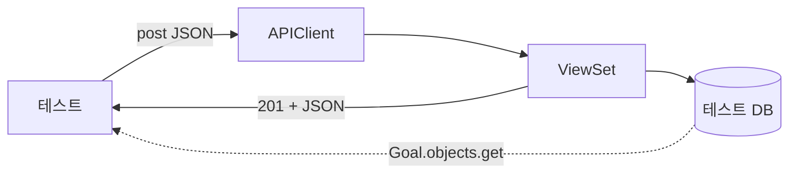

# Day 33 · API 테스트·모킹: 진짜 요청처럼, 가짜 외부 서비스로

> 읽는 시간: 약 13분

## 복습 3문제

**1.** (Day 32) `@pytest.fixture(scope="module")`로 만든 리스트를 한 테스트가 `append`하면, 같은 파일의 다음 테스트는?

<details>
<summary>정답</summary>

**수정된 리스트를 그대로 봅니다.** module scope는 파일마다 한 번만 만들어 같은 객체를 재사용하기 때문입니다. 넓은 scope는 읽기 전용 준비물에만 씁니다.

</details>

**2.** (Day 32) `GoalFactory.create_batch(3)`을 부르면 User는 몇 명 생기나요? (`owner`는 `SubFactory(UserFactory)`)

<details>
<summary>정답</summary>

**3명**입니다. Goal마다 `SubFactory`가 유저를 1명씩 만듭니다. 한 유저에게 몰려면 `create_batch(3, owner=me)`처럼 넘깁니다.

</details>

**3.** (Day 28) `transaction.on_commit(lambda: notify(...))`로 등록한 알림은 트랜잭션이 롤백되면?

<details>
<summary>정답</summary>

**아예 호출되지 않습니다.** 커밋이 성공했을 때만 실행됩니다. "기록은 취소됐는데 알림은 갔다"를 막는 장치입니다. 오늘 이걸 테스트로 확인합니다.

</details>

---

## 오늘 만들 것

Goals API(`/api/goals/`)에 **API 테스트**를 붙입니다. 상태 코드·JSON·권한을 확인하고, 체크인 시 나가는 **알림 발송은 가짜(mock)로 바꿔** 실제로 보내지 않고도 "불렸는지"를 검사합니다.

## 오늘 배울 것

- `APIClient`: 로그인한 앱처럼 JSON 요청을 보내고 응답 검사하기
- `parametrize`: 401·403·404 같은 "안 되는 경우"를 표 한 장으로 테스트
- `mock.patch`: 외부 서비스를 가짜로 바꾸고, **어디를** 바꿔야 하는지

---

## 1. APIClient: 앱이 보내는 요청을 그대로 흉내 내기

Day 31~32의 `client`는 **브라우저**를 흉내 냈습니다. 폼을 보내고 HTML을 받았죠. 하지만 Goals API를 부르는 건 모바일 앱입니다. 앱은 **JSON**을 보내고, **토큰**으로 로그인하고, **상태 코드**를 봅니다.

DRF의 **`APIClient`**는 이런 "앱 요청"을 흉내 냅니다. `format="json"`이면 본문을 JSON으로 바꿔 보내고, `force_authenticate`로 **토큰 발급 과정 없이** 로그인 상태를 만듭니다.

왜 중요할까요? API는 화면이 없어서, 깨져도 **눈으로 못 봅니다.** 앱 사용자가 "갑자기 안 돼요"라고 말할 때야 알게 됩니다. 테스트가 그 눈이 됩니다.

먼저 fixture로 준비합니다. (어제 배운 conftest.py)

```python
# conftest.py
from rest_framework.test import APIClient

@pytest.fixture
def api(user):
    c = APIClient()
    c.force_authenticate(user=user)
    return c
```

**결과를 맞혀 보세요:** 아래 테스트는 통과할까요?

```python
@pytest.mark.django_db
def test_create(api):
    r = api.post("/api/goals/",
        {"title": "독서", "target": 30},
        format="json")
    assert r.status_code == 200
```

<details>
<summary>정답</summary>

**실패합니다.** `ModelViewSet`의 생성(`create`)은 **201 Created**를 돌려줍니다. 200을 기대하면 틀립니다.

숫자를 외우기보다 `from rest_framework import status`의 `status.HTTP_201_CREATED`처럼 **이름**을 쓰면 실수가 줄고 읽기도 쉽습니다.

</details>

**JS (Node)** — supertest로 Express API 테스트

```javascript
const r = await request(app)
  .post("/api/goals")
  .set("Authorization", `Bearer ${t}`)
  .send({ title: "독서", target: 30 });
expect(r.status).toBe(201);
expect(r.body.title).toBe("독서");
```

**Python** — APIClient (로컬 실행)

```python
def test_create(api, user):
    r = api.post("/api/goals/",
        {"title": "독서", "target": 30},
        format="json")
    assert r.status_code == 201
    assert r.json()["title"] == "독서"
    goal = Goal.objects.get()
    assert goal.owner == user
```

마지막 두 줄이 핵심입니다. 응답만 보지 말고 **DB에 진짜 저장됐는지**, `owner`가 요청한 사람으로 채워졌는지(Day 22의 `perform_create`)까지 확인합니다.



**비유:** APIClient는 **모의 손님**입니다. 진짜 손님(앱) 대신 주문(요청)을 넣고, 나온 음식(응답)과 주방 장부(DB)를 둘 다 확인합니다.

> 💡 API 테스트 = 상태 코드 + JSON 본문 + DB 상태, 세 가지를 함께 확인한다.

<details>
<summary>🔍 더 깊이 (면접용)</summary>

- **`r.data` vs `r.json()`:** `r.data`는 렌더링 **전** 파이썬 객체(Serializer 결과), `r.json()`은 실제 전송된 바이트를 파싱한 결과입니다. 앱이 받는 걸 검사하려면 `r.json()`이 더 정직합니다. (날짜·Decimal은 문자열로 바뀌어 차이가 납니다.)
- **`force_authenticate` vs `credentials`:** `force_authenticate`는 인증 클래스를 **건너뜁니다.** 그래서 "토큰 인증 자체"를 테스트하려면 `c.credentials(HTTP_AUTHORIZATION="Token " + key)`로 진짜 헤더를 보내야 합니다.
- **`APIRequestFactory`:** 미들웨어·URL 라우팅 없이 뷰 함수만 직접 호출합니다. 빠르지만 실제 경로와 달라 놓치는 버그가 있습니다. 보통은 APIClient로 통합적으로, 복잡한 로직만 Factory나 순수 함수로 테스트합니다.
- **`APITestCase`:** unittest 스타일을 쓰는 팀에서는 `self.client`가 APIClient인 이 클래스를 씁니다.

</details>

---

## 2. parametrize: "안 되는 경우"를 표로 테스트

실무 버그의 상당수는 **성공 경로가 아니라 실패 경로**에서 납니다. "로그인 안 한 사람이 남의 목표를 지울 수 있었다" 같은 보안 사고가 대표적입니다.

그런데 실패 경우마다 테스트 함수를 하나씩 쓰면 거의 같은 코드가 반복됩니다. **`@pytest.mark.parametrize`**(매개변수화)는 **입력·기대값 표**를 주면 같은 테스트를 행마다 한 번씩 돌립니다.

**결과를 맞혀 보세요:** Day 24의 `get_queryset()`은 **내 목표만** 돌려줍니다. 다른 사람의 목표 `DELETE /api/goals/{남의 id}/`의 상태 코드는?

<details>
<summary>정답</summary>

**404 Not Found**입니다. 403이 아닙니다. `get_queryset()`에 아예 없으니 `get_object()`가 "그런 목표 없음"으로 끝냅니다.

이게 오히려 안전합니다. 403이면 "그 id의 목표가 **존재는 한다**"는 정보가 새어 나갑니다.

</details>

먼저 원리를 순수 Python으로 봅시다. 표의 각 행이 따로 실행됩니다.

```python-run
def can_delete(login, mine):
    if not login:
        return 401
    return 204 if mine else 404
cases = [(False, True, 401),
         (True, False, 404),
         (True, True, 204)]
for login, mine, want in cases:
    print(can_delete(login, mine) == want)
```

pytest에서는 이 표를 데코레이터로 씁니다. (로컬 실행)

```python
@pytest.mark.parametrize(
    "who, want", [
        ("anon", 401),
        ("other", 404),
        ("owner", 204),
    ])
```

```python
@pytest.mark.django_db
def test_delete(who, want, user):
    goal = GoalFactory(owner=user)
    c = make_client(who, owner=user)
    r = c.delete(f"/api/goals/{goal.pk}/")
    assert r.status_code == want
```

`make_client`는 `who`에 따라 로그인 안 한 / 다른 유저 / 주인 APIClient를 돌려주는 작은 도우미 함수입니다. 실행하면 `test_delete[anon]`, `test_delete[other]`, `test_delete[owner]` **세 개의 테스트**로 보고됩니다. 하나가 깨지면 어느 행인지 바로 보입니다.

**JS (Node)** — Jest의 `test.each`가 같은 역할

```javascript
test.each([
  ["anon", 401],
  ["other", 404],
  ["owner", 204],
])("%s → %i", async (who, want) => {
  // ...
});
```

**비유:** parametrize는 **체크리스트 점검**입니다. 같은 점검 절차를 "손님 / 직원 / 사장" 줄마다 반복하고, 줄마다 O·X를 따로 적습니다.

> 💡 권한 테스트는 "누가 × 무엇을" 표로. 실패 경로가 성공 경로만큼 중요하다.

<details>
<summary>🔍 더 깊이 (면접용)</summary>

- **401 vs 403:** 401은 "누구인지 모름(인증 필요)", 403은 "누군지 알지만 권한 없음"입니다. DRF는 인증 클래스가 `WWW-Authenticate` 헤더를 줄 수 있을 때(Token 등)만 401을 쓰고, `SessionAuthentication`만 있으면 비로그인도 **403**으로 돌려줍니다. 테스트가 이 차이를 잡아 줍니다.
- **ids:** `pytest.param("anon", 401, id="비로그인")`으로 보고서 이름을 바꿀 수 있고, `marks=pytest.mark.xfail`로 알려진 버그 행만 표시할 수도 있습니다.
- **조합 폭발:** `parametrize`를 두 개 겹치면 **곱집합**(3×4=12개)으로 돕니다. 편하지만 느려지니 의미 있는 조합만 남깁니다.
- **매트릭스 테스트:** 실무에서는 역할(anon/user/admin) × 액션(list/retrieve/update/delete) 표를 하나 두고 권한 회귀를 막는 패턴이 흔합니다.

</details>

---

## 3. mock.patch: 외부 서비스는 가짜로, 그리고 "어디를" 바꾸나

체크인하면 친구에게 푸시 알림을 보낸다고 합시다. 테스트를 돌릴 때마다 **진짜 푸시가 나가면** 곤란합니다. 느리고, 돈이 들고, 네트워크가 끊기면 테스트가 이유 없이 실패합니다(이런 걸 **flaky**, 들쭉날쭉한 테스트라 합니다).

**mock**(목, 가짜 객체)은 진짜 함수 자리에 **아무 일도 안 하면서 호출 기록만 남기는** 대역을 넣습니다. 그리고 테스트에서 "몇 번, 어떤 인자로 불렸나"를 확인합니다. `unittest.mock`은 표준 라이브러리라 바로 실행해 볼 수 있습니다.

```python-run
from unittest.mock import Mock
push = Mock(return_value="ok")
print(push("민지", "독서 체크인!"))
print(push.call_count)
push.assert_called_once_with(
    "민지", "독서 체크인!")
print("검사 통과")
```

`return_value`로 가짜 응답을, `side_effect=TimeoutError()`로 **실패**도 흉내 낼 수 있습니다. "푸시 서버가 죽어도 체크인은 저장되나?" 같은 테스트가 가능해집니다.

이제 가장 많이 틀리는 부분입니다. 코드가 이렇게 생겼습니다.

```python
# goals/notify.py
def send_push(user, msg): ...

# goals/views.py
from goals.notify import send_push
```

**결과를 맞혀 보세요:** 테스트에서 `patch("goals.notify.send_push")`로 바꿨습니다. 체크인 API를 부르면 진짜 푸시가 나갈까요?

<details>
<summary>정답</summary>

**나갑니다!** `from ... import send_push`는 views 모듈 안에 **진짜 함수를 가리키는 이름표**를 하나 더 만들어 둡니다(Day 1의 "변수는 이름표"). `patch`는 notify 쪽 이름표만 가짜로 바꿨고, views의 이름표는 여전히 진짜를 가리킵니다.

정답은 **쓰는 곳을 patch**: `patch("goals.views.send_push")`.

</details>


직접 확인해 봅시다. 모듈 두 개를 딕셔너리로 흉내 냅니다.

```python-run
notify = {"send": lambda: "진짜 푸시"}
views = {"send": notify["send"]}
notify["send"] = lambda: "가짜"
print(views["send"]())
views["send"] = lambda: "가짜"
print(views["send"]())
```

첫 줄은 여전히 "진짜 푸시"입니다. **쓰는 쪽(views)** 의 이름표를 바꿔야 가짜가 됩니다.

**JS (Node)** — Jest는 모듈 경로를 통째로 가짜로

```javascript
jest.mock("./notify");
const { sendPush } =
  require("./notify");
// ... 체크인 요청 ...
expect(sendPush)
  .toHaveBeenCalledTimes(1);
```

**Python** — pytest + patch (로컬 실행)

```python
from unittest.mock import patch

@patch("goals.views.send_push")
def test_checkin(mock_push, api, goal):
    url = f"/api/goals/{goal.pk}/checkin/"
    r = api.post(url)
    assert r.status_code == 201
    mock_push.assert_called_once()
```

함정이 하나 더 있습니다. Day 28에서 알림은 `transaction.on_commit`으로 보냈죠. 테스트는 끝에 **롤백**하므로 커밋이 일어나지 않고, 알림도 **영원히 안 불립니다.** pytest-django의 `django_capture_on_commit_callbacks`로 커밋 콜백을 실행시켜야 합니다.

```python
def test_push(api, goal,
        django_capture_on_commit_callbacks):
    url = f"/api/goals/{goal.pk}/checkin/"
    p = patch("goals.views.send_push")
    with p as m, \
         django_capture_on_commit_callbacks(
             execute=True):
        api.post(url)
    m.assert_called_once()
```

**비유:** mock은 **영화 스턴트 대역**입니다. 위험한 장면(외부 호출)은 대역이 하고, 감독(테스트)은 "그 장면을 정확히 한 번 찍었는지"만 확인합니다.

> 💡 mock은 "불렸나·뭘로 불렸나"를 검사한다. patch는 **정의된 곳이 아니라 쓰는 곳**을 바꾼다.

<details>
<summary>🔍 더 깊이 (면접용)</summary>

- **왜 쓰는 곳인가:** `patch("a.b.c")`는 import 후 `setattr(a.b, "c", mock)`을 할 뿐입니다. `from x import f`는 import 시점에 `views.f = x.f`로 **참조를 복사**하므로, 이후 `x.f`를 바꿔도 `views.f`는 그대로입니다. 반대로 `import goals.notify` 후 `notify.send_push()`로 부르면 매번 속성을 조회하므로 `goals.notify.send_push`를 patch해도 됩니다.
- **`autospec=True`:** 기본 Mock은 **아무 인자나** 받아서, 진짜 함수 시그니처가 바뀌어도 테스트가 통과합니다. `patch(..., autospec=True)`는 원래 함수의 인자 모양을 강제해 이런 "거짓 통과"를 막습니다.
- **`MagicMock`:** `__len__`, `__iter__` 같은 매직 메서드까지 지원합니다. `patch`의 기본값입니다.
- **과한 모킹의 위험:** 내 코드 내부까지 다 mock하면 테스트가 구현에 붙어 리팩터링할 때마다 깨지고, 실제로는 동작 안 하는데 통과하기도 합니다. **경계(외부 HTTP, 결제, 메일, 시간)** 만 mock하는 게 원칙입니다.
- **HTTP 전용 도구:** `responses`·`requests-mock`(requests), `respx`(httpx)는 URL 단위로 가짜 응답을 등록합니다. 시간은 `freezegun`/`time-machine`으로 고정합니다.
- **메일:** Django 테스트 러너는 메일 백엔드를 `locmem`으로 바꿔 `django.core.mail.outbox`에 쌓습니다. 메일은 mock 없이 `len(mail.outbox) == 1`로 검사할 수 있습니다.

</details>

---

## 연습문제

**1.** (로컬) 다른 유저가 내 목표를 `PATCH`로 제목 변경하려 하면 404가 나고, **DB의 제목은 그대로**인지 확인하는 테스트를 쓰세요.

<details>
<summary>정답</summary>

```python
@pytest.mark.django_db
def test_other_cannot_edit(user):
    goal = GoalFactory(owner=user,
                       title="독서")
    c = APIClient()
    c.force_authenticate(UserFactory())
    url = f"/api/goals/{goal.pk}/"
    r = c.patch(url, {"title": "해킹"},
                format="json")
    assert r.status_code == 404
```

```python
    # (이어서) DB 확인
    goal.refresh_from_db()
    assert goal.title == "독서"
```

**해설:** 상태 코드만 보면 "에러는 났는데 저장은 됐다" 같은 버그를 놓칩니다. `refresh_from_db()`로 메모리 객체를 DB 값으로 다시 읽어 **실제로 바뀌지 않았음**을 확인합니다. 다른 유저는 `UserFactory()`로 즉석에서 만듭니다.

</details>

**2.** (브라우저에서 실행) 푸시가 실패해도 체크인 함수가 `"saved"`를 돌려주는지, `side_effect`로 테스트해 보세요.

```python-run
from unittest.mock import Mock
def checkin(push):
    try:
        push("체크인!")
    except TimeoutError:
        pass
    return "saved"
# 여기에 테스트를 작성하세요
```

<details>
<summary>정답</summary>

```python-run
from unittest.mock import Mock
def checkin(push):
    try:
        push("체크인!")
    except TimeoutError:
        pass
    return "saved"
bad = Mock(side_effect=TimeoutError())
print(checkin(bad))
bad.assert_called_once_with("체크인!")
```

**해설:** `side_effect`에 예외 객체를 주면 Mock을 부를 때 그 예외가 **던져집니다.** 출력이 `saved`이고 `assert_called_once_with`도 통과하면, "푸시를 시도는 했고, 실패해도 저장은 유지된다"는 두 가지를 모두 확인한 것입니다. 외부 서비스 장애를 흉내 내는 가장 흔한 방법입니다.

</details>

**3.** 아래 테스트는 항상 실패합니다(`send_push`가 0번 불림). 이유 두 가지를 찾고 고치세요. `views.py`는 `from goals.notify import send_push`를 쓰고, 알림은 `on_commit`으로 보냅니다.

```python
@patch("goals.notify.send_push")
def test_push(m, api, goal):
    api.post(
      f"/api/goals/{goal.pk}/checkin/")
    m.assert_called_once()
```

<details>
<summary>정답</summary>

1. **patch 위치:** 정의된 곳(`goals.notify`)이 아니라 **쓰는 곳**(`goals.views.send_push`)을 바꿔야 합니다.
2. **on_commit:** 테스트는 롤백되므로 커밋 콜백이 실행되지 않습니다. `django_capture_on_commit_callbacks(execute=True)`로 감싸야 합니다.

```python
def test_push(api, goal,
        django_capture_on_commit_callbacks):
    p = patch("goals.views.send_push")
    with p as m, \
         django_capture_on_commit_callbacks(
             execute=True):
        api.post(
          f"/api/goals/{goal.pk}/checkin/")
    m.assert_called_once()
```

**해설:** 둘 중 하나만 고쳐도 여전히 0번입니다. "mock이 안 불려요"의 원인은 실무에서도 거의 이 두 가지입니다.

</details>

---

## 면접 질문

**Q1.** `mock.patch`를 쓸 때 "쓰는 곳을 patch하라"는 말의 의미와 이유를 설명해 주세요.

<details>
<summary>모범 답안</summary>

`patch`는 지정한 경로의 **속성 하나를 임시로 바꿔치기**할 뿐입니다. `from goals.notify import send_push`를 하면 import 시점에 `goals.views` 모듈에 같은 함수를 가리키는 **별도 이름**이 생깁니다. 그래서 `goals.notify.send_push`를 바꿔도 views는 원래 함수를 계속 부릅니다.

따라서 테스트 대상 코드가 **실제로 조회하는 이름**, 즉 `goals.views.send_push`를 patch해야 합니다. 모듈째 import(`import goals.notify`)해서 `notify.send_push()`로 부르는 코드라면 호출할 때마다 속성을 찾으므로 정의 위치를 patch해도 됩니다. 추가로 `autospec=True`를 쓰면 시그니처 불일치도 잡을 수 있습니다.

</details>

**Q2.** 테스트에서 무엇을 mock하고, 무엇을 mock하지 말아야 하나요?

<details>
<summary>모범 답안</summary>

**시스템 경계**에 있는 것만 mock합니다. 외부 HTTP API, 결제, 푸시·SMS, 현재 시간, 무작위 값처럼 느리거나, 돈이 들거나, 결과가 매번 다른 것들입니다.

반대로 **내 코드의 내부 로직이나 DB**는 가능하면 진짜로 돌립니다. 내부를 mock하면 테스트가 구현 방식에 묶여 리팩터링할 때마다 깨지고, 실제로는 연결이 안 되는데 통과하는 "거짓 통과"가 생깁니다. Django는 테스트 DB와 롤백이 빠르므로 ORM은 mock하지 않는 편이 일반적입니다. 메일은 `locmem` 백엔드의 `mail.outbox`로 mock 없이 검사합니다.

</details>

---

## 오늘 정리

- `APIClient` + `force_authenticate` + `format="json"`으로 앱 요청을 흉내 내고, 상태 코드·JSON·DB를 함께 본다.
- `parametrize`로 "누가 × 무엇을" 권한 표를 테스트한다. 남의 객체는 404가 안전하다.
- `mock`은 외부 서비스 대역. **쓰는 곳**을 patch하고, `on_commit`은 캡처해서 실행시킨다.

## 다음에 이어갈 것

Day 34는 **통합테스트·커버리지·CI**: 테스트가 코드의 몇 %를 지나가는지 재고, GitHub Actions로 push할 때마다 Goals 테스트가 자동으로 돌게 만듭니다.
