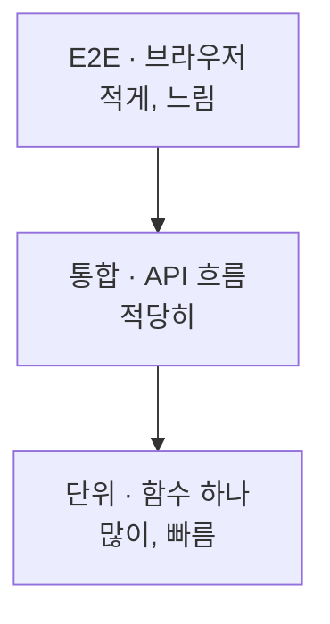

# Day 34 · 통합테스트·커버리지·CI: 테스트가 알아서 돌게

> 읽는 시간: 약 13분

## 복습 3문제

**1.** (Day 33) `goals/views.py`가 `from goals.notify import send_push`로 가져다 씁니다. 가짜로 바꾸려면 어디를 patch하나요?

<details>
<summary>정답</summary>

**`goals.views.send_push`** 입니다. from-import는 views 모듈에 이름표를 하나 더 붙입니다. `goals.notify.send_push`를 바꿔도 views는 원래 함수를 계속 봅니다. "정의된 곳이 아니라 **쓰는 곳**"을 바꿉니다.

</details>

**2.** (Day 32) `GoalFactory.build()`와 `GoalFactory.create()`의 차이는?

<details>
<summary>정답</summary>

`build()`는 **메모리에만** 객체를 만들고 DB에 저장하지 않습니다. `create()`는 `save()`까지 해서 **DB에 들어갑니다.** DB가 필요 없는 테스트는 `build()`가 빠르고, `django_db` 마크도 필요 없습니다.

</details>

**3.** (Day 30) `Goal.objects.bulk_create([...])`로 100개를 넣으면 `post_save` 시그널은 몇 번 불릴까요?

<details>
<summary>정답</summary>

**0번**입니다. `bulk_create`는 `save()`를 부르지 않고 INSERT를 한 번에 보냅니다. 그래서 빠르지만, `save()` 오버라이드나 시그널에 의존한 로직은 실행되지 않습니다.

</details>

---

## 오늘 만들 것

Goals 앱에 **"가입부터 진행률 확인까지" 이어지는 통합테스트**를 한 개 붙이고, **커버리지**로 안 지나간 코드를 찾고, **GitHub Actions**로 push할 때마다 테스트가 자동으로 돌게 만듭니다.

## 오늘 배울 것

- 통합테스트: 부품이 아니라 **사용자 흐름**을 한 번에 검사
- 커버리지: 테스트가 코드의 **어느 줄을 안 지나갔는지** 보기
- CI: 내 컴퓨터가 아니라 **서버가** 매번 테스트를 돌리게

---

## 1. 통합테스트: 부품은 멀쩡한데 조립하면 깨질 때

Day 31~33의 테스트는 대부분 **하나의 기능**만 봤습니다. "생성은 201", "남의 Goal은 404"처럼요. 이런 테스트를 **단위테스트**(unit test, 작은 부품 하나를 따로 검사)라고 부릅니다.

그런데 실제 사용자는 기능을 **이어서** 씁니다. 로그인 → Goal 만들기 → 체크인 → 진행률 보기. 각 단계가 혼자서는 맞아도, **이어 붙이는 곳**에서 깨질 수 있습니다.

**통합테스트**(integration test)는 이 흐름을 처음부터 끝까지 한 번에 따라가며 검사합니다.

**결과를 맞혀 보세요:** 아래 두 단위테스트는 모두 통과합니다. 그럼 앱도 정상일까요?

```python
# 체크인 API: 응답 키 이름을 바꿈
def test_checkin(api, goal):
    url = f"/api/goals/{goal.id}/checkin/"
    r = api.post(url)
    assert r.json()["count"] == 1
```

```python
# 진행률 계산: 여전히 "done"을 읽음
def test_progress():
    assert progress({"done": 3}, 10) == 30
```

<details>
<summary>정답</summary>

**아닐 수 있습니다.** 체크인 쪽은 `done`을 `count`로 바꿨고, 진행률 쪽은 여전히 `done`을 기다립니다. 각자의 테스트는 각자의 가정에 맞으니 둘 다 통과합니다.

하지만 **둘을 이어 붙이면** 진행률이 0%로 나오거나 `KeyError`가 납니다. 이런 "이음새 버그"는 흐름 전체를 도는 통합테스트만 잡습니다.

</details>

**JS (Node)** — supertest로 흐름 이어 가기

```javascript
const agent = request.agent(app);
await agent.post("/login").send(cred);
const g = await agent.post("/api/goals")
  .send({ title: "독서", target: 2 });
const url = `/api/goals/${g.body.id}`;
await agent.post(`${url}/checkin`);
const r = await agent.get(url);
expect(r.body.progress).toBe(50);
```

**Python** — 한 테스트 안에서 흐름 전체 (로컬 실행)

```python
@pytest.mark.django_db
def test_goal_flow(client,
                   django_user_model):
    django_user_model.objects.create_user(
        "dong", password="pw1234!")
    assert client.login(
        username="dong", password="pw1234!")
```

```python
    r = client.post("/api/goals/",
        {"title": "독서", "target": 2},
        content_type="application/json")
    gid = r.json()["id"]
    client.post(f"/api/goals/{gid}/checkin/")
    r = client.get(f"/api/goals/{gid}/")
    assert r.json()["progress"] == 50
```

여기서는 `force_authenticate`를 쓰지 않았습니다. **진짜 로그인**(세션 쿠키)을 거쳐야 인증 설정까지 함께 검사되기 때문입니다.



위 그림이 **테스트 피라미드**입니다. 빠른 단위테스트를 많이, 느리지만 현실적인 통합테스트는 핵심 흐름만 골라 씁니다.

**비유:** 단위테스트는 **부품 검사**, 통합테스트는 **조립한 자전거 시운전**입니다. 바퀴와 체인이 각각 멀쩡해도, 끼워 보면 안 맞을 수 있습니다.

> 💡 통합테스트는 "사용자가 실제로 밟는 길" 하나를 끝까지 걷는다. 핵심 흐름 몇 개만 고른다.

<details>
<summary>🔍 더 깊이 (면접용)</summary>

- **단위 vs 통합 vs E2E:** 단위는 함수·클래스 하나, 통합은 여러 계층(URL·뷰·Serializer·DB)을 함께, E2E는 실제 브라우저(Playwright·Selenium)로 화면까지 검사합니다. 위로 갈수록 현실적이지만 느리고 잘 깨집니다.
- **Flaky test**(가끔만 실패하는 테스트): 시간(`now()`), 순서 의존, 외부 네트워크가 주범입니다. 시간은 `freezegun`/`time-machine`으로 고정하고, 네트워크는 mock, 순서는 `pytest-randomly`로 섞어 일부러 드러냅니다.
- **`LiveServerTestCase`:** 진짜 서버 포트를 열어 E2E 도구가 접속하게 합니다. pytest-django에서는 `live_server` fixture입니다.
- **DB 차이:** 로컬은 SQLite, 운영은 PostgreSQL이면 JSONField·락·대소문자 정렬이 다르게 동작합니다. 통합테스트는 **운영과 같은 DB**에서 돌리는 게 원칙입니다. (아래 CI에서 Postgres를 띄우는 이유)

</details>

---

## 2. 커버리지: 테스트가 안 지나간 줄 찾기

테스트를 30개 써도 "충분한가?"는 감으로는 모릅니다. **커버리지**(coverage)는 테스트를 돌리는 동안 **실제로 실행된 줄**을 기록해서, 안 지나간 줄을 알려 줍니다.

원리는 단순합니다. 파이썬은 "지금 몇 번째 줄을 실행 중"이라고 알려 주는 훅(`sys.settrace`)을 갖고 있습니다. coverage.py는 그 훅으로 줄 번호를 모읍니다.

**결과를 맞혀 보세요:** `pct(3, 10)`만 실행하면, `pct` 안에서 기록되는 줄 번호는? (Run으로 확인)

```python-run
import sys
def pct(done, target):
    if target == 0:
        return 0
    return done * 100 // target
hit = set()
def t(f, e, a):
    if f.f_code.co_name == "pct":
        hit.add(f.f_lineno)
    return t
sys.settrace(t)
pct(3, 10)
sys.settrace(None)
print("지나간 줄:", sorted(hit))
```

<details>
<summary>정답</summary>

`지나간 줄: [2, 3, 5]` 입니다. 2는 함수 호출, 3은 `if`, 5는 마지막 `return`입니다.

**4번 줄(`return 0`)이 빠졌습니다.** `target == 0`인 경우를 아무 테스트도 안 해 본 겁니다. 커버리지 리포트의 `Missing` 칸에 바로 이런 줄 번호가 찍힙니다.

</details>

**JS (Node)** — Jest 내장 커버리지

```bash
npx jest --coverage
# 또는 Node 기본 러너 + c8
npx c8 node --test
```

**Python** — pytest-cov (로컬 실행)

```bash
pip install pytest-cov
pytest --cov=goals --cov-branch \
  --cov-report=term-missing
```

출력은 이렇게 생겼습니다. (칸 일부 생략)

```text
Name            Cover  Missing
goals/stats.py    88%  4, 3->4
goals/views.py   100%
```

`Missing`의 `4`는 안 지나간 줄, `3->4`는 **3번 줄의 if에서 4번으로 가는 갈래**를 한 번도 안 탔다는 뜻입니다.

`--cov-branch`가 중요한 이유가 여기 있습니다. 줄만 세면 `if` 줄을 "지나갔다"로 치지만, **참·거짓 두 갈래를 다 탔는지**는 브랜치 커버리지만 압니다.

**비유:** 커버리지는 **청소기 로봇의 지도**입니다. 어디를 지나갔는지는 정확히 알지만, 지나간 곳이 **깨끗해졌는지**(결과가 맞는지)는 모릅니다.

> 💡 커버리지는 "안 지나간 곳"을 찾는 도구다. 숫자가 높다고 "맞게 동작한다"는 뜻은 아니다.

<details>
<summary>🔍 더 깊이 (면접용)</summary>

- **100%의 함정:** `assert`가 없는 테스트도 줄은 지나갑니다. 실행만 하고 결과를 안 보면 커버리지는 100%, 검증은 0%입니다.
- **뮤테이션 테스트**(mutation testing): `>`를 `>=`로 바꾸는 식으로 코드를 일부러 망가뜨린 뒤 테스트가 실패하는지 봅니다. 안 깨지면 그 테스트는 약한 겁니다. 파이썬은 `mutmut`, JS는 Stryker.
- **설정:** `pyproject.toml`의 `[tool.coverage.run]`에 `branch = true`, `omit = ["*/migrations/*"]`를 두면 매번 옵션을 안 써도 됩니다. 마이그레이션·settings는 보통 제외합니다.
- **`# pragma: no cover`:** 정말 테스트할 가치가 없는 줄(디버그 전용 등)만 제외합니다. 남용하면 숫자만 부풀립니다.
- **적정 목표:** 보통 핵심 도메인 80~90%. 더 중요한 건 **새 코드의 커버리지가 떨어지지 않게** 지키는 것(diff coverage)입니다.

</details>

---

## 3. CI: 내가 깜빡해도 서버가 테스트를 돌린다

테스트를 잘 써 놔도 **안 돌리면** 소용없습니다. 급하게 고친 날일수록 "이번엔 괜찮겠지" 하고 건너뛰죠.

**CI**(Continuous Integration, 지속적 통합)는 코드를 push하거나 PR을 열 때마다 **서버가 자동으로** 테스트를 돌리는 것입니다. GitHub에서는 **GitHub Actions**가 이 일을 합니다.

**결과를 맞혀 보세요:** CI를 붙였고, PR에서 테스트가 빨간불(실패)입니다. 그래도 Merge 버튼을 누를 수 있을까요?

<details>
<summary>정답</summary>

**기본 설정에서는 누를 수 있습니다.** CI는 결과를 **보여 줄** 뿐, 막지는 않습니다.

막으려면 저장소 Settings → Branches(또는 Rulesets)에서 main 브랜치에 **"Require status checks to pass"** 를 켜고, 테스트 job을 필수로 지정해야 합니다.

</details>

워크플로는 `.github/workflows/test.yml` 파일 하나입니다. 길어서 두 조각으로 나눠 봅니다.

**① 언제, 어디서 돌릴까**

```yaml
name: test
on: [push, pull_request]
jobs:
  test:
    runs-on: ubuntu-latest
    steps:
      - uses: actions/checkout@v4
      - uses: actions/setup-python@v5
        with: { python-version: "3.12" }
```

**② 무엇을 돌릴까**

```yaml
      - run: pip install -r requirements.txt
      - run: >
          pytest --cov=goals --cov-branch
          --cov-fail-under=80
        env:
          DJANGO_SECRET_KEY: ci-only-key
```

`--cov-fail-under=80`이 핵심입니다. 커버리지가 80% 밑으로 떨어지면 **테스트가 다 통과해도 CI가 실패**합니다. 테스트 없이 코드만 늘리는 걸 막는 장치입니다.

**JS (Node)** — 같은 구조, 명령만 다름

```yaml
      - uses: actions/setup-node@v4
        with:
          node-version: 22
          cache: npm
      - run: npm ci
      - run: npm test -- --coverage
```

Node에서 `npm ci`가 하는 일을 파이썬에선 `pip install -r requirements.txt`가 합니다. 나머지 뼈대(checkout → 런타임 설치 → 의존성 → 테스트)는 똑같습니다.


**비유:** CI는 **공항 보안 검색대**입니다. 내가 "괜찮아요"라고 해도 모든 가방(커밋)이 똑같이 통과해야 비행기(main)에 탑니다.

> 💡 CI = push마다 깨끗한 서버에서 같은 테스트. 브랜치 보호까지 켜야 "빨간불이면 머지 금지"가 된다.

<details>
<summary>🔍 더 깊이 (면접용)</summary>

- **운영과 같은 DB:** job에 `services: postgres: image: postgres:16`을 붙이고 `DATABASE_URL`을 넘기면 CI가 Postgres로 테스트합니다. 헬스체크 옵션(`pg_isready`)으로 DB가 뜬 뒤 테스트를 시작하게 합니다.
- **캐시:** `setup-python`의 `cache: pip`로 의존성 설치 시간을 줄입니다.
- **matrix:** `strategy.matrix.python-version: ["3.11", "3.12"]`로 여러 버전을 동시에 돌립니다.
- **"내 컴퓨터에선 되는데":** CI는 매번 **빈 머신**에서 시작합니다. requirements에 빠진 패키지, 커밋 안 한 마이그레이션, 로컬에만 있는 `.env`가 여기서 드러납니다. `python manage.py makemigrations --check`를 CI에 넣으면 마이그레이션 누락도 잡습니다.
- **시크릿:** 진짜 키는 워크플로에 쓰지 말고 저장소 Secrets에 두고 `${{ secrets.NAME }}`으로 읽습니다. 포크에서 온 PR에는 시크릿이 전달되지 않습니다.
- **CI vs CD:** CI는 "합쳐도 안전한가"를 검사, CD(지속적 배포)는 통과한 코드를 자동으로 배포까지 합니다. Week 9에서 배포와 연결합니다.

</details>

---

## 연습문제

**1.** 아래 통합테스트의 빈칸을 채우세요. 흐름: 로그인 → target 4인 Goal 생성 → 체크인 3번 → 진행률 75 확인. (`api`는 Day 33의 로그인된 APIClient)

```python
@pytest.mark.django_db
def test_three_checkins(api):
    # 여기에 작성하세요
    ...
```

<details>
<summary>정답</summary>

```python
@pytest.mark.django_db
def test_three_checkins(api):
    r = api.post("/api/goals/",
        {"title": "러닝", "target": 4},
        format="json")
    assert r.status_code == 201
    gid = r.json()["id"]
```

```python
    url = f"/api/goals/{gid}/checkin/"
    for _ in range(3):
        r = api.post(url)
        assert r.status_code == 201
    r = api.get(f"/api/goals/{gid}/")
    assert r.json()["progress"] == 75
```

**해설:** 생성 응답의 `id`를 **다음 요청에 넘기는 것**이 통합테스트의 핵심입니다. 고정 id(`1`)를 쓰면 다른 테스트와 순서가 바뀔 때 깨집니다. 각 단계의 상태 코드도 확인해야, 실패 시 어느 단계에서 깨졌는지 바로 압니다.

</details>

**2.** 커버리지 리포트가 `goals/stats.py ... Missing: 4, 3->4`라고 합니다. 위 `pct` 함수 기준으로, 이 줄을 덮는 테스트를 쓰세요.

<details>
<summary>정답</summary>

```python
from goals.stats import pct

def test_pct_zero_target():
    assert pct(3, 0) == 0

def test_pct_normal():
    assert pct(3, 10) == 30
```

**해설:** `3->4`는 "`if target == 0`이 **참**인 갈래"를 한 번도 안 탔다는 뜻입니다. `target=0`을 넣으면 4번 줄과 그 갈래를 함께 지나갑니다. DB가 필요 없으니 `django_db` 마크도 없습니다. 0으로 나누기 같은 **경계값**이 커버리지 Missing에 자주 나옵니다.

</details>

**3.** CI가 "로컬에선 통과, CI에선 실패"합니다. 로그는 `django.db.utils.OperationalError: no such table: goals_checkin`. 원인과 CI에 넣을 예방 단계를 쓰세요.

<details>
<summary>정답</summary>

**원인:** `Checkin` 모델을 바꾸고 `makemigrations`로 만든 **마이그레이션 파일을 커밋하지 않았습니다.** 로컬 DB에는 테이블이 있지만, CI는 저장소에 있는 마이그레이션만으로 테스트 DB를 만듭니다.

**예방:** 테스트 전에 누락을 검사하는 단계를 넣습니다.

```yaml
      - run: >
          python manage.py
          makemigrations --check --dry-run
```

**해설:** `--check`는 새로 만들 마이그레이션이 있으면 **실패 코드로 종료**합니다. "모델은 바꿨는데 마이그레이션은 안 올린" 실수를 PR 단계에서 잡습니다.

</details>

---

## 면접 질문

<details>
<summary>Q1. 커버리지 100%면 버그가 없다고 할 수 있나요? 목표는 몇 %가 적당한가요?</summary>

**모범 답안:** 아닙니다. 커버리지는 **실행된 줄**을 셀 뿐, 결과를 **검증했는지**는 모릅니다. `assert` 없는 테스트도 100%가 될 수 있고, 줄 커버리지는 `if`의 한쪽 갈래만 타도 그 줄을 덮은 것으로 칩니다.

그래서 저는 세 가지를 같이 봅니다.

- `--cov-branch`로 **브랜치 커버리지**를 본다.
- 숫자 목표는 핵심 도메인 기준 80% 안팎으로 두고, `--cov-fail-under`로 **떨어지지 않게** 지킨다.
- 숫자보다 **경계값·실패 경로**(0, 빈 값, 권한 없음)를 테스트했는지 리뷰한다. 필요하면 뮤테이션 테스트로 테스트의 강도를 확인한다.

커버리지는 "안 테스트한 곳을 찾는 지도"로 쓰는 게 맞고, 품질 점수로 쓰면 의미 없는 테스트만 늘어납니다.

</details>

<details>
<summary>Q2. 단위·통합·E2E 테스트를 어떻게 나눠서 쓰시겠어요?</summary>

**모범 답안:** **테스트 피라미드**를 따릅니다.

- **단위**를 가장 많이: 진행률 계산, Serializer 검증, 권한 함수처럼 로직이 있는 곳. 빠르고 실패 위치가 정확합니다.
- **통합**은 핵심 흐름만: "로그인 → Goal 생성 → 체크인 → 진행률"처럼 돈·데이터가 걸린 경로. URL·인증·DB가 실제로 이어지는지 확인합니다. 운영과 같은 Postgres에서 돌립니다.
- **E2E**는 가장 적게: 결제·가입처럼 깨지면 치명적인 화면 흐름 몇 개만. 느리고 flaky하기 쉽기 때문입니다.

외부 서비스는 단위·통합 모두에서 mock으로 끊고, 실제 연동은 별도 스모크 테스트로 확인합니다. 이 전부를 CI에서 PR마다 돌리고, 브랜치 보호로 실패 시 머지를 막습니다.

</details>

---

## 오늘 정리

- **통합테스트**는 사용자 흐름 하나를 끝까지 걷는다. 단위는 많이, 통합은 핵심만 (피라미드).
- **커버리지**는 안 지나간 줄·갈래를 찾는 지도. `--cov-branch`로 보고, 숫자만 믿지 않는다.
- **CI**는 push마다 빈 서버에서 테스트. `--cov-fail-under` + 브랜치 보호로 빨간불 머지를 막는다.

## 다음에 이어갈 것

Day 35는 **TDD 실습 + 코딩테스트 맛보기**: "테스트 먼저 쓰고, 통과시키고, 다듬기"로 Goals의 **연속 달성일(streak)** 기능을 만들고, 같은 방식으로 코딩테스트 문제 하나를 풀어 봅니다.
