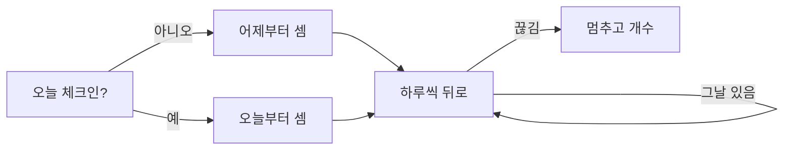

# Day 35 · TDD 실습 + 코딩테스트 맛보기: 테스트 먼저 쓰기

> 읽는 시간: 약 14분

## 복습 3문제

**1.** (Day 34) 커버리지 리포트의 `Missing: 4, 3->4`에서 `3->4`는 무슨 뜻인가요?

<details>
<summary>정답</summary>

**3번 줄에서 4번 줄로 가는 갈래를 한 번도 안 탔다**는 뜻입니다. 보통 `if`가 참인 경우를 테스트하지 않았을 때 나옵니다. `--cov-branch`를 켜야 이런 갈래 정보가 보입니다.

</details>

**2.** (Day 34) CI에 `makemigrations --check --dry-run`을 넣는 이유는?

<details>
<summary>정답</summary>

모델은 바꿨는데 **마이그레이션 파일을 커밋하지 않은 실수**를 잡기 위해서입니다. 새로 만들 마이그레이션이 있으면 실패 코드로 끝나서 PR이 빨간불이 됩니다.

</details>

**3.** (Day 31) `@pytest.mark.django_db` 테스트에서 만든 데이터는 다음 테스트에서도 보이나요?

<details>
<summary>정답</summary>

**안 보입니다.** pytest-django는 테스트마다 트랜잭션을 열고, 끝나면 **롤백**합니다. 그래서 테스트끼리 데이터가 섞이지 않고 순서에 의존하지 않습니다.

</details>

---

## 오늘 만들 것

Goals 앱에 **연속 달성일(streak)** 을 붙입니다. "오늘까지 며칠 연속 체크인했나"를 **테스트부터 쓰고** 만듭니다. 같은 방법으로 코딩테스트 문제 하나도 풀어 봅니다.

## 오늘 배울 것

- TDD: **빨강 → 초록 → 다듬기** 3박자
- TDD로 streak 함수를 한 걸음씩 키우기
- 코딩테스트도 "테스트 먼저": 느린 답 → 빠른 답

---

## 1. TDD: 테스트를 먼저 쓰는 이유

지금까지는 **코드를 먼저** 쓰고 테스트를 붙였습니다. 이러면 테스트가 "내가 짠 코드가 하는 일"을 따라 쓰게 됩니다. 버그도 같이 정답으로 굳어 버리기 쉽습니다.

**TDD**(Test-Driven Development, 테스트 주도 개발)는 순서를 뒤집습니다. "이 함수는 **이렇게 동작해야 한다**"를 테스트로 먼저 적고, 그걸 통과시키는 코드를 씁니다.

한 바퀴는 세 단계입니다.

- 🔴 **Red**: 실패하는 테스트를 하나 쓴다.
- 🟢 **Green**: 통과할 만큼만 **최소한**으로 코드를 쓴다.
- 🔵 **Refactor**: 테스트를 초록으로 유지한 채 코드를 다듬는다.


**결과를 맞혀 보세요:** 새 기능의 테스트를 먼저 쓰고, 코드는 아직 없이 실행했습니다. 테스트가 **통과**했다면 무엇이 의심스러울까요?

<details>
<summary>정답</summary>

**테스트가 아무것도 검사하지 않을 가능성**이 큽니다. `assert`를 빼먹었거나, 엉뚱한 함수를 부르거나, 이미 있던 동작을 검사한 것입니다. 그래서 TDD는 Red를 **꼭 눈으로 확인**합니다. "실패하는 걸 본 테스트"만 믿을 수 있습니다.

</details>

**JS (Node)** · Jest에서도 순서는 같습니다

```javascript
// 1) 테스트 먼저 (아직 streak 없음)
test("기록 없으면 0", () => {
  expect(streak([], 17)).toBe(0);
});
// 2) 실행 → 빨강 (정의 안 됨)
// 3) 최소 구현 → 초록
```

**Python** · pytest

```python
# tests/test_streak.py
from goals.streak import streak

def test_no_days_is_zero():
    assert streak([], 17) == 0
# pytest → 빨강 (ImportError)
```

**비유:** 시험지를 먼저 만들고 공부하는 것과 같습니다. 무엇을 맞혀야 하는지 정해 두면, 공부(코드)가 옆길로 새지 않습니다.

> 💡 TDD = 실패를 먼저 보고(🔴), 최소로 통과시키고(🟢), 안전하게 다듬기(🔵).

---

## 2. TDD로 streak 키우기

규칙을 먼저 말로 정합니다. 이게 TDD의 진짜 첫 단계입니다.

- 오늘부터 하루씩 거슬러 올라가며 **연속으로 체크인한 날**을 센다.
- 오늘 아직 안 했어도 **어제까지 이어졌으면** 유지한다 (아침에 0이 되면 슬프니까요).
- 같은 날 두 번 체크인해도 **하루로** 센다.

연습에서는 날짜 대신 **날 번호**(17 = 오늘, 16 = 어제)를 씁니다. 원리는 같고 코드가 짧아집니다.

### 한 바퀴씩 돌기

🔴 → 🟢 첫 바퀴는 "빈 기록이면 0"입니다. 가장 단순한 구현은 `return 0` 입니다. 바보 같아 보여도 일부러 이렇게 합니다. **테스트가 강요한 것만** 만들어야 쓸데없는 코드가 안 생깁니다.

두 번째 테스트 "오늘만 했으면 1"이 들어오면 `return 0`은 깨집니다. 그때 진짜 로직이 필요해집니다. 테스트가 하나씩 늘 때마다 코드가 **조금씩 일반화**됩니다.

**결과를 맞혀 보세요:** 아래 구현은 테스트 4개 중 몇 개를 통과할까요?

```python-run
def streak(days, today):
    n, d = 0, today
    while d in days:
        n, d = n + 1, d - 1
    return n
T = [([], 0), ([17], 1),
     ([15, 16, 17], 3), ([15, 16], 2)]
for a, w in T:
    print(streak(a, 17) == w, a)
```

<details>
<summary>정답</summary>

**3개**입니다. 마지막 `[15, 16]`(어제까지 했고 오늘은 아직)에서 0이 나와 실패합니다. 오늘(17)이 없어서 `while`이 바로 끝나기 때문입니다. 규칙 2번을 아직 코드에 안 넣은 상태 = **🔴 Red** 입니다.

</details>

🟢 이제 실패한 테스트를 통과시킬 만큼만 고칩니다. "오늘 없으면 어제부터 센다" 두 줄, 그리고 중복을 없애는 `set`.

```python-run
def streak(days, today):
    s, d, n = set(days), today, 0
    if d not in s:
        d -= 1
    while d in s:
        n, d = n + 1, d - 1
    return n
print(streak([15, 16, 16], 17))
# 출력: 2
```

🔵 Refactor: 테스트가 초록이니 마음 놓고 다듬습니다. `set`으로 바꾼 것도 다듬기입니다. 리스트의 `in`은 처음부터 훑지만(O(n)), `set`은 해시로 바로 찾습니다(평균 O(1)).



### Django에 붙이기 (로컬)

순수 함수는 그대로 두고, 모델은 **날짜를 꺼내 넘기기만** 합니다. 계산과 DB를 나눠 두면 계산 테스트에 DB가 필요 없어 빠릅니다.

```python
# goals/streak.py
from datetime import timedelta

def streak(days, today):
    s, d, n = set(days), today, 0
    one = timedelta(days=1)
    if d not in s:
        d -= one
```

```python
    while d in s:
        n, d = n + 1, d - one
    return n
```

날 번호 대신 `date`를 쓰니 `-1`이 `timedelta(days=1)`로 바뀐 것뿐입니다. 테스트가 있으니 이런 교체도 겁나지 않습니다.

```python
# goals/models.py
from goals.streak import streak as calc
# (Goal 클래스 안)
def streak(self):
    days = self.checkins.values_list(
        "day", flat=True)
    return calc(days, timezone.localdate())
```

> 💡 규칙을 말로 → 테스트 하나 → 최소 구현. 계산은 순수 함수로 빼서 DB 없이 테스트.

<details>
<summary>🔍 더 깊이 (면접용)</summary>

**오늘 날짜를 함수 안에서 구하면 안 되는 이유**

`streak` 안에서 `date.today()`를 부르면 테스트 결과가 **실행하는 날마다** 달라집니다. 그래서 `today`를 **인자로 받게** 했습니다. 이를 의존성 주입(dependency injection, 바깥에서 넣어 주기)이라고 합니다. 자정 근처에 깨지는 flaky test의 단골 원인입니다.

부득이하게 안에서 구한다면 `freezegun`이나 `time-machine`으로 시간을 고정합니다.

```python
from freezegun import freeze_time

@freeze_time("2026-11-17")
def test_streak_model(goal_with_3days):
    assert goal_with_3days.streak() == 3
```

**`timezone.localdate()` vs `date.today()`**

`USE_TZ=True`면 DB에는 UTC로 저장됩니다. 서울 새벽 1시는 UTC로 전날 16시입니다. "오늘"을 서버 OS 기준으로 잡으면 하루가 밀릴 수 있어, Django의 `timezone.localdate()`(settings의 `TIME_ZONE` 기준)를 씁니다.

**TDD의 한계**

- 설계가 아직 흐릿한 탐색 단계(프로토타입)에서는 테스트가 자주 버려진다.
- UI·외부 연동처럼 결과를 assert로 표현하기 어려운 곳은 효과가 작다.
- 그래서 실무에서는 "로직이 분명한 도메인 함수·버그 수정"에 TDD를 주로 쓴다. 버그 수정 때 **재현 테스트를 먼저** 쓰는 것이 가장 흔한 TDD다.

</details>

---

## 3. 코딩테스트도 "테스트 먼저"

코딩테스트(알고리즘 문제)에서 가장 흔한 실수는 **예제만 보고 바로 짜는 것**입니다. 빈 입력, 중복, 한 개짜리 입력 같은 **경계값**에서 떨어집니다. 오늘 배운 TDD 습관이 그대로 통합니다.

**문제 (Goals 버전):** 체크인한 날 번호 목록이 **정렬 안 된 채, 중복 포함**으로 주어집니다. "역대 최장 연속 기록"은 며칠일까요? (LeetCode 128 *Longest Consecutive Sequence*와 같은 문제입니다.)

### ① 테스트부터

```python-run
T = [([], 0), ([5], 1),
     ([3, 1, 2, 9], 3),
     ([7, 7, 8, 1], 2),
     ([100, 4, 200, 1, 3, 2], 4)]
def check(fn):
    for a, w in T:
        ok = fn(a) == w
        print("OK " if ok else "FAIL", a)
```

이 블록을 먼저 **Run** 하세요. 아래 블록들에서 `check`를 씁니다.

### ② 먼저 떠오르는 답: 정렬

정렬하면 연속인 수가 나란히 붙습니다. 앞 수보다 딱 1 크면 이어 세고, 아니면 1부터 다시 셉니다.

```python-run
def best_sort(days):
    xs, top, cur = sorted(set(days)), 0, 0
    for i, x in enumerate(xs):
        if i and xs[i - 1] == x - 1:
            cur += 1
        else:
            cur = 1
        top = max(top, cur)
    return top
check(best_sort)
```

정렬이 O(n log n)이라 전체도 **O(n log n)** 입니다. 면접관이 "O(n)으로 되나요?"라고 물으면 다음 단계로 갑니다.

**결과를 맞혀 보세요:** `set`으로 "x-1이 있나?"를 바로 알 수 있습니다. 그렇다면 **어떤 수에서만** 세기 시작하면 될까요?

<details>
<summary>정답</summary>

**`x - 1`이 없는 수**, 즉 연속 구간의 **시작점**에서만 셉니다. `[1,2,3,4]`라면 1에서만 4까지 세고, 2·3·4는 앞이 있으니 건너뜁니다. 그래서 각 수를 많아야 두 번(확인 1번, 세기 1번)만 보게 됩니다.

</details>

### ③ 빠른 답: set + 시작점에서만 세기

```python-run
def best(days):
    s, top = set(days), 0
    for x in s:
        if x - 1 not in s:
            n = 1
            while x + n in s: n += 1
            top = max(top, n)
    return top
check(best)
```

**JS (Node)** · 같은 아이디어

```javascript
const best = (days) => {
  const s = new Set(days); let top = 0;
  for (const x of s) {
    if (s.has(x - 1)) continue;
    let n = 1;
    while (s.has(x + n)) n++;
    top = Math.max(top, n);
  }
  return top;
};
```

**비유:** 줄 선 사람들 중 **앞사람이 없는 사람**에게만 "뒤로 몇 명이에요?"라고 묻는 것입니다. 중간 사람에게 물으면 같은 줄을 또 세게 됩니다.

> 💡 코딩테스트 순서: 경계값 테스트 → 쉬운 답(정렬) → 병목 찾기 → 자료구조로 개선(set).

<details>
<summary>🔍 더 깊이 (면접용)</summary>

**while이 for 안에 있는데 왜 O(n)인가?**

중첩 반복문이라 O(n²)처럼 보입니다. 하지만 `while`은 **시작점에서만** 돌고, 각 구간을 딱 한 번 끝까지 셉니다. 모든 구간 길이의 합은 n이므로 `while`이 도는 총횟수도 n입니다. 바깥 `for` n번 + 안쪽 총 n번 = **O(n)**. 이런 분석을 **분할 상환**(amortized, 전체를 합쳐서 평균 내기)이라고 합니다.

**시작점 검사를 빼면?**

`[1..n]`에서 모든 수가 끝까지 세면 n + (n-1) + … = **O(n²)** 이 됩니다. 한 줄의 `if`가 복잡도를 바꿉니다.

**공간 복잡도**

정렬 풀이는 `sorted`가 새 리스트를 만들어 O(n), set 풀이도 O(n). 메모리를 O(1)로 줄이려면 제자리 정렬(`list.sort()`)을 쓰고 O(n log n) 시간을 받아들여야 합니다. **시간과 공간의 맞바꿈**을 말할 수 있으면 좋습니다.

**set의 O(1)은 평균**

해시 충돌이 몰리면 최악 O(n)입니다. 파이썬은 문자열 해시에 랜덤 시드(`PYTHONHASHSEED`)를 써서 의도적인 충돌 공격을 막습니다.

</details>

---

## 연습문제

**1.** streak 규칙에 "**미래 날짜는 무시**"를 넣으려고 테스트 `streak([16, 17, 18], 17) == 2`를 먼저 썼습니다. 실행하니 **처음부터 초록**입니다. 무엇을 해야 할까요?

<details>
<summary>정답</summary>

**코드는 고치지 않고 테스트만 남깁니다.** 지금 구현은 17부터 거꾸로 세므로 18은 원래 안 봅니다. 즉 요구사항이 **이미 충족**돼 있다는 걸 테스트가 증명했습니다.

```python
def test_future_ignored():
    assert streak([16, 17, 18], 17) == 2
    assert streak([18], 17) == 0
```

**해설:** Red를 못 봤을 때는 두 가지를 의심합니다. ① 테스트가 엉뚱한 걸 검사하나? ② 이미 되는 기능인가? 여기선 ②입니다. 그래도 테스트는 **규칙의 문서**이자, 나중에 누가 "앞으로 세기"로 바꿨을 때 깨져서 알려 주는 안전망이 됩니다.

</details>

**2.** Goal API 응답에 `streak`를 넣으려 합니다. TDD로 먼저 쓸 API 테스트를 작성하세요. (Day 33의 `api` fixture, 오늘 체크인 1개가 있는 `goal` fixture가 있다고 가정)

<details>
<summary>정답</summary>

```python
@pytest.mark.django_db
def test_goal_detail_has_streak(api, goal):
    r = api.get(f"/api/goals/{goal.id}/")
    assert r.status_code == 200
    assert r.json()["streak"] == 1
```

통과시키는 최소 코드는 Serializer에 필드 하나입니다.

```python
class GoalSerializer(ModelSerializer):
    streak = serializers.IntegerField(
        read_only=True)
    class Meta:
        model = Goal
        fields = [..., "streak"]
```

**해설:** `IntegerField(read_only=True)`는 `goal.streak`를 읽는데, 메서드면 DRF가 자동으로 호출해 줍니다. 처음엔 `KeyError: 'streak'`로 🔴, 필드를 넣으면 🟢. 목록 API라면 Goal마다 쿼리가 나가 **N+1**(Day 26)이 생기니, 🔵 단계에서 `prefetch_related("checkins")`를 검토합니다.

</details>

**3.** (코딩테스트) 체크인 날 번호 목록에서 **"하루 빠뜨린 날"** 을 모두 찾아 정렬해 돌려주세요. 예: `[3, 1, 5]` → `[2, 4]`. 빈 목록이면 `[]`. 테스트부터 쓰고 풀어 보세요.

<details>
<summary>정답</summary>

```python-run
def gaps(days):
    if not days:
        return []
    s = set(days)
    lo, hi = min(s), max(s)
    return [d for d in range(lo, hi + 1)
            if d not in s]
print(gaps([3, 1, 5]))
print(gaps([]), gaps([2, 2]))
# 출력: [2, 4]
# 출력: [] []
```

**해설:** 테스트 후보는 예제, 빈 목록, 중복만 있는 목록입니다. 빈 목록을 먼저 처리하지 않으면 `min([])`에서 `ValueError`가 납니다. 이게 경계값 테스트를 먼저 쓰는 이유입니다. `set`으로 바꿔 `in`을 O(1)로 만들었으니 전체는 O(n + 범위)입니다.

</details>

---

## 면접 질문

<details>
<summary>Q1. TDD를 해 보셨나요? 장단점과 언제 쓰는지 말해 주세요.</summary>

**모범 답안:** Red → Green → Refactor 순서로, 실패하는 테스트를 먼저 쓰고 최소 구현으로 통과시킨 뒤 다듬는 방식입니다.

**장점**은 세 가지입니다.

- 요구사항을 코드보다 먼저 **구체적인 예시**로 정리하게 된다.
- 테스트하기 쉬운 구조(순수 함수, 의존성 주입)로 **설계가 자연스럽게** 나뉜다. 예를 들어 streak 계산을 모델에서 떼어 날짜를 인자로 받게 했다.
- 리팩터링할 때 안전망이 있다.

**단점**은 초기 속도가 느리고, 탐색 중인 기능이나 UI에서는 테스트를 자주 버린다는 점입니다.

그래서 저는 로직이 분명한 도메인 함수와 **버그 수정**에 씁니다. 버그는 먼저 재현 테스트로 빨강을 만든 뒤 고쳐서, 같은 버그가 다시 오면 CI가 잡게 합니다.

</details>

<details>
<summary>Q2. 정렬 안 된 정수 배열에서 가장 긴 연속 수열의 길이를 O(n)으로 구하세요. 왜 O(n)인지도요.</summary>

**모범 답안:** 모두 `set`에 넣고, `x - 1`이 set에 **없는** 수만 구간 시작점으로 보고 `x + 1, x + 2…`를 셉니다.

```python
def longest(nums):
    s, top = set(nums), 0
    for x in s:
        if x - 1 not in s:
            n = 1
            while x + n in s: n += 1
            top = max(top, n)
    return top
```

반복문이 중첩돼 보이지만, 안쪽 `while`은 시작점에서만 돌고 각 수를 **한 번씩만** 셉니다. 구간 길이 합이 n이라 총 O(n), set 조회는 평균 O(1)입니다. 공간은 O(n)입니다.

먼저 정렬 풀이 O(n log n)을 말하고, 병목이 정렬임을 짚은 뒤 set으로 개선하는 흐름으로 설명합니다. 빈 배열(0)과 중복(set으로 제거)도 테스트로 확인합니다.

</details>

---

## 오늘 정리

- **TDD**: 🔴 실패를 눈으로 보고 → 🟢 최소 구현 → 🔵 초록 유지하며 다듬기.
- 계산은 **순수 함수**로 빼고 `today`처럼 바뀌는 값은 **인자로** 받으면 테스트가 쉽다.
- 코딩테스트도 **경계값 테스트 먼저** → 쉬운 답 → 자료구조(set)로 개선.

## 다음에 이어갈 것

Week 8 시작! Day 36은 **Redis·캐시 전략**: Goals 대시보드의 무거운 통계(진행률·streak 집계)를 매번 계산하지 않고 **캐시**에 담아 빠르게 보여 주는 방법을 배웁니다.
