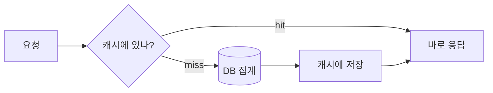
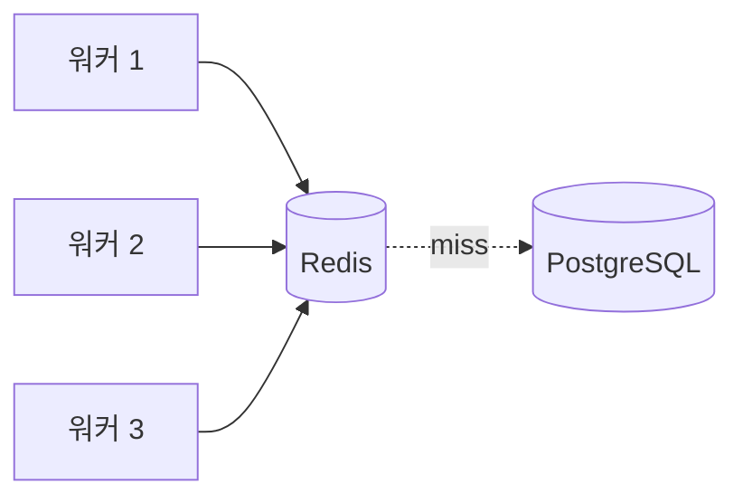

# Day 36 · Redis·캐시 전략: 무거운 계산은 한 번만

> 읽는 시간: 약 14분

## 복습 3문제

**1.** (Day 35) TDD에서 새 테스트를 썼는데, 코드도 없이 처음부터 **통과**했습니다. 무엇을 의심해야 할까요?

<details>
<summary>정답</summary>

**테스트가 아무것도 검사하지 않을 가능성**입니다. `assert`를 빼먹었거나 엉뚱한 함수를 부른 경우가 많습니다. 그래서 TDD는 🔴 빨강을 꼭 눈으로 확인합니다.

</details>

**2.** (Day 20) `Goal.objects.filter(...).update(done=True)`를 하면 `post_save` 시그널이 불릴까요?

<details>
<summary>정답</summary>

**안 불립니다.** `update()`는 SQL `UPDATE` 한 번으로 끝나서 `save()`와 `pre_save`/`post_save`를 건너뜁니다. 오늘 이 사실이 **캐시 무효화**에서 다시 중요해집니다.

</details>

**3.** (Day 26) 목록 API에서 Goal마다 체크인 쿼리가 하나씩 더 나가는 문제를 뭐라고 부르고, 어떻게 고치나요?

<details>
<summary>정답</summary>

**N+1 문제**입니다. `prefetch_related("checkins")`로 체크인을 쿼리 한 번에 모아 오면 됩니다. 쿼리 수를 줄이는 게 먼저고, 그래도 느리면 오늘 배울 **캐시**를 씁니다.

</details>

---

## 오늘 만들 것

Goals 대시보드의 **통계 카드**(전체 진행률, 최장 streak)를 **Redis 캐시**에 담습니다. 매 요청마다 집계하던 걸 한 번만 계산하고, 체크인이 생기면 캐시를 지웁니다.

## 오늘 배울 것

- 캐시가 뭐고, **cache-aside** 패턴은 어떻게 도나
- Django 캐시 API + **Redis** 연결
- 가장 어려운 부분: **언제 캐시를 지울까** (무효화)

---

## 1. 캐시와 cache-aside 패턴

대시보드를 열 때마다 모든 체크인을 집계한다고 해 봅시다. 데이터가 적을 땐 괜찮지만, 사용자가 늘면 **같은 계산을 수천 번** 반복합니다. 결과는 대부분 그대로인데 말이죠.

**캐시**(cache, 자주 쓰는 결과를 가까운 곳에 잠깐 보관하는 저장소)는 이 낭비를 없앱니다. 한 번 계산한 결과를 메모리에 두고, 다음엔 꺼내 쓰기만 합니다.

가장 흔한 방식이 **cache-aside**(캐시 옆에 두기, lazy loading)입니다.

1. 캐시에서 먼저 찾는다.
2. 있으면(**hit**, 적중) 바로 돌려준다.
3. 없으면(**miss**, 실패) DB에서 계산하고, 캐시에 **넣은 뒤** 돌려준다.


**비유:** 자주 찾는 책을 책상 위에 꺼내 두는 것과 같습니다. 도서관(DB)까지 안 가도 되지만, 새 판이 나오면 책상 위 책은 **낡은 정보**가 됩니다.



**결과를 맞혀 보세요:** 아래 코드에서 `"DB 계산"`은 몇 번 출력될까요?

```python-run
cache = {}
def stats(uid):
    if uid in cache:
        return cache[uid]
    print("DB 계산", uid)
    cache[uid] = uid * 10
    return cache[uid]
for u in [1, 1, 2, 1]:
    stats(u)
```

<details>
<summary>정답</summary>

**2번**입니다 (`DB 계산 1`, `DB 계산 2`). 첫 `1`과 첫 `2`만 miss이고 나머지는 hit입니다. 4번 요청에 DB는 2번만 갔으니 **적중률**(hit ratio)은 50%입니다.

</details>

**JS (Node)** · 이미 써 봤을 패턴입니다

```javascript
const hit = await redis.get(key);
if (hit) return JSON.parse(hit);
const v = await computeStats(uid);
await redis.set(key, JSON.stringify(v),
  { EX: 300 });
return v;
```

**Python** · Django 캐시 API로 같은 일

```python
from django.core.cache import cache

def get_stats(uid):
    key = f"stats:{uid}"
    v = cache.get(key)
    if v is None:
        v = compute_stats(uid)
        cache.set(key, v, timeout=300)
    return v
```

`cache.get_or_set(key, func, 300)` 한 줄로도 됩니다. `timeout=300`은 **TTL**(Time To Live, 몇 초 뒤 자동 삭제)입니다.

> 💡 캐시는 "**읽기는 많고, 바뀌는 건 드문**" 데이터에 효과가 큽니다. 먼저 쿼리를 고치고(N+1, 인덱스), 그다음 캐시입니다.

<details>
<summary>🔍 더 깊이 (면접용) — 다른 캐시 패턴</summary>

| 패턴 | 쓰기 방식 | 특징 |
|---|---|---|
| cache-aside | 앱이 miss 때 채움 | 가장 흔함, 첫 요청 느림 |
| write-through | DB와 캐시 동시 쓰기 | 항상 최신, 쓰기 느림 |
| write-back | 캐시 먼저, DB 나중 | 쓰기 빠름, 유실 위험 |

캐시가 놓이는 곳도 여러 층입니다: 브라우저(`Cache-Control`) → CDN → 앱 캐시(Redis) → DB 버퍼 풀. "어느 층에서 막을지"가 설계 질문입니다.

`None`을 그대로 캐시하면 `cache.get()`의 "없음"과 구분이 안 됩니다. 결과가 없을 수도 있는 값이면 `cache.get(key, default=SENTINEL)`처럼 **센티널 객체**로 구분합니다.

</details>

---

## 2. Django + Redis 연결하기

Django 캐시 API는 **백엔드를 갈아 끼울 수 있게** 만들어져 있습니다. 코드는 `cache.get/set`만 쓰고, 실제 저장소는 settings에서 고릅니다.

| 백엔드 | 어디에 | 언제 |
|---|---|---|
| LocMem | 프로세스 메모리 | 개발·테스트 |
| Redis | 별도 서버 | 운영 기본값 |
| Dummy | 저장 안 함 | 캐시 끄기 |

**왜 운영에선 Redis일까요?** gunicorn 워커 4개가 각자 LocMem을 쓰면 **캐시도 4벌**입니다. 한 워커에서 지워도 나머지 셋엔 낡은 값이 남습니다. Redis는 모든 워커·서버가 **함께 보는 한 곳**입니다.



**Redis**(REmote DIctionary Server)는 메모리에 키-값을 두는 서버입니다. 단일 스레드로 명령을 하나씩 처리해서 `INCR` 같은 연산이 **원자적**(쪼개지지 않음)입니다.

로컬에서 띄우고 연결해 보세요.

```bash
docker run -d -p 6379:6379 redis:7
pip install redis
```

```python
# settings.py (Django 4.0+ 내장 백엔드)
CACHES = {
  "default": {
    "BACKEND": "django.core.cache."
      "backends.redis.RedisCache",
    "LOCATION": "redis://127.0.0.1:6379/1",
  }
}
```

**결과를 맞혀 보세요:** `python manage.py shell`에서 실행하면?

```python
from django.core.cache import cache
cache.set("n", 1)
cache.incr("n")
cache.incr("n")
print(cache.get("n"))
cache.add("n", 100)
print(cache.get("n"))
```

<details>
<summary>정답</summary>

**3**, 그리고 다시 **3**입니다. `incr`은 1씩 올립니다. `add`는 "**키가 없을 때만**" 저장하므로 이미 있는 `n`은 그대로입니다. `add`는 Redis의 `SET NX`라서, 여러 워커 중 **딱 한 명만** 성공하는 간단한 락으로도 씁니다.

</details>

테스트에서는 settings를 바꿔 LocMem을 씁니다. Redis 없이도 CI가 돌고, 테스트끼리 섞이지 않게 `cache.clear()`를 fixture에 넣습니다.

```python
@pytest.fixture(autouse=True)
def _clear_cache():
    cache.clear()
    yield
```

> 💡 코드는 `cache` API만, 저장소는 settings에서. 운영은 **공유 캐시(Redis)**, 테스트는 LocMem + `clear()`.

<details>
<summary>🔍 더 깊이 (면접용) — Redis는 캐시 말고도</summary>

- **세션 저장소**: `SESSION_ENGINE = "...sessions.backends.cache"` (Day 18에서 예고한 것).
- **Celery 브로커**: 다음 시간에 배울 비동기 작업 큐.
- **레이트 리밋**: `INCR` + `EXPIRE`로 "분당 60회".
- **랭킹**: Sorted Set(`ZADD`, `ZREVRANGE`)으로 streak 순위표.

메모리가 차면 `maxmemory-policy`에 따라 키를 버립니다. 캐시 용도면 `allkeys-lru`(가장 오래 안 쓴 것부터)가 흔합니다. 그래서 **캐시는 언제든 사라질 수 있다**고 가정하고, 원본은 항상 DB에 둡니다.

</details>

---

## 3. 캐시 무효화: 언제 지울까

> "컴퓨터 과학에서 어려운 건 두 가지: 캐시 무효화와 이름 짓기." — Phil Karlton

캐시는 빠른 대신 **낡을 수 있습니다**. 사용자가 방금 체크인했는데 대시보드 streak가 그대로면 버그처럼 보입니다. 지우는 방법은 크게 두 가지입니다.

- **TTL로 기다리기**: 5분 지나면 자동으로 사라짐. 간단하지만 최대 5분 낡음.
- **쓸 때 지우기**: 체크인 저장 순간 `cache.delete(key)`. 즉시 최신.

실무는 **둘 다** 씁니다. 쓸 때 지우고, 혹시 놓친 경우를 위해 TTL을 안전망으로 둡니다.

**결과를 맞혀 보세요:** 시간을 인자로 받는 TTL 캐시입니다 (Day 35의 "바뀌는 값은 인자로"). 출력은?

```python-run
store = {}
def put(k, v, now, ttl):
    store[k] = (v, now + ttl)
def get(k, now):
    v, exp = store.get(k, (None, 0))
    return v if now < exp else None
put("s", 7, now=0, ttl=300)
print(get("s", 100), get("s", 300))
```

<details>
<summary>정답</summary>

**`7 None`** 입니다. 100초엔 아직 유효하고, 300초는 `now < exp`(300 < 300)가 거짓이라 만료됐습니다. 진짜 Redis도 TTL이 지나면 키를 없는 것처럼 다룹니다.

</details>

**쓸 때 지우기**는 시그널(Day 20)로 붙이면 깔끔합니다.

```python
# goals/signals.py
@receiver(post_save, sender=CheckIn)
@receiver(post_delete, sender=CheckIn)
def drop_stats(sender, instance, **kw):
    uid = instance.goal.owner_id
    key = f"stats:{uid}"
    transaction.on_commit(
        lambda: cache.delete(key))
```

**`on_commit`이 왜 필요할까요?** 트랜잭션(Day 28) 안에서 바로 지우면, 커밋 **전에** 다른 요청이 들어와 옛 데이터를 다시 캐시에 넣을 수 있습니다. 커밋된 **뒤에** 지워야 안전합니다.

**JS (Node)** · 같은 생각

```javascript
await db.tx(async t => {
  await t.insertCheckIn(c);
});
// 커밋 후에 지우기
await redis.del(`stats:${uid}`);
```

**함정:** 복습 2번을 떠올려 보세요. `bulk_create`나 `qs.update()`는 시그널을 **부르지 않습니다**. 그 경로로 체크인을 넣으면 캐시가 안 지워집니다. 그런 곳에선 `cache.delete`를 **직접** 부르거나, TTL 안전망에 기댑니다.

> 💡 **쓸 때 지우기 + TTL 안전망**. 지우기는 `on_commit` 뒤에, 그리고 시그널을 건너뛰는 경로를 잊지 말 것.

<details>
<summary>🔍 더 깊이 (면접용) — 스탬피드·관통·버전 키</summary>

**캐시 스탬피드**(cache stampede, thundering herd): 인기 키가 만료되는 순간 수백 요청이 동시에 miss → DB에 같은 집계가 수백 번 몰립니다. 해결:

- **락**: `cache.add("lock:k", 1, 10)`에 성공한 한 요청만 계산, 나머진 잠깐 기다리거나 옛 값 사용.
- **TTL 지터**: `300 + random.randint(0, 60)`으로 만료 시각을 흩뜨림.
- **미리 갱신**: 만료 직전 백그라운드(Celery)로 다시 계산.

**캐시 관통**(penetration): DB에도 없는 키를 계속 요청 → 매번 miss. "없음"도 짧은 TTL로 캐시하거나 블룸 필터로 걸러냅니다.

**버전 키**: 지우는 대신 `stats:v{n}:{uid}`처럼 버전을 올리면 옛 키는 TTL로 자연 소멸합니다. Django는 `cache.incr_version(key)`와 `KEY_PREFIX`/`VERSION` 설정을 제공합니다. 배포 때 직렬화 형식이 바뀌면 `VERSION`만 올리면 됩니다.

**뷰·템플릿 캐시**: `@cache_page(60)`은 응답 전체를 캐시합니다. 로그인 사용자마다 다른 페이지면 `vary_on_cookie`가 필요하고, 실수하면 **남의 대시보드가 보이는** 사고가 납니다. 사용자별 데이터는 오늘처럼 키에 `uid`를 넣는 저수준 캐시가 안전합니다.

</details>

---

## 연습문제

**1.** `get_stats`를 `cache.get_or_set`으로 한 줄로 바꾸세요. 키는 `stats:{uid}`, TTL 300초.

<details>
<summary>정답</summary>

```python
def get_stats(uid):
    return cache.get_or_set(
        f"stats:{uid}",
        lambda: compute_stats(uid),
        300,
    )
```

**해설:** 두 번째 인자에 **함수**를 넘기면 miss일 때만 호출됩니다. `compute_stats(uid)`를 직접 넘기면 hit여도 **매번 계산**해 버려서 캐시 의미가 없습니다. JS에서 `() => compute()`를 넘기는 것과 같은 이유입니다.

</details>

**2.** 아래 TTL 캐시에 **hit/miss 카운터**를 붙여 적중률을 출력하세요. 요청 순서는 `[1, 1, 2, 1, 2, 3]`, 시간은 무시합니다.

<details>
<summary>정답</summary>

```python-run
store, hit, miss = {}, 0, 0
for uid in [1, 1, 2, 1, 2, 3]:
    if uid in store:
        hit += 1
    else:
        miss += 1
        store[uid] = uid * 10
print(hit, miss, f"{hit/(hit+miss):.0%}")
# 출력: 3 3 50%
```

**해설:** 처음 보는 1·2·3은 miss, 나머지 셋은 hit입니다. 운영에선 Redis `INFO stats`의 `keyspace_hits`/`keyspace_misses`로 같은 값을 봅니다. 적중률이 낮으면 TTL이 너무 짧거나, 키가 너무 잘게 쪼개졌거나, 애초에 캐시할 데이터가 아닌 겁니다.

</details>

**3.** 관리자 화면에서 "선택한 목표 체크인 일괄 추가"를 `CheckIn.objects.bulk_create(rows)`로 만들었습니다. 대시보드 통계가 안 바뀌는 버그를 고치세요.

<details>
<summary>정답</summary>

```python
with transaction.atomic():
    CheckIn.objects.bulk_create(rows)
    uids = {r.goal.owner_id for r in rows}
    keys = [f"stats:{u}" for u in uids]
    transaction.on_commit(
        lambda: cache.delete_many(keys))
```

**해설:** `bulk_create`는 `post_save`를 부르지 않아 시그널 무효화가 안 됩니다. 영향받는 사용자 키를 모아 커밋 뒤 `delete_many`로 한 번에 지웁니다. `r.goal`이 N+1을 만들지 않도록 rows를 만들 때 `goal`을 미리 `select_related`로 가져오거나 `owner_id`를 따로 모아 두면 더 좋습니다. 이 버그를 막는 테스트(🔴 먼저!)도 함께 씁니다.

</details>

---

## 면접 질문

<details>
<summary>Q1. 캐시를 도입할 때 무엇을 고려하나요? 데이터 정합성은 어떻게 지키나요?</summary>

**모범 답안:** 먼저 **캐시가 필요한지**부터 봅니다. 쿼리 개선(N+1, 인덱스)으로 해결되면 캐시는 복잡도만 늘립니다.

도입한다면 네 가지를 정합니다.

- **대상**: 읽기 많고 변경 적은 데이터. 사용자별이면 키에 사용자 ID 포함.
- **패턴**: 보통 cache-aside. miss 때 DB에서 채움.
- **무효화**: 쓰기 시점에 `delete`(시그널 또는 서비스 계층), **커밋 후**(`on_commit`)에 실행. 시그널을 건너뛰는 `update()`/`bulk_create` 경로는 명시적으로 지움.
- **안전망**: TTL로 최악의 낡음 시간을 제한하고, 지터로 동시 만료를 피함.

"캐시는 언제든 사라질 수 있다"를 전제로, 원본은 DB에 두고 Redis 장애 시에도 DB로 동작하게 합니다. 적중률과 DB 부하를 지표로 효과를 확인합니다.

</details>

<details>
<summary>Q2. 인기 키가 만료되는 순간 DB 부하가 튀었습니다. 원인과 해결책은?</summary>

**모범 답안:** **캐시 스탬피드**입니다. 많은 요청이 동시에 miss를 보고 모두 DB에 같은 계산을 보냅니다.

해결책:

- **분산 락**: `cache.add(lock_key, 1, timeout)`(Redis `SET NX EX`)에 성공한 한 요청만 재계산. 나머지는 잠깐 대기 후 재조회하거나 옛 값을 응답.
- **TTL 지터**: 만료 시각을 무작위로 흩뜨림.
- **사전 갱신**: 만료 전에 백그라운드 작업으로 다시 채움(stale-while-revalidate).

락은 계산이 실패해도 풀리도록 **반드시 timeout**을 둡니다. 그렇지 않으면 락이 영원히 남아 아무도 캐시를 못 채웁니다.

</details>

---

## 오늘 정리

- **cache-aside**: 캐시 먼저 → miss면 DB 계산 후 저장. 효과는 읽기 많고 변경 적을 때.
- Django는 `cache` API 하나, 운영은 **Redis**(워커 간 공유), 테스트는 LocMem + `clear()`.
- **무효화** = 쓸 때 지우기(`on_commit` 뒤) + TTL 안전망. `update`/`bulk_create`는 시그널이 없다.

## 다음에 이어갈 것

Day 37은 **Celery·비동기 작업**: 체크인 알림 메일이나 통계 재계산처럼 오래 걸리는 일을 요청 밖으로 빼서, Redis를 브로커로 백그라운드에서 돌립니다.
