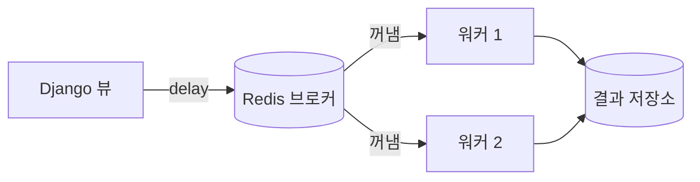

# Day 37 · Celery 아키텍처·브로커: 오래 걸리는 일은 뒤로

> 읽는 시간: 약 14분

## 복습 3문제

**1.** (Day 36) cache-aside에서 캐시에 값이 **없을 때(miss)** 순서는?

<details>
<summary>정답</summary>

DB에서 계산 → **캐시에 저장** → 응답. 다음 요청은 캐시에서 바로 꺼냅니다(hit).

</details>

**2.** (Day 36) 체크인 저장 시 캐시 삭제를 `transaction.on_commit` 안에서 하는 이유는?

<details>
<summary>정답</summary>

커밋 **전에** 지우면, 그 사이 다른 요청이 **커밋 전 옛 데이터**로 캐시를 다시 채울 수 있습니다. 롤백되면 지울 필요도 없었고요. 커밋이 확정된 뒤에 지워야 안전합니다. 오늘 Celery 작업을 보낼 때도 **똑같은 이유**로 `on_commit`을 씁니다.

</details>

**3.** (Day 33) 테스트에서 메일 발송 같은 외부 호출을 진짜로 하지 않으려면?

<details>
<summary>정답</summary>

`unittest.mock.patch`로 **사용하는 곳의 경로**를 가짜로 바꿉니다. Django 메일은 테스트에서 자동으로 `locmem` 백엔드라 `mail.outbox`로 확인할 수도 있습니다.

</details>

---

## 오늘 만들 것

Goals 앱에서 체크인하면 **축하 메일**과 **통계 재계산**을 Celery 작업으로 보냅니다. 응답은 바로 돌아가고, 무거운 일은 워커가 뒤에서 처리합니다.

## 오늘 배울 것

- 왜 일을 **요청 밖으로** 빼야 하나 (작업 큐)
- Celery의 4요소: **프로듀서 → 브로커 → 워커 → 결과 저장소**
- Django에서 쓰는 법과 3가지 함정 (ID만 넘기기, `on_commit`, 테스트)

---

## 1. 왜 요청 밖으로 빼나: 작업 큐

체크인 버튼을 누르면 서버가 할 일이 늘었습니다. 저장, 축하 메일, 통계 재계산, 슬랙 알림. 메일 서버가 2초 걸리면 **사용자는 2초 동안 빙글빙글**을 봅니다.

더 큰 문제는 **실패**입니다. 메일 서버가 죽으면 체크인 자체가 500 에러가 됩니다. 체크인은 이미 성공했는데도요.

해결책은 **작업 큐**(job queue, 할 일을 적어 두는 대기열)입니다. 요청은 "메일 보내 줘"라는 **메모만 남기고** 바로 응답합니다. 별도 프로세스가 메모를 꺼내 처리합니다.

**비유:** 식당 주문과 같습니다. 웨이터(웹 서버)는 주문서를 주방 레일(큐)에 꽂고 다음 손님에게 갑니다. 요리사(워커)가 순서대로 만듭니다. 웨이터가 요리까지 하면 손님 줄이 끝없이 길어집니다.

**결과를 맞혀 보세요:** 아래에서 `"응답"`은 몇 번째 줄로 출력될까요?

```python-run
from collections import deque
q = deque()
def checkin(uid):
    q.append(("mail", uid))
    print("응답", uid)
checkin(7)
while q:
    print("처리", q.popleft())
```

<details>
<summary>정답</summary>

**첫 번째 줄**입니다.

```text
응답 7
처리 ('mail', 7)
```

`checkin`은 큐에 **넣기만** 하고 바로 응답합니다. 실제 처리는 그 뒤, 별도 루프(워커 역할)가 합니다. Celery는 이 `deque`를 **Redis**로, `while` 루프를 **다른 프로세스(워커)**로 바꾼 것입니다.

</details>

Node에서 익숙한 비교를 보면 차이가 선명합니다.

**JS (Node)**

```javascript
// 같은 프로세스에서 나중에 실행
app.post("/checkin", async (req, res) => {
  await save(req.body);
  setImmediate(() => sendMail(req.user));
  res.json({ ok: true });
});
```

**Python (Celery)**

```python
# 다른 프로세스(워커)에서 실행
def checkin(request):
    ci = CheckIn.objects.create(...)
    send_mail_task.delay(ci.id)
    return JsonResponse({"ok": True})
```

`setImmediate`는 **같은 프로세스** 안입니다. 서버가 재시작되면 메일은 사라집니다. Celery는 메모가 **Redis에 남아 있어서** 웹 서버가 죽어도 워커가 처리합니다. Node에서 이 역할은 **BullMQ**(Redis 기반 큐)가 합니다.

> 💡 "사용자가 기다릴 필요 없는 일"과 "실패해도 응답은 성공이어야 하는 일"은 큐로 뺀다.

---

## 2. Celery의 4요소

Celery는 혼자 동작하지 않습니다. 네 부분이 협력합니다.

| 요소 | 역할 | Goals 앱 |
|---|---|---|
| 프로듀서 | 작업을 보냄 | Django 뷰 |
| 브로커 | 메시지 보관 | Redis |
| 워커 | 꺼내서 실행 | `celery worker` |
| 결과 저장소 | 결과 보관(선택) | Redis/DB |

**브로커**(broker, 중개자)는 우체통입니다. 뷰는 작업 이름과 인자를 **JSON 메시지**로 만들어 넣습니다. 함수 자체가 아니라 **"이 이름의 함수를 이 인자로"라는 메모**가 들어갑니다.




워커는 여러 개 띄울 수 있습니다. 메일이 밀리면 워커만 늘리면 되고, 웹 서버는 건드리지 않습니다. 이걸 **수평 확장**(scale out, 같은 일꾼을 더 두기)이라고 합니다.

**결과를 맞혀 보세요:** 워커를 **하나도 안 띄운** 상태에서 `send_mail_task.delay(1)`을 부르면?

<details>
<summary>정답</summary>

**에러 없이 바로 리턴합니다.** 메시지는 Redis에 쌓여 기다립니다. 나중에 워커를 켜면 그때 처리됩니다. "메일이 안 가요" 버그의 1순위 원인이 바로 **워커를 안 켰다**입니다. 반대로 **Redis가 꺼져 있으면** `delay()` 자체가 연결 에러를 냅니다.

</details>

`delay()`가 돌려주는 건 결과가 아니라 **AsyncResult**(나중에 결과를 찾을 번호표)입니다. JS의 Promise와 닮았지만, 다른 프로세스에서 끝나므로 `await`처럼 기다리면 **큐로 뺀 의미가 없어집니다**.

```python
r = add.delay(2, 3)
print(r.id)
# 출력: 'a1b2c3...' (작업 ID)
print(r.status)
# 출력: PENDING 또는 SUCCESS
```

> 💡 Celery = 뷰가 브로커에 메모를 넣고, 워커가 꺼내 실행. `delay()`는 결과가 아닌 번호표를 준다.

---

## 3. Django에 붙이기 + 3가지 함정

먼저 설치하고 앱을 만듭니다 (로컬에서 실행하세요).

```bash
pip install "celery[redis]"
docker run -d -p 6379:6379 redis:7
```

프로젝트 폴더에 `celery.py`를 둡니다. Django 설정을 읽어 오는 부분이 핵심입니다.

```python
# config/celery.py
import os
from celery import Celery
os.environ.setdefault(
    "DJANGO_SETTINGS_MODULE",
    "config.settings")
app = Celery("config")
```

```python
# config/celery.py (이어서)
app.config_from_object(
    "django.conf:settings",
    namespace="CELERY")
app.autodiscover_tasks()
```

`namespace="CELERY"`라서 설정은 `CELERY_`로 시작합니다. `autodiscover_tasks()`는 각 앱의 `tasks.py`를 자동으로 찾습니다.

```python
# config/settings.py
REDIS = "redis://localhost:6379"
CELERY_BROKER_URL = f"{REDIS}/1"
CELERY_RESULT_BACKEND = f"{REDIS}/2"
CELERY_TASK_SERIALIZER = "json"
```

Day 36 캐시가 `/0`을 썼다면 브로커는 `/1`처럼 **DB 번호를 나눕니다**. 캐시를 비우다 큐까지 날리는 사고를 막습니다.

이제 작업을 정의합니다.

```python
# goals/tasks.py
from celery import shared_task
@shared_task
def send_cheer(checkin_id):
    ci = CheckIn.objects.get(id=checkin_id)
    send_mail("잘했어요!", ..., [ci.owner.email])
```

워커는 터미널을 하나 더 열어 띄웁니다.

```bash
celery -A config worker -l info
```

### 함정 ① 객체 말고 ID를 넘긴다

**결과를 맞혀 보세요:** `send_cheer.delay(ci)`처럼 모델 객체를 넘기면?

<details>
<summary>정답</summary>

**`kombu.exceptions.EncodeError`**(JSON으로 바꿀 수 없음)가 납니다. 메시지는 JSON이라 모델 객체를 못 담습니다. 설령 pickle로 담더라도, 워커가 실행할 때쯤엔 **이미 바뀐 옛 데이터**입니다. 그래서 **ID만 넘기고 워커에서 다시 조회**합니다.

</details>

아래로 직접 확인해 보세요. JSON은 숫자·문자열·리스트·딕셔너리만 압니다.

```python-run
import json
class CheckIn: pass
print(json.dumps({"args": [7]}))
try:
    json.dumps({"args": [CheckIn()]})
except TypeError as e:
    print("실패:", type(e).__name__)
```

### 함정 ② 커밋 뒤에 보낸다

뷰가 트랜잭션 안에서 `delay()`를 부르면, 워커가 **커밋보다 먼저** 작업을 꺼낼 수 있습니다. 워커는 `CheckIn.DoesNotExist`를 만납니다. 아직 DB에 안 보이니까요.

```python
# ❌ 워커가 커밋 전에 실행될 수 있음
with transaction.atomic():
    ci = CheckIn.objects.create(...)
    send_cheer.delay(ci.id)
```

```python
# ✅ 커밋 확정 후에 큐에 넣기
with transaction.atomic():
    ci = CheckIn.objects.create(...)
    transaction.on_commit(
        lambda: send_cheer.delay(ci.id))
```

Day 36의 캐시 삭제와 같은 원리입니다. **"DB에 확정된 사실"에만 반응**하게 만듭니다. Celery 5.4+는 `send_cheer.delay_on_commit(ci.id)`라는 지름길도 줍니다.

### 함정 ③ 테스트에선 바로 실행

테스트마다 Redis와 워커를 띄우면 느리고 불안정합니다(flaky). 두 가지 방법이 있습니다.

```python
# 1) 작업 함수를 그냥 직접 호출
send_cheer(ci.id)
assert len(mail.outbox) == 1
```

```python
# 2) 뷰가 '보냈는지'만 확인
@patch("goals.views.send_cheer.delay")
def test_checkin(self, m):
    self.client.post("/api/checkins/", ...)
    m.assert_called_once()
```

2번은 `on_commit`이 테스트 트랜잭션 안에서 안 불리므로 `with self.captureOnCommitCallbacks(execute=True):`로 감싸야 합니다(Day 33).

> 💡 ID만 넘기고, 커밋 뒤에 보내고, 테스트에선 작업을 함수처럼 직접 부른다.

<details>
<summary>🔍 더 깊이 (면접용)</summary>

**전달 보장(delivery guarantee).** 워커는 메시지를 꺼낸 뒤 **ack**(확인 응답)를 보내야 브로커에서 지워집니다.

- 기본값은 **실행 직전 ack**(early ack). 실행 중 워커가 죽으면 그 작업은 **사라집니다**(at-most-once, 최대 한 번).
- `acks_late=True`면 **실행 후 ack**. 죽으면 다시 배달됩니다(at-least-once, 최소 한 번). 대신 **두 번 실행될 수 있으니 멱등성**이 필요합니다. 이건 Day 38 주제입니다.
- "정확히 한 번(exactly-once)"은 분산 환경에서 사실상 불가능합니다. at-least-once + 멱등 처리로 흉내 냅니다.

**prefetch.** 워커는 메시지를 미리 몇 개 받아 둡니다(`worker_prefetch_multiplier`, 기본 4 × 동시성). 오래 걸리는 작업이 섞이면 한 워커가 일을 쥐고 있고 다른 워커는 노는 문제가 생깁니다. 긴 작업은 `1`로 낮춥니다.

**Redis 브로커의 visibility timeout.** Redis는 RabbitMQ처럼 진짜 ack 프로토콜이 없어서, ack 안 된 메시지를 일정 시간(기본 1시간) 뒤 다시 배달합니다. `acks_late` + 1시간 넘는 작업이면 **중복 실행**됩니다. ETA/countdown을 길게 잡을 때도 같은 함정이 있습니다.

**RabbitMQ vs Redis.** RabbitMQ는 메시지 전용 브로커(AMQP)로 ack·라우팅·영속성이 강합니다. Redis는 이미 캐시로 쓰고 있다면 추가 인프라가 없어 간편합니다. 메시지 유실이 치명적이면 RabbitMQ(또는 SQS)를 고려합니다.

**동시성 모델.** 기본 `prefork`(프로세스 여러 개, CPU 작업에 적합, GIL 회피). I/O 위주면 `gevent`/`eventlet`(그린 스레드 수백 개)도 씁니다.

**큐 분리.** `task_routes`로 메일은 `mail` 큐, 통계는 `stats` 큐에 보내고 워커를 따로 띄우면, 느린 통계 작업이 메일을 막지 않습니다.

</details>

---

## 연습문제

**1.** 체크인 생성 뒤 `recalc_stats`(통계 재계산 후 캐시 갱신) 작업을 **커밋 뒤에** 보내는 코드를 쓰세요. 작업 함수도 함께 쓰세요.

<details>
<summary>정답</summary>

```python
# goals/tasks.py
@shared_task
def recalc_stats(uid):
    data = compute_stats(uid)
    cache.set(f"stats:{uid}", data, 300)
```

```python
# goals/views.py
with transaction.atomic():
    ci = CheckIn.objects.create(...)
    uid = request.user.id
    transaction.on_commit(
        lambda: recalc_stats.delay(uid))
```

**해설:** 인자는 **사용자 ID(int)** 하나라 JSON으로 안전합니다. `on_commit`이라 워커는 새 체크인이 보이는 DB를 읽습니다. Day 36에서는 캐시를 **지우기만** 했는데, 이제 워커가 미리 **다시 채워** 두니 다음 대시보드 요청도 hit가 됩니다(사전 갱신).

</details>

**2.** 아래 미니 큐에 **워커 2개**를 흉내 내 보세요. 작업 `[1..6]`을 번갈아 꺼내 `"워커A: 1"`처럼 출력합니다.

<details>
<summary>정답</summary>

```python-run
from collections import deque
q = deque(range(1, 7))
workers = ["A", "B"]
i = 0
while q:
    w = workers[i % 2]
    print(f"워커{w}: {q.popleft()}")
    i += 1
```

**해설:** 같은 큐에서 여러 워커가 꺼내 가므로 작업은 **한 번씩만** 처리되고, 워커를 늘리면 처리량이 늘어납니다. 실제 Celery에선 순서가 이렇게 깔끔하지 않습니다. 작업 시간이 제각각이라 **끝난 워커가 먼저** 다음 것을 가져갑니다. 그래서 "작업 순서"에 의존하는 코드는 위험합니다.

</details>

**3.** 동료의 코드가 가끔 `CheckIn.DoesNotExist`를 냅니다. 원인 두 가지와 해결책을 쓰세요.

```python
@transaction.atomic
def checkin(request):
    ci = CheckIn.objects.create(...)
    send_cheer.delay(ci)
```

<details>
<summary>정답</summary>

```python
@transaction.atomic
def checkin(request):
    ci = CheckIn.objects.create(...)
    transaction.on_commit(
        lambda: send_cheer.delay(ci.id))
```

**해설:** ① **객체 `ci`를 그대로** 넘겨 직렬화 문제가 생깁니다(JSON이면 `EncodeError`, pickle이면 옛 데이터). → `ci.id`. ② 데코레이터 `@transaction.atomic` 때문에 함수 전체가 트랜잭션이라, `delay()`가 **커밋 전에** 메시지를 보냅니다. 빠른 워커는 아직 안 보이는 행을 찾다 `DoesNotExist`를 냅니다. → `on_commit`. "가끔" 나는 건 워커와 커밋의 **경쟁 상태**(race condition, 누가 먼저냐에 따라 결과가 달라지는 상황)이기 때문입니다.

</details>

---

## 면접 질문

<details>
<summary>Q1. Celery의 구성 요소와 작업이 처리되는 흐름을 설명해 주세요.</summary>

**모범 답안:** 네 요소로 설명합니다.

1. **프로듀서**(Django)가 `delay()`/`apply_async()`로 작업 이름과 인자를 **직렬화(JSON)**해 브로커에 넣습니다.
2. **브로커**(Redis·RabbitMQ)가 메시지를 큐에 보관합니다.
3. **워커**가 큐를 구독하다 메시지를 꺼내, 등록된 함수를 찾아 실행하고 **ack**를 보냅니다.
4. 필요하면 **결과 저장소**에 상태와 반환값을 기록합니다. 호출 쪽은 `AsyncResult`로 조회합니다.

실무 포인트로 세 가지를 덧붙입니다. 인자는 **ID 같은 원시값**만 넘기고, DB 변경과 엮인 작업은 **`on_commit` 뒤에** 보내며, 기본 early ack는 워커가 죽으면 작업이 유실될 수 있어 중요 작업은 `acks_late` + **멱등성**으로 보완합니다.

</details>

<details>
<summary>Q2. 어떤 작업을 비동기로 빼고, 어떤 건 동기로 두나요?</summary>

**모범 답안:** 기준은 **"응답에 그 결과가 필요한가"**와 **"실패해도 요청은 성공이어야 하나"**입니다.

- **비동기로**: 메일·푸시 알림, 외부 API 연동, 통계 재계산, 이미지 리사이즈, 리포트 생성. 느리거나 외부 의존이 있고 사용자가 결과를 즉시 볼 필요가 없음.
- **동기로**: 주문 저장, 결제 승인, 권한 확인처럼 **응답이 결과에 의존**하는 일. 비동기로 빼면 "성공했다고 했는데 실패" 상태를 처리하는 복잡도가 생깁니다.

비동기로 빼면 **관찰성**(작업 실패 모니터링, Flower 같은 대시보드)과 **재시도 정책**이 새로 필요하다는 비용도 함께 말합니다.

</details>

---

## 오늘 정리

- **작업 큐**: 기다릴 필요 없는 일은 메모만 남기고 바로 응답. 워커가 뒤에서 처리.
- Celery = **Django(프로듀서) → Redis(브로커) → 워커 → 결과 저장소**. `delay()`는 번호표.
- 3가지 함정: **ID만** 넘기기, **`on_commit` 뒤에** 보내기, 테스트에선 **직접 호출**.

## 다음에 이어갈 것

Day 38은 **재시도·멱등성·beat 스케줄**: 메일 서버가 실패하면 자동으로 다시 시도하고, 두 번 실행돼도 메일이 한 통만 가게 만들고, "매일 밤 9시 체크인 리마인더"를 예약합니다.
