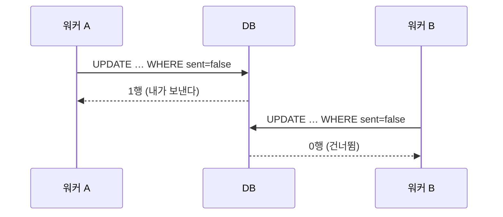

# Day 38 · 재시도·멱등성·beat: 실패해도, 두 번 돌아도, 정해진 시간에

> 읽는 시간: 약 14분

## 복습 3문제

**1.** (Day 37) Celery 작업에 모델 객체 대신 **ID**를 넘기는 이유 두 가지는?

<details>
<summary>정답</summary>

① 메시지가 **JSON**이라 모델 객체는 직렬화가 안 됩니다(`EncodeError`). ② 워커가 실행할 때쯤엔 객체가 **옛 데이터**일 수 있습니다. ID만 넘기고 워커에서 다시 조회하면 둘 다 해결됩니다.

</details>

**2.** (Day 37) 워커를 하나도 안 띄운 채 `send_cheer.delay(1)`을 부르면?

<details>
<summary>정답</summary>

에러 없이 바로 리턴합니다. 메시지는 Redis에 **쌓여서 기다립니다**. 워커를 켜면 그때 처리됩니다. 반대로 Redis가 꺼져 있으면 `delay()`가 연결 에러를 냅니다.

</details>

**3.** (Day 34) 가끔 통과하고 가끔 실패하는 테스트를 뭐라고 부르고, 흔한 원인은?

<details>
<summary>정답</summary>

**flaky test**입니다. 흔한 원인은 현재 시각·난수 의존, 테스트 사이 상태 공유(전역 변수, 캐시), 실제 네트워크 호출, 순서 의존입니다. 시간은 고정하고(freezegun), 외부는 모킹하고, 상태는 매번 정리합니다.

</details>

---

## 오늘 만들 것

Goals 앱의 축하 메일 작업을 **튼튼하게** 만듭니다. 메일 서버가 잠깐 죽으면 알아서 다시 시도하고, 두 번 실행돼도 메일은 **한 통만** 가고, 매일 밤 9시에 "오늘 체크인 안 했어요" **리마인더**가 자동으로 나갑니다.

## 오늘 배울 것

- **재시도**: 일시적 실패를 간격을 늘려 가며 다시 시도하기
- **멱등성**: 같은 작업이 두 번 돌아도 결과가 한 번과 같게
- **beat**: Celery의 cron, 정해진 시각에 작업 보내기

---

## 1. 재시도: 잠깐 실패는 다시 하면 된다

외부 서비스는 **자주, 잠깐** 실패합니다. 메일 서버가 1초 동안 응답을 안 하거나, 네트워크가 순간 끊기는 식입니다. 이런 걸 **일시적 오류**(transient error, 조금 뒤엔 저절로 낫는 오류)라고 부릅니다.

Day 37까지의 작업은 한 번 실패하면 그대로 끝입니다. 사용자는 축하 메일을 영영 못 받습니다. 그래서 **자동 재시도**가 필요합니다.

**비유:** 전화를 걸었는데 통화 중이면, 바로 100번 다시 거는 대신 1분, 2분, 4분 뒤에 다시 겁니다. 상대도 숨 돌릴 틈이 생기죠.

**결과를 맞혀 보세요:** `max_retries=3`이면 작업은 **최대 몇 번** 실행될까요?

<details>
<summary>정답</summary>

**4번**입니다. 첫 실행 1번 + 재시도 3번. "retries"는 **다시 하는 횟수**라서 처음 실행은 세지 않습니다. 면접에서 자주 헷갈리는 포인트입니다.

</details>

Celery에선 데코레이터 옵션 몇 개로 끝납니다. Node의 BullMQ와 거의 같은 모양입니다.

**JS (Node, BullMQ)**

```javascript
// 실패하면 1s, 2s, 4s… 뒤 재시도
await queue.add("cheer", { id: 7 }, {
  attempts: 6,
  backoff: { type: "exponential",
             delay: 1000 },
});
```

**Python (Celery)**

```python
# attempts 6 = 첫 실행 1 + 재시도 5
@shared_task(
    autoretry_for=(SMTPException,),
    retry_backoff=True,
    max_retries=5)
def send_cheer(checkin_id): ...
```

- `autoretry_for`: **이 예외일 때만** 재시도합니다.
- `retry_backoff=True`: 1초, 2초, 4초, 8초… **지수 백오프**(exponential backoff, 기다림을 두 배씩 늘리기). 상한은 `retry_backoff_max`(기본 600초).
- `retry_jitter=True`(기본값): 대기 시간을 **무작위로 흩뜨립니다**.

주의: BullMQ `attempts`는 **첫 실행 포함**, Celery `max_retries`는 **재시도만**입니다.


아래에서 백오프 대기 시간을 직접 계산해 보세요.

```python-run
import random
random.seed(1)
for n in range(5):
    base = min(2 ** n, 600)
    wait = random.uniform(0, base)
    print(n + 1, "차 재시도:", base, "초 상한,",
          round(wait, 1), "초 대기")
```

**지터는 왜 필요할까요?** 메일 서버가 죽은 순간 작업 1,000개가 동시에 실패했다고 해 봅시다. 지터가 없으면 1,000개가 **정확히 1초 뒤 동시에** 다시 몰려와 막 살아난 서버를 또 쓰러뜨립니다. 이걸 **thundering herd**(한꺼번에 몰려드는 소 떼)라고 합니다. Day 36 캐시 스탬피드에서 TTL에 지터를 준 것과 같은 이유입니다.

**어떤 예외를 재시도할까요?** 다시 해도 결과가 같은 오류는 재시도하면 안 됩니다.

| 오류 | 재시도? |
|---|---|
| 타임아웃·연결 끊김 | ✅ |
| 외부 API 503·429 | ✅ |
| 이메일 주소 형식 오류 | ❌ |
| `DoesNotExist`·코드 버그 | ❌ |

> 💡 재시도는 **일시적 오류만**, **간격은 지수로 늘리고**, **지터로 흩뜨린다**. 횟수 상한도 꼭 둔다.

---

## 2. 멱등성: 두 번 돌아도 한 번처럼

재시도에는 대가가 있습니다. **같은 작업이 두 번 실행될 수 있습니다.** 예를 들어 메일은 이미 보냈는데, 성공 응답을 받기 직전 연결이 끊기면 Celery는 "실패"로 보고 다시 보냅니다. 사용자는 축하 메일을 두 통 받습니다.

Day 37 더 깊이에서 본 `acks_late`(실행 후 확인)도 같습니다. 워커가 죽으면 작업이 **다시 배달**되니 "최소 한 번"(at-least-once)은 보장되지만 "정확히 한 번"은 아닙니다.

해결책은 작업을 **멱등**(idempotent, 여러 번 해도 한 번 한 것과 결과가 같음)하게 만드는 것입니다.

**비유:** 엘리베이터 버튼은 멱등입니다. 열 번 눌러도 엘리베이터는 한 번 옵니다. 반면 자판기 "구매" 버튼은 누를 때마다 음료가 나옵니다.

**결과를 맞혀 보세요:** 어느 쪽이 멱등일까요?

```python
# A
goal.done = True
goal.save()
```

```python
# B
goal.count += 1
goal.save()
```

<details>
<summary>정답</summary>

**A가 멱등**입니다. 두 번 해도 `done`은 `True`입니다. **B는 아닙니다**. 두 번 돌면 count가 2 올라갑니다. "값을 **정한다**(set)"는 멱등이고, "값을 **더한다**(increment)"·"메일을 **보낸다**"는 멱등이 아닙니다.

</details>

멱등이 아닌 작업을 멱등으로 만드는 기본 방법은 **"했다"는 기록을 먼저 확인하는 것**입니다.

```python-run
sent = set()
def send_cheer(cid):
    if cid in sent:
        return print(cid, "이미 보냄")
    sent.add(cid)
    print(cid, "메일 발송")
for cid in [7, 7, 8]:
    send_cheer(cid)
```

하지만 실제 서버에선 워커가 **여러 개**입니다. "확인하고 → 보내기" 사이에 다른 워커가 끼어들면 둘 다 "아직 안 보냄"을 봅니다(Day 28의 경쟁 상태). 그래서 확인과 기록을 **한 번에(원자적으로)** 해야 합니다.

DB의 조건부 `update()`가 가장 간단합니다. `update()`는 **바뀐 행 수**를 돌려줍니다.

```python
@shared_task(...)
def send_cheer(checkin_id):
    n = (CheckIn.objects
         .filter(id=checkin_id,
                 cheer_sent=False)
         .update(cheer_sent=True))
    if n == 0:
        return
```

```python
    # (이어서) 내가 깃발을 꽂았으니 발송
    ci = CheckIn.objects.get(id=checkin_id)
    send_mail("잘했어요!", ...,
              [ci.owner.email])
```

`UPDATE … WHERE cheer_sent = false`는 DB가 행을 잠그고 처리하므로, 동시에 두 워커가 실행해도 **한 쪽만 1**을 받습니다. 나머지는 0을 받고 조용히 끝납니다.

**JS (Node)**

```javascript
// Redis SET NX: 없을 때만 저장
const ok = await redis.set(
  `cheer:${id}`, 1, "NX", "EX", 86400);
if (!ok) return;
await sendMail(id);
```

**Python**

```python
# cache.add: 없을 때만 저장 (원자적)
key = f"cheer:{checkin_id}"
if not cache.add(key, 1, 86400):
    return
send_mail(...)
```

DB 플래그 방식은 기록이 영구히 남고, Redis `add`(SET NX) 방식은 DB 컬럼 없이 빠르게 막습니다. 둘 다 "**먼저 깃발을 꽂은 쪽만** 일을 한다"는 같은 아이디어입니다.



> 💡 재시도·acks_late가 있으면 **중복 실행은 반드시 일어난다**고 가정한다. 확인과 기록을 원자적으로 해서 "먼저 깃발 꽂은 쪽만" 일하게 한다.

<details>
<summary>🔍 더 깊이 (면접용)</summary>

**깃발을 먼저 꽂으면 생기는 문제.** 위 코드는 `cheer_sent=True`를 **먼저** 기록하고 메일을 보냅니다. 메일이 실패해 재시도되면? 재시도 때는 n이 0이라 **영영 안 보냅니다**(at-most-once로 바뀜). 해결은 세 가지 중 고릅니다.

- 상태를 3단계로: `pending → sending → sent`. `sending`이 오래 머물면 정리 작업이 되돌립니다.
- 메일 실패 시 깃발을 **되돌리고**(`update(cheer_sent=False)`) 예외를 다시 던져 재시도.
- 외부 서비스가 **멱등 키**를 지원하면 그걸 씁니다(아래).

**멱등 키(Idempotency-Key).** Stripe 같은 결제 API는 요청 헤더에 고유 키를 받아, 같은 키의 두 번째 요청은 **처음 결과를 그대로 돌려줍니다**. 클라이언트가 타임아웃 후 재시도해도 결제가 두 번 되지 않습니다. 우리 API도 `POST /checkins/`에 이 헤더를 받아 `(user, key)` **유니크 제약**으로 구현할 수 있습니다. 유니크 제약 위반(`IntegrityError`)이면 기존 결과를 돌려줍니다.

**HTTP 메서드.** GET·PUT·DELETE는 멱등, POST는 아닙니다. 그래서 클라이언트는 GET은 자동 재시도해도 POST는 함부로 재시도하지 않습니다.

**exactly-once는 왜 불가능한가.** 보내는 쪽은 "상대가 처리했는데 응답만 잃었는지" "처리 전에 죽었는지" 구분할 수 없습니다(두 장군 문제). 그래서 실무 공식은 **at-least-once 전달 + 멱등 처리 = 사실상 exactly-once 효과**입니다.

**아웃박스 패턴.** "DB 저장 + 메시지 발행"을 원자적으로 하려면, 같은 트랜잭션에서 `outbox` 테이블에 이벤트를 쓰고, 별도 작업이 그 테이블을 읽어 발행합니다. `on_commit`은 커밋 직후 프로세스가 죽으면 발행이 사라질 수 있다는 약점이 있는데, 아웃박스는 이를 막습니다.

</details>

---

## 3. beat: Celery의 알람 시계

지금까지 작업은 **사용자 행동**(체크인)이 계기였습니다. 그런데 "매일 밤 9시에 오늘 체크인 안 한 사람에게 리마인더"는 누가 보낼까요? 아무도 버튼을 누르지 않습니다.

**celery beat**는 정해진 시각마다 작업을 **브로커에 넣어 주는** 별도 프로세스입니다. 직접 실행하지는 않고, 넣기만 합니다. 실행은 늘 하던 대로 워커가 합니다.

**비유:** beat는 알람 시계, 워커는 일하는 사람입니다. 알람은 "일어나!"만 외치고, 일은 사람이 합니다.

**JS (Node, node-cron)**

```javascript
// 매일 21:00, 같은 프로세스에서 실행
cron.schedule("0 21 * * *", () => {
  remindAll();
}, { timezone: "Asia/Seoul" });
```

**Python (Celery beat)**

```python
from celery.schedules import crontab
CELERY_TIMEZONE = "Asia/Seoul"
CELERY_BEAT_SCHEDULE = {
  "nightly-remind": {
    "task": "goals.tasks.remind_all",
    "schedule": crontab(hour=21, minute=0),
  },
}
```

node-cron은 **웹 서버 안에서** 돌아서, 서버를 3대 띄우면 리마인더도 3번 나갑니다. beat는 **독립 프로세스 하나**라 그 문제가 없습니다(단, beat도 하나만 띄워야 합니다).

```bash
# 웹·워커와 별도 터미널에서 (로컬)
celery -A config beat -l info
```

리마인더 작업은 **"나눠 보내기"(fan-out)**로 씁니다. 한 작업이 10만 명에게 메일을 보내면 한 명 실패할 때 전체가 재시도됩니다. 대상만 고르고, 사람마다 작은 작업을 보냅니다.

```python
@shared_task
def remind_all():
    today = timezone.localdate()
    ids = (User.objects
      .exclude(checkins__date=today)
      .values_list("id", flat=True))
    for uid in ids:
        remind_one.delay(uid, str(today))
```

**결과를 맞혀 보세요:** 운영에서 beat를 실수로 **2개** 띄우면?

<details>
<summary>정답</summary>

21:00에 `remind_all`이 **두 번** 큐에 들어가고, 사용자는 리마인더를 **두 통** 받습니다. beat는 **딱 하나만** 띄워야 합니다. 그래도 사고는 나니, `remind_one`을 `(uid, 날짜)` 키로 **멱등하게** 만들어 두면 안전합니다. 위 코드가 날짜를 인자로 넘기는 이유입니다.

</details>

```python
@shared_task
def remind_one(uid, day):
    key = f"remind:{uid}:{day}"
    if not cache.add(key, 1, 86400 * 2):
        return
    send_reminder_mail(uid)
```

> 💡 beat는 시각마다 작업을 **넣기만** 하는 알람, 실행은 워커. beat는 하나만, 작업은 사람별로 쪼개고 멱등하게.

<details>
<summary>🔍 더 깊이 (면접용)</summary>

**schedule 종류.** `crontab(...)`(벽시계 기준), 숫자/`timedelta`(간격, 예: 30초마다), `solar`(일출·일몰). 간격 스케줄은 beat 재시작 시점에 따라 실제 시각이 밀립니다.

**스케줄을 DB에 두기.** `django-celery-beat`는 스케줄을 DB 테이블에 저장해 Admin에서 켜고 끌 수 있습니다. `celery -A config beat --scheduler django_celery_beat.schedulers:DatabaseScheduler`.

**beat 단일 실행 보장.** 컨테이너 오케스트레이션에서 replicas=1로 고정하거나, Redis 락 기반 스케줄러(RedBeat)로 리더 하나만 발행하게 합니다.

**놓친 실행·시간대.** beat가 21:00에 죽어 있었다면 그 실행은 건너뜁니다. 꼭 필요하면 "마지막 처리 시각"을 DB에 두고 따라잡습니다(catch-up). `CELERY_TIMEZONE`은 Django `TIME_ZONE`과 맞추고, 서머타임 지역은 02:00대를 피합니다.

**`expires`.** 큐가 밀려 21:00 리마인더가 다음 날 새벽에 실행되면 오히려 해롭습니다. `apply_async(expires=3600)`이나 스케줄 `options={"expires": 3600}`로 낡은 작업은 버립니다.

</details>

---

## 연습문제

**1.** 외부 API가 `429 Too Many Requests`나 타임아웃이면 재시도, `400`이면 재시도 없이 실패하는 `sync_calendar(uid)` 작업 데코레이터를 쓰세요.

<details>
<summary>정답</summary>

```python
class Retryable(Exception):
    pass
```

```python
@shared_task(
    autoretry_for=(Retryable, Timeout),
    retry_backoff=True,
    retry_jitter=True,
    max_retries=5)
def sync_calendar(uid):
    r = requests.post(URL, json={...},
                      timeout=5)
```

```python
    if r.status_code == 429:
        raise Retryable("rate limited")
    r.raise_for_status()
```

**해설:** `autoretry_for`에 넣은 예외만 재시도됩니다. 429는 우리가 만든 `Retryable`로 바꿔 던지고, 400은 `raise_for_status()`가 `HTTPError`를 던지는데 이건 목록에 없으니 **즉시 실패**합니다. `timeout=5`가 없으면 요청이 영원히 걸려 재시도조차 안 되니 꼭 둡니다.

</details>

**2.** 같은 `(uid, day)`로 여러 번 불려도 리마인더를 **한 번만** 출력하는 `remind(uid, day)`를 순수 Python으로 쓰세요. `[1, 1, 2]` 순서로 불러 확인합니다.

<details>
<summary>정답</summary>

```python-run
done = set()
def remind(uid, day):
    if (uid, day) in done:
        return
    done.add((uid, day))
    print("리마인더 →", uid, day)
for u in [1, 1, 2]:
    remind(u, "11-20")
```

**해설:** 출력은 `1`과 `2` 두 줄입니다. 키에 **날짜를 포함**해야 내일은 다시 보낼 수 있습니다. 실서버에선 `set` 대신 여러 워커가 공유하는 `cache.add`(SET NX)나 DB 유니크 제약을 씁니다. `in` 확인과 `add`가 분리돼 있으면 멀티 워커에서 경쟁 상태가 생기기 때문입니다.

</details>

**3.** 동료가 "체크인 수 증가" 작업을 만들었습니다. 재시도가 켜져 있어 count가 가끔 2씩 올라갑니다. 원인과 고친 코드를 쓰세요.

```python
@shared_task(autoretry_for=(Exception,),
             max_retries=3)
def bump(goal_id):
    Goal.objects.filter(id=goal_id).update(
        count=F("count") + 1)
    notify_slack(goal_id)
```

<details>
<summary>정답</summary>

```python
@shared_task
def recount(goal_id):
    n = CheckIn.objects.filter(
        goal_id=goal_id).count()
    Goal.objects.filter(id=goal_id).update(
        count=n)
```

**해설:** 원인은 두 가지가 겹친 것입니다. ① `+1`은 **멱등이 아닙니다**. ② `notify_slack`이 실패하면 **작업 전체**가 재시도돼, 이미 성공한 `+1`이 또 실행됩니다. 고친 코드는 "더하기" 대신 **실제 개수를 세서 정하기(set)**로 바꿔 몇 번 돌아도 같고, 실패하기 쉬운 외부 호출(`notify_slack`)은 **별도 작업**으로 떼어 `autoretry_for=(Timeout,)`로 그것만 재시도합니다. `autoretry_for=(Exception,)`처럼 모든 예외를 재시도하는 것도 버그까지 재시도하니 피합니다.

</details>

---

## 면접 질문

<details>
<summary>Q1. 메시지 큐에서 "정확히 한 번" 처리를 어떻게 보장하나요?</summary>

**모범 답안:** 분산 환경에서 진짜 exactly-once 전달은 사실상 불가능하다고 먼저 말합니다. 보내는 쪽은 "처리 후 응답만 잃은 것"과 "처리 전 실패"를 구분할 수 없기 때문입니다.

그래서 실무에선 **at-least-once 전달 + 멱등한 소비자**로 같은 효과를 냅니다.

1. Celery는 `acks_late=True`로 워커가 죽어도 작업이 다시 배달되게 합니다.
2. 작업은 **멱등 키**(예: `checkin_id`, `(uid, 날짜)`)로 중복을 막습니다. DB 유니크 제약, 조건부 `UPDATE … WHERE sent=false`의 영향 행 수, Redis `SET NX` 중 하나로 **확인과 기록을 원자적으로** 합니다.
3. 가능하면 연산 자체를 "더하기"가 아닌 "정하기"로 설계합니다.

DB 저장과 메시지 발행까지 원자적이어야 하면 **아웃박스 패턴**을 덧붙입니다.

</details>

<details>
<summary>Q2. 재시도 정책을 설계할 때 무엇을 고려하나요?</summary>

**모범 답안:** 네 가지를 봅니다.

- **무엇을**: 타임아웃·5xx·429 같은 **일시적 오류만**. 400·검증 오류·코드 버그는 재시도해도 같으니 바로 실패시키고 알림을 보냅니다.
- **얼마나 자주**: **지수 백오프 + 지터**. 고정 간격이면 실패한 작업들이 동시에 몰려 상대 서버를 다시 쓰러뜨립니다(thundering herd). 429면 `Retry-After`를 따릅니다.
- **언제까지**: `max_retries`와 최대 대기 상한. 끝까지 실패하면 **dead letter**(실패 작업 보관함)나 로그·알림으로 사람이 볼 수 있게 합니다.
- **안전한가**: 재시도는 중복 실행을 부르므로 작업이 **멱등**해야 하고, 외부 호출엔 **timeout**을 둡니다.

더 나아가 상대 서버가 계속 죽어 있으면 **서킷 브레이커**로 잠시 호출 자체를 멈추는 것도 언급합니다.

</details>

---

## 오늘 정리

- **재시도**: 일시적 오류만, 지수 백오프 + 지터, 횟수 상한. `max_retries=3`은 최대 4번 실행.
- **멱등성**: 재시도·acks_late면 중복 실행은 일어난다. 원자적 깃발(조건부 update, `cache.add`)로 한 번만.
- **beat**: 시각마다 작업을 **넣는** 알람, 하나만 띄우고, 사람별로 쪼개서 멱등하게.

## 다음에 이어갈 것

Day 39는 **async views·Channels 개요**: Django의 `async def` 뷰는 언제 빨라지고 언제 손해인지, 그리고 체크인하면 대시보드가 **새로고침 없이** 바뀌는 실시간 기능의 큰 그림을 봅니다.
