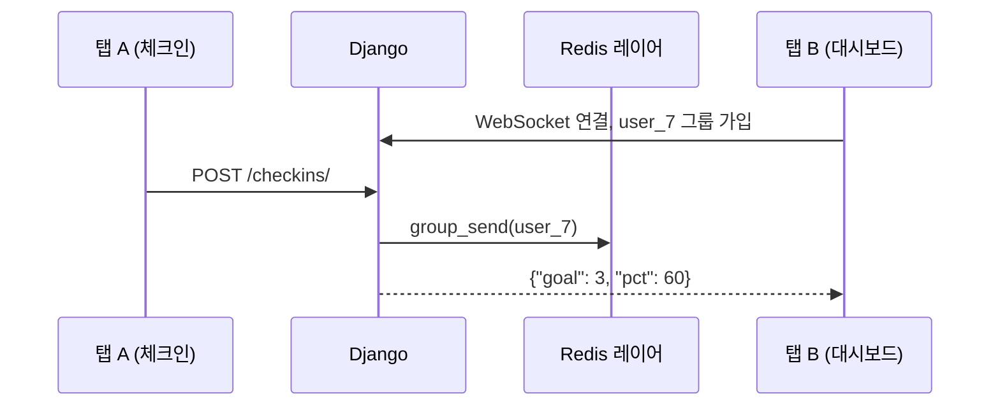

# Day 39 · async views·Channels 개요: 기다림은 겹치고, 화면은 실시간으로

> 읽는 시간: 약 14분

## 복습 3문제

**1.** (Day 38) `max_retries=3`인 작업은 최대 몇 번 실행될까요?

<details>
<summary>정답</summary>

**4번**입니다. 첫 실행 1번 + 재시도 3번. `max_retries`는 **다시 하는 횟수**만 셉니다. BullMQ `attempts`는 첫 실행을 포함하니 헷갈리지 마세요.

</details>

**2.** (Day 38) celery beat를 서버마다 하나씩, 총 3개 띄우면 어떤 일이 생길까요?

<details>
<summary>정답</summary>

같은 스케줄 작업이 **3번씩** 브로커에 들어갑니다. 밤 9시 리마인더가 3통 나갑니다. beat는 **딱 하나만** 띄우고, 작업 자체도 멱등하게 만들어 둡니다.

</details>

**3.** (Day 36) 캐시 스탬피드(stampede)란 무엇이고, 막는 방법 하나는?

<details>
<summary>정답</summary>

인기 키가 만료되는 순간 수많은 요청이 **동시에** 캐시 미스를 보고 DB로 몰리는 현상입니다. TTL에 **지터**를 주거나, 락(`cache.add`)을 잡은 요청 하나만 다시 계산하게 해서 막습니다.

</details>

---

## 오늘 만들 것

Goals 대시보드 상단에 **외부 위젯 3개**(날씨·오늘의 명언·GitHub 잔디)를 붙입니다. `async` 뷰로 세 API를 **동시에** 불러 3초 걸리던 화면을 1초로 줄이고, 체크인하면 다른 탭의 대시보드가 **새로고침 없이** 바뀌는 실시간 기능의 설계도를 그립니다.

## 오늘 배울 것

- **async 뷰**: 기다림(I/O)을 겹쳐서 빨라지는 원리, 그리고 ASGI
- **함정**: 블로킹 코드, 동기 ORM, WSGI에서의 async
- **Channels**: WebSocket·consumer·channel layer로 실시간 푸시

---

## 1. async 뷰: 기다리는 동안 다른 일 하기

Django 뷰는 기본이 **동기**(sync)입니다. 외부 API를 부르면 응답이 올 때까지 그 스레드는 **아무것도 못 하고 멈춰** 있습니다. API 3개를 차례로 부르면 기다림이 그대로 **더해집니다**.

Node에선 이게 당연히 해결돼 있었죠. `await`로 기다리는 동안 이벤트 루프가 다른 일을 합니다. Django도 3.1부터 `async def` 뷰를 지원합니다. 같은 원리입니다.

**비유:** 라면 3개를 끓일 때, 한 냄비가 다 끓을 때까지 옆에 서 있지 않습니다. 세 냄비를 **동시에** 불에 올리고 기다립니다. 총 시간은 가장 오래 걸리는 냄비만큼입니다.

**결과를 맞혀 보세요:** 각각 1초 걸리는 API를 부릅니다. 3개라면(그림에선 날씨·명언·잔디) A 방식과 B 방식은 각각 몇 초?

```python
# A: 하나씩 await
w = await get_weather()
q = await get_quote()
# B: 한꺼번에 gather
w, q = await asyncio.gather(
    get_weather(), get_quote())
```

<details>
<summary>정답</summary>

**A는 3초, B는 1초**입니다. A도 `async`지만 한 줄씩 기다리니 결국 차례대로입니다. `async`를 붙인다고 빨라지는 게 아니라, **여러 기다림을 동시에 걸어야**(gather) 빨라집니다. Node에서 `await`를 줄줄이 쓰는 것과 `Promise.all`의 차이와 같습니다.

</details>


**JS (Node)**

```javascript
// 셋을 동시에 시작, 다 끝나면 진행
const [w, q, g] = await Promise.all([
  getWeather(), getQuote(),
  getGrass(),
]);
```

**Python (asyncio)**: 위 B와 같은 모양입니다. `Promise.all` = `asyncio.gather`, `Promise` ≈ 코루틴(coroutine, `async def`가 돌려주는 "멈췄다 이어지는 함수").

직접 실행해 보세요. 사이트에선 맨 바깥에서 `await`를 바로 쓸 수 있습니다. 로컬 `.py` 파일에선 `asyncio.run(main())`으로 감쌉니다.

```python-run
import asyncio, time
async def api(name):
    await asyncio.sleep(0.5)
    return name
t = time.perf_counter()
r = await asyncio.gather(
    api("날씨"), api("명언"), api("잔디"))
print(r, round(time.perf_counter() - t, 1))
```

이제 Django 뷰로 옮깁니다. 외부 HTTP는 `requests` 대신 **비동기 클라이언트** `httpx.AsyncClient`를 씁니다(로컬에서 `pip install httpx`).

```python
# goals/views.py
import asyncio, httpx
async def widgets(request):
    async with httpx.AsyncClient(
            timeout=2) as c:
        w, q, g = await asyncio.gather(
            c.get(WEATHER), c.get(QUOTE),
            c.get(GRASS))
```

```python
    # (이어서) 세 응답을 합쳐 JSON으로
    return JsonResponse({
        "weather": w.json(),
        "quote": q.json(),
        "grass": g.json()})
```

여기서 한 가지가 더 필요합니다. 동시에 수많은 요청을 받으려면 서버가 **ASGI**(Asynchronous Server Gateway Interface, 비동기 서버와 Django를 잇는 규약)로 돌아야 합니다. 지금까지 쓴 `runserver`·gunicorn 기본 설정은 **WSGI**(동기 규약)입니다.

| 구분 | WSGI | ASGI |
|---|---|---|
| 서버 예 | gunicorn | uvicorn·daphne |
| 동시성 | 프로세스·스레드 수 | 이벤트 루프 |
| WebSocket | ❌ | ✅ |

로컬에선 `pip install uvicorn` 후 `uvicorn config.asgi:application`으로 띄웁니다.

> 💡 async는 **기다림(I/O)을 겹칠 때만** 빨라진다. `async def` + `gather` + ASGI 서버, 셋이 다 있어야 효과가 난다.

---

## 2. 함정: 루프를 막으면 모두가 멈춘다

async의 대가는 **한 스레드가 모든 요청을 돌린다**는 점입니다. 누군가 루프를 붙잡고 안 놓으면(블로킹, blocking) 그동안 **다른 모든 요청이 멈춥니다**. Node에서 `fs.readFileSync`나 무거운 계산이 서버 전체를 얼리는 것과 똑같습니다.

**결과를 맞혀 보세요:** async 뷰 안에서 `time.sleep(1)`(또는 `requests.get`)을 쓰면, 동시에 들어온 요청 3개는 몇 초 걸릴까요?

<details>
<summary>정답</summary>

**3초**입니다. `time.sleep`·`requests.get`은 루프에 "다른 일 해도 돼"라고 양보하지 않습니다. 그래서 요청이 하나씩 처리됩니다. 동기 뷰보다 **오히려 나쁩니다**. 동기 뷰는 적어도 스레드 여러 개로 나눠 받으니까요.

</details>

아래에서 확인해 보세요. `bad`는 루프를 붙잡고 기다리는(블로킹) 함수, `good`은 양보하며 기다리는 함수입니다. 두 블록을 **차례로** 실행하세요.

```python-run
import asyncio, time
async def bad():
    t = time.perf_counter()
    while time.perf_counter() - t < 0.3:
        pass
async def good():
    await asyncio.sleep(0.3)
```

```python-run
import asyncio, time
for f in (bad, good):
    t = time.perf_counter()
    await asyncio.gather(f(), f(), f())
    print(f.__name__,
          round(time.perf_counter() - t, 1))
# 출력: bad 0.9 / good 0.3 (대략)
```

**두 번째 함정은 ORM입니다.** Django ORM은 원래 동기입니다. async 뷰에서 `Goal.objects.get()`을 그대로 부르면 Django가 일부러 **`SynchronousOnlyOperation`** 에러를 냅니다. 루프를 막는 걸 미리 차단하는 안전장치입니다.

Django 4.1부터는 `a`가 붙은 비동기 메서드가 있습니다.

```python
# async 뷰 안의 ORM
goal = await Goal.objects.aget(pk=pk)
n = await Goal.objects.filter(
    owner=request.user).acount()
async for g in Goal.objects.all():
    print(g.title)
```

비동기 버전이 없는 코드(예: `transaction.atomic`, 동기 라이브러리)는 **`sync_to_async`**로 감싸서 별도 스레드로 보냅니다.

Node에서 무거운 일을 `worker_threads`로 빼는 것과 비슷한 발상입니다.

```python
from asgiref.sync import sync_to_async
@sync_to_async
def save_checkin(goal_id):
    with transaction.atomic():
        ...
await save_checkin(7)
```

반대 방향 `async_to_sync`는 **동기 코드에서 async 함수를 부를 때** 씁니다. 3장 Channels에서 곧 씁니다.

**그럼 Goals 앱 뷰를 전부 async로 바꿔야 할까요?** 아닙니다. 체크인 저장 같은 평범한 CRUD 뷰는 DB 한 번 다녀오면 끝이라 겹칠 기다림이 없습니다. 위젯처럼 **외부 호출이 여러 개**거나, **오래 열어 두는 연결**(스트리밍·WebSocket)일 때만 async가 이득입니다.

> 💡 async 뷰 안에선 **블로킹 금지**: `requests` 대신 `httpx`, ORM은 `aget`·`acount`·`async for`, 없는 건 `sync_to_async`. 평범한 CRUD는 동기 뷰가 낫다.

<details>
<summary>🔍 더 깊이 (면접용)</summary>

**WSGI에서 async 뷰를 돌리면?** 동작은 합니다. 하지만 Django가 요청마다 **일회용 이벤트 루프**를 만들어 그 뷰만 돌립니다. 한 요청 안에서 `gather`로 겹치는 이득은 있지만, 요청끼리는 여전히 워커 수만큼만 동시에 처리되고 루프 생성 비용만 붙습니다.

**ASGI에서 동기 뷰를 돌리면?** Django가 `sync_to_async`로 **스레드에 넘겨** 실행합니다. 역시 동작하지만 스레드 전환 비용이 듭니다. 미들웨어도 마찬가지입니다. 미들웨어 중 하나라도 동기 전용이면 요청이 sync↔async를 **오가며** 전환 비용(요청당 약 1ms)을 냅니다. 그래서 "섞어 쓰기"는 가능하지만 공짜는 아닙니다.

**`thread_sensitive=True`(기본값).** `sync_to_async`는 기본적으로 같은 요청의 동기 코드를 **한 스레드**에서 차례로 돌립니다. DB 연결처럼 스레드에 묶인 자원이 섞이지 않게 하려는 것입니다. 그래서 동기 코드 여러 개를 `gather`로 묶어도 **동시에 돌지 않습니다**.

**async ORM의 실체.** `aget()` 등은 현재 내부적으로 `sync_to_async`로 감싼 동기 쿼리입니다(DB 드라이버 수준 완전 비동기는 진행 중). 그래서 "async ORM이라 DB가 빨라진다"는 틀린 말입니다. 루프를 막지 않게 해 줄 뿐입니다.

**CPU 작업은 async로 안 빨라진다.** 이미지 리사이즈·대량 통계 계산은 루프를 붙잡습니다. GIL 때문에 스레드로도 병렬이 안 되니 **Celery 워커**(Day 37)나 프로세스로 보냅니다.

**동시성 vs 병렬성.** async는 한 번에 하나만 실행하되 기다림을 겹치는 **동시성**(concurrency)입니다. 여러 코어에서 정말 동시에 실행하는 **병렬성**(parallelism)과 다릅니다.

</details>

---

## 3. Channels: 서버가 먼저 말을 거는 법

HTTP는 **클라이언트가 물어야** 서버가 답합니다. 그래서 다른 탭(또는 다른 기기)에서 체크인해도, 지금 보고 있는 대시보드는 새로고침 전엔 모릅니다.

**WebSocket**은 연결을 **계속 열어 두고** 서버가 먼저 데이터를 보낼 수 있는 통로입니다. Django 기본 기능만으로는 WebSocket을 못 다룹니다. 그래서 **Django Channels** 라이브러리를 씁니다. Channels는 ASGI 위에서 HTTP와 WebSocket을 함께 처리합니다.

**비유:** HTTP는 우편, WebSocket은 전화 통화입니다. 우편은 내가 보내야 답장이 오지만, 통화 중엔 상대가 언제든 먼저 말할 수 있습니다.

Channels의 부품은 셋입니다.

- **consumer**: WebSocket용 뷰. 연결·메시지·종료를 처리합니다.
- **channel layer**: 프로세스·서버끼리 메시지를 전달하는 우체국. 보통 **Redis**를 씁니다.
- **group**: 채널(연결)들의 묶음. "user_7 그룹 전체에 보내"가 가능합니다.



**결과를 맞혀 보세요:** 서버를 2대 띄웠습니다. 탭 A는 서버 1, 탭 B는 서버 2에 연결돼 있습니다. channel layer 없이 서버 1의 메모리에만 "연결 목록"을 두면, 탭 A의 체크인 알림이 탭 B에 갈까요?

<details>
<summary>정답</summary>

**안 갑니다.** 서버 1은 서버 2에 붙은 연결을 모릅니다. 그래서 모든 서버가 함께 보는 **Redis channel layer**가 필요합니다. Socket.IO에서 서버를 늘릴 때 **Redis adapter**를 붙이는 것과 같은 이유입니다.

</details>

**JS (Node, Socket.IO)**

```javascript
io.on("connection", (s) => {
  s.join(`user_${s.userId}`);
});
// 체크인 후
io.to("user_7").emit("goal",
  { goal: 3, pct: 60 });
```

**Python (Channels consumer)**

```python
class GoalConsumer(
        AsyncJsonWebsocketConsumer):
    async def connect(self):
        uid = self.scope["user"].id
        self.g = f"user_{uid}"
        await self.channel_layer.group_add(
            self.g, self.channel_name)
        await self.accept()
```

```python
    # (이어서) 연결이 끊기면 그룹에서 빼기
    async def disconnect(self, code):
        layer = self.channel_layer
        await layer.group_discard(
            self.g, self.channel_name)
    # type "goal.update" → 이 메서드 호출
    async def goal_update(self, event):
        await self.send_json(event["data"])
```

`group_send`의 `"type": "goal.update"`는 점이 밑줄로 바뀌어 `goal_update` 메서드를 부릅니다. 체크인 뷰는 동기라서 `async_to_sync`로 보냅니다. 커밋 후에 보내야 하니 Day 37의 `on_commit`도 씁니다.

```python
# 체크인 뷰(동기) 안, 저장 후
layer = get_channel_layer()
send = async_to_sync(layer.group_send)
transaction.on_commit(lambda: send(
    f"user_{request.user.id}",
    {"type": "goal.update",
     "data": {"goal": g.id, "pct": pct}}))
```

연결 경로는 `asgi.py`에서 나눕니다. HTTP는 평소대로 Django로, WebSocket은 consumer로 갑니다.

```python
# config/asgi.py (요약)
application = ProtocolTypeRouter({
  "http": get_asgi_application(),
  "websocket": AuthMiddlewareStack(
    URLRouter([path("ws/goals/",
      GoalConsumer.as_asgi())])),
})
```

로컬에선 `pip install channels channels-redis daphne`로 설치합니다.

**꼭 WebSocket이어야 할까요?** 갱신이 드물면 **폴링**, 서버→클라 한 방향이면 **SSE**(Server-Sent Events)로 충분합니다. "친구와 함께 목표"처럼 **양방향**이 필요할 때 Channels가 맞습니다.

> 💡 Channels = ASGI 위의 WebSocket. **consumer**가 연결을 받고, **group**으로 묶고, **Redis channel layer**가 서버 간에 메시지를 나른다.

<details>
<summary>🔍 더 깊이 (면접용)</summary>

**channel layer는 유실될 수 있다.** channels-redis는 메시지를 영구 저장하지 않습니다. 받는 연결이 그 순간 없거나 용량을 넘으면 **버려집니다**(at-most-once). 그래서 진실의 원천은 **DB**로 두고, WebSocket은 "바뀌었어" **신호**로만 씁니다. 재연결하면 클라이언트가 REST로 최신 상태를 다시 받아야 합니다.

**인증.** `AuthMiddlewareStack`은 **세션 쿠키**로 `scope["user"]`를 채웁니다. 브라우저 WebSocket은 커스텀 헤더를 못 보내서, JWT를 쓰면 쿼리스트링·첫 메시지로 토큰을 받는 커스텀 미들웨어가 필요합니다. 쿼리스트링 토큰은 로그에 남으니 **짧은 수명**으로 발급합니다. `connect`에서 미인증이면 `close()`합니다.

**Origin 검사.** WebSocket엔 CORS가 적용되지 않습니다. 다른 사이트가 사용자 쿠키로 연결하는 **CSWSH**(Cross-Site WebSocket Hijacking)를 막으려면 `AllowedHostsOriginValidator`로 감쌉니다.

**스케일.** 연결 하나하나가 서버 메모리를 차지합니다. 로드밸런서는 WebSocket **Upgrade**를 통과시켜야 하고, 연결이 오래가니 배포 때 끊김·재연결(지수 백오프 + 지터, Day 38)을 설계합니다.

</details>

---

## 연습문제

**1.** 위젯 API 중 하나가 가끔 5초씩 걸립니다. 대시보드는 **1초 안에** 떠야 합니다. 느린 위젯만 `None`으로 두고 나머지는 보여 주세요. (순수 asyncio로)

<details>
<summary>정답</summary>

각 호출을 `asyncio.wait_for`로 감싸 시간 제한을 걸고, `gather(..., return_exceptions=True)`로 **하나가 실패해도 나머지 결과는 받습니다**.

```python-run
import asyncio
async def api(name, s):
    await asyncio.sleep(s)
    return name
async def safe(c):
    try:
        return await asyncio.wait_for(c, 0.5)
    except asyncio.TimeoutError: return None
```

```python-run
r = await asyncio.gather(
    safe(api("날씨", 0.1)),
    safe(api("명언", 2)),
    safe(api("잔디", 0.2)))
print(r)
# 출력: ['날씨', None, '잔디']
```

예외를 `safe`에서 삼켰기 때문에 하나가 느려도 나머지는 살아남습니다. 감싸지 않으면 예외 하나가 `gather` **전체를 실패**시킵니다(`return_exceptions=True`로도 막을 수 있습니다). 실무에선 `httpx.AsyncClient(timeout=...)`로 같은 효과를 내고, 실패한 위젯은 캐시된 이전 값(Day 36)을 보여 주면 더 좋습니다.

</details>

**2.** 아래 async 뷰의 문제 두 가지를 찾고 고치세요.

```python
async def goal_detail(request, pk):
    goal = Goal.objects.get(pk=pk)
    r = requests.get(GRASS_URL)
    return JsonResponse(
        {"title": goal.title,
         "grass": r.json()})
```

<details>
<summary>정답</summary>

① `Goal.objects.get`은 동기 ORM이라 **`SynchronousOnlyOperation`** 에러가 납니다. ② `requests.get`은 블로킹이라 응답 동안 **루프 전체가 멈춥니다**. 에러도 안 나서 더 위험합니다.

```python
async def goal_detail(request, pk):
    goal = await Goal.objects.aget(pk=pk)
    async with httpx.AsyncClient(
            timeout=2) as c:
        r = await c.get(GRASS_URL)
    return JsonResponse(
        {"title": goal.title,
         "grass": r.json()})
```

다만 호출이 하나뿐이라 겹칠 기다림이 없습니다. 이 뷰는 **동기 뷰**로 둬도 충분합니다.

</details>

**3.** 체크인하면 **같은 목표를 공유한 친구들**(그룹 `goal_3`)의 대시보드도 갱신되게 하세요. consumer가 URL의 목표 id로 그룹에 가입하고, 체크인 뷰가 그 그룹에 보내도록 쓰세요.

<details>
<summary>정답</summary>

URL에서 id를 받고(`path("ws/goals/<int:gid>/", ...)`), `scope["url_route"]`로 꺼냅니다. **권한 확인**을 빼먹지 마세요. 아무나 남의 목표 그룹에 가입하면 정보가 샙니다.

```python
async def connect(self):
    gid = self.scope["url_route"][
        "kwargs"]["gid"]
    user = self.scope["user"]
    ok = await Goal.objects.filter(
        id=gid, members=user).aexists()
    if not ok:
        return await self.close()
```

```python
    # (이어서) 통과하면 그룹 가입
    self.g = f"goal_{gid}"
    await self.channel_layer.group_add(
        self.g, self.channel_name)
    await self.accept()
```

체크인 뷰는 본문 코드에서 그룹 이름만 `f"goal_{g.id}"`로 바꾸면 됩니다. 메시지엔 **최소 정보**(id, 진행률)만 담습니다. 자세한 내용이 필요하면 클라이언트가 REST로 다시 받습니다. 유실돼도 DB가 진실이니 안전합니다.

</details>

---

## 면접 질문

<details>
<summary>Q1. Django 뷰를 async로 바꾸면 무조건 빨라지나요?</summary>

**모범 답안:** 아닙니다. async는 **I/O 대기를 겹칠 때만** 이득입니다.

- **빨라지는 경우**: 외부 API 여러 개를 `gather`로 동시에 부를 때, 스트리밍·WebSocket처럼 연결을 오래 열어 둘 때. ASGI 서버(uvicorn 등)에서 돌려야 요청 간 동시성도 생깁니다.
- **손해인 경우**: 단순 CRUD는 겹칠 기다림이 없습니다. WSGI에선 요청마다 이벤트 루프를 만들고, ASGI에서도 동기 미들웨어·동기 코드가 섞이면 스레드 전환 비용이 붙습니다.
- **위험한 경우**: async 뷰 안의 블로킹 호출(`requests`, `time.sleep`, 동기 ORM)은 루프를 막아 **모든 요청을 멈춥니다**. CPU 작업은 async로 안 빨라지니 Celery로 보냅니다.

그래서 저는 기본은 동기 뷰, 외부 호출이 많은 엔드포인트만 async로 고르고, 바꾼 뒤엔 부하 테스트로 확인합니다.

</details>

<details>
<summary>Q2. Django로 실시간 알림을 만든다면 어떻게 설계하나요?</summary>

**모범 답안:**

- **통로 선택**: 서버→클라 한 방향이면 SSE, 양방향이면 WebSocket(Django Channels). 드문 갱신이면 폴링도 충분합니다.
- **구조**: ASGI 서버에서 `ProtocolTypeRouter`로 HTTP와 WebSocket을 나누고, consumer가 연결 시 **인증·권한**을 확인한 뒤 `user_{id}` 같은 **group**에 가입합니다.
- **여러 서버**: 서버끼리 연결 목록을 모르므로 **Redis channel layer**로 `group_send`합니다.
- **보내는 쪽**: 동기 뷰·Celery에서 `async_to_sync(group_send)`를 쓰고, `on_commit` 뒤에 보내 롤백된 데이터가 알림으로 나가지 않게 합니다.
- **신뢰성**: channel layer는 유실될 수 있으니 DB를 진실로 두고, 메시지는 작은 "변경 신호"로만 씁니다. 클라이언트는 재연결 시 백오프 + 지터로 다시 붙고 REST로 최신 상태를 받습니다.
- **보안**: Origin 검사(CSWSH 방지), 토큰은 짧은 수명.

</details>

---

## 오늘 정리

- **async 뷰**: `async def` + `gather` + ASGI 서버가 모여야 빨라진다. 기다림을 **겹치는** 것이지 코드가 빨라지는 게 아니다.
- **함정**: 블로킹 호출은 루프 전체를 멈춘다. `httpx`, `aget`·`async for`, `sync_to_async`. 평범한 CRUD는 동기가 낫다.
- **Channels**: consumer·group·Redis channel layer로 서버가 먼저 푸시. 메시지는 신호일 뿐, 진실은 DB.

## 다음에 이어갈 것

Day 40부터는 9주차 **배포**입니다. 오늘 본 WSGI/ASGI가 실제 서버에서 어떻게 도는지, gunicorn 워커 수는 어떻게 정하는지부터 봅니다.
