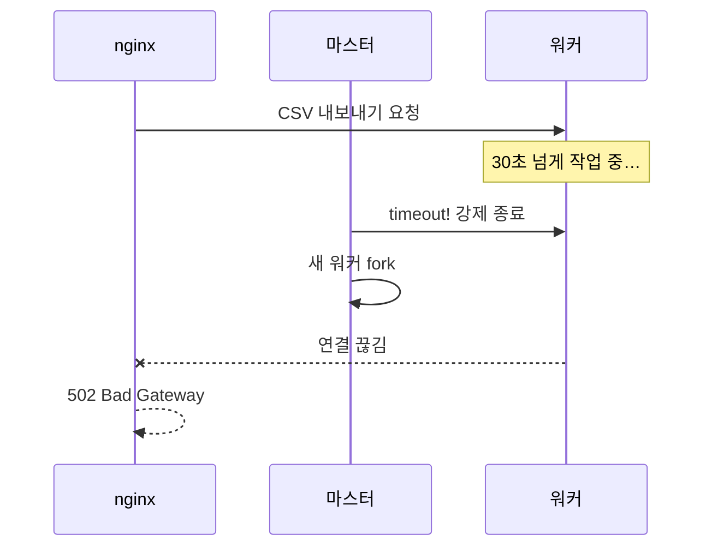

# Day 40 · WSGI/ASGI·gunicorn 워커: runserver를 졸업하는 날

> 읽는 시간: 약 13분

## 복습 3문제

**1.** (Day 39) async 뷰에서 1초짜리 API 3개를 `await` 세 줄로 차례로 부르면 몇 초? `gather`로 부르면?

<details>
<summary>정답</summary>

**차례로 3초, gather로 1초**입니다. `async def`를 붙이는 것만으로는 안 빨라집니다. 여러 기다림을 **동시에 걸어야** 겹쳐집니다. Node의 `await` 줄줄이 vs `Promise.all`과 같습니다.

</details>

**2.** (Day 39) async 뷰 안에서 `requests.get()`을 쓰면 왜 위험할까요?

<details>
<summary>정답</summary>

`requests`는 **블로킹** 호출이라 이벤트 루프에 양보하지 않습니다. 그 사이 같은 루프의 **모든 요청이 멈춥니다**. `httpx.AsyncClient`처럼 비동기 클라이언트를 쓰거나, 꼭 동기 코드라면 `sync_to_async`로 감쌉니다.

</details>

**3.** (Day 37) Celery 작업에 모델 객체 대신 **ID**만 넘기는 이유는?

<details>
<summary>정답</summary>

메시지는 JSON으로 브로커에 저장됩니다. 객체를 통째로 넘기면 무겁고, 워커가 실행할 때쯤엔 **이미 낡은 데이터**일 수 있습니다. ID만 넘기고 워커가 DB에서 **최신 값**을 다시 읽습니다.

</details>

---

## 오늘 만들 것

지금까지 Goals 대시보드는 `runserver`로 돌았습니다. 오늘은 실제 서버용 실행기 **gunicorn**으로 바꾸고, `gunicorn.conf.py`에 **워커 수·타임아웃·재시작 규칙**을 적습니다. Day 39의 async 위젯 뷰도 함께 돌도록 **ASGI 워커**를 고릅니다.

## 오늘 배울 것

- **WSGI/ASGI**: 서버와 Django 사이의 "콘센트 규격"
- **gunicorn 워커 모델**: 마스터 1 + 워커 N, 몇 개가 적당한가
- **워커 종류·타임아웃**: sync, gthread, uvicorn 워커와 502의 정체

---

## 1. WSGI·ASGI: 서버와 앱을 잇는 규격

Node에선 `http.createServer(app)` 한 줄이면 앱이 곧 서버였습니다. Python은 다릅니다. **웹 서버**(요청을 받는 프로그램)와 **웹 앱**(Django)이 따로 있습니다. 둘이 대화하는 약속이 **WSGI**(Web Server Gateway Interface)입니다.

왜 나눴을까요? 약속만 지키면 **아무 서버에 아무 프레임워크**나 꽂을 수 있기 때문입니다. gunicorn·uWSGI·mod_wsgi 어디에든 Django·Flask를 꽂습니다.

**비유:** 콘센트 규격입니다. 220V 규격만 맞으면 어떤 회사 플러그든 꽂힙니다. 서버는 벽, Django는 가전제품입니다.

WSGI 앱의 정체는 놀랍도록 단순합니다. **함수 하나**입니다.

**결과를 맞혀 보세요:** 서버가 아래 `app`을 부르면 브라우저는 무엇을 받을까요?

```python
def app(environ, start_response):
    start_response("200 OK",
        [("Content-Type", "text/plain")])
    return [b"hello goals"]
```

<details>
<summary>정답</summary>

상태 `200 OK`, 본문 `hello goals`를 받습니다. 서버는 요청 정보를 `environ`(딕셔너리)에 담아 함수를 부르고, 앱은 `start_response`로 **상태·헤더**를, `return`으로 **본문 바이트 조각들**을 돌려줍니다. Django의 `config/wsgi.py`에 있는 `application`도 결국 이런 함수(호출 가능한 객체)입니다.

</details>

**JS (Node)**

```javascript
// 앱 함수 = (요청, 응답)
const app = (req, res) => {
  res.writeHead(200);
  res.end("hello goals");
};
http.createServer(app).listen(8000);
```

**Python (WSGI)**

```python
# 앱 = (environ, start_response)
# 서버는 gunicorn이 따로 담당
# $ gunicorn config.wsgi:application
```

서버 역할을 직접 흉내 내 봅시다. 가짜 `environ`을 만들어 앱을 불러 봅니다.

```python-run
def app(environ, start_response):
    path = environ["PATH_INFO"]
    start_response("200 OK", [])
    return [f"path={path}".encode()]
```

이어서 서버 쪽입니다. 위 블록을 먼저 실행하세요.

```python-run
def fake_server(path):
    def start(status, headers):
        print(status)
    env = {"PATH_INFO": path}
    body = b"".join(app(env, start))
    print(body.decode())
fake_server("/goals/")
# 출력: 200 OK / path=/goals/
```

WSGI는 **요청 하나 = 함수 호출 하나**입니다. 호출이 끝날 때까지 그 워커는 붙잡혀 있습니다. 그래서 WebSocket처럼 연결을 오래 여는 일은 못 합니다.

이 한계를 푼 게 **ASGI**(Asynchronous SGI)입니다. 앱이 `async` 함수가 되고, 한 연결에서 메시지를 **여러 번 주고받습니다**.

```python
# ASGI 앱의 모양
async def app(scope, receive, send):
    # scope: 연결 정보 (http/websocket)
    # receive: 받기 / send: 보내기
    ...
```


Django 프로젝트엔 처음부터 `config/wsgi.py`와 `config/asgi.py`가 **둘 다** 있습니다. 같은 Django를 어느 콘센트에 꽂을지 고르는 것뿐입니다.

> 💡 WSGI/ASGI는 서버와 Django 사이의 **규격**이다. WSGI = 요청당 함수 호출 한 번, ASGI = async로 여러 번 주고받기.

<details>
<summary>🔍 더 깊이 (면접용)</summary>

- **PEP 3333**이 WSGI 표준입니다. 앱은 "호출 가능한 객체(callable)"면 되므로 함수든 `__call__`이 있는 클래스든 됩니다. Django의 `WSGIHandler`가 그 클래스입니다.
- **본문이 리스트(iterable)인 이유**: 큰 응답을 조각조각 흘려보내기(streaming) 위해서입니다. `StreamingHttpResponse`가 이걸 씁니다. 하지만 WSGI에선 스트리밍하는 동안 워커가 **계속 붙잡혀** 있습니다.
- **미들웨어도 같은 규격**: WSGI 앱을 감싸 또 다른 WSGI 앱을 만드는 함수가 WSGI 미들웨어입니다(연습문제 2). Express 미들웨어와 달리 `next()`가 없고 **감싸기(데코레이터)** 방식입니다.
- **ASGI의 `scope["type"]`**: `"http"`, `"websocket"`, `"lifespan"`(서버 시작·종료 이벤트). Channels의 `ProtocolTypeRouter`가 이 값으로 분기합니다.
- **runserver를 운영에 쓰면 안 되는 이유**: 보안 점검·성능 최적화가 안 된 개발용 서버이고, 프로세스 관리(죽으면 재시작)도 없습니다. Django 문서도 명시적으로 금지합니다.

</details>

---

## 2. gunicorn: 마스터 1 + 워커 N

gunicorn은 시작하면 **마스터**(master) 프로세스 하나가 뜹니다. 마스터는 요청을 직접 처리하지 않습니다. 대신 **워커**(worker) 프로세스를 N개 띄우고(fork), 감시합니다.

워커 하나가 죽으면? 마스터가 바로 **새 워커를 띄웁니다**. 그래서 하나가 터져도 서비스는 계속됩니다. 이 방식을 **pre-fork 모델**(미리 여러 개 복제해 두기)이라고 합니다.

**비유:** 식당 매니저(마스터)와 웨이터(워커)입니다. 매니저는 서빙하지 않고, 웨이터가 쓰러지면 새 웨이터를 부릅니다. 손님(요청)은 놀고 있는 웨이터가 받습니다.


**결과를 맞혀 보세요:** 기본 sync 워커가 **2개**입니다. 2초 걸리는 요청 4개가 동시에 들어오면 마지막 요청은 몇 초 뒤에 끝날까요?

<details>
<summary>정답</summary>

**4초**입니다. sync 워커 하나는 **한 번에 요청 하나**만 처리합니다. 처음 2개가 0~2초, 나머지 2개가 2~4초에 처리됩니다. 워커가 1개였다면 8초입니다. sync 워커 수 = **동시에 처리할 수 있는 요청 수**입니다.

</details>

직접 계산해 보세요. 숫자를 바꿔 가며 실행해 봅니다.

```python-run
import math
def last_done(reqs, workers, sec):
    rounds = math.ceil(reqs / workers)
    return rounds * sec

print(last_done(4, 2, 2))
print(last_done(4, 1, 2))
# 출력: 4 / 8
```

**JS (Node)**

```javascript
// PM2 cluster 모드와 같은 구조
// $ pm2 start app.js -i 4
// 또는 node:cluster
if (cluster.isPrimary) {
  for (let i = 0; i < 4; i++)
    cluster.fork();
} else startServer();
```

**Python (gunicorn)**

```bash
# 마스터 1 + 워커 4
gunicorn config.wsgi:application \
  --workers 4 --bind 0.0.0.0:8000
```

Node는 이벤트 루프 하나로도 동시 요청을 잘 받으니, cluster는 "CPU 코어를 다 쓰려고" 씁니다. Django sync 워커는 **블로킹**이라 워커 수가 곧 동시 처리량입니다. 그래서 워커 수가 더 중요합니다.

그럼 몇 개가 적당할까요? gunicorn 문서의 출발점은 이 공식입니다.

```python-run
import os
cpu = os.cpu_count() or 2
print("워커 =", 2 * cpu + 1)
```

**(2 × CPU 코어) + 1**. 한 워커가 DB를 기다리는 동안 다른 워커가 CPU를 쓰도록 코어보다 넉넉히 둡니다. 다만 **출발점**일 뿐입니다. 진짜 상한은 보통 **메모리**입니다. 워커는 각자 Django 전체를 메모리에 올리니까요.

> 💡 sync 워커 수 = 동시 처리 수. 시작은 **2×코어+1**, 메모리와 부하 테스트로 조정한다.

<details>
<summary>🔍 더 깊이 (면접용)</summary>

- **왜 스레드가 아니라 프로세스?** CPython의 **GIL**(한 번에 한 스레드만 파이썬 코드를 실행하게 하는 잠금) 때문에 CPU 작업은 스레드로 병렬이 안 됩니다. 프로세스는 각자 GIL을 가지므로 코어를 모두 씁니다. (3.13+의 free-threaded 빌드는 아직 실험적입니다.)
- **누가 요청을 받나?** 마스터가 포트를 열고(listen) fork하면 워커들이 **같은 소켓**을 물려받아 각자 `accept()`합니다. 놀고 있는 워커가 먼저 가져갑니다. 마스터는 분배하지 않습니다.
- **`--preload`**: 앱을 마스터에서 미리 import한 뒤 fork합니다. **copy-on-write**(쓰기 전까지 메모리 공유) 덕에 메모리가 줄고 시작이 빠릅니다. 대신 DB 연결 같은 걸 fork 전에 열면 워커끼리 **소켓을 공유**하는 사고가 납니다. 코드 변경 시 `HUP` 재시작으로 반영되지 않는 점도 주의.
- **무중단 재시작**: `kill -HUP <마스터>`면 새 워커를 띄우고 옛 워커는 하던 요청을 마친 뒤 종료(graceful)합니다.
- **컨테이너에선?** k8s처럼 파드를 여러 개 띄우면 "파드당 워커 수 × 파드 수"가 전체 동시 처리량입니다. 파드에 CPU 1개라면 워커 2~3개가 흔합니다.

</details>

---

## 3. 워커 종류·타임아웃: 502는 어디서 오나

sync 워커만 있는 건 아닙니다. `--worker-class`(`-k`)로 바꿉니다. Goals 앱에 맞는 걸 고르는 게 오늘의 핵심입니다.

| 워커 | 동시성 방식 | 어울리는 곳 |
|---|---|---|
| sync | 워커당 1요청 | 평범한 CRUD |
| gthread | 워커당 스레드 N | I/O 대기 많음 |
| uvicorn | 이벤트 루프 | ASGI·async 뷰 |

Goals 대시보드엔 Day 39의 async 위젯 뷰가 있습니다. async 뷰를 제대로 겹쳐 돌리려면 **ASGI**여야 하죠. 그래서 gunicorn이 프로세스 관리만 하고, 워커 안에서는 **uvicorn**이 ASGI로 돌게 합니다.

```bash
# 로컬에서
pip install gunicorn uvicorn-worker
gunicorn config.asgi:application \
  -k uvicorn_worker.UvicornWorker \
  -w 4
```

(예전 글에선 `-k uvicorn.workers.UvicornWorker`로 나옵니다. 최신 uvicorn에선 별도 패키지 `uvicorn-worker`로 옮겨졌습니다.)

이제 **타임아웃**입니다. 워커가 요청 하나에 너무 오래 매달리면 마스터가 그 워커를 **죽이고** 새로 띄웁니다. 기본값은 **30초**입니다.

**결과를 맞혀 보세요:** sync 워커, `timeout=30`. Goals의 "1년치 통계 CSV 내보내기" 뷰가 40초 걸립니다. 사용자는 무엇을 보게 될까요?

<details>
<summary>정답</summary>

30초쯤에 마스터가 `WORKER TIMEOUT`을 로그에 남기고 워커를 **강제 종료**합니다. 응답이 끊기니 앞단의 nginx는 **502 Bad Gateway**를 돌려줍니다. 타임아웃을 늘리는 건 미봉책입니다. 40초짜리 일은 **Celery로 보내고**(Day 37), 완성되면 알림·다운로드 링크를 줍니다.

</details>



설정은 명령줄 대신 파일로 남겨 둡니다. 커밋되니 팀원도 같은 설정을 씁니다.

```python
# gunicorn.conf.py (프로젝트 루트)
import multiprocessing
cpu = multiprocessing.cpu_count()
workers = 2 * cpu + 1
worker_class = (
    "uvicorn_worker.UvicornWorker")
bind = "0.0.0.0:8000"
```

```python
# (이어서) 안전장치
timeout = 30
graceful_timeout = 30
max_requests = 1000
max_requests_jitter = 100
accesslog = "-"
```

`max_requests`는 워커가 요청 1000개를 처리하면 **스스로 은퇴**하고 새 워커로 바뀌게 합니다. 어딘가 메모리가 새도 주기적으로 초기화되죠. `jitter`는 모든 워커가 **동시에** 은퇴하지 않게 흩어 줍니다(Day 38의 지터와 같은 발상).

실행은 이제 이 한 줄입니다.

```bash
gunicorn config.asgi:application
# gunicorn.conf.py를 자동으로 읽음
```

> 💡 워커 종류는 앱 성격대로: CRUD는 sync, I/O 많으면 gthread, async·WebSocket은 uvicorn 워커. 오래 걸리는 일은 타임아웃을 늘리지 말고 **Celery로**.

<details>
<summary>🔍 더 깊이 (면접용)</summary>

- **gthread**: `--threads 4`면 워커당 스레드 4개로 동시 4요청. sync 워커에 `threads>1`을 주면 자동으로 gthread가 됩니다. I/O 대기 중엔 GIL이 풀리므로 DB·외부 API가 많은 앱에 효과적입니다. 대신 **스레드 안전**(전역 변수 공유 주의)을 지켜야 합니다.
- **gevent/eventlet**: 그린렛(가벼운 협력 스레드)과 **몽키 패칭**(표준 라이브러리 소켓을 비동기 버전으로 바꿔치기)으로 수천 연결을 받습니다. 패치가 안 되는 C 확장 DB 드라이버가 있으면 블로킹되는 함정이 있습니다.
- **timeout의 정확한 의미**: sync 워커에선 "요청 처리 시간"과 거의 같지만, 정확히는 워커가 마스터에게 **살아 있다는 신호(heartbeat)**를 못 보낸 시간입니다. async 계열 워커에선 이벤트 루프가 막혔을 때 걸립니다.
- **느린 클라이언트(slow client)**: sync 워커는 느린 모바일 업로드를 받는 동안에도 붙잡힙니다. 그래서 gunicorn 문서는 **앞에 nginx 같은 버퍼링 프록시를 두라**고 권합니다. 내일(Day 41) 주제입니다.
- **DB 연결 수 계산**: 워커 9개 × 스레드 4 × 서버 3대 = 최대 108 연결. PostgreSQL 기본 `max_connections=100`을 넘습니다. `CONN_MAX_AGE`나 PgBouncer(연결 풀러)를 같이 설계해야 합니다.
- **uvicorn 단독 vs gunicorn+uvicorn 워커**: 최신 uvicorn은 `--workers`로 자체 프로세스 관리도 됩니다. gunicorn을 쓰면 `max_requests`, HUP 재시작 같은 검증된 운영 기능을 얻습니다. 컨테이너 오케스트레이터가 재시작을 맡으면 uvicorn 단독 + 프로세스 1개도 흔한 선택입니다.

</details>

---

## 연습문제

**1.** Goals 서버는 **4코어, RAM 2GB**입니다. 워커 하나가 메모리 **300MB**를 씁니다. OS·기타용으로 400MB는 남겨야 합니다. 워커를 몇 개로 정할까요?

<details>
<summary>정답</summary>

```python-run
cpu, ram, spare, per = 4, 2048, 400, 300
by_cpu = 2 * cpu + 1
by_mem = (ram - spare) // per
print(by_cpu, by_mem, min(by_cpu, by_mem))
# 출력: 9 5 5
```

공식으로는 9개지만 메모리로는 **5개**가 한계입니다. 9개를 띄우면 2.7GB가 필요해 스왑(디스크를 메모리처럼 쓰기)이 일어나거나 OOM killer가 워커를 죽입니다. **둘 중 작은 값**에서 시작하고, 부족하면 gthread로 워커당 동시성을 늘리거나 서버를 키웁니다.

</details>

**2.** 모든 응답에 `X-App: goals` 헤더를 붙이는 **WSGI 미들웨어** `add_header(app)`를 만드세요. Django 없이 순수 Python으로요.

<details>
<summary>정답</summary>

```python-run
def add_header(app):
    def wrapped(env, sr):
        def start(status, hdrs):
            hdrs.append(("X-App", "goals"))
            return sr(status, hdrs)
        return app(env, start)
    return wrapped
```

```python-run
def hello(environ, start_response):
    start_response("200 OK", [])
    return [b"hi"]

app = add_header(hello)
app({}, lambda s, h: print(s, h))
# 출력: 200 OK [('X-App', 'goals')]
```

미들웨어는 **앱을 받아 앱을 돌려주는 함수**입니다. `start_response`(여기선 `sr`)를 가로채 헤더를 하나 더 넣고 원래 것을 부릅니다. 바깥에서 보면 `wrapped`도 똑같은 WSGI 앱이라 몇 겹이든 감쌀 수 있습니다. Django의 `MIDDLEWARE`도 같은 "감싸기" 발상입니다.

</details>

**3.** Goals 앱엔 일반 CRUD 뷰들과 Day 39의 async 위젯 뷰(외부 API 3개 동시 호출)가 함께 있습니다. 아래 명령의 문제점은? 고쳐 보세요.

```bash
gunicorn config.wsgi:application -w 4
```

<details>
<summary>정답</summary>

**WSGI + sync 워커**라서 async 뷰가 있어도 요청끼리 겹치지 않습니다. Django가 요청마다 이벤트 루프를 새로 만들어 뷰를 돌리고, 워커는 그동안 계속 붙잡힙니다. 뷰 안의 `gather` 덕에 한 요청은 1초로 줄지만, **동시 처리 수는 여전히 4**입니다.

```bash
gunicorn config.asgi:application \
  -k uvicorn_worker.UvicornWorker \
  -w 4 --timeout 30
```

`asgi:application`으로 바꾸고 uvicorn 워커를 씁니다. 이제 위젯 요청이 외부 API를 기다리는 동안 **같은 워커가 다른 요청**도 받습니다. 동기 CRUD 뷰는 Django가 스레드에서 돌려 주니 그대로 동작합니다.

</details>

---

## 면접 질문

<details>
<summary>Q1. WSGI와 ASGI의 차이를 설명해 주세요.</summary>

**모범 답안:** 둘 다 **웹 서버와 Python 앱 사이의 인터페이스 규격**입니다. 덕분에 서버와 프레임워크를 자유롭게 조합합니다.

- **WSGI**(PEP 3333): 동기 규격. 앱은 `app(environ, start_response)` 함수이고, **요청 하나 = 호출 하나**입니다. 동시성은 서버의 프로세스·스레드 수로 얻습니다. WebSocket처럼 오래 열린 연결은 다룰 수 없습니다.
- **ASGI**: 비동기 규격. 앱은 `async def app(scope, receive, send)`이고, 한 연결에서 이벤트를 **여러 번** 주고받습니다. HTTP·WebSocket·lifespan을 모두 다룹니다. 이벤트 루프 하나로 많은 I/O 대기를 겹칩니다.
- **실무 선택**: 평범한 CRUD는 WSGI(gunicorn sync/gthread)로 충분하고 단순합니다. async 뷰·WebSocket·스트리밍이 있으면 ASGI(uvicorn, 또는 gunicorn + uvicorn 워커)를 씁니다. ASGI에서 동기 코드가 섞이면 스레드 전환 비용이 생기는 점도 고려합니다.

</details>

<details>
<summary>Q2. gunicorn 워커 수는 어떻게 정하고, 502가 나면 무엇부터 보나요?</summary>

**모범 답안:**

- **출발점**: `2 × CPU 코어 + 1`. 워커가 I/O를 기다리는 동안 다른 워커가 CPU를 쓰도록 넉넉히 둡니다.
- **상한**: 워커는 각자 앱 전체를 메모리에 올리므로 `(가용 메모리) / (워커당 메모리)`를 넘기지 않습니다. DB `max_connections`도 같이 계산합니다(워커 × 스레드 × 서버 수).
- **검증**: 부하 테스트로 p95 지연·에러율을 보며 조정합니다. I/O가 많으면 gthread·uvicorn 워커로 워커당 동시성을 늘립니다.
- **502 진단**: gunicorn 로그에 `WORKER TIMEOUT`이 있으면 느린 요청이 원인입니다. 느린 쿼리(N+1 등)를 고치거나 긴 작업을 Celery로 넘깁니다. 로그에 OOM·`SIGKILL`이 있으면 메모리 부족이니 워커 수를 줄이거나 `max_requests`로 누수를 완화합니다. 워커가 다 바빠 큐가 밀리는 경우엔 nginx 쪽에서 504·연결 거부가 나타나니 워커 수·스케일 아웃을 검토합니다.

</details>

---

## 오늘 정리

- **WSGI/ASGI**는 서버↔Django 규격. WSGI는 요청당 함수 호출, ASGI는 async로 여러 번 주고받기.
- **gunicorn**은 마스터가 워커 N개를 관리. sync 워커 수 = 동시 처리 수, 시작은 2×코어+1, 상한은 메모리.
- **워커 종류·타임아웃**: async 뷰가 있으면 uvicorn 워커. 30초 넘는 일은 Celery로, 그대로 두면 502.

## 다음에 이어갈 것

내일(Day 41)은 gunicorn **앞에 nginx**를 세웁니다. 느린 클라이언트를 대신 받아 주고, CSS·이미지 같은 **정적 파일**은 Django를 거치지 않고 바로 내보내게 합니다.
