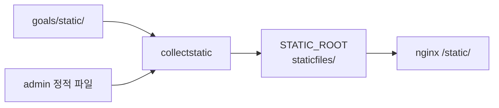
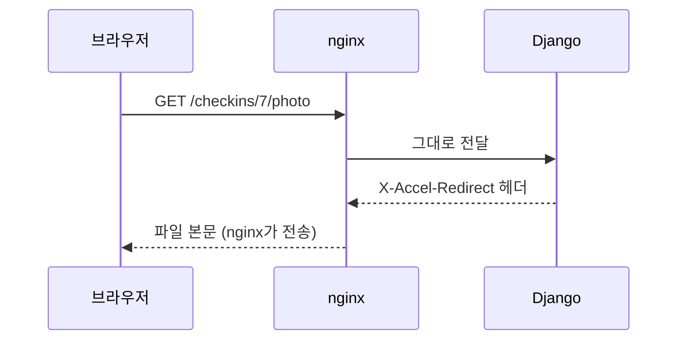

# Day 41 · nginx·정적 파일: gunicorn 앞에 문지기를 세우는 날

> 읽는 시간: 약 13분

## 복습 3문제

**1.** (Day 40) sync 워커 4개인 gunicorn에 1초짜리 요청 8개가 동시에 오면, 마지막 요청은 몇 초 뒤에 끝날까요?

<details>
<summary>정답</summary>

**2초**입니다. sync 워커 하나는 한 번에 요청 하나만 처리합니다. 4개씩 두 번에 나눠 처리하니 1초 + 1초입니다. **sync 워커 수 = 동시 처리 수**입니다.

</details>

**2.** (Day 40) gunicorn 로그에 `WORKER TIMEOUT`이 찍히고 사용자는 502를 봤습니다. 무슨 일이 일어난 걸까요?

<details>
<summary>정답</summary>

요청 하나가 `--timeout`(기본 30초)보다 오래 걸렸습니다. 마스터가 그 워커를 **죽이고** 새로 띄웠습니다. 응답 도중 연결이 끊겼으니 앞단 프록시는 502(Bad Gateway)를 돌려줍니다. 느린 쿼리를 고치거나 긴 작업을 Celery로 넘깁니다.

</details>

**3.** (Day 36) cache-aside 패턴에서 캐시에 값이 **없을 때** 순서는?

<details>
<summary>정답</summary>

① 캐시 조회 → 없음(miss) ② **DB에서 읽기** ③ 그 값을 **캐시에 저장**(TTL과 함께) ④ 응답. 다음 요청은 ①에서 바로 끝납니다. 앱 코드가 캐시를 직접 관리하는 방식이라 "옆에(aside) 둔 캐시"라고 부릅니다.

</details>

---

## 오늘 만들 것

어제 Goals 대시보드를 gunicorn으로 띄웠습니다. 오늘은 그 **앞에 nginx**를 세웁니다. CSS·JS는 nginx가 바로 내보내고, 체크인 **인증샷 업로드**도 nginx가 먼저 받아 줍니다.

## 오늘 배울 것

- **리버스 프록시**: nginx가 gunicorn을 왜 지켜 주는가
- **정적 파일**: `collectstatic`과 해시 파일명 캐시
- **미디어 파일**: 업로드 크기 제한과 비공개 파일 내보내기

---

## 1. 리버스 프록시: 느린 손님은 nginx가 상대한다

**리버스 프록시**(reverse proxy)는 서버 **앞에서** 요청을 대신 받아 뒤로 넘기는 서버입니다. 브라우저는 nginx만 보고, gunicorn은 숨어 있습니다.

왜 필요할까요? 어제 배운 대로 sync 워커는 **요청 하나에 통째로 붙잡힙니다**. 지하철 속 폰이 사진을 10초에 걸쳐 올리면, 워커도 10초 동안 아무것도 못 합니다. 이런 손님이 4명이면 워커 4개가 전부 멈춥니다.

**비유:** 은행 창구 앞의 안내 데스크입니다. 서류를 다 채울 때까지 안내 데스크에서 기다리게 하고, **완성된 서류만** 창구(워커)로 보냅니다.


**결과를 맞혀 보세요:** 느린 폰이 10초 걸려 사진을 올리고, Django 처리는 0.05초입니다. nginx가 있을 때와 없을 때, 워커가 붙잡히는 시간은?

<details>
<summary>정답</summary>

- **nginx 없음**: 약 **10.05초**. 워커가 업로드 바이트가 다 올 때까지 기다립니다.
- **nginx 있음**: 약 **0.05초**. nginx가 요청 본문을 끝까지 **버퍼링**(임시로 모아 두기)한 뒤, 빠른 로컬 연결로 한 번에 넘깁니다.

응답도 마찬가지입니다. 느린 폰이 응답을 천천히 받아 가도, nginx가 대신 들고 있으니 워커는 바로 다음 요청으로 갑니다.

</details>

```python-run
def held(upload_s, work_s, nginx):
    # nginx가 업로드를 대신 기다려 줌
    wait = 0 if nginx else upload_s
    return round(wait + work_s, 2)

print(held(10, 0.05, nginx=False))
print(held(10, 0.05, nginx=True))
# 출력: 10.05 / 0.05
```

nginx는 어떻게 느린 연결 수천 개를 버틸까요? Node처럼 **이벤트 루프**(epoll)로 돌기 때문입니다. 기다림이 많은 일은 nginx가, 계산은 Django 워커가 맡는 **분업**입니다.

설정은 짧습니다. `/etc/nginx/sites-available/goals`의 `server` 블록 안에 씁니다.

```nginx
# server { listen 80; ... } 안에
location / {
    proxy_pass http://127.0.0.1:8000;
    proxy_set_header Host $host;
    proxy_set_header X-Forwarded-For
        $proxy_add_x_forwarded_for;
    proxy_set_header X-Forwarded-Proto
        $scheme;
}
```

`proxy_set_header`가 중요합니다. 프록시를 거치면 Django가 보는 **접속자는 nginx**(127.0.0.1)가 됩니다. 원래 도메인·IP·https 여부를 헤더로 **전달**해야 Django가 진짜 손님을 압니다.

**JS (Node)**

```javascript
// Express: 프록시 뒤에 있다고 알려 줌
app.set("trust proxy", 1);
// 이제 req.ip, req.protocol이
// X-Forwarded-* 헤더를 따름
```

**Python (Django settings)**

```python
SECURE_PROXY_SSL_HEADER = (
    "HTTP_X_FORWARDED_PROTO", "https")
ALLOWED_HOSTS = ["goals.example.com"]
```

`SECURE_PROXY_SSL_HEADER`가 있어야 `request.is_secure()`가 https에서 `True`가 됩니다. Express의 `trust proxy`와 같은 역할입니다. 로컬에선 `sudo nginx -t`로 문법을 검사한 뒤 `sudo systemctl reload nginx`로 적용하세요.

> 💡 nginx는 느린 클라이언트·연결 관리를 맡고, gunicorn 워커는 **완성된 요청만** 빠르게 처리한다.

<details>
<summary>🔍 더 깊이 (면접용)</summary>

- **버퍼링 지시어**: `proxy_request_buffering`(요청 본문)과 `proxy_buffering`(응답) 모두 기본 `on`입니다. SSE·스트리밍 응답은 `proxy_buffering off`나 `X-Accel-Buffering: no` 헤더로 꺼야 실시간으로 흘러갑니다.
- **gunicorn 문서의 권고**: sync 워커는 slow client에 취약하므로 **버퍼링 프록시 뒤에** 두라고 명시합니다. gevent·uvicorn 워커는 덜 취약하지만, TLS·정적 파일 때문에 보통 그래도 nginx를 둡니다.
- **502 vs 504**: 502는 upstream이 연결을 거부·끊음(gunicorn 다운, 워커 강제 종료). 504는 `proxy_read_timeout`(기본 60초) 안에 응답이 안 옴. gunicorn timeout(30초)이 더 짧으면 502가 먼저 납니다.
- **X-Forwarded-For 위조**: 클라이언트가 직접 `X-Forwarded-For: 1.2.3.4`를 보낼 수 있습니다. `$proxy_add_x_forwarded_for`는 뒤에 **덧붙이기**만 하므로, 믿을 값은 **내 프록시가 붙인 맨 오른쪽**입니다. 레이트 리밋에 맨 왼쪽 IP를 쓰면 우회됩니다.
- **Host 헤더**: `proxy_set_header Host $host`를 빼면 nginx는 `proxy_pass`의 주소(`127.0.0.1:8000`)를 Host로 보냅니다. `ALLOWED_HOSTS` 검사에서 400이 나거나, 비밀번호 재설정 메일 링크가 엉뚱한 주소가 됩니다.
- **TLS 종료**(TLS termination): HTTPS 암복호화를 nginx에서 끝내고, 뒤로는 평문 HTTP로 넘깁니다. 그래서 `X-Forwarded-Proto`가 필요합니다.

</details>

---

## 2. 정적 파일: collectstatic과 해시 파일명

Day 8에서 ``으로 CSS를 붙였습니다. 개발 중엔 `runserver`가 앱 폴더마다 뒤져서 내보내 줬습니다. 그런데 운영에선 사정이 다릅니다.

**결과를 맞혀 보세요:** 운영 설정으로 `DEBUG = False`를 켜고 gunicorn으로 띄웠습니다. 대시보드를 열면?

<details>
<summary>정답</summary>

페이지는 뜨지만 **CSS·JS가 전부 404**라 스타일이 깨집니다. Django는 `DEBUG=False`일 때 정적 파일을 **내보내지 않습니다**. 파이썬 워커로 파일을 퍼 나르는 건 느리고 비싸서, "운영에선 웹 서버가 하라"는 설계입니다.

</details>

그래서 두 단계가 필요합니다. ① 여기저기 흩어진 정적 파일을 **한 폴더로 모으기**. ② 그 폴더를 **nginx가 직접** 내보내기.



**비유:** 각 반 교실(앱)에 흩어진 교과서를 졸업 전에 **도서관(STATIC_ROOT) 한 곳**에 모으는 일입니다. 사서(nginx)는 도서관만 압니다.

**JS (Node)**

```javascript
// 빌드 결과를 dist/에 모으고
// $ npm run build
// 정적 서버가 dist/를 그대로 내보냄
app.use(express.static("dist"));
```

**Python (Django)**

```python
STATIC_URL = "static/"
STATIC_ROOT = BASE_DIR / "staticfiles"
# 모으기 (배포할 때마다)
# $ python manage.py collectstatic
```

```nginx
location /static/ {
    alias /srv/goals/staticfiles/;
    expires 1y;
    add_header Cache-Control "immutable";
}
```

`expires 1y`는 "브라우저야, 1년 동안 다시 묻지 마"입니다. 빠르지만 문제가 생깁니다. CSS를 고쳐 배포해도 사용자는 **1년 동안 옛 CSS**를 봅니다.

해법은 **파일 내용이 바뀌면 이름도 바꾸는 것**입니다. 새 이름이면 브라우저 입장에선 처음 보는 파일이니 새로 받습니다. 이것을 **캐시 버스팅**(cache busting)이라 합니다.

```python-run
import hashlib
def hashed(name, body):
    h = hashlib.md5(body).hexdigest()[:12]
    stem, ext = name.rsplit(".", 1)
    return f"{stem}.{h}.{ext}"
print(hashed("app.css", b"h1{color:red}"))
print(hashed("app.css", b"h1{color:blue}"))
# 출력: 내용이 바뀌면 이름도 바뀜
```

Django는 이걸 `ManifestStaticFilesStorage`로 해 줍니다. webpack·Vite의 `app.3f2a9c.js`와 같은 발상입니다.

```python
STORAGES = {
  "default": {"BACKEND":
    "django.core.files.storage"
    ".FileSystemStorage"},
  "staticfiles": {"BACKEND":
    "django.contrib.staticfiles.storage"
    ".ManifestStaticFilesStorage"},
}
```

`collectstatic` 때 `app.css`를 `app.<해시>.css`로 복사하고, `staticfiles.json`(매니페스트)에 "원래 이름 → 해시 이름"을 적습니다. 템플릿의 ``가 이 표를 보고 **해시 이름 URL**을 찍어 줍니다.

> 💡 운영의 정적 파일 = `collectstatic`으로 모으고, nginx가 내보내고, 해시 파일명으로 **영원히 캐시**한다.

<details>
<summary>🔍 더 깊이 (면접용)</summary>

- **`alias` vs `root`**: `root /srv/x;`는 URI 전체를 뒤에 붙입니다(`/srv/x/static/a.css`). `alias /srv/x/;`는 location 부분을 **갈아 끼웁니다**(`/srv/x/a.css`). 슬래시 짝(`/static/` ↔ `.../`)이 안 맞으면 경로가 꼬이거나 상위 폴더가 노출되는 취약점(alias traversal)이 생깁니다.
- **매니페스트 누락 에러**: `ManifestStaticFilesStorage`에서 `collectstatic`을 깜빡하면 ``이 `ValueError: Missing staticfiles manifest entry`로 **500**을 냅니다. 배포 스크립트에 꼭 넣습니다.
- **CSS 안의 URL도 고쳐 줌**: CSS의 `url("bg.png")`도 해시 이름으로 바꿔 씁니다. 그래서 참조된 파일이 없으면 collectstatic이 실패합니다.
- **WhiteNoise**: nginx 없이(PaaS·컨테이너 하나) 배포할 때 Django 미들웨어로 정적 파일을 내보냅니다. 시작 때 파일 목록을 메모리에 올리고 압축본(gzip/brotli)과 캐시 헤더를 붙여 꽤 효율적입니다. 앞에 CDN을 두면 대부분 요청은 Django까지 오지도 않습니다.

</details>

---

## 3. 미디어 파일: 업로드는 정적 파일과 다르다

**정적 파일**은 개발자가 만들어 배포와 함께 나가는 파일입니다. **미디어 파일**은 사용자가 **운영 중에 올리는** 파일입니다. Goals의 체크인 인증샷이 미디어입니다.

| 구분 | 정적 | 미디어 |
|---|---|---|
| 만든 사람 | 개발자 | 사용자 |
| 설정 | `STATIC_ROOT` | `MEDIA_ROOT` |
| 바뀌는 때 | 배포 때 | 아무 때나 |

**결과를 맞혀 보세요:** 사용자가 5MB 사진을 올렸습니다. nginx 설정은 기본값입니다. 무슨 일이 생길까요?

<details>
<summary>정답</summary>

**413 Request Entity Too Large**입니다. nginx의 `client_max_body_size` 기본값은 **1MB**라서, 요청이 Django에 닿기도 전에 nginx가 거절합니다. Django 로그엔 아무것도 없어서 헤매기 쉽습니다.

</details>

```nginx
server {
    client_max_body_size 10m;
    location /media/ {
        alias /srv/goals/media/;
    }
}
```

**JS (Node)**

```javascript
// multer: 업로드 크기 제한
const upload = multer({
  dest: "uploads/",
  limits: { fileSize: 10 * 1024 ** 2 },
});
```

**Python (Django)**

```python
MEDIA_URL = "media/"
MEDIA_ROOT = BASE_DIR / "media"

class CheckIn(models.Model):
    photo = models.ImageField(
        upload_to="checkins/%Y/%m/")
```

그런데 `/media/`를 nginx가 그냥 내보내면 **주소만 알면 누구나** 남의 인증샷을 봅니다. 권한 검사는 Django만 할 수 있습니다. 그렇다고 Django가 파일을 직접 퍼 나르면 워커가 또 붙잡힙니다.

해법은 **X-Accel-Redirect**입니다. Django는 **권한만 확인**하고 "이 파일 내보내 줘"라는 헤더만 돌려줍니다. 실제 파일 전송은 nginx가 합니다.

**비유:** 클럽 입구에서 직원(Django)이 신분증을 확인하고 손등에 도장을 찍어 줍니다. 안에서 음료를 나르는 건 바텐더(nginx)입니다.



```python
def photo(request, pk):
    ci = get_object_or_404(CheckIn, pk=pk,
        goal__owner=request.user)
    resp = HttpResponse()
    resp["X-Accel-Redirect"] = (
        f"/protected/{ci.photo.name}")
    return resp
```

```nginx
location /protected/ {
    internal;
    alias /srv/goals/media/;
}
```

`internal`은 "브라우저가 직접 이 주소로 오면 404"라는 뜻입니다. 오직 Django가 허락한 응답을 통해서만 열립니다.

> 💡 미디어는 사용자가 올린 **믿을 수 없는** 파일이다. 크기는 nginx에서 막고, 비공개 파일은 Django가 허락하고 nginx가 보낸다.

<details>
<summary>🔍 더 깊이 (면접용)</summary>

- **Django의 업로드 한도**: `FILE_UPLOAD_MAX_MEMORY_SIZE`(기본 2.5MB)를 넘는 파일은 메모리 대신 **임시 파일**로 받습니다. `DATA_UPLOAD_MAX_MEMORY_SIZE`(2.5MB)는 파일을 **제외한** 본문 한도입니다. 파일 크기 자체는 nginx와 폼 검증에서 막습니다.
- **업로드 XSS**: 사용자가 `.html`·`.svg`를 올리고 같은 도메인에서 열리면 스크립트가 실행됩니다. 확장자·내용 검증, `Content-Disposition: attachment`, `X-Content-Type-Options: nosniff`, **별도 도메인**(예: `media.goals-cdn.com`)으로 막습니다.
- **서버가 여러 대면?** 로컬 디스크 `MEDIA_ROOT`는 서버마다 달라 깨집니다. S3 같은 객체 스토리지(`django-storages`)에 두고, 비공개 파일은 **presigned URL**(만료되는 서명 주소)로 내보내는 것이 X-Accel-Redirect의 클라우드 버전입니다.

</details>

---

## 연습문제

**1.** 아래 설정으로 `/static/goals/app.css`를 요청하면 404가 납니다. 파일은 `/srv/goals/staticfiles/goals/app.css`에 있습니다. nginx는 어느 경로를 찾았을까요? 고쳐 보세요.

```nginx
location /static/ {
    root /srv/goals/staticfiles;
}
```

<details>
<summary>정답</summary>

`root`는 **URI 전체를 그대로 뒤에 붙입니다**. 그래서 nginx는 `/srv/goals/staticfiles/static/goals/app.css`를 찾았고, `static/`이 한 번 더 들어가 404입니다.

고치는 법은 두 가지입니다.

```nginx
location /static/ {
    alias /srv/goals/staticfiles/;
}
```

`alias`는 `/static/` 부분을 지정한 폴더로 **갈아 끼웁니다**. location과 alias 둘 다 `/`로 끝나게 짝을 맞춥니다. 또는 `STATIC_ROOT`를 `/srv/goals/static`으로 바꾸고 `root /srv/goals;`를 써도 됩니다.

</details>

**2.** nginx는 여러 `location` 중 **가장 길게 일치하는 접두사**(prefix)를 고릅니다. 이 규칙을 순수 Python으로 흉내 내 보세요. `route("/static/goals/a.css", ...)`는 `"/static/"`를 돌려줘야 합니다.

```python-run
LOCS = ["/", "/static/", "/media/"]

def route(path, locs):
    # 여기를 채우세요
    pass

print(route("/static/goals/a.css", LOCS))
print(route("/goals/3/", LOCS))
```

<details>
<summary>정답</summary>

```python-run
LOCS = ["/", "/static/", "/media/"]

def route(path, locs):
    hits = [l for l in locs
            if path.startswith(l)]
    return max(hits, key=len)

print(route("/static/goals/a.css", LOCS))
print(route("/goals/3/", LOCS))
```

출력은 `/static/`과 `/`입니다. `/static/goals/a.css`는 `/`와 `/static/` **둘 다** 일치하지만, 더 긴 `/static/`이 이깁니다. 그래서 `location /`가 맨 위에 있어도 정적 파일은 nginx가 직접 내보냅니다. 설정 파일의 **순서와 상관없다**는 점이 Express(위에서부터 먼저 맞는 것)와 다릅니다. 참고로 실제 nginx는 `=`(정확히 일치)와 정규식 location도 있어 규칙이 조금 더 복잡합니다.

</details>

**3.** Goals를 https로 올리면서 nginx에서 TLS를 끝내고, Django에 `SECURE_SSL_REDIRECT = True`를 넣었습니다. 그런데 브라우저가 "리디렉션 횟수가 너무 많습니다"를 띄웁니다. 왜일까요? 고쳐 보세요.

<details>
<summary>정답</summary>

nginx는 https를 받아 **평문 http로** gunicorn에 넘깁니다. Django가 보기엔 모든 요청이 http라서 `request.is_secure()`가 `False`입니다. 그래서 매번 "https로 가세요" 301을 보내고, 브라우저는 https로 다시 오고, 또 http로 보이고… **무한 루프**입니다.

nginx는 원래 scheme을 헤더로 넘깁니다.

```nginx
proxy_set_header X-Forwarded-Proto
    $scheme;
```

Django는 그 헤더를 믿도록 설정합니다.

```python
SECURE_PROXY_SSL_HEADER = (
    "HTTP_X_FORWARDED_PROTO", "https")
SECURE_SSL_REDIRECT = True
```

주의: 이 설정은 **프록시가 헤더를 항상 덮어쓸 때만** 안전합니다. Django가 인터넷에 직접 노출돼 있으면 공격자가 헤더를 꾸며 https인 척할 수 있습니다.

</details>

---

## 면접 질문

<details>
<summary>Q1. gunicorn이 있는데 왜 앞에 nginx를 두나요?</summary>

**모범 답안:** 역할 분담 때문입니다. gunicorn 워커는 **비싼 자원**(프로세스마다 Django 전체 메모리)이고, sync 워커는 연결 하나에 통째로 묶입니다.

- **느린 클라이언트 흡수**: nginx가 요청·응답을 버퍼링해 워커는 완성된 요청만 빠르게 처리합니다. 이벤트 루프 기반이라 연결 수천 개를 적은 메모리로 버팁니다.
- **정적·미디어 파일**: 디스크에서 sendfile로 바로 내보내 Python을 거치지 않습니다. 캐시 헤더·gzip도 붙입니다.
- **TLS 종료·보안**: 인증서 처리, 업로드 크기 제한(`client_max_body_size`), 레이트 리밋, 잘못된 요청 차단을 앞단에서 합니다.
- **라우팅·무중단**: 여러 앱/워커로 분배하고, upstream 재시작 중 에러 페이지를 보여 줄 수 있습니다.

주의점으로 `X-Forwarded-Proto`·`Host`를 넘기고 `SECURE_PROXY_SSL_HEADER`를 설정해야 Django가 https와 원래 도메인을 인식합니다. PaaS처럼 nginx가 없으면 WhiteNoise + CDN으로 정적 파일을 대신합니다.

</details>

<details>
<summary>Q2. 정적 파일 배포와 캐시 무효화 전략을 설명해 주세요.</summary>

**모범 답안:**

- **모으기**: 배포 때 `collectstatic`으로 앱별 정적 파일을 `STATIC_ROOT` 하나로 모읍니다. `DEBUG=False`에선 Django가 정적 파일을 내보내지 않으므로 nginx·WhiteNoise·CDN이 맡습니다.
- **해시 파일명**: `ManifestStaticFilesStorage`가 `app.<내용 해시>.css`로 복사하고 매니페스트를 만듭니다. ``은 해시 URL을 찍습니다.
- **캐시 정책**: 해시 자산은 `Cache-Control: max-age=1년, immutable`로 영구 캐시합니다. 내용이 바뀌면 이름이 바뀌니 무효화가 필요 없습니다. 반대로 **HTML은 짧게** 캐시해 새 URL이 빨리 퍼지게 합니다.
- **함정**: collectstatic 누락 시 매니페스트 에러로 500, 여러 서버라면 모든 서버(또는 공용 스토리지/CDN)에 같은 결과물이 있어야 합니다. 롤링 배포 중엔 옛 HTML이 옛 해시를 찾을 수 있으니 **이전 버전 파일도 잠시 남겨 둡니다**.

</details>

---

## 오늘 정리

- **nginx**는 리버스 프록시. 느린 손님·TLS·파일을 맡고, 워커는 완성된 요청만 처리한다.
- **정적 파일**은 `collectstatic`으로 모아 nginx가 내보내고, 해시 파일명으로 영구 캐시한다.
- **미디어**는 사용자 업로드. 크기는 `client_max_body_size`, 비공개는 X-Accel-Redirect.

## 다음에 이어갈 것

내일(Day 42)은 nginx·gunicorn·Postgres·Redis를 **Docker**로 묶습니다. 멀티스테이지 빌드로 이미지를 가볍게 만들고, `docker compose up` 한 줄로 Goals 전체를 띄웁니다.
