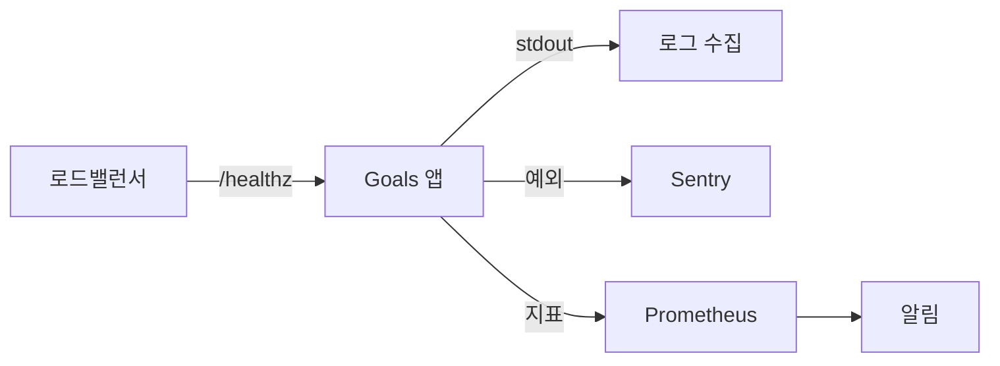

# Day 43 · 환경변수·보안·로깅: Goals를 운영 모드로 바꾸는 날

> 읽는 시간: 약 13분

## 복습 3문제

**1.** (Day 42) Dockerfile에서 `COPY requirements.txt`와 `RUN pip install`을 `COPY . .`보다 **위에** 두는 이유는?

<details>
<summary>정답</summary>

**레이어 캐시** 때문입니다. 한 줄이 바뀌면 그 아래 줄만 다시 만듭니다. 코드는 자주 바뀌고 의존성은 드물게 바뀌니, 의존성 설치를 위에 두면 코드만 고친 빌드에서 `pip install` 레이어를 그대로 재사용합니다. 빌드가 몇 분에서 몇 초로 줄어듭니다.

</details>

**2.** (Day 42) compose 안의 web 컨테이너가 Postgres에 붙을 때 `DB_HOST`는 `localhost`가 아니라 무엇이어야 할까요?

<details>
<summary>정답</summary>

**서비스 이름**(예: `db`)입니다. 컨테이너마다 자기만의 네트워크 공간이 있어서, web 컨테이너의 localhost엔 Postgres가 없습니다. compose가 만든 네트워크의 내장 DNS가 `db`를 그 컨테이너 IP로 풀어 줍니다.

</details>

**3.** (Day 41) nginx가 HTTPS를 끝내고(TLS 종료) gunicorn엔 HTTP로 넘깁니다. Django의 `request.is_secure()`가 계속 False입니다. 해결 설정은?

<details>
<summary>정답</summary>

nginx가 `X-Forwarded-Proto: https` 헤더를 붙이게 하고, Django에 `SECURE_PROXY_SSL_HEADER = ("HTTP_X_FORWARDED_PROTO", "https")`로 그 헤더를 믿게 합니다.

nginx가 `X-Forwarded-Proto: https` 헤더를 붙이게 하고, Django에서 그 헤더를 믿도록 설정합니다.

```python
SECURE_PROXY_SSL_HEADER = (
    "HTTP_X_FORWARDED_PROTO", "https")
```

**주의:** nginx가 이 헤더를 **항상 덮어써야** 합니다. 클라이언트가 보낸 값을 그대로 넘기면 누구나 "나 HTTPS야"라고 속일 수 있습니다.

</details>

---

## 오늘 만들 것

Goals의 `settings.py`에 박혀 있는 `SECRET_KEY`·`DEBUG`·DB 비밀번호를 **환경변수**로 빼냅니다. `check --deploy` 경고를 0개로 만들고, 로그를 **한 줄 구조화 로그**로 stdout에 남겨 장애 원인을 바로 찾게 합니다.

## 오늘 배울 것

- **환경변수로 설정 분리**: 같은 이미지, 다른 환경
- **DEBUG=False 보안 체크리스트**: `check --deploy`
- **로깅과 모니터링**: 로그·지표·에러 추적·헬스체크

---

## 1. 환경변수: 코드는 같고 설정만 다르게

Day 42에서 Goals를 이미지 하나로 묶었습니다. 그런데 개발에선 `DEBUG=True`, 운영에선 `False`여야 하고 DB 주소도 다릅니다. 환경마다 이미지를 따로 만들면 "테스트한 것과 배포한 것이 다른" 문제가 다시 생깁니다.

더 큰 문제는 **비밀값**입니다. `SECRET_KEY`나 DB 비밀번호를 코드에 쓰고 커밋하면, 나중에 지워도 **git 히스토리에 영원히** 남습니다. 공개 저장소라면 몇 분 안에 봇이 긁어 갑니다.

그래서 **12-Factor App**(클라우드 앱 설계 원칙 12가지)은 "설정은 환경변수에"라고 말합니다. 코드와 이미지는 하나, 환경마다 바뀌는 값만 실행할 때 주입합니다.

**비유:** 이미지는 같은 밀키트, 환경변수는 주문서입니다. "덜 맵게", "곱빼기"는 주문서로 바꾸지 밀키트를 새로 만들지 않습니다.


**결과를 맞혀 보세요:** 무엇이 출력될까요?

```python-run
import os
os.environ["DEBUG"] = "False"
DEBUG = bool(os.environ["DEBUG"])
print(DEBUG)
```

<details>
<summary>정답</summary>

**True**입니다. 환경변수는 **항상 문자열**이고, 비어 있지 않은 문자열은 `bool()`에서 전부 참입니다. `"False"`도, `"0"`도 참입니다. 운영에서 DEBUG가 켜지는 흔한 사고입니다. 그래서 문자열을 **직접 비교**해야 합니다.

</details>

**JS (Node)**

```javascript
// 문자열이라 직접 비교
const debug =
  process.env.DEBUG === "true";
const key = process.env.SECRET_KEY;
if (!key) throw new Error("no key");
```

**Python**

```python
import os
DEBUG = os.environ.get(
    "DEBUG", "False") == "True"
# 없으면 KeyError로 바로 죽음
SECRET_KEY = os.environ["SECRET_KEY"]
```

`os.environ["X"]`는 값이 없으면 **시작하자마자** `KeyError`를 냅니다. 이것을 **fail fast**(빨리 실패하기)라고 합니다. `get("SECRET_KEY", "dev-secret")`처럼 기본값을 주면 운영에서 약한 키로 **조용히** 돌아갑니다. 그게 훨씬 위험합니다.

자주 쓰는 변환은 작은 함수로 만들어 둡니다.

```python-run
import os
def env_bool(name, default="0"):
    v = os.environ.get(name, default)
    return v.lower() in ("1", "true", "yes")

os.environ["DEBUG"] = "False"
print(env_bool("DEBUG"))
# 출력: False
```

값은 어디서 올까요? 로컬에선 git에 올리지 않는 `.env` 파일을 compose가 `env_file: .env`로 읽어 주고, 운영에선 배포 플랫폼의 비밀값 저장소에서 주입합니다.

```bash
# .env  (.gitignore에 꼭 추가)
DEBUG=False
SECRET_KEY=50자-이상-랜덤-문자열
ALLOWED_HOSTS=goals.yndl.dev
```

```yaml
services:
  web:
    env_file: .env
```

> 💡 설정은 환경변수로, 문자열은 직접 비교, 비밀값은 기본값 없이 fail fast.

<details>
<summary>🔍 더 깊이 (면접용)</summary>

**settings 분리 패턴**: `settings/base.py`·`dev.py`·`prod.py`를 `DJANGO_SETTINGS_MODULE`로 고르는 방식과, 파일 하나에서 전부 env로 읽는 방식(12-Factor)이 있습니다. 실무에선 base + env로 섞기도 합니다.

**SECRET_KEY는 무엇을 지키나?**

세션 쿠키 서명, 비밀번호 재설정 토큰, `signing` 모듈, messages 프레임워크 쿠키 등 **서명**에 쓰입니다. 비밀번호 해시와는 무관합니다(해시엔 별도 salt). 키가 새면 공격자가 세션이나 재설정 링크를 위조할 수 있습니다.

**키 교체(rotation)**: Django 4.1부터 `SECRET_KEY_FALLBACKS`가 있습니다. 새 키로 서명하되 옛 키 서명도 잠시 인정해, 모든 사용자를 로그아웃시키지 않고 교체합니다.

**환경변수의 한계**: 권한 있는 사용자는 `/proc/PID/environ`·`docker inspect`로 볼 수 있고, 에러 리포트에 env가 통째로 찍히는 사고도 납니다. 엄격한 곳은 secrets를 **파일로 마운트**(`DB_PASSWORD_FILE` 관례)하거나 Vault·AWS Secrets Manager에서 읽습니다.

</details>

---

## 2. DEBUG=False와 check --deploy

`DEBUG=True`인 운영 서버에서 에러가 나면, 노란 에러 페이지에 **코드 경로, 지역 변수, SQL, 설정값**이 고스란히 나옵니다. 공격자에겐 지도입니다. 게다가 DEBUG 모드는 실행한 SQL을 메모리에 쌓아 두어 장시간 돌면 메모리도 샙니다.

**비유:** 공사 중엔 도면을 벽에 붙이고 문을 열어 둬도 됩니다. 개업하면 도면은 치우고 문은 잠가야 합니다. DEBUG=False가 개업입니다.

**결과를 맞혀 보세요:** 로컬에서 `DEBUG=False`로 바꾸고 `runserver`를 켰습니다. 다른 건 안 건드렸습니다. 페이지를 열면?

<details>
<summary>정답</summary>

**400 Bad Request**가 납니다. DEBUG가 꺼지면 Django는 요청의 `Host` 헤더를 `ALLOWED_HOSTS`와 대조합니다. 목록이 비어 있으면 모든 요청을 거절합니다. `ALLOWED_HOSTS = ["localhost"]`를 넣으면 열립니다. 덤으로 CSS도 사라지는데, runserver가 DEBUG일 때만 정적 파일을 서빙하기 때문입니다(Day 41의 nginx·WhiteNoise 몫).

</details>

무엇을 켜야 하는지 외울 필요는 없습니다. Django가 **점검표**를 줍니다.

```bash
DEBUG=False ./manage.py check --deploy
```

처음 돌리면 이런 경고가 우르르 나옵니다.

| 경고 ID | 뜻 |
|---|---|
| security.W004 | HSTS 미설정 |
| security.W008 | HTTPS 리다이렉트 없음 |
| security.W012 | 세션 쿠키가 HTTP로도 전송 |
| security.W016 | CSRF 쿠키가 HTTP로도 전송 |
| security.W009 | SECRET_KEY가 짧거나 약함 |
| security.W018 | DEBUG가 켜져 있음 |

운영 설정은 대부분 몇 줄로 해결됩니다.

```python
SECURE_SSL_REDIRECT = True
SESSION_COOKIE_SECURE = True
CSRF_COOKIE_SECURE = True
SECURE_HSTS_SECONDS = 3600
SECURE_PROXY_SSL_HEADER = (
    "HTTP_X_FORWARDED_PROTO", "https")
CSRF_TRUSTED_ORIGINS = [
    "https://goals.yndl.dev"]
```

**HSTS**(HTTP Strict Transport Security)는 브라우저에 "이 사이트는 앞으로 HTTPS로만 와"라고 기억시킵니다. 한 번 퍼지면 되돌리기 어려워서, **짧게(1시간) 시작해** 문제없으면 1년으로 늘립니다.

**JS (Node)** — Express에선 미들웨어를 직접 고릅니다.

```javascript
app.use(helmet());
app.set("trust proxy", 1);
app.use(session({
  secret: process.env.SECRET,
  cookie: { secure: true },
}));
```

**Python** — Django는 `SecurityMiddleware`가 기본으로 들어 있어, 위 설정값만 켜면 같은 효과입니다.

> 💡 DEBUG=False는 시작일 뿐. `check --deploy` 경고를 0개로 만드는 게 배포 전 체크리스트다.

<details>
<summary>🔍 더 깊이 (면접용)</summary>

**Host 헤더 공격과 비밀번호 재설정 중독**

비밀번호 재설정 메일의 링크는 `request.get_host()`로 만듭니다. Host 검증이 없으면 공격자가 `Host: evil.com`으로 재설정을 요청해, 피해자가 받은 메일 링크를 evil.com으로 바꿀 수 있습니다. 피해자가 누르면 토큰이 공격자 서버로 갑니다. `ALLOWED_HOSTS`가 이것을 막습니다.

**리다이렉트 무한 루프**

nginx 뒤에서 `SECURE_SSL_REDIRECT=True`만 켜고 `SECURE_PROXY_SSL_HEADER`를 빠뜨리면, Django는 모든 요청을 HTTP로 보고 계속 HTTPS로 보냅니다. 브라우저는 "리디렉션 횟수가 너무 많습니다"를 띄웁니다.

**나머지 헤더**

- `X-Content-Type-Options: nosniff`: 기본 켜짐. 업로드한 텍스트를 브라우저가 스크립트로 추측 실행하는 것을 막음.
- `X-Frame-Options: DENY`: clickjacking(투명 iframe 위에 클릭 유도) 방지. `XFrameOptionsMiddleware`.
- **CSP**(Content-Security-Policy): 허용한 출처의 스크립트만 실행. XSS의 마지막 방어선. Django 6.0부터 내장 지원, 이전엔 `django-csp`.

</details>

---

## 3. 로깅과 모니터링: 아픈 걸 먼저 알아차리기

DEBUG를 끄면 에러 화면은 그냥 "Server Error (500)"입니다. 사용자에겐 안전하지만, **나도** 무슨 일인지 모릅니다. 그래서 로그가 필요합니다.

`print()`로는 부족합니다. 심각도(level)가 없어서 거를 수 없고, 시간·요청 정보가 없어서 찾을 수 없습니다. 컨테이너에선 로그를 **파일이 아니라 stdout**으로 내보냅니다. Docker나 플랫폼이 모아 주기 때문입니다(12-Factor: 로그는 이벤트 스트림).

**결과를 맞혀 보세요:** 아무 설정 없이 실행하면 몇 줄이 출력될까요?

```python-run
import logging
log = logging.getLogger("goals")
log.info("목표 생성")
log.warning("진행률이 100% 초과")
```

<details>
<summary>정답</summary>

**한 줄**(`진행률이 100% 초과`)만 나옵니다. 설정이 없으면 기본 레벨이 **WARNING**이라 INFO는 버려집니다. 레벨 순서는 DEBUG < INFO < WARNING < ERROR < CRITICAL입니다. "운영에선 INFO 이상, 디버깅할 땐 DEBUG"처럼 **레벨만 바꿔** 양을 조절하는 게 로깅의 핵심입니다.

</details>

**구조화 로그**(structured log)는 사람 문장 대신 `키=값`이나 JSON으로 남깁니다. 그래야 "goal_id=7인 로그만", "level=ERROR만"처럼 **검색·집계**할 수 있습니다.

**JS (Node)** — pino는 기본이 JSON입니다.

```javascript
const log = require("pino")();
log.info({ goalId: 7 }, "created");
// 출력: {"level":30,"goalId":7,...}
// {"level":30,"goalId":7,
//  "msg":"created", ...}
```

**Python** — 표준 `logging`에 형식을 지정합니다.

```python-run
import logging, sys
logging.basicConfig(stream=sys.stdout,
    level=logging.INFO,
    format="lv=%(levelname)s "
           "name=%(name)s msg=%(message)s")
log = logging.getLogger("goals")
log.info("goal created")
# 출력: lv=INFO name=goals msg=goal created
```

Django에선 `LOGGING` 딕셔너리로 같은 일을 합니다. 레벨도 환경변수로 받습니다.

```python
LOGGING = {
  "version": 1,
  "handlers": {"console": {
      "class": "logging.StreamHandler"}},
  "root": {"handlers": ["console"],
    "level": os.environ.get(
        "LOG_LEVEL", "INFO")},
}
```

로그만으론 "지금 괜찮은가?"를 알기 어렵습니다. 모니터링은 보통 네 가지를 함께 씁니다.



**비유:** 로그는 블랙박스 영상, 지표는 계기판, 에러 추적은 경고등, 헬스체크는 "살아 있니?" 하고 두드리는 노크입니다.

**에러 추적**: Sentry는 예외가 나면 스택·요청 정보를 모아 알려 줍니다. `sentry_sdk.init(dsn=os.environ.get("SENTRY_DSN"))`처럼 DSN을 env로 받으면, 개발에선 비워 두는 것만으로 꺼집니다.

**헬스체크**: compose healthcheck나 로드밸런서가 주기적으로 부르는 가벼운 URL입니다. DB까지 닿는지 확인합니다.

```python
from django.db import connection
from django.http import JsonResponse

def healthz(request):
    with connection.cursor() as c:
        c.execute("SELECT 1")
    return JsonResponse({"ok": True})
```

**지표**는 웹 서비스라면 **RED** 세 개부터: Rate(초당 요청), Errors(에러 비율), Duration(응답 시간, 특히 p95·p99). Goals의 경우 "5분간 5xx 비율 > 1%면 알림" 하나만 걸어도 사용자보다 먼저 압니다.

> 💡 로그는 stdout에 구조화해서, 예외는 Sentry로, 상태는 RED 지표와 /healthz로.

<details>
<summary>🔍 더 깊이 (면접용)</summary>

**요청 ID로 로그 꿰기**

한 요청이 여러 줄 로그를 남깁니다. 요청마다 ID를 붙이면 그 요청의 로그만 모아 볼 수 있습니다. nginx가 `X-Request-ID`를 붙이고, Django가 `contextvars`에 담아 모든 로그에 찍습니다(연습문제 3).

**절대 로그에 남기면 안 되는 것**: 비밀번호, 토큰, `Authorization`·`Cookie` 헤더, 주민번호·카드번호 같은 개인정보. 로그는 여러 사람이 보고 오래 보관됩니다. Sentry의 `send_default_pii=False`도 같은 이유입니다.

**liveness vs readiness**: liveness(살아 있나? 실패→재시작)는 가볍게, readiness(트래픽 받을 준비?)에서 DB를 확인합니다. DB 장애 때 liveness가 DB를 보면 앱이 재시작만 반복합니다.

**알림은 원인보다 증상에**: "CPU 80%"보다 "p99 응답 > 1초", "5xx > 1%"처럼 **사용자가 느끼는 것**에 겁니다. SLO(서비스 수준 목표, 예: 한 달 99.9% 성공)와 에러 예산 개념으로 이어집니다.

**그 밖에**: 컨테이너에선 `PYTHONUNBUFFERED=1`로 버퍼링을 꺼야 로그가 바로 보입니다. 5xx 예외는 `django.request` 로거가 ERROR로 남깁니다. 세 번째 축 **트레이스**(OpenTelemetry)는 여러 서비스를 거치는 요청의 구간별 시간을 보여 줍니다.

</details>

---

## 연습문제

**1.** Goals `settings.py`에 다음을 쓰세요. ① `SECRET_KEY`는 없으면 시작 실패 ② `DEBUG`는 기본 False, `"true"`·`"1"`이면 True ③ `ALLOWED_HOSTS`는 쉼표 목록.

<details>
<summary>정답</summary>

```python
import os

def env_bool(name, default="0"):
    v = os.environ.get(name, default)
    return v.lower() in ("1", "true", "yes")

SECRET_KEY = os.environ["SECRET_KEY"]
DEBUG = env_bool("DEBUG")
```

```python
raw = os.environ.get("ALLOWED_HOSTS", "")
ALLOWED_HOSTS = [h.strip() for h in
    raw.split(",") if h.strip()]
```

**해설:** `SECRET_KEY`만 기본값 없이 `[]`로 읽어 fail fast합니다. `DEBUG`는 기본이 **안전한 쪽(False)**이어야, 환경변수를 깜빡해도 운영에서 켜지지 않습니다. 목록은 빈 문자열이 섞이지 않게 `if h.strip()`으로 거릅니다.

</details>

**2.** 배포 후 admin 로그인에서 `CSRF verification failed. Origin checking failed - https://goals.yndl.dev does not match any trusted origins.` 에러가 납니다. 원인 후보 두 가지와 해결책은?

<details>
<summary>정답</summary>

① **`CSRF_TRUSTED_ORIGINS` 누락**: Django 4.0부터 HTTPS 요청의 `Origin` 헤더를 검사하고, 이 설정엔 **스킴까지** 적어야 합니다.

```python
CSRF_TRUSTED_ORIGINS = [
    "https://goals.yndl.dev"]
```

② **프록시 헤더 미설정**: nginx가 TLS를 끝내서 Django는 요청을 `http://`로 봅니다. 브라우저의 Origin은 `https://`라 어긋납니다. nginx에서 `X-Forwarded-Proto`를 넘기고 Django에 `SECURE_PROXY_SSL_HEADER`를 설정합니다.

**해설:** 둘 다 "로컬에선 됐는데 운영에서만" 나는 대표 에러입니다. 로컬은 HTTP 하나라 어긋날 일이 없기 때문입니다.

</details>

**3.** 모든 로그에 요청 ID(`rid`)가 찍히게 하세요. nginx가 `X-Request-ID` 헤더를 붙여 준다고 가정합니다.

<details>
<summary>정답</summary>

`contextvars`에 담습니다. 스레드·async 작업마다 값이 따로라 요청끼리 섞이지 않습니다.

```python
# goals/reqid.py
import contextvars, uuid
rid = contextvars.ContextVar(
    "rid", default="-")
```

미들웨어가 요청마다 값을 넣습니다.

```python
def request_id_mw(get_response):
    def mw(request):
        v = (request.headers.get(
            "X-Request-ID")
             or uuid.uuid4().hex)
        rid.set(v)
        return get_response(request)
    return mw
```

필터가 모든 로그 레코드에 값을 붙입니다.

```python
import logging
class RidFilter(logging.Filter):
    def filter(self, record):
        record.rid = rid.get()
        return True
```

`LOGGING`의 console 핸들러에 `"filters": ["rid"]`를 걸고, 형식에 `rid=%(rid)s`를 넣으면 끝입니다. `MIDDLEWARE` 목록 앞쪽에 `goals.reqid.request_id_mw`를 추가하세요.

**해설:** 응답 헤더에도 같은 ID를 돌려주면, 사용자가 에러 화면의 ID를 알려 줄 때 그 요청 로그를 바로 찾을 수 있습니다. Node에선 `AsyncLocalStorage`가 같은 역할입니다.

</details>

---

## 면접 질문

<details>
<summary>Q1. SECRET_KEY나 DB 비밀번호 같은 비밀값을 어떻게 관리하나요?</summary>

**모범 답안:**

- **코드·이미지에 넣지 않습니다.** 한 번 커밋하면 히스토리에 남으므로, 실수로 올렸다면 지우는 게 아니라 **즉시 교체**합니다.
- 실행할 때 **환경변수나 마운트된 파일**로 주입합니다. 로컬은 gitignore된 `.env`, 운영은 플랫폼 secrets나 AWS Secrets Manager·Vault를 씁니다.
- 필수 값은 기본값 없이 읽어 **없으면 시작 실패**(fail fast)시킵니다.
- 교체는 주기적으로, Django는 `SECRET_KEY_FALLBACKS`로 무중단 교체.
- 로그·에러 리포트에 비밀값이 찍히지 않게 필터링합니다.

</details>

<details>
<summary>Q2. 운영 중 "가끔 500이 난다"는 제보를 받았습니다. 어떻게 원인을 찾나요?</summary>

**모범 답안:**

1. **에러 추적(Sentry)**에서 해당 시간대 예외와 스택, 영향받은 URL·횟수를 봅니다.
2. 예외에 붙은 **요청 ID**로 그 요청의 **로그 전체**를 모아 앞뒤 상황(어떤 입력, 어떤 쿼리)을 확인합니다.
3. **지표**로 범위를 봅니다. 특정 배포 이후인지, 트래픽이 몰릴 때만인지, DB 응답 시간이 같이 튀는지.
4. 재현 가능한 **테스트를 먼저 작성**하고 고친 뒤 배포합니다.
5. 재발을 빨리 알도록 **5xx 비율 알림**을 걸고, 필요하면 회고를 남깁니다.

핵심은 DEBUG를 켜는 게 아니라 **로그·지표·추적을 미리 깔아 두는 것**입니다.

</details>

---

## 오늘 정리

- **환경변수**: 이미지는 하나, 설정만 주입. 문자열은 직접 비교, 비밀값은 fail fast.
- **보안**: DEBUG=False + `ALLOWED_HOSTS` + `check --deploy` 경고 0개. HSTS는 짧게 시작.
- **관측**: stdout 구조화 로그, Sentry, RED 지표, `/healthz`.

## 다음에 이어갈 것

내일(Day 44)은 9주차 마지막 날입니다. 지금까지 만든 Docker 이미지와 환경변수 설정으로 Goals를 **실제 클라우드(AWS·Fly.io 등)에 배포**하고, 도메인·HTTPS·DB 마이그레이션 순서까지 한 번에 엮습니다.
