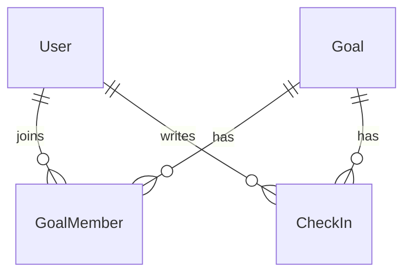

# Day 45 · 요구사항·ERD 재설계: Goals 설계도를 다시 그리는 날

> 읽는 시간: 약 14분

## 복습 3문제

**1.** (Day 44) 컨테이너 시작 명령에 `migrate && gunicorn`을 넣으면 머신 3대에서 무슨 일이 생길까요?

<details>
<summary>정답</summary>

세 머신이 **동시에** migrate를 돌립니다. Django는 마이그레이션 기록만 남길 뿐 분산 락이 없어서, 같은 마이그레이션이 경쟁하거나 한 대가 실패해 죽습니다. 그래서 migrate는 `release_command` 같은 **일회성 작업 하나**로 돌립니다.

</details>

**2.** (Day 44) Goal의 `title`을 `name`으로 바꿀 때 왜 배포를 세 번(expand → migrate → contract)으로 나누나요?

<details>
<summary>정답</summary>

롤링 배포 중엔 **옛 코드와 새 코드가 같은 DB에서 함께** 돕니다. 한 번에 이름을 바꾸면 옛 코드가 `title`을 못 찾아 500이 납니다. 새 컬럼 추가 → 데이터 복사·읽기 전환 → 옛 컬럼 삭제로 나누면 어느 순간에도 두 버전이 모두 동작합니다.

</details>

**3.** (Day 12) `ManyToManyField`는 DB에 어떻게 저장되나요?

<details>
<summary>정답</summary>

**중간 테이블**(FK 두 개를 가진 테이블)로 저장됩니다. `Goal.tags`라면 `goal_id`, `tag_id` 두 열을 가진 테이블이 생깁니다. 관계에 추가 정보가 필요하면 `through=`로 그 중간 테이블을 직접 모델로 만듭니다. 오늘 이 생각을 한 단계 더 씁니다.

</details>

---

## 오늘 만들 것

10주차는 **포트폴리오 완성** 주간입니다. 첫날은 코드를 멈추고 Goals의 **요구사항을 다시 쓰고 ERD를 재설계**합니다. 새 기능은 "친구와 함께하는 목표"입니다.

## 오늘 배울 것

- **요구사항 → 엔티티**: 문장에서 테이블을 뽑아내는 법
- **관계에 정보가 붙으면 엔티티로**: GoalMember 설계
- **정규화·제약**: 중복을 줄이고, 규칙은 DB가 지키게

---

## 1. 요구사항에서 테이블을 뽑아내기

ERD(Entity-Relationship Diagram, 엔티티와 관계를 그린 설계도)는 코드보다 먼저 그립니다. 테이블 모양이 틀리면 나중에 고치는 비용이 가장 큽니다. Day 44에서 본 것처럼 컬럼 하나 바꾸는 데 배포가 세 번 필요했으니까요.

출발점은 **유저 스토리**(사용자 입장에서 쓴 한 문장 요구사항)입니다. 형식은 "~로서, ~하고 싶다, ~하려고"입니다.

| 스토리 | 명사(엔티티 후보) | 동사(관계) |
|---|---|---|
| 친구를 목표에 초대 | 친구, 목표 | 초대한다 |
| 각자 매일 체크인 | 체크인, 날짜 | 기록한다 |
| 진행률을 본다 | 진행률 | 계산한다 |

**명사는 테이블 후보, 동사는 관계나 행위 후보**입니다. 단, 모든 명사가 테이블이 되진 않습니다. "날짜"는 컬럼이고, "진행률"은 저장할지 계산할지 따로 정할 값입니다(3장).

**비기능 요구사항**(기능이 아닌 품질 조건: "목록은 200ms 안에", "비공개 목표는 남에게 안 보임")도 적습니다. 인덱스·권한 설계가 여기서 나옵니다.

**비유:** 집을 짓기 전 "가족 4명, 재택근무, 고양이"를 먼저 적는 것과 같습니다. 방 개수(테이블)는 그 목록에서 나옵니다.

**결과를 맞혀 보세요:** 지금 `CheckIn`은 `goal`, `amount`, `day`만 있고 `(goal, day)`가 유일합니다. "친구와 함께, 각자 매일 체크인"을 그대로 넣으면?

```python-run
rows = set()
def check_in(goal, user, day):
    if (goal, day) in rows:
        return f"{user}: 거절"
    rows.add((goal, day))
    return f"{user}: OK"
print(check_in(1, "나", "11-27"))
print(check_in(1, "친구", "11-27"))
```

<details>
<summary>정답</summary>

`나: OK`, `친구: 거절`입니다. 유일 조건이 "목표당 하루 한 번"이라, 같은 목표의 두 번째 사람은 체크인할 수 없습니다. 게다가 `user` 정보가 아예 없어 **누가** 했는지도 모릅니다.

요구사항 한 줄이 바뀌면 **유일 조건과 FK가 같이 바뀝니다.** 이걸 코드 짜기 전에 발견하는 게 ERD의 목적입니다.

</details>

새 요구사항을 반영한 ERD입니다. `||--o{`는 "하나 대 여러 개"를 뜻합니다.



**JS (Node)** — Prisma는 스키마 파일이 곧 ERD입니다.

```javascript
// schema.prisma
model CheckIn {
  id     Int  @id @default(autoincrement())
  goal   Goal @relation(fields: [goalId],
              references: [id])
  goalId Int
  // user·amount·day 필드 생략
  @@unique([goalId, userId, day])
}
```

**Python** — Django는 모델 클래스가 같은 역할을 합니다.

```python
class CheckIn(models.Model):
    goal = models.ForeignKey(
        Goal, on_delete=models.CASCADE)
    user = models.ForeignKey(
        User, on_delete=models.CASCADE)
    amount = models.PositiveIntegerField()
    day = models.DateField()
```

`auto_now_add=True`를 뺀 이유(시간대)는 아래 접기에 있습니다.

> 💡 스토리의 명사 → 테이블 후보, 동사 → 관계. 요구사항이 바뀌면 FK와 **유일 조건**부터 다시 본다.

<details>
<summary>🔍 더 깊이 (면접용)</summary>

**"오늘"은 누구의 오늘인가?**

`DateField(auto_now_add=True)`는 서버 시간대(`TIME_ZONE`) 기준 날짜를 넣습니다. 서버가 UTC면 한국 사용자가 오전 8시에 체크인해도 **전날**로 저장됩니다. "하루 한 번" 제약이 엉뚱한 날에 걸립니다.

해법: 사용자 프로필에 시간대(`Asia/Seoul`)를 저장하고, 서버가 그 시간대로 날짜를 계산해 `day`에 넣습니다. 시각(`created_at`)은 항상 UTC로 따로 저장합니다. "**시각은 UTC, 날짜는 사용자 기준**"이 원칙입니다.

**ERD 표기:** `||` 정확히 하나, `o{` 0개 이상, `|{` 하나 이상. 면접에서 ERD를 그릴 땐 **카디널리티**(몇 대 몇)와 선택/필수를 꼭 표시합니다.

</details>

---

## 2. 관계에 정보가 붙으면, 관계가 엔티티가 된다

"친구와 함께"를 가장 쉽게 넣는 방법은 `Goal.members = ManyToManyField(User)`입니다. 그런데 요구사항을 다시 읽으면 관계에 **정보**가 붙어 있습니다. "누가 **방장**인지", "**언제** 참여했는지", "초대를 **수락**했는지"입니다.

관계 자체가 속성을 가지면, 그 관계는 **독립된 엔티티**로 올립니다. Day 12의 `through`가 바로 이것입니다. 이름도 `GoalUser`보다 **GoalMember**(목표의 멤버)처럼 업무 언어로 짓습니다.


**비유:** "학생-수업"은 단순한 연결이지만, 성적·출석이 붙는 순간 "수강신청서"라는 서류가 생깁니다. 그 서류가 GoalMember입니다.

**결과를 맞혀 보세요:** 같은 사람을 같은 목표에 두 번 초대했습니다. 유일 조건 없이 멤버 수를 세면?

```python-run
members = []
def invite(goal, user, role="member"):
    members.append((goal, user, role))
invite(1, "나", "owner")
invite(1, "친구")
invite(1, "친구")
print(len([m for m in members if m[0] == 1]))
```

<details>
<summary>정답</summary>

`3`입니다. 실제 사람은 2명인데 친구가 두 번 들어갔습니다. 버튼 두 번 클릭, 재시도, 동시 요청 중 어느 것으로도 생깁니다. 애플리케이션에서 "있는지 확인 후 추가"를 해도 동시 요청이면 둘 다 통과합니다(Day 38의 경쟁 상태).

그래서 `(goal, user)` 유일 조건을 **DB에** 겁니다. 두 번째 INSERT는 DB가 거절합니다.

</details>

```python
class GoalMember(models.Model):
    class Role(models.TextChoices):
        OWNER = "owner", "방장"
        MEMBER = "member", "멤버"
    goal = models.ForeignKey(Goal,
        on_delete=models.CASCADE,
        related_name="memberships")
```

```python
    user = models.ForeignKey(User,
        on_delete=models.CASCADE)
    role = models.CharField(max_length=10,
        choices=Role.choices,
        default=Role.MEMBER)
    joined_at = models.DateTimeField(
        auto_now_add=True)
```

```python
    class Meta:
        constraints = [
            models.UniqueConstraint(
                fields=["goal", "user"],
                name="one_membership")]
```

`Goal`에는 `members = ManyToManyField(User, through="GoalMember")`를 달아 `goal.members.all()`도 쓸 수 있게 합니다. "내가 속한 목표"는 `Goal.objects.filter(memberships__user=me)`입니다.

**JS (Node)** — Prisma에선 이걸 **명시적 다대다**(explicit m-n)라 부릅니다.

```javascript
model GoalMember {
  goal     Goal     @relation(...)
  goalId   Int
  user     User     @relation(...)
  userId   Int
  role     String   @default("member")
  @@id([goalId, userId])
}
```

Prisma는 `(goalId, userId)` 복합 기본 키를 자주 씁니다. Django는 복합 PK 지원이 5.2부터라, 보통 **대리 키 `id` + UniqueConstraint**로 같은 효과를 냅니다.

> 💡 관계에 역할·날짜·상태가 붙으면 중간 테이블을 **모델로 승격**하고, 중복은 UniqueConstraint로 DB가 막게 한다.

<details>
<summary>🔍 더 깊이 (면접용)</summary>

**owner FK를 남길까, role로 옮길까?**

- `Goal.owner` FK 유지: "주인은 정확히 한 명"을 **구조로** 보장. 대신 주인 정보가 두 곳(owner, GoalMember)에 생겨 어긋날 수 있음.
- role만 사용: 한 곳에 모임. 대신 "owner는 정확히 한 명"을 **부분 유일 인덱스**로 보장해야 함.

```python
models.UniqueConstraint(
    fields=["goal"],
    condition=Q(role="owner"),
    name="one_owner_per_goal")
```

`condition`이 붙은 제약은 Postgres의 **부분 인덱스**(조건에 맞는 행만 담는 인덱스)가 됩니다. "최소 한 명"은 DB 제약으로 표현이 어려워, 방장 탈퇴 시 위임하는 로직을 트랜잭션 안에서 처리합니다.

**정수 id vs UUID:** 정수는 작고 인덱스 지역성이 좋지만 `/goals/42/`에서 개수·순서가 드러나 **열거 공격**에 노출됩니다. UUIDv4는 랜덤이라 B-tree 삽입이 흩어집니다. 시간순 UUIDv7이나 "내부는 정수, 외부 노출은 별도 공개 ID" 방식이 절충안입니다.

</details>

---

## 3. 정규화: 같은 사실은 한 곳에만

새 화면에 "이번 주 진행률"과 "연속 일수(streak)"를 보여 주고 싶습니다. 가장 쉬운 방법은 `Goal`에 `progress` 컬럼을 두고 체크인할 때마다 갱신하는 것입니다. 하지만 같은 사실(체크인 합계)이 **두 곳**에 저장되는 순간 문제가 생깁니다.

**정규화**(normalization)는 "같은 사실을 한 곳에만 저장"하도록 테이블을 나누는 일입니다. 중복이 있으면 한쪽만 바뀌는 **갱신 이상**(update anomaly)이 생깁니다.

**결과를 맞혀 보세요:** 체크인을 삭제하는 관리자 기능을 만들면서, `progress` 갱신을 깜빡했습니다.

```python-run
goal = {"target": 10, "progress": 0}
checkins = []
def add(n):
    checkins.append(n)
    goal["progress"] += n
add(3); add(4)
checkins.pop()
print(goal["progress"], sum(checkins))
```

<details>
<summary>정답</summary>

`7 3`입니다. 저장된 진행률은 7인데 실제 체크인 합은 3입니다. 체크인을 바꾸는 **모든 경로**(추가·수정·삭제·Admin·bulk 연산·raw SQL)가 갱신을 기억해야 하는데, 하나만 빠져도 어긋납니다. 특히 Day 30의 `bulk_create`·`update()`는 `save()`와 시그널을 건너뜁니다.

</details>

그래서 기본은 **저장하지 말고 계산**입니다. 진리의 원천(source of truth)은 CheckIn 테이블 하나입니다.

```python
qs = Goal.objects.annotate(
    done=Sum("checkins__amount",
        filter=Q(checkins__day__gte=start)))
```

**JS (Node)**

```javascript
// Prisma 집계도 같은 생각
const r = await prisma.checkIn.aggregate({
  _sum: { amount: true },
  where: { goalId, day: { gte: start } },
});
```

계산이 느려지면 그때 **비정규화**(일부러 중복 저장)를 합니다. 단, 규칙을 정합니다. 갱신은 한 함수에서만, 트랜잭션 안에서, `F()`로 원자적으로. 그리고 언제든 원본에서 다시 계산할 수 있게 둡니다.

```python
with transaction.atomic():
    CheckIn.objects.create(goal=g,
        user=me, amount=n, day=today)
    Goal.objects.filter(pk=g.pk).update(
        total=F("total") + n)
```

비정규화와 짝을 이루는 것이 **제약**(constraint)입니다. 규칙을 폼·시리얼라이저에만 두면 Admin, 셸, 다른 서비스는 그대로 통과합니다. DB에 두면 **어떤 경로로도** 못 어깁니다.

```python
class Meta:
    constraints = [
        models.CheckConstraint(
            condition=Q(amount__gt=0),
            name="amount_positive"),
    ]
# Django 5.1 미만은 condition= 대신 check=
```

**비유:** 정규화는 연락처를 주소록 한 곳에만 두는 것입니다. 메모장 다섯 곳에 적어 두면, 번호가 바뀔 때 한 곳은 꼭 놓칩니다.

> 💡 기본은 정규화 + 계산. 느릴 때만 비정규화하고, 갱신 경로는 하나로, 규칙은 DB 제약으로.

<details>
<summary>🔍 더 깊이 (면접용)</summary>

**정규형 한 줄씩**

- **1NF**: 칸 하나에 값 하나. `tags="피아노,영어"`는 위반 → Tag 테이블로.
- **2NF**: 복합 키의 **일부**에만 의존하는 컬럼 제거. `(goal, user, day)` 키인 체크인에 `goal_title`이 있으면 goal에만 의존 → 위반.
- **3NF**: 키가 아닌 컬럼에 의존하는 컬럼 제거. `user_id`와 `user_email`을 같이 두면 email은 user에 의존 → 위반.
- **BCNF**: 모든 결정자가 후보 키. 실무에선 3NF/BCNF까지 맞추고 필요한 곳만 비정규화합니다.

**비정규화가 정당한 경우:** 읽기가 쓰기보다 압도적으로 많고, 집계가 비싸고, 약간의 지연이 허용될 때(카운터, 랭킹, 피드). 선택지는 캐시 컬럼, 머티리얼라이즈드 뷰, Redis 캐시(Day 36), Celery로 주기 재계산(Day 38) 등.

**on_delete 고르기**

`CASCADE`는 부모와 함께 삭제(Goal → CheckIn), `PROTECT`는 자식이 있으면 삭제 거부(결제 내역 있는 상품), `SET_NULL`은 연결만 끊음(탈퇴 회원의 글 보존, `null=True` 필요).

**소프트 삭제의 함정:** `deleted_at`으로 숨기면 일반 UNIQUE가 삭제된 행과도 충돌합니다. 그래서 `condition=Q(deleted_at__isnull=True)`인 부분 유일 제약을 씁니다. 또 모든 쿼리에 필터가 필요해 기본 매니저를 바꾸게 되는데, 관계 조회·Admin에서 새는 곳이 생기기 쉽습니다. 개인정보 삭제 요청(GDPR 등)엔 진짜 삭제가 필요하다는 점도 기억하세요.

</details>

---

## 연습문제

**1.** "목표마다 알림을 여러 개 둘 수 있다. 알림은 요일과 시각을 가진다. 같은 목표에 같은 요일·시각 알림은 하나만." 모델을 만드세요.

<details>
<summary>정답</summary>

```python
class Reminder(models.Model):
    goal = models.ForeignKey(Goal,
        on_delete=models.CASCADE,
        related_name="reminders")
    weekday = models.SmallIntegerField()
    at = models.TimeField()
```

```python
    class Meta:
        constraints = [
            models.UniqueConstraint(
                fields=["goal", "weekday",
                        "at"],
                name="one_reminder_slot")]
```

요일 범위(0=월 ~ 6=일)도 DB가 지키게 `constraints`에 하나 더 넣습니다.

```python
models.CheckConstraint(
    condition=Q(weekday__range=(0, 6)),
    name="weekday_0_6")
```

해설: 목표 1 : 알림 N이라 FK는 **N쪽(Reminder)** 에 둡니다. "요일 목록"을 `weekdays="1,3,5"` 문자열로 한 행에 넣으면 1NF 위반이라 "월요일 알림만 찾기"가 어렵습니다. 요일마다 한 행으로 두면 Celery beat(Day 38)가 `filter(weekday=오늘, at=지금)`으로 바로 찾습니다. `at`은 사용자 시간대 기준 시각이라는 점도 함께 정해 둡니다.

</details>

**2.** 아래 테이블의 문제를 정규화 관점에서 찾고, 고친 구조를 말해 보세요.

```text
checkin(id, goal_id, goal_title,
        user_id, user_email, amount, day)
```

<details>
<summary>정답</summary>

- `goal_title`은 `goal_id`에 의존 → 목표 제목을 바꾸면 체크인 수백 행을 다 고쳐야 함(갱신 이상). 3NF 위반.
- `user_email`도 `user_id`에 의존 → 같은 문제.

고친 구조: `checkin(id, goal_id, user_id, amount, day)`만 두고, 제목·이메일은 JOIN으로 가져옵니다.

```python
qs = (CheckIn.objects
      .select_related("goal", "user")
      .only("amount", "day",
            "goal__title", "user__email"))
```

Day 26의 `select_related`로 JOIN 한 번이면 N+1 없이 읽습니다. "읽기 편하려고 복사"하기 전에 JOIN 비용이 정말 문제인지 EXPLAIN(Day 27)으로 먼저 확인합니다.

</details>

**3.** "내가 속한 목표 목록과, 각 목표의 멤버 수"를 쿼리 한 번으로 가져오세요. 방장 목표가 먼저 나오게 합니다.

<details>
<summary>정답</summary>

```python
mine = GoalMember.objects.filter(user=me)
role = mine.filter(goal=OuterRef("pk"))
qs = (Goal.objects
  .filter(pk__in=mine.values("goal"))
  .annotate(
    n=Count("memberships"),
    my_role=Subquery(role.values("role"))))
```

```python
qs = qs.order_by(Case(
    When(my_role="owner", then=0),
    default=1), "-id")
```

해설: 가장 흔한 오답은 `filter(memberships__user=me).annotate(n=Count("memberships"))`입니다. Django는 **같은 다대다 관계로 filter한 뒤 annotate하면 그 JOIN을 재사용**합니다. 그래서 "내 멤버십 행"만 세어 `n`이 항상 1이 됩니다. 정답처럼 `pk__in` 서브쿼리로 목표를 고르면 Count는 모든 멤버를 셉니다.

내 역할은 `Subquery`로 목표마다 한 값만 가져와 정렬에 씁니다. `(goal, user)` 유일 제약 덕분에 서브쿼리는 항상 한 행 이하라 안전합니다. 전부 SQL 한 번으로 나갑니다(`print(qs.query)`로 확인).

</details>

---

## 면접 질문

<details>
<summary>Q1. 정규화와 비정규화는 각각 언제 선택하나요?</summary>

**모범 답안:**

기본은 **3NF 수준의 정규화**입니다. 같은 사실이 한 곳에만 있어 갱신 이상이 없고, 쓰기가 단순하며, 제약으로 무결성을 지키기 쉽습니다.

비정규화는 **측정 후** 선택합니다. 읽기가 압도적으로 많고, JOIN·집계가 병목임을 EXPLAIN과 지표로 확인했을 때입니다. 예: 피드의 좋아요 수, 대시보드 진행률.

비정규화할 때 지키는 규칙:

1. 진리의 원천은 하나(원본 테이블), 복사본은 언제든 재계산 가능
2. 갱신 경로를 한 함수로 모으고, 트랜잭션 + `F()`로 원자적 갱신
3. `bulk`·raw SQL처럼 `save()`를 건너뛰는 경로를 막거나 주기 재계산으로 보정

트레이드오프 한 줄: 정규화는 **쓰기 정합성**을, 비정규화는 **읽기 속도**를 삽니다.

</details>

<details>
<summary>Q2. 요구사항이 "1:N"에서 "N:M"으로 바뀌면 어떻게 마이그레이션하나요?</summary>

**모범 답안:** Goals에서 `Goal.owner`(1:N)를 GoalMember(N:M)로 바꾸는 상황을 예로 듭니다. 무중단을 위해 Day 44의 expand → migrate → contract로 나눕니다.

1. **expand**: GoalMember 테이블 추가. 새 목표를 만들 때 owner와 GoalMember(role=owner)에 **둘 다** 씀. 읽기는 아직 owner.
2. **데이터 이전**: 기존 목표마다 owner를 GoalMember로 복사. 큰 테이블은 배치로.

```python
def forwards(apps, schema):
    G = apps.get_model("goals", "Goal")
    M = apps.get_model("goals", "GoalMember")
    rows = G.objects.values_list(
        "id", "owner_id")
```

```python
    M.objects.bulk_create(
      (M(goal_id=g, user_id=u, role="owner")
       for g, u in rows),
      batch_size=1000, ignore_conflicts=True)
```

3. **읽기 전환**: 권한 검사를 `memberships`로 바꿔 배포.
4. **contract**: owner를 더 안 쓰는 게 확인되면 컬럼 삭제.

`apps.get_model`은 마이그레이션 시점의 **과거 모델**을 줍니다. 현재 모델을 import하면 나중에 필드가 바뀔 때 옛 마이그레이션이 깨집니다. `ignore_conflicts`는 1단계에서 이미 생긴 행과의 유일 충돌을 건너뜁니다.

</details>

---

## 오늘 정리

- **요구사항 → ERD**: 스토리의 명사·동사에서 엔티티와 관계를 뽑고, FK·유일 조건부터 다시 본다.
- **관계 승격**: 역할·날짜가 붙은 관계는 GoalMember 같은 모델로, 중복은 UniqueConstraint로.
- **정규화**: 같은 사실은 한 곳에. 계산이 기본, 비정규화는 측정 후 규칙을 지켜서.

## 다음에 이어갈 것

내일(Day 46)은 오늘 그린 ERD대로 **핵심 API와 화면을 다듬습니다**. GoalMember 권한을 DRF permission에 반영하고, 초대·체크인 흐름을 정리합니다.
